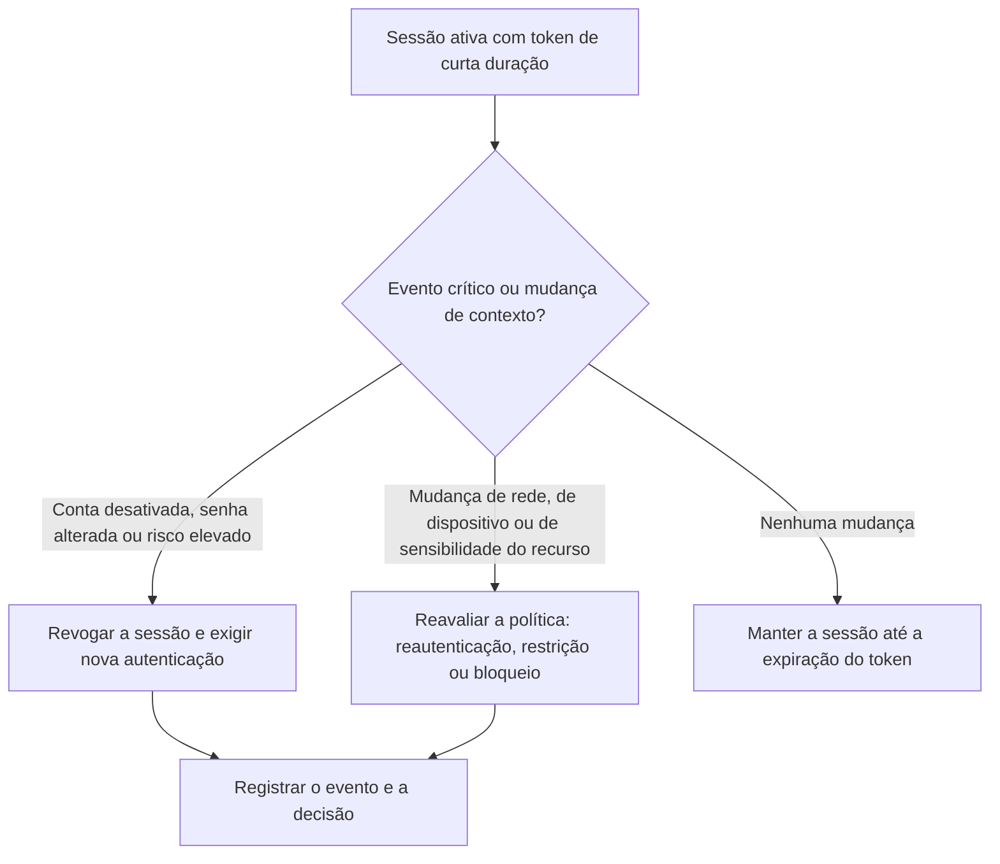

# Zero Trust para Identidades e Dispositivos

> **Objetivo pedagógico:** aplicar o Zero Trust aos dois primeiros pilares: **identidades** (autenticação forte, autorização dinâmica, avaliação contínua de acesso e sessões curtas) e **dispositivos** (inventário, conformidade, integridade, identidade do dispositivo e tratamento de dispositivos não gerenciados); entender como os sinais de risco alimentam o motor de decisão de acesso; definir camadas de acesso por sensibilidade; e ilustrar a lógica do motor de políticas com um exemplo em código.

## 1. Pilar de identidade em Zero Trust

Os controles detalhados de identidade estão na pasta 06. Aqui, concentramo-nos no que o Zero Trust acrescenta: **verificação contínua e decisão dinâmica**.

| Capacidade | Descrição | Referência |
|---|---|---|
| Autenticação forte e resistente a phishing | Base de qualquer decisão | Pasta 06, arquivo 2 |
| Autorização dinâmica | Permissões avaliadas por sessão, com atributos e contexto | Pasta 06, arquivo 3 |
| Avaliação contínua de acesso | Revogação de sessões quase em tempo real diante de eventos críticos (desativação de conta, alteração de senha e mudança de risco) | Seção 2 |
| Pontuação de risco do usuário e da entrada | Sinais de credenciais vazadas, de viagem impossível e de comportamento anômalo | Arquivo 5 |
| Sessões curtas e reautenticação | Reautenticação para acessos sensíveis ou quando o contexto muda | Seção 2 |
| Acesso sob demanda para privilégios | Elevação temporária e aprovada | Pasta 06, arquivo 4 |
| Governança de identidades | Ciclo de vida e revisões | Pasta 06, arquivo 6 |

## 2. Verificação contínua

Em modelos tradicionais, o token emitido na autenticação é válido por horas, mesmo que a situação mude (por exemplo, a conta seja desativada ou o dispositivo seja comprometido). No Zero Trust, a **confiança tem prazo e depende do contexto**.

| Mecanismo | Descrição |
|---|---|
| Tokens de curta duração | Reduzem a janela de uso indevido |
| Avaliação contínua de acesso (CAE) | O provedor de recursos e o provedor de identidade trocam eventos críticos (conta desativada, senha alterada, sessão revogada, mudança de risco) para encerrar sessões rapidamente |
| Reavaliação por evento | Mudança de rede, de localização, de dispositivo ou de sensibilidade do recurso aciona nova verificação |
| Vinculação de token ao dispositivo | O token só funciona no dispositivo que o recebeu, reduzindo o roubo de sessão |
| Reautenticação para ações sensíveis | Por exemplo, alterar políticas, acessar dados restritos ou aprovar pagamentos |
| Sessões com limite de duração por risco | Acessos privilegiados com sessões mais curtas |



## 3. Pilar de dispositivos

### 3.1 Capacidades

| Capacidade | Descrição |
|---|---|
| Inventário de dispositivos | Todos os dispositivos que acessam recursos corporativos, com proprietário e finalidade |
| Gestão (UEM e MDM) | Configuração, atualização e controle remoto de dispositivos de usuários |
| Conformidade | Verificação de requisitos: sistema operacional atualizado, disco criptografado, bloqueio de tela, proteção contra malware ativa, firewall e ausência de desbloqueio indevido (jailbreak e root) |
| Identidade do dispositivo | Certificado ou chave vinculada ao hardware (TPM e enclave seguro) que comprova que o dispositivo é o registrado |
| Integridade e atestação | Verificação de que o dispositivo iniciou em estado confiável (inicialização segura e atestação de integridade) |
| Detecção e resposta em endpoints (EDR) | Sinais de comprometimento que alimentam as decisões de acesso |
| Postura contínua | Reavaliação periódica e por evento; o dispositivo que deixa de ser conforme perde o acesso |
| Dispositivos não gerenciados e pessoais (BYOD) | Acesso limitado a aplicações específicas, com proteções de aplicativo ou isolamento por navegador |
| Dispositivos de IoT e de OT | Segmentação e monitoramento; sem confiança implícita |

### 3.2 Dispositivos de administração

Administradores devem acessar o plano de controle da nuvem a partir de **dispositivos gerenciados, endurecidos e dedicados** (estações de acesso privilegiado), com exigência de conformidade como condição de acesso (pasta 06, arquivo 4).

## 4. Níveis de confiança do dispositivo

| Nível | Descrição | Acessos permitidos (exemplo) |
|---|---|---|
| 1 Gerenciado e conforme, com identidade de hardware | Dispositivo corporativo, criptografado, atualizado, com EDR saudável e certificado vinculado ao TPM | Todos os recursos, inclusive privilegiados e dados restritos |
| 2 Gerenciado, mas com desvio leve | Dispositivo corporativo com atualização pendente | Recursos de uso geral; sem acesso a dados restritos até a correção |
| 3 Não gerenciado, com proteção de aplicação | Dispositivo pessoal, com aplicativo protegido ou navegador isolado | Aplicações específicas, sem download de dados |
| 4 Desconhecido ou não conforme | Dispositivo sem registro ou com sinais de comprometimento | Bloqueio ou acesso mínimo (por exemplo, portal de autoatendimento para regularização) |

## 5. Camadas de acesso por sensibilidade

| Sensibilidade do recurso | Usuário | Dispositivo | Autenticação | Sessão |
|---|---|---|---|---|
| Público ou interno de baixo risco | Qualquer usuário autenticado | Qualquer dispositivo (nível 1 a 3) | MFA padrão | Normal |
| Confidencial | Usuário com papel adequado e risco baixo | Nível 1 ou 2 | MFA forte | Normal, com reavaliação por evento |
| Restrito (dados sensíveis, pagamentos) | Usuário autorizado, risco baixo, sem anomalias | Nível 1 | MFA resistente a phishing, reautenticação periódica | Curta; reautenticação para ações sensíveis |
| Privilegiado (plano de controle) | Administrador com elevação aprovada | Nível 1, estação dedicada | MFA resistente a phishing | Muito curta; gravação e alertas |

## 6. Motor de decisão de acesso: ilustração em código

O exemplo abaixo ilustra a **lógica** de um mecanismo de políticas (PE), combinando sinais de identidade, de dispositivo e de contexto. Em produção, essa lógica é executada por serviços de acesso condicional e por motores de políticas dos provedores; o código serve para entender o raciocínio.

```python
# Ilustração didática de um mecanismo de políticas (PE) de Zero Trust
# Entradas: risco do usuário, conformidade do dispositivo, sensibilidade do recurso, MFA e contexto de local
from dataclasses import dataclass

@dataclass
class Contexto:
    risco_usuario: str          # "baixo", "medio" ou "alto"
    nivel_dispositivo: int      # 1 a 4 (arquivo 2, seção 4)
    sensibilidade: str          # "interno", "confidencial", "restrito" ou "privilegiado"
    mfa_resistente_a_phishing: bool
    local_esperado: bool

def decidir_acesso(c: Contexto) -> tuple[str, str]:
    # Negações absolutas
    if c.risco_usuario == "alto":
        return "negar", "Risco de usuário alto: exigir remediação e nova autenticação"
    if c.nivel_dispositivo == 4:
        return "negar", "Dispositivo desconhecido ou não conforme"
    # Regras por sensibilidade
    if c.sensibilidade == "privilegiado":
        if c.nivel_dispositivo == 1 and c.mfa_resistente_a_phishing and c.local_esperado:
            return "permitir", "Sessão curta com gravação e alerta"
        return "negar", "Privilegiado exige dispositivo nível 1, MFA resistente a phishing e local esperado"
    if c.sensibilidade == "restrito":
        if c.nivel_dispositivo == 1 and c.mfa_resistente_a_phishing:
            return "permitir", "Reautenticação para ações sensíveis"
        return "negar", "Restrito exige dispositivo nível 1 e MFA resistente a phishing"
    if c.sensibilidade == "confidencial":
        if c.nivel_dispositivo in (1, 2) and c.local_esperado:
            return "permitir", "Reavaliação por evento"
        if c.nivel_dispositivo == 3:
            return "permitir_limitado", "Aplicação específica, sem download de dados"
        return "negar", "Condições insuficientes para dados confidenciais"
    return "permitir", "Recurso de baixo risco"

if __name__ == "__main__":
    print(decidir_acesso(Contexto("baixo", 1, "restrito", True, True)))
    print(decidir_acesso(Contexto("medio", 3, "confidencial", False, True)))
    print(decidir_acesso(Contexto("alto", 1, "interno", True, True)))
```

A ilustração mostra três propriedades do Zero Trust: **decisão por sessão**, **múltiplos sinais** e **resposta proporcional à sensibilidade** (permitir, limitar ou negar).

## 7. Implementação por provedor (categorias)

| Provedor | Mecanismos relevantes |
|---|---|
| Microsoft | Acesso condicional com conformidade de dispositivo (Intune), proteção de identidade, avaliação contínua de acesso, proteção de tokens |
| Google | Acesso sensível ao contexto, verificação de dispositivo (BeyondCorp Enterprise), chaves de segurança e programa de proteção avançada |
| AWS | Federação com o IdP corporativo e políticas com condições; acesso a aplicações com AWS Verified Access, que usa sinais de identidade e de dispositivo de provedores parceiros |
| Terceiros | Soluções de UEM, EDR e de postura de dispositivos integradas ao provedor de identidade |

## 8. Exemplo prático: acesso ao console de nuvem por administradores

| Verificação | Condição para acesso |
|---|---|
| Identidade | Conta administrativa separada; elevação sob demanda aprovada |
| Autenticação | Chave FIDO2 de hardware (resistente a phishing) |
| Dispositivo | Estação de acesso privilegiado, gerenciada, com EDR saudável, disco criptografado e certificado de dispositivo |
| Contexto | País esperado; sem anonimizadores; risco de entrada baixo |
| Sessão | Duração máxima de 4 horas; reautenticação para alterar políticas de identidade |
| Resposta | Dispositivo que perde a conformidade tem a sessão encerrada em minutos; alerta para a segurança |
| Resultado | Em um teste de phishing com proxy reverso, o administrador não conseguiu usar a credencial capturada: a chave FIDO2 não funcionou na página falsa e o token não era utilizável em outro dispositivo |

## 9. Casos de uso corporativos

- Implementação de acesso condicional por dispositivo e por risco para toda a organização.
- Política de BYOD com acesso limitado e proteção de aplicações.
- Estações de administração gerenciadas como condição para o acesso ao plano de controle.

## 10. Normas e frameworks relevantes

- NIST SP 800-207 (princípios 3 a 6); NIST SP 800-63B; NIST SP 800-124 Rev. 2 (segurança de dispositivos móveis); NIST SP 800-53 Rev. 5 (AC, IA e CM)
- CISA ZTMM 2.0 (pilares de identidade e de dispositivos); CIS Controls v8.1 (controles 1, 4, 5 e 10)
- ISO/IEC 27002:2022 (7.9, 8.1, 8.5 e 8.7); CSA CCM v4 (IAM e UEM)
- MITRE ATT&CK: T1078, T1539, T1550 (uso de credenciais e de sessões roubadas)

## 11. Checklist operacional: identidades e dispositivos em Zero Trust

- [ ] MFA resistente a phishing em contas privilegiadas e em recursos restritos
- [ ] Avaliação contínua de acesso e tokens de curta duração habilitados
- [ ] Inventário de dispositivos; gestão (UEM) e verificação de conformidade ativas
- [ ] Conformidade do dispositivo como condição de acesso a recursos sensíveis
- [ ] Identidade de dispositivo (certificados ou chaves vinculadas ao hardware) para acessos privilegiados
- [ ] Política de BYOD e de dispositivos não gerenciados com acesso limitado
- [ ] Camadas de acesso por sensibilidade documentadas e aplicadas
- [ ] Estações de administração dedicadas para o plano de controle
- [ ] Revogação rápida de sessões em eventos críticos
- [ ] Registro das decisões de acesso com o contexto

## 12. Referências

- Rose, S. et al. NIST SP 800-207. 2020.
- Grassi, P. et al. NIST SP 800-63B. Digital Identity Guidelines: Authentication and Lifecycle Management.
- Souppaya, M.; Scarfone, K. NIST SP 800-124 Rev. 2: Guidelines for Managing the Security of Mobile Devices in the Enterprise. 2023.
- Microsoft. Documentação de acesso condicional, avaliação contínua de acesso e conformidade de dispositivos; Google. BeyondCorp Enterprise; AWS. AWS Verified Access (versões vigentes).
- Pasta 06 deste repositório.
