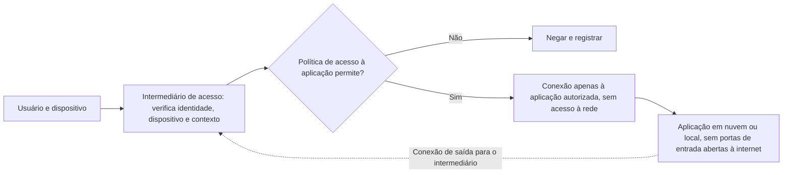
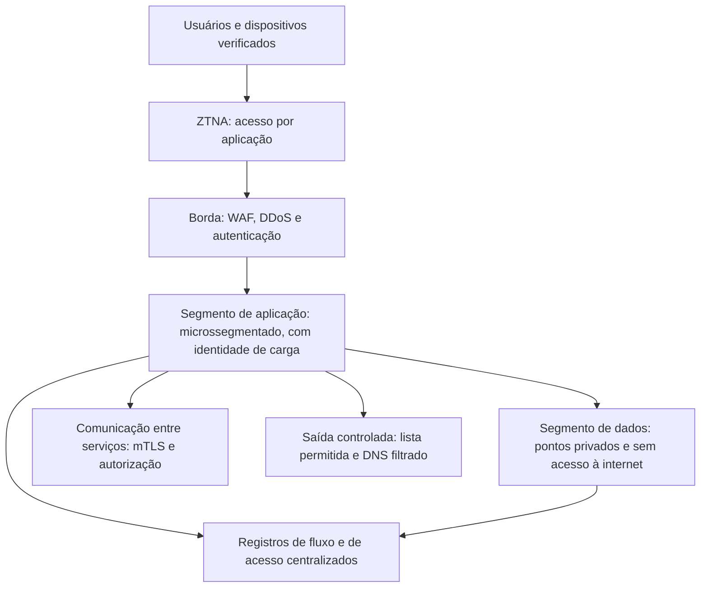

# Zero Trust para Redes, Microssegmentação e Acesso a Aplicações

> **Objetivo pedagógico:** aplicar o Zero Trust ao pilar de redes em nuvem: substituir o acesso amplo por VPN pelo acesso por aplicação (ZTNA), eliminar a exposição direta de serviços ("aplicações escuras"), projetar a microssegmentação baseada em identidade e em etiquetas, usar conectividade privada para serviços gerenciados, proteger a comunicação entre serviços com autenticação mútua (mTLS) e malhas de serviços, controlar saída e DNS, e criar políticas de rede de "negar por padrão" em ambientes de contêineres.

> Os detalhes técnicos de segurança de rede em nuvem (grupos de segurança, firewalls, inspeção e DDoS) estão na pasta 08. Este arquivo trata do que o Zero Trust muda no desenho.

## 1. Da confiança por localização ao acesso por aplicação

| Modelo | Comportamento | Problema |
|---|---|---|
| VPN de acesso amplo | O usuário autenticado entra na rede e alcança muitos sistemas | Um acesso comprometido permite movimentação lateral e reconhecimento |
| Redes planas e confiança entre sistemas internos | Servidores se comunicam livremente | Propagação rápida de ataques (ransomware) |
| Serviços expostos à internet com proteção apenas de rede | Portas abertas e listas de IP | Ataques diretos, varreduras e exploração |
| **ZTNA (acesso à rede de confiança zero)** | O acesso é concedido **por aplicação**, após verificar identidade, dispositivo e contexto, por um intermediário | Reduz a superfície e o alcance |

## 2. ZTNA: acesso por aplicação



| Característica | Descrição |
|---|---|
| Acesso por aplicação | O usuário só vê e alcança as aplicações autorizadas |
| Aplicações "escuras" | As aplicações não têm portas de entrada abertas à internet: um conector faz conexão de saída ao intermediário |
| Verificação por sessão | Identidade, dispositivo e contexto são verificados a cada acesso |
| Inspeção e registro | O intermediário registra e, quando aplicável, inspeciona a sessão |
| Sem concessão de endereço de rede | O usuário não recebe um endereço na rede interna |
| Cobertura | Aplicações web, protocolos de administração (SSH e RDP) e acesso a bancos de dados, conforme a solução |

### 2.1 Opções por provedor e por categoria

| Provedor ou categoria | Soluções (exemplos) |
|---|---|
| Google Cloud | Identity-Aware Proxy (IAP) para aplicações web e para encaminhamento de TCP (acesso SSH e RDP sem endereços públicos); BeyondCorp Enterprise |
| AWS | AWS Verified Access (acesso por aplicação sem VPN, com sinais de identidade e de dispositivo); Systems Manager Session Manager para acesso a instâncias |
| Azure e Microsoft | Microsoft Entra Private Access e Application Proxy (acesso a aplicações privadas); Azure Bastion para administração de máquinas virtuais |
| Terceiros e SSE | Plataformas de acesso seguro de borda de serviço (SSE e SASE) que combinam ZTNA, gateways seguros de internet e agentes de segurança de acesso à nuvem (CASB) |

As soluções, nomes e licenciamento mudam; confirme na documentação vigente.

## 3. Microssegmentação

A **microssegmentação** divide a rede em segmentos pequenos, com políticas explícitas entre eles, de modo que um comprometimento não se propague.

| Princípio | Descrição |
|---|---|
| Negar por padrão | Nenhuma comunicação é permitida sem regra explícita |
| Regras por identidade e por função, e não por endereço | Preferir etiquetas, grupos de segurança de aplicação e contas de serviço a faixas de IP, que mudam em ambientes elásticos |
| Segmentação por aplicação e por camada | Cada aplicação e cada camada (web, aplicação e dados) em seu segmento |
| Restrição de leste a oeste | Controle do tráfego entre cargas, e não apenas de entrada e de saída |
| Administração separada | Acesso de gestão por caminhos dedicados e identificados |
| Visibilidade | Registros de fluxo para validar e refinar as regras |
| Automação | Regras definidas por código e verificadas continuamente |

### 3.1 Mecanismos nativos

| Provedor | Mecanismos de microssegmentação |
|---|---|
| AWS | Grupos de segurança que referenciam outros grupos de segurança (regras entre camadas, e não por IP), listas de controle de acesso de rede, firewall de rede e registros de fluxo |
| Azure | Grupos de segurança de rede com grupos de segurança de aplicação (regras por função), Azure Firewall e registros de fluxo |
| Google Cloud | Regras de firewall com destinos e origens por conta de serviço ou por etiqueta segura, políticas de firewall hierárquicas e registros de regras |
| Kubernetes | Políticas de rede entre pods e, quando necessário, malhas de serviços |

### 3.2 Exemplo: política de rede do Kubernetes com negação por padrão

```yaml
# Passo 1: negar todo o tráfego de entrada e de saída dos pods do espaço de nomes
apiVersion: networking.k8s.io/v1
kind: NetworkPolicy
metadata:
  name: negar-todo-trafego-por-padrao
  namespace: aplicacao
spec:
  podSelector: {}
  policyTypes: ["Ingress", "Egress"]
---
# Passo 2: permitir apenas o tráfego necessário (a API pode receber da borda e falar com o banco na porta 5432)
apiVersion: networking.k8s.io/v1
kind: NetworkPolicy
metadata:
  name: permitir-api-para-banco
  namespace: aplicacao
spec:
  podSelector:
    matchLabels:
      funcao: banco
  policyTypes: ["Ingress"]
  ingress:
  - from:
    - podSelector:
        matchLabels:
          funcao: api
    ports:
    - protocol: TCP
      port: 5432
```

As políticas de rede exigem um plugin de rede compatível com a aplicação de políticas. Inclua também regras de saída para DNS e para os destinos necessários antes de impor a negação de saída; teste em um ambiente não produtivo.

## 4. Conectividade privada para serviços gerenciados

| Princípio | Descrição |
|---|---|
| Serviços gerenciados sem exposição pública | Bancos, armazenamentos e filas acessados por pontos privados, e não por endereços públicos |
| Pontos de extremidade privados | AWS PrivateLink e pontos de extremidade de gateway; Azure Private Link e pontos de extremidade privados; Google Private Service Connect e Acesso Privado do Google |
| Políticas no ponto de extremidade | Restringir quais recursos e quais identidades podem usar o ponto |
| DNS privado | Resolução de nomes para endereços privados |
| Bloqueio do acesso público | Desabilitar o acesso público nos serviços quando houver ponto privado |
| Perímetros de serviço | Controles que impedem a exfiltração de dados para fora de um perímetro de serviços (por exemplo, controles de serviço da VPC no Google Cloud) |

## 5. Comunicação entre serviços: autenticação mútua e malha de serviços

| Elemento | Descrição |
|---|---|
| mTLS (TLS mútuo) | Ambos os lados apresentam certificados: o servidor sabe quem é o cliente e vice-versa |
| Identidade de serviço | Identidades criptográficas por carga (por exemplo, no padrão SPIFFE), emitidas e rotacionadas automaticamente |
| Malha de serviços (*service mesh*) | Camada de infraestrutura que aplica mTLS, autorização entre serviços e observabilidade, sem alterar o código |
| Autorização entre serviços | Política: "o serviço A pode chamar o método X do serviço B" |
| Criptografia em trânsito interna | Todo o tráfego, mesmo "interno", é criptografado |
| Rotação de certificados | Curta duração e automatização |

Considere a complexidade operacional: malhas de serviços são justificadas quando há muitos serviços e requisitos de autenticação mútua e de autorização entre eles; em ambientes menores, a combinação de identidades de carga, políticas de rede e TLS pode bastar.

## 6. Controle de saída e DNS

| Controle | Descrição |
|---|---|
| Saída por lista permitida | Cargas só acessam destinos necessários (proxy ou firewall com filtro de destino) |
| Proteção de DNS | Filtragem de domínios maliciosos; registros de DNS; bloqueio de túneis de DNS |
| Inspeção de tráfego | Inspeção de tráfego criptografado, quando justificado e legalmente adequado |
| Bloqueio de saída direta para a internet em redes de dados | Redes de dados sem acesso à internet |
| Detecção de comunicação anômala | Análise de fluxos e de DNS (beaconing e exfiltração) |

## 7. Visão integrada do pilar de redes



## 8. Verificações de somente leitura

```bash
# AWS: instâncias de acesso verificado (Verified Access) e pontos de extremidade de VPC (conectividade privada)
aws ec2 describe-verified-access-instances --query "VerifiedAccessInstances[].[VerifiedAccessInstanceId,Description]" --output table
aws ec2 describe-vpc-endpoints --query "VpcEndpoints[].[VpcEndpointId,ServiceName,VpcEndpointType]" --output table

# AWS: grupos de segurança com SSH ou RDP aberto para a internet
aws ec2 describe-security-groups \
  --filters Name=ip-permission.cidr,Values=0.0.0.0/0 Name=ip-permission.from-port,Values=22,3389 \
  --query "SecurityGroups[].[GroupId,GroupName]" --output table

# Azure: pontos de extremidade privados e endereços IP públicos
az network private-endpoint list --query "[].{nome:name,rg:resourceGroup}" --output table
az network public-ip list --query "[].{nome:name,ip:ipAddress,rg:resourceGroup}" --output table

# Google Cloud: regras de firewall que permitem origem 0.0.0.0/0
gcloud compute firewall-rules list --filter="sourceRanges:0.0.0.0/0 AND direction=INGRESS" \
  --format="table(name,network.basename(),allowed[].map().firewall_rule().list())"
```

## 9. Exemplo prático: substituição de VPN ampla por acesso por aplicação

| Situação inicial | Ação | Resultado |
|---|---|---|
| 1.200 usuários com VPN de acesso amplo à rede de produção; portas SSH e RDP abertas para listas de IP | Implantação de acesso por aplicação (identidade, MFA resistente a phishing e dispositivo conforme) para as 14 aplicações internas | Cada usuário alcança só as aplicações do seu papel |
| Administradores acessavam servidores por SSH com chaves | Acesso por sessão gerenciada e por túnel autenticado, sem portas de entrada; registro de sessões | 0 portas de administração expostas |
| Rede plana entre servidores de aplicação e de banco | Microssegmentação por função (regras entre grupos de segurança de aplicação) e pontos privados para bancos | Movimentação lateral bloqueada |
| Saída livre para a internet | Saída por proxy com lista permitida e filtragem de DNS | Exfiltração e comunicação com servidores maliciosos bloqueadas |
| Resultado | Em um exercício de comprometimento de uma estação, o acesso do atacante ficou restrito a uma aplicação e não houve alcance a bancos de dados | |

## 10. Casos de uso corporativos

- Migração de VPN de acesso amplo para ZTNA por aplicação.
- Microssegmentação de aplicações críticas e de ambientes de dados.
- Autenticação mútua e autorização entre serviços em arquiteturas de microsserviços.

## 11. Normas e frameworks relevantes

- NIST SP 800-207 (princípios 2, 3 e 6); NIST SP 800-207A (Zero Trust em nuvem nativa de aplicação); NIST SP 800-204 (série, malhas de serviços e microsserviços)
- CISA ZTMM 2.0 (pilar de redes); NSA. Advancing Zero Trust Maturity Throughout the Network and Environment Pillar (2024)
- ISO/IEC 27002:2022 (8.20 a 8.23); CSA CCM v4 (IVS); CIS Controls v8.1 (controles 12 e 13)
- MITRE ATT&CK: T1021 (serviços remotos), T1046 (descoberta de serviços de rede), T1210 (exploração de serviços remotos)

## 12. Checklist operacional: redes em Zero Trust

- [ ] VPN de acesso amplo substituída (ou restringida) por acesso por aplicação para os recursos prioritários
- [ ] Nenhuma porta de administração exposta à internet; administração por sessões autenticadas e registradas
- [ ] Aplicações sem portas de entrada abertas, quando possível (aplicações escuras)
- [ ] Microssegmentação com negação por padrão, por aplicação e por camada, com regras por função
- [ ] Serviços gerenciados acessados por pontos privados; acesso público desabilitado
- [ ] Autenticação mútua e criptografia em trânsito entre serviços (mTLS), conforme a criticidade
- [ ] Políticas de rede em Kubernetes com negação por padrão
- [ ] Saída controlada por lista permitida e DNS filtrado
- [ ] Registros de fluxo, de DNS e de acesso centralizados
- [ ] Regras revisadas periodicamente e verificadas por código

## 13. Referências

- Rose, S. et al. NIST SP 800-207; Chandramouli, R.; Butcher, Z. NIST SP 800-207A: A Zero Trust Architecture Model for Access Control in Cloud-Native Applications. 2023.
- Chandramouli, R. NIST SP 800-204 e 204A: segurança de aplicações baseadas em microsserviços e malhas de serviços.
- NSA. Advancing Zero Trust Maturity Throughout the Network and Environment Pillar. 2024.
- Documentação de AWS Verified Access, AWS PrivateLink; Azure Private Link e Microsoft Entra Private Access; Google IAP, Private Service Connect e VPC Service Controls (versões vigentes).
- Pasta 08 deste repositório (segurança de rede em nuvem).
