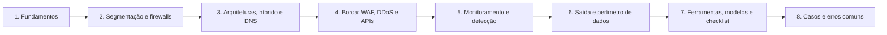

# 08 Segurança de Rede em Nuvem

## Objetivo

Projetar, configurar e monitorar a segurança de rede em ambientes de nuvem: compreender o modelo de redes virtuais definidas por software e a responsabilidade compartilhada, segmentar e controlar o tráfego com grupos de segurança, listas de controle e firewalls, desenhar arquiteturas de rede (hub e spoke, conectividade híbrida e DNS), proteger a borda contra ataques de aplicação e de negação de serviço, monitorar e detectar anomalias com registros de fluxo e inspeção, e controlar a saída de tráfego e o perímetro de dados para prevenir a exfiltração.

## Trilha de estudo recomendada

## Conteúdo da pasta

| Ordem | Arquivo | Objetivo |
|---|---|---|
| 1 | [fundamentos-de-seguranca-de-rede-em-nuvem.md](fundamentos-de-seguranca-de-rede-em-nuvem.md) | Redes virtuais, equivalências entre provedores, modelo de ameaças e princípios |
| 2 | [segmentacao-controles-de-trafego-e-firewalls.md](segmentacao-controles-de-trafego-e-firewalls.md) | Grupos de segurança, ACLs, firewalls de rede e higiene de regras |
| 3 | [arquiteturas-de-rede-conectividade-hibrida-e-dns.md](arquiteturas-de-rede-conectividade-hibrida-e-dns.md) | Hub e spoke, conectividade com ambientes locais, roteamento e DNS |
| 4 | [protecao-de-borda-waf-ddos-e-seguranca-de-apis.md](protecao-de-borda-waf-ddos-e-seguranca-de-apis.md) | CDN, WAF, DDoS, TLS e gateways de API |
| 5 | [monitoramento-de-rede-fluxos-deteccao-e-inspecao.md](monitoramento-de-rede-fluxos-deteccao-e-inspecao.md) | Registros de fluxo, DNS, espelhamento, detecções e consultas |
| 6 | [controle-de-saida-perimetro-de-dados-e-prevencao-de-exfiltracao.md](controle-de-saida-perimetro-de-dados-e-prevencao-de-exfiltracao.md) | Saída controlada, políticas de ponto de extremidade e perímetro de dados |
| 7 | [ferramentas-verificacoes-modelos-e-checklist-de-rede.md](ferramentas-verificacoes-modelos-e-checklist-de-rede.md) | Verificações de somente leitura, modelos e checklist |
| 8 | [casos-de-uso-e-erros-comuns-em-seguranca-de-rede.md](casos-de-uso-e-erros-comuns-em-seguranca-de-rede.md) | Casos fictícios, erros comuns, exercícios e perguntas de revisão |

## Princípios da pasta

- Privado por padrão e negar por padrão: nenhuma exposição ou comunicação sem necessidade e sem regra explícita
- Segmentar para limitar o raio de impacto e a movimentação lateral
- A localização na rede não concede confiança: autenticar e criptografar também o tráfego interno
- Controlar a saída tanto quanto a entrada: a exfiltração e o comando e controle saem pela rede
- Registrar e observar: fluxos, DNS e borda geram os sinais para detecção e investigação
- Configurar por código e verificar continuamente: regras de rede mudam rápido

## Relação com outras pastas

- 01 a 05: fundamentos, responsabilidade, governança, riscos e arquitetura
- 06 e 07: identidade e zero trust (acesso por aplicação e microssegmentação)
- 09 e 10: proteção de dados e criptografia
- 12 e 13: controles e monitoramento
- 17 e 18: postura e proteção de cargas de trabalho
- 19 e 20: contêineres e Kubernetes (políticas de rede)
- 22 e 23: resposta a incidentes e forense (registros de rede)
- 24 a 26: redes em Azure, AWS e Google Cloud

## Referências

- Scarfone, K.; Hoffman, P. NIST SP 800-41 Rev. 1: Guidelines on Firewalls and Firewall Policy. 2009
- Frankel, S. et al. NIST SP 800-77 Rev. 1: Guide to IPsec VPNs. 2020; McKay, K.; Cooper, D. NIST SP 800-52 Rev. 2: Guidelines for TLS Implementations. 2019
- CIS Foundations Benchmarks (AWS, Azure e Google Cloud), seções de rede; CIS Controls v8.1, controles 12 e 13
- CSA. Cloud Controls Matrix v4, domínio IVS; ISO/IEC 27002:2022, controles 8.20 a 8.23
- MITRE ATT&CK for Cloud e Enterprise, técnicas de rede
