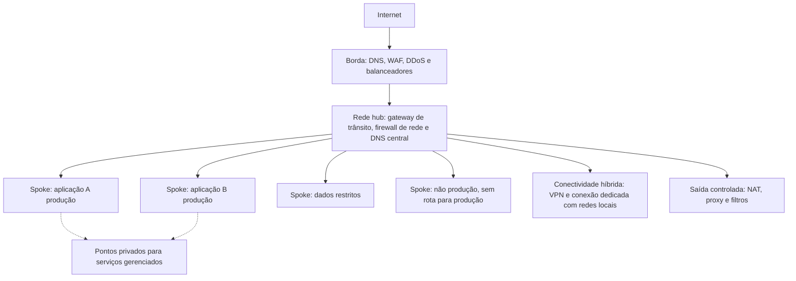
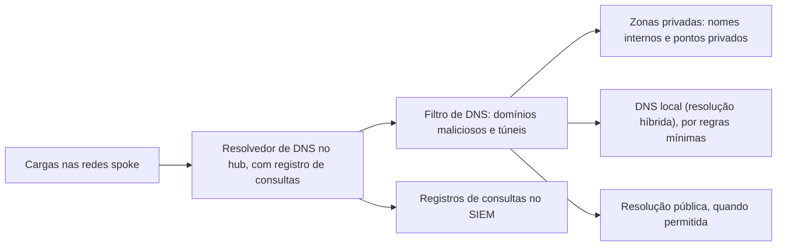

# Arquiteturas de Rede, Conectividade Híbrida e DNS

> **Objetivo pedagógico:** projetar topologias de rede em nuvem seguras e escaláveis (hub e spoke, peering, gateways de trânsito, VPC compartilhada), planejar o endereçamento IP sem sobreposição, projetar a conectividade híbrida com ambientes locais (VPN IPsec, conexões dedicadas e criptografia), tratar a segurança do roteamento (BGP), projetar a arquitetura de DNS (zonas privadas, resolução híbrida, filtragem e monitoramento) e escolher entre peering, gateways de trânsito e conectividade privada por serviço.

## 1. Topologias de rede em nuvem

| Topologia | Descrição | Vantagens | Cuidados |
|---|---|---|---|
| Rede única por aplicação (isolada) | Cada aplicação em sua própria rede virtual, sem conexão com as demais | Isolamento máximo | Poucos serviços compartilhados; pode exigir duplicação |
| Peering ponto a ponto | Conexões diretas entre redes virtuais | Simples e de baixa latência | Não transitivo; explosão de conexões em muitas redes |
| Hub e spoke | Rede central (hub) com serviços comuns e inspeção, conectada a redes de aplicação (spokes) | Controle e inspeção centralizados; escala | O hub é ponto crítico; planejar capacidade e roteamento |
| Gateway de trânsito (Transit Gateway, Virtual WAN, Network Connectivity Center) | Serviço gerenciado que interconecta muitas redes e conexões locais | Escala; roteamento centralizado; segmentação por tabelas de rotas | Custos; configuração de rotas por domínio |
| VPC compartilhada (Google Cloud) e sub-redes compartilhadas (AWS) | Uma rede de propriedade central compartilhada com projetos ou contas de serviço | Governança central da rede; cargas em projetos separados | Delegação de permissões e isolamento por sub-rede |
| Conectividade privada por serviço (PrivateLink e equivalentes) | Exposição de um serviço específico a outras redes, sem rotas entre elas | Reduz a superfície; tolera endereços sobrepostos | Gestão de pontos de extremidade por serviço |

## 2. Arquitetura hub e spoke com inspeção

| Elemento | Princípios de segurança |
|---|---|
| Hub | Administração separada; firewall de rede; DNS central; sem cargas de aplicação; registros de fluxo e de firewall |
| Spokes | Uma rede por aplicação ou por domínio; sem rotas diretas entre spokes, exceto por política no hub |
| Tabelas de rotas por domínio de segurança | Produção, não produção e dados restritos em domínios de roteamento separados |
| Entrada | Pontos controlados, com WAF e proteção contra negação de serviço |
| Saída | Central, com filtro de destino e registro |
| Conectividade híbrida | Terminada no hub, com segmentação e filtros |
| Serviços compartilhados | Em redes ou contas dedicadas, com acesso mínimo |

## 3. Plano de endereçamento IP

| Prática | Descrição |
|---|---|
| Plano central de endereçamento (IPAM) | Faixas alocadas por ambiente, região e aplicação, sem sobreposição com redes locais e entre nuvens |
| Reservar espaço para crescimento | Evitar redes pequenas demais para a escala futura |
| Hierarquia clara | Blocos por unidade, por região e por ambiente |
| Documentação e automação | Registro das alocações por código; verificação de sobreposição |
| IPv6 | Planejar o suporte; aplicar as mesmas regras de segurança que no IPv4 (um erro comum é esquecer as regras de IPv6) |
| Endereços sobrepostos inevitáveis (aquisições) | Isolar com conectividade por serviço (PrivateLink) ou com tradução de endereços |

### Exemplo de plano (fictício)

| Bloco | Uso | Observações |
|---|---|---|
| 10.0.0.0/16 | Hub da região principal | Firewall, DNS e conectividade híbrida |
| 10.1.0.0/16 | Produção: aplicações | Um /22 por aplicação |
| 10.2.0.0/16 | Produção: dados restritos | Sem rota para não produção |
| 10.10.0.0/16 | Não produção | Sem rota para produção |
| 10.20.0.0/16 | Região de recuperação | Espelho da estrutura principal |
| 172.16.0.0/12 | Redes locais (existentes) | Sem sobreposição com a nuvem |

## 4. Conectividade híbrida

| Opção | Descrição | Características | Segurança |
|---|---|---|---|
| VPN IPsec site a site | Túneis criptografados pela internet | Rápida de implantar; largura de banda limitada e variável | Criptografia por padrão; use IKEv2 e suítes modernas; túneis redundantes |
| Conexão dedicada (Direct Connect, ExpressRoute e Cloud Interconnect) | Enlaces privados entre o ambiente local e o provedor | Latência previsível; maior largura de banda | Não são criptografadas por padrão: aplicar criptografia (MACsec, quando disponível, ou IPsec sobre o enlace) conforme os requisitos |
| Dedicada com VPN de reserva | Conexão dedicada principal e VPN como contingência | Resiliência | Mesmas políticas de segmentação nos dois caminhos |
| Acesso remoto de usuários | VPN ou acesso por aplicação (pasta 07) | Preferir acesso por aplicação | Autenticação forte e dispositivo conforme |
| Conectividade entre nuvens | Interconexões entre provedores ou por colocation | Usada em multicloud | Criptografia e segmentação |

### Boas práticas de conectividade híbrida

| Prática | Descrição |
|---|---|
| Redundância | Dois enlaces ou túneis, em localidades ou zonas diferentes |
| Segmentação | Não estender a rede local à nuvem como uma única rede plana; filtros e firewalls na borda híbrida |
| Rotas mínimas | Anunciar e aceitar apenas as faixas necessárias |
| Criptografia | Exigida para dados sensíveis, inclusive em enlaces dedicados |
| Monitoramento | Estado dos túneis, desempenho, tráfego e anomalias |
| Plano de falha | Procedimento de operação quando o enlace falha |
| Administração | Equipamentos de borda locais atualizados, com acesso restrito |

## 5. Segurança do roteamento (BGP)

| Risco | Controle |
|---|---|
| Anúncios de rotas indevidos (por erro ou por ataque) | Filtros de prefixos de entrada e de saída; listas de prefixos permitidos |
| Excesso de rotas | Limite máximo de prefixos por vizinho, com alerta e desligamento |
| Sequestro de rotas | Validação de origem de rotas (RPKI) e participação em iniciativas de boas práticas de roteamento (por exemplo, o MANRS) quando aplicável |
| Falta de autenticação entre vizinhos | Autenticação das sessões, quando suportada |
| Mudanças não autorizadas | Controle de mudanças e alertas |
| Propagação de rotas entre ambientes | Tabelas de rotas por domínio e filtros no hub |

## 6. Arquitetura de DNS

O DNS é essencial para a conectividade e é um vetor de ataque (túneis de DNS, sequestro e envenenamento).

| Componente | Descrição | Segurança |
|---|---|---|
| Zonas privadas | Nomes internos resolvidos apenas por redes autorizadas (Route 53 zonas privadas, Azure Private DNS e Cloud DNS zonas privadas) | Reduz a exposição de nomes internos; controle de associação de redes |
| Resolução híbrida | Encaminhamento de consultas entre o DNS local e o da nuvem | Resolvers dedicados e regras de encaminhamento mínimas; registro das consultas |
| DNS de pontos privados | Registros que apontam para endereços privados de serviços gerenciados | Essencial para o uso de pontos de extremidade privados |
| Zonas públicas | Nomes expostos à internet | Controle de alterações; proteção de contas; DNSSEC quando aplicável |
| Filtragem de DNS (firewall de DNS) | Bloqueio de domínios maliciosos e de padrões de túnel | Route 53 Resolver DNS Firewall, filtragem de FQDN em firewalls e serviços de DNS seguro |
| Registro de consultas | Logs de consultas de DNS | Detecção de comunicação com comando e controle e de exfiltração (arquivo 5) |
| Proteção contra tomada de subdomínios | Remoção de registros apontando para recursos descontinuados (*subdomain takeover*) | Inventário de registros e verificação periódica |
| Proteção do registrador e das contas de DNS | MFA, bloqueio de transferência e alertas | Evita o sequestro de domínios |

## 7. Escolha entre as opções de conectividade

| Necessidade | Opção sugerida |
|---|---|
| Poucas redes, conectividade simples | Peering |
| Muitas redes, roteamento e inspeção centralizados | Gateway de trânsito ou Virtual WAN, com hub e firewall |
| Expor um serviço a consumidores em outras redes ou contas, sem expor a rede inteira | Conectividade privada por serviço (PrivateLink e equivalentes) |
| Governança central da rede com cargas em projetos separados | VPC compartilhada |
| Endereços sobrepostos | Conectividade por serviço ou tradução de endereços |
| Ambiente local com tráfego crítico | Conexão dedicada com criptografia e VPN de reserva |
| Acesso de usuários a aplicações | Acesso por aplicação (ZTNA), e não VPN ampla |

## 8. Exemplo prático: desenho de rede para uma instituição financeira

| Elemento | Decisão |
|---|---|
| Topologia | Hub e spoke com gateway de trânsito; domínios de roteamento separados para produção, para dados restritos e para não produção |
| Segmentação | Dados de clientes em spoke isolado, sem rota para não produção; acesso somente de aplicações autorizadas por regras de rede e por pontos privados |
| Endereçamento | Plano central com IPAM; sem sobreposição com as redes locais; IPv6 com as mesmas regras |
| Conectividade híbrida | Duas conexões dedicadas em localidades distintas, com criptografia, e VPN de reserva; rotas mínimas e limite de prefixos |
| Inspeção | Firewall de rede no hub para tráfego entre domínios, entrada e saída; filtros por domínio na saída |
| DNS | Resolvedores no hub, zonas privadas, filtragem de DNS e registro de consultas; verificação de subdomínios órfãos |
| Borda | WAF e proteção DDoS; certificados gerenciados (arquivo 4) |
| Registros | Fluxos, DNS, firewall e borda centralizados (arquivo 5) |
| Resiliência | Segunda região com rede espelhada e conexões híbridas redundantes |

## 9. Casos de uso corporativos

- Projeto da rede de uma landing zone com hub e spoke, planos de endereçamento e DNS.
- Planejamento da conectividade híbrida com requisitos de segurança e de resiliência.
- Revisão de arquitetura de rede de aquisições e de fusões, com endereços sobrepostos.

## 10. Normas e frameworks relevantes

- NIST SP 800-77 Rev. 1 (VPN IPsec); NIST SP 800-81-2 (DNS seguro); NIST SP 800-189 (BGP seguro); NIST SP 800-53 Rev. 5 (SC-7, SC-20 e SC-21)
- CIS Foundations Benchmarks (rede); CIS Controls v8.1 (controles 12 e 13); CSA CCM v4 (IVS)
- ISO/IEC 27002:2022 (8.20 a 8.22); MANRS (Mutually Agreed Norms for Routing Security)
- MITRE ATT&CK: T1071.004 (DNS), T1583.001 (aquisição de domínios), T1584 (comprometimento de infraestrutura)

## 11. Checklist operacional: arquitetura de rede

- [ ] Topologia documentada (hub e spoke ou equivalente), com domínios de roteamento por criticidade
- [ ] Plano central de endereçamento sem sobreposição; regras de IPv6 equivalentes às de IPv4
- [ ] Inspeção centralizada no hub para entrada, saída e tráfego entre domínios, quando exigido
- [ ] Conectividade híbrida redundante, criptografada para dados sensíveis, com rotas mínimas e limites de prefixos
- [ ] Dados restritos em segmentos isolados, sem rotas de não produção
- [ ] DNS privado, resolução híbrida controlada, filtragem e registro de consultas
- [ ] Inventário de registros de DNS e verificação de subdomínios órfãos
- [ ] Proteção das contas de DNS e dos registradores (MFA e bloqueio)
- [ ] Acesso de usuários por aplicação, e não por VPN ampla
- [ ] Revisão anual da topologia e dos planos de endereçamento

## 12. Referências

- Frankel, S. et al. NIST SP 800-77 Rev. 1. 2020.
- Rose, S. et al. NIST SP 800-81-2: Secure Domain Name System (DNS) Deployment Guide. 2013.
- Kuhn, D. R. et al. NIST SP 800-189: Resilient Interdomain Traffic Exchange: BGP Security and DDoS Mitigation. 2019.
- MANRS. Mutually Agreed Norms for Routing Security (documentação).
- Amazon Web Services; Microsoft; Google Cloud. Documentação de redes de hub e spoke, de Transit Gateway, de Virtual WAN, de Network Connectivity Center e de conectividade híbrida (versões vigentes).
- Pasta 07 deste repositório.
