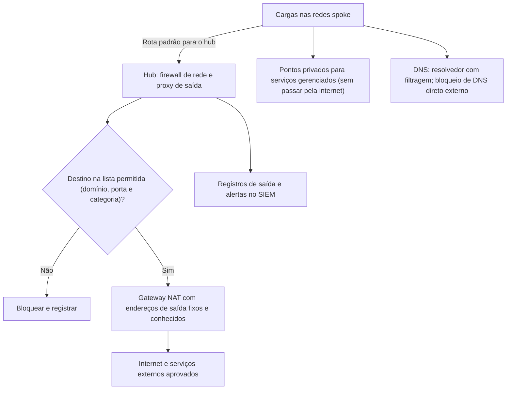

# Controle de Saída, Perímetro de Dados e Prevenção de Exfiltração

> **Objetivo pedagógico:** controlar a saída de tráfego tanto quanto a entrada: projetar a saída centralizada e filtrada (NAT, proxy, firewall e filtros por domínio), restringir o acesso de cargas a serviços e a destinos aprovados, aplicar o conceito de perímetro de dados (identidades confiáveis, recursos confiáveis e redes esperadas), usar políticas de pontos de extremidade e perímetros de serviço para impedir a exfiltração por serviços de nuvem, tratar o DNS como canal de saída e detectar tentativas de exfiltração.

## 1. Por que controlar a saída

A maior parte dos ataques exige **tráfego de saída**: comando e controle, download de ferramentas, exfiltração de dados e uso de serviços externos. Por padrão, as redes de nuvem **permitem a saída ampla**, o que facilita o abuso.

| Uso malicioso da saída | Exemplo |
|---|---|
| Comando e controle | Malware se comunica periodicamente com a infraestrutura do atacante |
| Download de ferramentas e de cargas | Obtenção de código malicioso a partir da internet |
| Exfiltração de dados | Envio de dados para servidores externos, serviços de armazenamento ou domínios do atacante |
| Abuso de serviços legítimos de nuvem | Cópia de dados para uma conta do atacante no mesmo provedor |
| Mineração e abuso de recursos | Conexões a *pools* externos |
| Movimentação entre ambientes | Acesso a outras nuvens ou a redes de terceiros |

## 2. Níveis de controle de saída

| Nível | Descrição | Aplicação |
|---|---|---|
| 1 Saída livre | Cargas acessam qualquer destino | Ambientes de baixa criticidade e sem dados sensíveis |
| 2 Saída por rotas e por NAT controlados | Saída por gateways NAT e rotas definidas, com registros | Base mínima |
| 3 Saída filtrada por destino | Lista de domínios e de endereços permitidos (proxy ou firewall com filtro de FQDN) | Cargas de produção |
| 4 Saída mínima e privada | Sem rota para a internet; acesso apenas a serviços por pontos privados e a destinos internos | Redes de dados restritos |
| 5 Perímetro de dados | Além do destino, controla a identidade, a conta e a rede que originam e recebem os dados | Dados restritos e sistemas críticos |

## 3. Arquitetura de saída controlada



| Componente | Prática |
|---|---|
| Rota padrão | Aponta para o hub (firewall e proxy), e não para o gateway da internet |
| Proxy de saída | Autenticação por identidade de carga, quando possível; filtro por domínio e por categoria; registro |
| Firewall de rede | Filtro de FQDN, inspeção e assinaturas; bloqueio de protocolos não necessários |
| Gateway NAT | Endereços de saída fixos, que permitem a parceiros restringir o acesso por origem |
| Lista de permissões | Domínios e endereços aprovados por aplicação, com dono e justificativa |
| Bloqueio de DNS externo | Cargas só usam o resolvedor interno; bloqueio de DNS e de DNS sobre HTTPS para resolvedores externos |
| Serviços por pontos privados | Acesso a armazenamento, bancos e filas sem passar pela internet |
| Exceções | Temporárias, com aprovação e monitoramento |

## 4. Perímetro de dados (data perimeter)

O **perímetro de dados** é um conjunto de controles preventivos que garante que **somente identidades confiáveis** acessem **recursos confiáveis** a partir de **redes esperadas**. Ele protege contra a exfiltração para contas externas e contra o uso indevido de credenciais.

| Objetivo | Descrição | Mecanismos típicos |
|---|---|---|
| Somente identidades confiáveis | Os dados só são acessados por identidades da organização | Condições em políticas de recursos (por exemplo, restringir ao identificador da organização) |
| Somente recursos confiáveis | As identidades da organização só acessam recursos da organização (impede copiar dados para uma conta externa) | Políticas de pontos de extremidade e políticas organizacionais com condições de organização de recurso |
| Somente redes esperadas | O acesso a dados só ocorre a partir das redes corporativas e de pontos privados | Condições de rede e de ponto de extremidade nas políticas; perímetros de serviço |

### 4.1 Mecanismos por provedor

| Provedor | Mecanismos de perímetro de dados |
|---|---|
| AWS | Políticas de pontos de extremidade de VPC, políticas de controle de serviços, condições de organização e de rede em políticas de recursos; orientações do "data perimeter" |
| Azure | Políticas de pontos de extremidade de serviço, pontos de extremidade privados, regras de rede em contas de armazenamento, perímetros de segurança de rede e Azure Policy |
| Google Cloud | VPC Service Controls (perímetros de serviço), níveis de acesso, políticas de organização e restrições de pontos de extremidade |

### 4.2 Exemplo: política de ponto de extremidade de VPC (AWS) que restringe o acesso a armazenamento aos recursos da organização

```json
{
  "Version": "2012-10-17",
  "Statement": [
    {
      "Sid": "PermitirSomenteRecursosDaOrganizacao",
      "Effect": "Allow",
      "Principal": "*",
      "Action": "s3:*",
      "Resource": "*",
      "Condition": {
        "StringEquals": {
          "aws:ResourceOrgID": "o-exemploorg"
        }
      }
    }
  ]
}
```

Anexada a um ponto de extremidade de gateway para o armazenamento de objetos, a política impede que as cargas da rede acessem buckets de **outras organizações** (por exemplo, o de um atacante) pelo ponto de extremidade, mesmo com credenciais válidas. Os identificadores da organização são fictícios. **Teste antes de aplicar:** alguns serviços de terceiros, de atualização e de pacotes dependem de recursos fora da organização; inclua exceções específicas e justificadas.

### 4.3 Exemplo: perímetro de serviço (Google Cloud, conceito)

| Elemento | Descrição |
|---|---|
| Perímetro | Conjunto de projetos e de serviços protegidos (por exemplo, armazenamento, bancos e analytics) |
| Regras de entrada | Quem pode acessar de fora do perímetro (por identidade, nível de acesso e origem) |
| Regras de saída | Para onde os dados podem ser enviados fora do perímetro |
| Modo de teste (*dry run*) | Registra violações sem bloquear, para ajustar antes da imposição |
| Efeito | Mesmo com permissões de IAM, a cópia de dados para fora do perímetro é bloqueada |

## 5. DNS como canal de saída

| Controle | Descrição |
|---|---|
| Resolvedor único e interno | Cargas só consultam o resolvedor corporativo, com registro e filtragem |
| Bloqueio de DNS externo | Negar conexões diretas a resolvedores externos (portas 53, 853 e DNS sobre HTTPS conhecido) |
| Filtragem de domínios | Bloqueio de domínios maliciosos, recém-registrados e de categorias de risco |
| Detecção de túneis | Análise de volume, de tamanho de nomes e de tipos de registros (arquivo 5) |
| Resposta | Bloqueio do domínio e isolamento da carga |

## 6. Detecção de tentativas de exfiltração

| Sinal | Fonte | Ação |
|---|---|---|
| Volume de saída acima da linha de base | Fluxos, NAT e proxy | Investigar; verificar destino, processo e identidade |
| Destinos novos ou raros | Fluxos, DNS e proxy | Verificar reputação e finalidade |
| Cópias de dados para armazenamento externo | Auditoria de dados e de rede | Bloquear por perímetro; investigar |
| Consultas de DNS anômalas | Registros de DNS | Bloquear domínio; isolar carga |
| Compartilhamento de snapshots e de imagens com contas externas | Auditoria da nuvem | Alerta e bloqueio por política |
| Alterações de políticas de pontos de extremidade e de perímetro | Auditoria da nuvem | Alerta crítico |
| Uso de credenciais fora das redes esperadas | Auditoria e fluxos | Revogar e investigar |

Os compartilhamentos de **recursos** (snapshots de discos, imagens de máquinas e backups) com outras contas são um canal de exfiltração frequente: restrinja-os por política e monitore (pasta 22, forense de nuvem).

## 7. Implantação gradual

| Fase | Atividades |
|---|---|
| 1. Visibilidade | Habilitar registros de saída; mapear destinos por aplicação |
| 2. Linha de base | Identificar os destinos legítimos e os volumes habituais |
| 3. Modo de observação | Políticas em modo de registro (por exemplo, *dry run* de perímetro) |
| 4. Imposição por camadas | Rota padrão ao hub; filtro por destino em redes de produção; perímetro de dados para dados restritos |
| 5. Gestão de exceções | Processo para novos destinos, com prazo e revisão |
| 6. Monitoramento contínuo | Alertas, revisão de listas e ajuste |

## 8. Exemplo prático: bloqueio de uma tentativa de cópia para uma conta externa

| Etapa | Resultado |
|---|---|
| Cenário | Credenciais de um desenvolvedor foram comprometidas; o atacante tenta copiar dados do armazenamento de uma aplicação para um bucket em uma conta externa, a partir de uma instância na rede da empresa |
| Controles | Ponto de extremidade de VPC com política que só permite recursos da organização; saída à internet apenas por proxy com lista de destinos; alerta de volume de saída |
| Efeito | A operação de cópia foi negada pelo ponto de extremidade; a tentativa de envio por internet foi bloqueada pelo proxy e registrada; o alerta acionou o SOC em 3 minutos |
| Resposta | Revogação das credenciais, investigação e correção da origem do comprometimento |
| Resultado | Nenhum dado exfiltrado; evidências preservadas |

## 9. Casos de uso corporativos

- Controle de saída padrão para redes de produção, com exceções governadas.
- Perímetro de dados para dados restritos e para ambientes regulados.
- Detecção e resposta a tentativas de exfiltração por serviços de nuvem e por DNS.

## 10. Normas e frameworks relevantes

- NIST SP 800-53 Rev. 5 (SC-7(5) negar por padrão e permitir por exceção, SC-7(8), AC-4 controle de fluxo de informação, SI-4)
- CIS Controls v8.1 (controles 3, 12 e 13); CSA CCM v4 (IVS e DSP); ISO/IEC 27002:2022 (8.12 prevenção de vazamento de dados, 8.20 a 8.23)
- AWS. Building a Data Perimeter on AWS (whitepaper); Google Cloud. VPC Service Controls; Microsoft. Network security perimeter (documentação vigente)
- MITRE ATT&CK: T1041, T1048, T1537 (transferência para outra conta de nuvem), T1567 (exfiltração por serviço web), T1572

## 11. Checklist operacional: saída e perímetro de dados

- [ ] Rota padrão das cargas para o hub, com firewall e proxy; sem saída direta à internet em redes de dados
- [ ] Lista de destinos permitidos por aplicação, com dono e justificativa
- [ ] DNS por resolvedor interno com filtragem; DNS externo bloqueado
- [ ] Gateway NAT com endereços de saída fixos e registrados
- [ ] Serviços gerenciados acessados por pontos privados, com políticas de ponto de extremidade
- [ ] Perímetro de dados para dados restritos (identidades, recursos e redes confiáveis)
- [ ] Compartilhamento de snapshots, de imagens e de backups com contas externas restrito por política
- [ ] Modo de observação antes da imposição; processo de exceções com prazo
- [ ] Alertas de volume de saída, de destinos novos e de alterações de políticas de perímetro
- [ ] Revisão trimestral das listas e das exceções

## 12. Referências

- Amazon Web Services. Building a Data Perimeter on AWS (whitepaper, versões vigentes).
- Google Cloud. VPC Service Controls (documentação vigente).
- Microsoft. Pontos de extremidade privados, regras de rede de armazenamento e perímetro de segurança de rede (documentação vigente).
- MITRE. ATT&CK: Exfiltration. https://attack.mitre.org
- Pastas 07, 09, 13 e 22 deste repositório.
