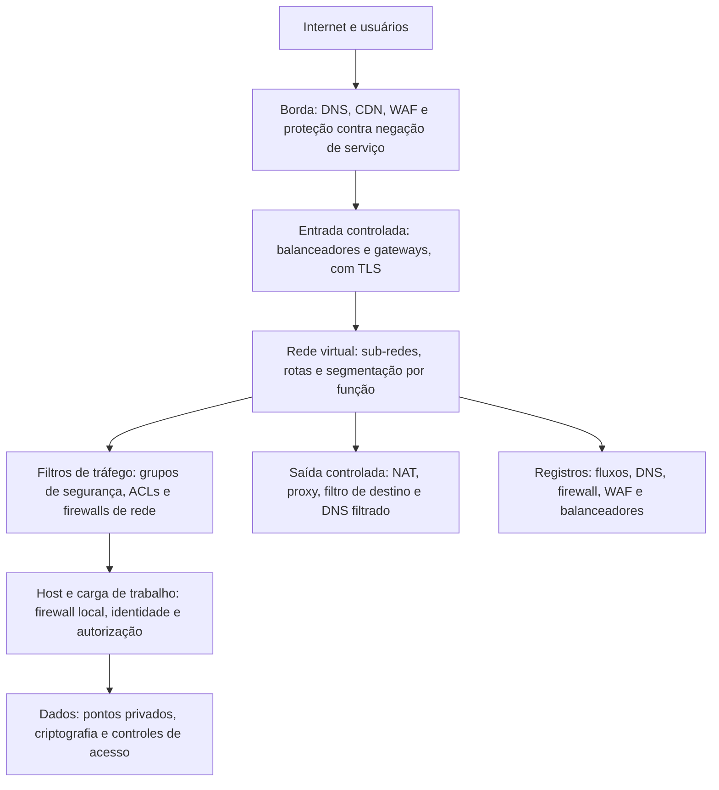

# Fundamentos de Segurança de Rede em Nuvem

> **Objetivo pedagógico:** compreender como funcionam as redes virtuais definidas por software em nuvem (redes, sub-redes, rotas e gateways), a divisão de responsabilidades entre provedor e cliente, as equivalências entre AWS, Azure e Google Cloud, as diferenças em relação a redes locais (visibilidade, elasticidade, endereçamento e controle por API), o modelo de ameaças de rede (exposição, movimentação lateral, exfiltração, negação de serviço e abuso de DNS) e os princípios de projeto que orientam as demais seções desta pasta.

## 1. A rede em nuvem é software

Em nuvem, a rede é uma **abstração definida por software**, criada e alterada por API. O cliente não manipula cabos, comutadores ou roteadores físicos: configura redes virtuais, tabelas de rotas, filtros de tráfego, gateways e serviços gerenciados.

| Característica | Implicação de segurança |
|---|---|
| Criada e alterada por API | Uma credencial comprometida pode abrir uma porta ao mundo em segundos; as alterações de rede precisam de controle e de auditoria |
| Elástica e efêmera | Endereços IP mudam; regras baseadas em IP envelhecem; é preciso regras por identidade, etiqueta e função |
| Isolamento lógico entre clientes | O provedor isola o tráfego dos clientes; o cliente é responsável por configurar corretamente a própria rede |
| Sem acesso à camada física e sem captura livre de pacotes | A visibilidade depende de registros de fluxo e de espelhamento de tráfego oferecidos pelo provedor |
| Serviços gerenciados fora da rede do cliente | Bancos, armazenamentos e filas têm pontos de extremidade próprios, que podem ser públicos por padrão |
| Muitos pontos de entrada | Balanceadores, gateways, pontos de extremidade, VPNs e conexões dedicadas |
| Endereçamento e conectividade entre muitas redes | Sobreposição de faixas e roteamento complexo exigem planejamento |

## 2. Responsabilidade compartilhada na rede

| Camada | Provedor | Cliente |
|---|---|---|
| Rede física, cabeamento, comutadores e backbone | Sim | Não |
| Isolamento entre clientes na infraestrutura | Sim | Não |
| Disponibilidade e proteção básica da infraestrutura contra negação de serviço | Sim (nível básico) | Proteções adicionais conforme o caso |
| Redes virtuais, sub-redes e rotas | Fornece os recursos | Projeta e configura |
| Filtros de tráfego (grupos de segurança, listas de controle e firewalls) | Fornece os mecanismos | Define e mantém as regras |
| Exposição de serviços (endereços públicos e pontos de extremidade) | Fornece as opções | Decide e verifica |
| Conectividade híbrida (VPN e conexões dedicadas) | Fornece os serviços | Configura, protege e monitora |
| Criptografia em trânsito | Oferece suporte | Exige e configura (TLS, IPsec) |
| Registros de rede | Fornece os recursos, geralmente opcionais | Habilita, retém e analisa |
| Segurança do sistema operacional e das aplicações em execução na rede | Não | Sim |

## 3. Equivalências entre provedores

| Conceito | AWS | Azure | Google Cloud |
|---|---|---|---|
| Rede virtual | VPC (regional) | Rede virtual, VNet (regional) | Rede VPC (global, com sub-redes regionais) |
| Sub-rede | Sub-rede (por zona de disponibilidade) | Sub-rede | Sub-rede (por região) |
| Filtro de tráfego por recurso (com estado) | Grupo de segurança | Grupo de segurança de rede (NSG) | Regra de firewall da VPC |
| Filtro por sub-rede (sem estado) | Lista de controle de acesso de rede (NACL) | NSG associado à sub-rede | Políticas de firewall |
| Agrupamento lógico por função | Referência a grupos de segurança | Grupo de segurança de aplicação (ASG) | Etiquetas seguras e contas de serviço como origem e destino |
| Firewall de rede gerenciado | AWS Network Firewall | Azure Firewall | Cloud NGFW (Cloud Firewall) |
| Saída para a internet | Gateway NAT e gateway de internet | Gateway NAT, Azure Firewall e IPs públicos | Cloud NAT |
| Conexão entre redes | Peering de VPC e Transit Gateway | Peering de VNet e Virtual WAN | Peering de VPC, VPC compartilhada e Network Connectivity Center |
| Conectividade privada com serviços | PrivateLink e pontos de extremidade de VPC | Private Link e pontos de extremidade privados | Private Service Connect e Acesso Privado do Google |
| Conexão dedicada local | Direct Connect | ExpressRoute | Cloud Interconnect |
| VPN site a site | Site-to-Site VPN | VPN Gateway | Cloud VPN |
| Proteção de aplicações web | AWS WAF | Azure WAF (Front Door e Application Gateway) | Cloud Armor |
| Proteção contra negação de serviço | AWS Shield | Azure DDoS Protection | Cloud Armor e infraestrutura global |
| Registros de fluxo | VPC Flow Logs | Registros de fluxo de NSG e de rede virtual | VPC Flow Logs |
| Espelhamento de tráfego | VPC Traffic Mirroring | Captura de pacotes e soluções de terceiros | Packet Mirroring |
| DNS privado | Zonas hospedadas privadas (Route 53) | Azure Private DNS | Cloud DNS (zonas privadas) |

Os nomes e os recursos mudam; confirme na documentação vigente.

## 4. Camadas de proteção de rede

## 5. Modelo de ameaças de rede

| Ameaça | Descrição | Controles principais |
|---|---|---|
| Exposição indevida | Serviços de administração, bancos e armazenamentos acessíveis pela internet | Privado por padrão; negação por padrão; verificação contínua; pontos privados |
| Varredura e exploração de serviços | Descoberta de portas e de vulnerabilidades por atacantes | Redução de exposição; WAF; correções; detecção |
| Movimentação lateral | Atacante alcança outros sistemas a partir de um comprometido | Microssegmentação; autenticação entre serviços; regras mínimas |
| Exfiltração de dados | Envio de dados para destinos externos | Controle de saída; perímetro de dados; DNS filtrado; detecção de volumes |
| Comando e controle | Comunicação de malware com a infraestrutura do atacante | Saída por lista permitida; DNS filtrado; análise de fluxos |
| Negação de serviço | Esgotamento de recursos por volume (camadas 3 e 4) ou por requisições (camada 7) | Proteção DDoS; WAF; limitação de taxa; arquitetura elástica |
| Ataques a aplicações web e APIs | Injeções, controle de acesso quebrado, abuso de APIs | WAF; validação; autenticação e autorização (arquivo 4) |
| Abuso de DNS | Túneis de DNS, sequestro e envenenamento | DNS privado, filtragem, DNSSEC e monitoramento (arquivo 3) |
| Interceptação e adulteração | Captura de tráfego não criptografado | TLS e IPsec; autenticação mútua |
| Abuso de conectividade híbrida | Rotas excessivas e confiança entre redes locais e de nuvem | Segmentação, filtros e revisão de rotas |
| Comprometimento do plano de controle de rede | Alteração maliciosa de regras e de rotas | Identidade forte; políticas organizacionais; alertas de alterações de rede |

## 6. Princípios de projeto

| Princípio | Aplicação |
|---|---|
| Privado por padrão | Recursos em sub-redes privadas, sem endereços públicos; exposição somente por pontos controlados |
| Negar por padrão | Nenhuma comunicação sem regra explícita e justificada |
| Menor conectividade | Portas, origens e destinos mínimos |
| Segmentação por função e por classificação | Camadas de aplicação, de dados e de gestão separadas; dados restritos isolados |
| Regras por identidade, etiqueta e função | Evitar dependência de endereços IP |
| Inspeção em pontos de passagem | Tráfego entre segmentos e de saída inspecionado, quando justificado |
| Criptografia em trânsito | TLS e IPsec, inclusive no tráfego interno |
| Controle de saída | A saída é tão controlada quanto a entrada |
| Administração segura | Sem portas de administração expostas; acesso por sessões autenticadas |
| Registro e observabilidade | Fluxos, DNS, firewall e borda registrados e centralizados |
| Configuração como código | Regras definidas, revisadas e verificadas por código |
| Revisão periódica | Regras e rotas revisadas; remoção do que não é usado |

## 7. Exemplo prático: do requisito à regra de rede

Requisito: "A aplicação de extratos expõe HTTPS ao público; o banco só é acessível pela aplicação; a administração é feita por sessões autenticadas."

| Requisito | Decisão de rede |
|---|---|
| Entrada pública apenas em HTTPS | Balanceador com WAF na borda; portas 80 e 443; redirecionamento para 443 |
| Aplicação não exposta diretamente | Instâncias ou contêineres em sub
