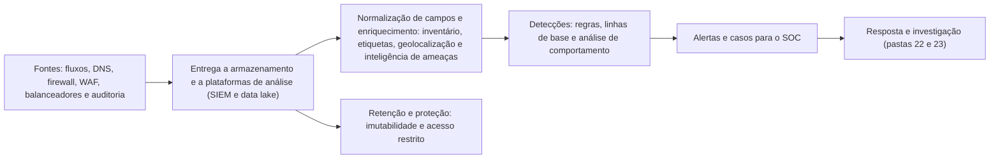

# Monitoramento de Rede: Fluxos, Detecção e Inspeção

> **Objetivo pedagógico:** monitorar redes em nuvem com as fontes de telemetria disponíveis (registros de fluxo, registros de DNS, de firewall, de WAF e de balanceadores, e espelhamento de tráfego), compreender o formato e as limitações dos registros de fluxo, projetar o pipeline de coleta e de retenção, definir casos de uso de detecção (varreduras, exposição, comunicação periódica, exfiltração e abuso de DNS), escrever consultas de exemplo e apoiar a investigação de incidentes.

## 1. Fontes de telemetria de rede

| Fonte | Conteúdo | Limitações |
|---|---|---|
| Registros de fluxo (VPC Flow Logs e equivalentes) | Metadados de conexões: origem, destino, portas, protocolo, bytes, pacotes, ação (permitido ou negado) | Sem conteúdo de pacotes; agregados em intervalos; não registram todo tipo de tráfego |
| Registros de DNS (consultas do resolvedor) | Nomes consultados, tipo, resposta e origem | Cobrem apenas consultas feitas pelo resolvedor monitorado |
| Registros de firewall de rede | Conexões permitidas e negadas, regras acionadas, alertas de assinaturas | Dependem da configuração de registro |
| Registros de WAF e de balanceadores | Requisições HTTP, regras bloqueadoras, códigos de resposta, origem | Cobrem a borda |
| Registros de gateways, de NAT e de proxies | Conexões de saída, destinos e volumes | Dependem da arquitetura |
| Espelhamento de tráfego (Traffic Mirroring e Packet Mirroring) | Cópia de pacotes para análise profunda (Zeek, Suricata e capturas) | Custos e volume; usar de forma seletiva |
| Registros de conectividade híbrida | Estado de túneis, de sessões BGP e de tráfego | Variam por serviço |
| Registros de auditoria do plano de controle | Alterações de regras, de rotas e de recursos de rede | Fundamentais para detectar abuso (pasta 13) |

Observação: os registros de fluxo de **grupos de segurança de rede** do Azure estão em processo de substituição pelos registros de fluxo de **redes virtuais**; confirme o cronograma de retirada e o recurso recomendado na documentação vigente antes de projetar o pipeline.

## 2. Registros de fluxo: formato e uso

Exemplo do formato padrão dos registros de fluxo de VPC da AWS (campos principais):

| Campo | Significado |
|---|---|
| `version`, `account-id`, `interface-id` | Versão do formato, conta e interface de rede |
| `srcaddr`, `dstaddr` | Endereços de origem e de destino |
| `srcport`, `dstport`, `protocol` | Portas e protocolo (6 = TCP, 17 = UDP, 1 = ICMP) |
| `packets`, `bytes` | Volume na janela de agregação |
| `start`, `end` | Início e fim da janela |
| `action` | `ACCEPT` ou `REJECT` (permitido ou negado pelos filtros) |
| `log-status` | Estado do registro |

Provedores oferecem formatos estendidos com campos adicionais (por exemplo, tipo de tráfego, identificador da sub-rede e nomes de serviços); consulte a documentação para escolher o formato.

### Limitações importantes

| Limitação | Efeito |
|---|---|
| Não há conteúdo de pacotes | Detecção por padrões de metadados, e não por assinaturas |
| Agregação por janela | Não mostra a ordem exata nem eventos muito curtos |
| Nem todo tráfego é registrado (por exemplo, tráfego de DNS do resolvedor do provedor, de metadados de instância e de licenças, em alguns provedores) | Complementar com registros de DNS e outros |
| Custo de armazenamento | Definir retenção, filtros e amostragem com consciência de riscos |
| Latência de entrega | Os registros chegam com atraso de minutos |
| Registros de **negações** dependem de regras | Tráfego negado é visível apenas se for avaliado pelos filtros que registram |

## 3. Pipeline de telemetria



| Decisão | Considerações |
|---|---|
| Onde habilitar | Todas as redes de produção; dados restritos e hubs com prioridade; considerar sub-redes de teste conforme o risco |
| Nível de detalhe e formato | Formato estendido para facilitar a detecção; atenção a custos |
| Destino | Conta de registros centralizada, com armazenamento imutável e consulta eficiente |
| Retenção | Definida por criticidade e requisitos regulatórios; os incidentes podem exigir meses (arquivar em armazenamento de baixo custo) |
| Enriquecimento | Associar endereços a recursos, a etiquetas e a proprietários (inventário), para torná-los úteis |
| Proteção | Controle de acesso e proteção contra alteração |
| Sincronização de tempo | Todos os registros em UTC |

## 4. Casos de uso de detecção

| # | Caso de uso | Fontes | Indicadores | Técnica ATT&CK |
|---|---|---|---|---|
| 1 | Varredura de portas e reconhecimento | Fluxos, firewall | Muitas conexões negadas de uma origem a várias portas ou hosts | T1046 |
| 2 | Tráfego da internet a serviços de administração | Fluxos, WAF, firewall | Conexões aceitas a portas 22, 3389 ou de bancos a partir de endereços públicos | T1190, T1021 |
| 3 | Força bruta em serviços expostos | Fluxos, registros de autenticação | Muitas tentativas curtas e repetidas ao mesmo destino | T1110 |
| 4 | Comunicação periódica (beaconing) com destinos externos | Fluxos, DNS, proxy | Intervalos regulares, tamanhos semelhantes e destino constante | T1071 |
| 5 | Exfiltração por volume | Fluxos, NAT, proxy | Volume de saída muito acima da linha de base, para destinos novos | T1041, T1048 |
| 6 | Túnel e exfiltração por DNS | Registros de DNS | Muitas consultas a um domínio, nomes longos e aleatórios, respostas TXT incomuns | T1071.004, T1572 |
| 7 | Comunicação com destinos maliciosos conhecidos | DNS, fluxos, firewall | Correspondência com inteligência de ameaças | T1071 |
| 8 | Movimentação lateral | Fluxos internos | Conexões entre segmentos que normalmente não se comunicam; uso de protocolos de administração | T1021, T1570 |
| 9 | Alteração de regras e de rotas de rede | Auditoria da nuvem | Abertura de portas ao mundo, desabilitação de registros de fluxo, novas rotas e peerings | T1562.007, T1562.008 |
| 10 | Uso incomum de regiões ou de gateways | Fluxos, auditoria | Tráfego ou recursos em regiões não aprovadas | T1578 |
| 11 | Picos de requisições e de erros na borda | WAF, balanceadores | Aumento de requisições, de bloqueios e de códigos 4xx e 5xx | T1498, T1499 |
| 12 | Uso de serviços de armazenamento externos | Proxy, DNS, fluxos | Envio de dados a serviços de nuvem não aprovados | T1567, T1537 |

## 5. Consultas de exemplo

### 5.1 Amazon Athena sobre registros de fluxo de VPC

```sql
-- Origens públicas com conexões aceitas a portas de administração e de bancos (últimas 24 horas)
-- A tabela vpc_flow_logs e as partições devem existir; ajuste o nome e o filtro de data
SELECT srcaddr, dstaddr, dstport, count(*) AS registros, sum(bytes) AS bytes_total
FROM vpc_flow_logs
WHERE action = 'ACCEPT'
  AND dstport IN (22, 3389, 3306, 5432, 1433, 27017)
  AND NOT (regexp_like(srcaddr, '^(10\.|192\.168\.|172\.(1[6-9]|2[0-9]|3[01])\.)'))
  AND from_unixtime(start) > current_timestamp - interval '1' day
GROUP BY srcaddr, dstaddr, dstport
ORDER BY registros DESC
LIMIT 50;

-- Principais destinos de saída por volume (candidatos a exfiltração), excluindo faixas privadas
SELECT srcaddr, dstaddr, sum(bytes) AS bytes_saida
FROM vpc_flow_logs
WHERE action = 'ACCEPT'
  AND regexp_like(srcaddr, '^10\.')
  AND NOT regexp_like(dstaddr, '^(10\.|192\.168\.|172\.(1[6-9]|2[0-9]|3[01])\.)')
  AND from_unixtime(start) > current_timestamp - interval '1' day
GROUP BY srcaddr, dstaddr
ORDER BY bytes_saida DESC
LIMIT 20;
```

### 5.2 Detecção de periodicidade com DuckDB (dados exportados)

```sql
-- Intervalos entre conexões por origem, destino e porta, a partir de um CSV com colunas: horario_utc, srcaddr, dstaddr, dstport
WITH c AS (
  SELECT srcaddr, dstaddr, dstport,
         epoch(CAST(horario_utc AS TIMESTAMP)) AS t,
         epoch(CAST(horario_utc AS TIMESTAMP))
           - lag(epoch(CAST(horario_utc AS TIMESTAMP))) OVER (PARTITION BY srcaddr, dstaddr, dstport ORDER BY CAST(horario_utc AS TIMESTAMP)) AS delta
  FROM read_csv_auto('fluxos_exportados.csv')
)
SELECT srcaddr, dstaddr, dstport, count(*) AS conexoes,
       round(avg(delta), 1) AS media_s, round(stddev(delta), 2) AS desvio_s
FROM c
WHERE delta IS NOT NULL
GROUP BY ALL
HAVING count(*) > 20 AND stddev(delta) < 2
ORDER BY conexoes DESC;
```

O desvio baixo indica periodicidade, mas **serviços legítimos também são periódicos** (verificações de saúde e atualizações): verifique o destino, o processo e o contexto antes de concluir.

### 5.3 Consulta de DNS (Microsoft Sentinel, exemplo conceitual)

```kusto
// Domínios com muitas consultas e nomes longos (candidatos a túneis de DNS)
// A tabela e os campos dependem do conector de DNS utilizado (ajuste ao seu esquema)
DnsEvents
| where TimeGenerated > ago(1d)
| extend dominio = tostring(split(Name, ".")[-2]), tamanho = strlen(Name)
| summarize consultas = count(), nomes_unicos = dcount(Name), tamanho_medio = avg(tamanho) by dominio, ClientIP
| where consultas > 500 and tamanho_medio > 40
| order by consultas desc
```

## 6. Investigação com base em registros de rede

| Pergunta | Fontes e abordagem |
|---|---|
| Que sistemas se comunicaram com um IP suspeito? | Fluxos, DNS e firewall: consultar o IP em todas as redes e janelas relevantes |
| Quando o acesso começou e terminou? | Registros de fluxo (`start` e `end`), alinhados em UTC |
| Que volume foi transferido? | Bytes e pacotes por fluxo, NAT e proxy |
| O tráfego foi permitido ou negado? | Campo de ação; regras de firewall e de grupos de segurança |
| Que carga ou identidade originou a comunicação? | Inventário (endereço para recurso), registros de processos e de identidade (pasta 23) |
| A rede foi alterada antes? | Auditoria do plano de controle: alterações de regras, de rotas e de gateways |
| Há dados de pacote para análise profunda? | Espelhamento prévio de tráfego ou captura sob demanda (pasta 23) |

Preserve os registros relevantes **antes** da retenção expirar (pasta 23, PB-01).

## 7. Espelhamento e inspeção de pacotes

| Aspecto | Orientação |
|---|---|
| Uso | Análise profunda em ambientes críticos, investigação e detecção por assinaturas (Suricata e Zeek) |
| Mecanismos | VPC Traffic Mirroring (AWS), Packet Mirroring (Google Cloud), captura de pacotes e soluções de terceiros (Azure) |
| Seletividade | Espelhar apenas o necessário (sub-redes críticas, hubs e pontos de saída) |
| Privacidade e legalidade | O conteúdo de pacotes pode conter dados pessoais; defina finalidade, acesso restrito e retenção (LGPD) |
| TLS | A maior parte do tráfego é criptografada: a análise de metadados (SNI, JA3 e tamanhos) é frequentemente mais viável que a de conteúdo |
| Capacidade | Dimensionar o analisador; amostragem quando necessário |

## 8. Exemplo prático: detecção de exfiltração por DNS

| Etapa | Resultado |
|---|---|
| Alerta | Detecção de DNS: 14 mil consultas em 2 horas a subdomínios aleatórios do domínio `exemplo-dados.example`, a partir de uma instância de aplicação |
| Triagem | Nomes longos (média de 58 caracteres), consultas TXT, sem correspondência com serviços conhecidos |
| Fluxos | A instância não tinha outro tráfego de saída; a resolução ocorria pelo resolvedor interno |
| Contenção | Isolamento da instância; bloqueio do domínio no firewall de DNS; preservação dos registros (PB-01 da pasta 23) |
| Investigação | A instância executava um processo desconhecido após a exploração de uma vulnerabilidade da aplicação; dados de configuração e de clientes foram codificados nas consultas |
| Impacto | Volume estimado de 38 MB de dados; avaliação pelo DPO |
| Correções | Correção da vulnerabilidade; saída por DNS apenas pelo resolvedor com filtragem; detecção de túneis implantada; segmentação reforçada |

## 9. Casos de uso corporativos

- Centro de monitoramento de rede em nuvem com casos de uso de detecção priorizados.
- Preservação e análise de registros de rede em investigações e em auditorias.
- Detecção de desvios entre a rede esperada e a observada.

## 10. Normas e frameworks relevantes

- NIST SP 800-92 (gestão de logs); NIST SP 800-94 (detecção e prevenção de intrusões); NIST SP 800-53 Rev. 5 (AU, SI-4)
- CIS Controls v8.1 (controles 8 e 13); CSA CCM v4 (LOG e IVS); ISO/IEC 27002:2022 (8.15 e 8.16)
- MITRE ATT&CK (técnicas de descoberta, de comando e controle e de exfiltração)
- LGPD, arts. 6º e 46 (finalidade, necessidade e segurança no tratamento de dados de rede)

## 11. Checklist operacional: monitoramento de rede

- [ ] Registros de fluxo habilitados nas redes de produção, no formato escolhido e entregues à conta de registros
- [ ] Registros de DNS, de firewall, de WAF e de balanceadores habilitados e centralizados
- [ ] Retenção definida por criticidade; proteção contra alteração; horários em UTC
- [ ] Enriquecimento com inventário (endereço para recurso, etiqueta e proprietário)
- [ ] Casos de uso de detecção (arquivo 4) implantados, testados e atribuídos a responsáveis
- [ ] Alertas para alteração de regras, de rotas e de registros de fluxo
- [ ] Espelhamento seletivo de tráfego em ambientes críticos, com governança de privacidade
- [ ] Procedimento de preservação de registros em incidentes
- [ ] Revisão trimestral das detecções, dos limiares e dos custos

## 12. Referências

- Kent, K.; Souppaya, M. NIST SP 800-92. 2006.
- Scarfone, K.; Mell, P. NIST SP 800-94: Guide to Intrusion Detection and Prevention Systems (IDPS). 2007.
- Amazon Web Services. VPC Flow Logs; Microsoft. Registros de fluxo de redes virtuais; Google Cloud. VPC Flow Logs (documentação vigente).
- Sanders, C.; Smith, J. Applied Network Security Monitoring. Syngress, 2013.
- Pastas 13, 22 e 23 deste repositório.
