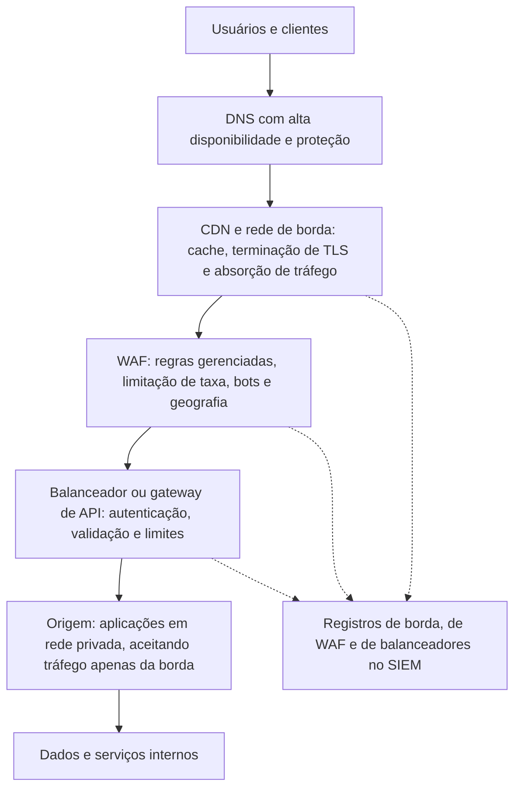

# Proteção de Borda: WAF, DDoS e Segurança de APIs

> **Objetivo pedagógico:** proteger a borda de aplicações em nuvem: projetar a entrada pública (DNS, CDN, balanceadores e gateways de API), configurar firewalls de aplicações web (WAF) com conjuntos de regras gerenciadas e regras próprias (limitação de taxa, geografia e bots), implantar proteção contra negação de serviço (DDoS) volumétrica e de aplicação, proteger a origem, gerir TLS e certificados, proteger APIs com autenticação, autorização, validação e limites, e operar o WAF com testes, ajustes de falsos positivos e registros.

## 1. Arquitetura de borda



| Princípio | Descrição |
|---|---|
| Pontos de entrada únicos e identificados | Evitar múltiplas portas de entrada não monitoradas |
| Origem protegida | A origem só aceita tráfego da borda (por listas de origens da CDN, cabeçalhos secretos, conectividade privada ou autenticação mútua) |
| Camadas independentes | DDoS, WAF, autenticação da API e validação na aplicação |
| TLS moderno e certificados gerenciados | Versões e suítes seguras; renovação automática |
| Registro e observabilidade | Todos os eventos da borda registrados |
| Teste e ajuste | O WAF e os limites são testados e calibrados antes de bloquear |

## 2. Firewall de aplicações web (WAF)

O WAF inspeciona requisições HTTP e HTTPS para bloquear ataques de aplicação (injeções, scripts entre sites, abuso de protocolo e automação maliciosa).

| Elemento | Descrição |
|---|---|
| Conjuntos de regras gerenciadas | Regras mantidas pelo fornecedor ou pela comunidade (por exemplo, baseadas no OWASP Core Rule Set), cobrindo as principais classes de ataque |
| Regras próprias | Regras específicas da aplicação: caminhos, métodos, tamanhos, cabeçalhos |
| Limitação de taxa | Limite de requisições por cliente (IP, token ou chave) e por janela de tempo |
| Controle de bots | Detecção de automação, de *scraping* e de preenchimento de credenciais |
| Regras geográficas | Bloqueio ou desafio por país, com justificativa de negócio |
| Listas de reputação | Bloqueio de origens conhecidas por abuso |
| Modos de operação | **Contagem (detecção)** para observar; **bloqueio** para impor |
| Inspeção do corpo | Limites de tamanho e de profundidade de inspeção |
| Respostas personalizadas | Páginas de erro, desafios e códigos apropriados |
| Registros | Requisições bloqueadas e permitidas, regras acionadas e amostras |

### 2.1 Serviços por provedor

| Provedor | Serviços de WAF |
|---|---|
| AWS | AWS WAF (em CloudFront, Application Load Balancer, API Gateway e outros), com regras gerenciadas e controle de bots |
| Azure | Azure Web Application Firewall em Front Door e em Application Gateway, com conjuntos de regras padrão e regras personalizadas |
| Google Cloud | Cloud Armor (políticas de segurança, regras pré-configuradas do OWASP, limitação de taxa e Adaptive Protection) |
| Terceiros | WAF e CDN de fornecedores especializados |

### 2.2 Exemplo: regra de limitação de taxa (AWS WAF)

```json
{
  "Name": "limitar-taxa-por-ip",
  "Priority": 1,
  "Statement": {
    "RateBasedStatement": {
      "Limit": 1000,
      "AggregateKeyType": "IP"
    }
  },
  "Action": { "Block": {} },
  "VisibilityConfig": {
    "SampledRequestsEnabled": true,
    "CloudWatchMetricsEnabled": true,
    "MetricName": "limitar-taxa-por-ip"
  }
}
```

A regra bloqueia IPs que excedam o limite de requisições na janela de avaliação configurada. **Calibre o limite** com o tráfego real e inicie com a ação de contagem antes de bloquear, para evitar impacto sobre clientes legítimos (por exemplo, redes com muitos usuários atrás de um mesmo endereço).

### 2.3 Operação segura do WAF

| Atividade | Descrição |
|---|---|
| Implantação em modo de contagem | Observar falsos positivos antes de bloquear |
| Ajuste de regras | Exceções específicas e justificadas para falsos positivos; evitar desligar conjuntos inteiros |
| Testes | Testes de segurança de aplicações (pasta 16) e testes sintéticos para validar bloqueios |
| Regras virtuais de correção | Proteção temporária de vulnerabilidades até a correção do código |
| Monitoramento | Painéis de bloqueios, de taxas e de regras acionadas; alertas para picos |
| Gestão de mudanças | Alterações de regras revisadas e versionadas como código |
| Registro e retenção | Registros enviados ao SIEM, com retenção para investigação |
| Revisão periódica | Revisão trimestral de regras, de exceções e de listas |

O WAF **complementa**, mas **não substitui**, a correção de vulnerabilidades e o desenvolvimento seguro (pasta 21).

## 3. Proteção contra negação de serviço (DDoS)

| Tipo de ataque | Camada | Descrição | Mitigação |
|---|---|---|---|
| Volumétrico | 3 e 4 | Inundação de tráfego para saturar a banda | Redes de borda de grande capacidade (CDN e Anycast), serviços de DDoS dos provedores |
| De protocolo | 3 e 4 | Exploração de fraquezas de protocolos (inundação SYN e amplificação) | Proteção automática de infraestrutura; regras de rede |
| De aplicação | 7 | Muitas requisições aparentemente legítimas, ou requisições caras | WAF, limitação de taxa, controle de bots, cache, desafios |
| Esgotamento de recursos de negócio | 7 | Abuso de funcionalidades (login, busca e geração de relatórios) | Limites por usuário, filas, validações, captchas |
| Ataques a DNS | 7 | Inundação ou sequestro do DNS | DNS de alta disponibilidade e proteção do provedor |

| Provedor | Serviço |
|---|---|
| AWS | AWS Shield (proteção padrão incluída; Shield Advanced com detecção avançada, suporte e proteção de custos) e WAF para a camada 7 |
| Azure | Azure DDoS Protection (proteção em nível de rede virtual ou de IP) e WAF |
| Google Cloud | Proteção da infraestrutura global do balanceamento; Cloud Armor (inclui Adaptive Protection e proteção avançada contra DDoS em planos corporativos) |

### Estratégia de resiliência a DDoS

| Elemento | Prática |
|---|---|
| Arquitetura | Distribuída e elástica; uso de CDN; evitar exposição da origem |
| Proteção em camadas | Rede de borda, WAF e limites na aplicação |
| Planejamento de capacidade e de custos | Proteção contra o "esgotamento de carteira" por escala automática excessiva (limites e orçamentos) |
| Plano de resposta | Playbook: detecção, ativação de proteções, comunicação e contato com o provedor |
| Testes | Simulações autorizadas, de acordo com as políticas do provedor |
| Monitoramento | Linhas de base de tráfego e alertas de anomalias |

## 4. TLS e certificados

| Aspecto | Orientação |
|---|---|
| Versões | TLS 1.2 como mínimo e TLS 1.3 preferencial; desabilitar versões antigas |
| Suítes de cifras | Suítes modernas com sigilo perfeito adiante; desabilitar cifras fracas |
| Certificados | Emitidos por autoridades confiáveis; gerenciados e renovados automaticamente (por exemplo, AWS Certificate Manager, certificados gerenciados do Azure e Google Certificate Manager) |
| Chaves | Protegidas em serviços de gestão de chaves; rotação |
| HSTS | Forçar HTTPS nos navegadores |
| Redirecionamento | HTTP para HTTPS |
| Autenticação mútua (mTLS) | Para integrações e APIs sensíveis |
| Monitoramento de expiração | Alertas para certificados prestes a expirar |
| Transparência de certificados | Monitorar a emissão indevida de certificados para os seus domínios |
| Inspeção de TLS | Quando necessária, com avaliação de privacidade e de impacto |

## 5. Segurança de APIs na borda

| Controle | Descrição |
|---|---|
| Autenticação | OAuth 2.0 e OpenID Connect; chaves de API apenas para identificação, e não como única autenticação |
| Autorização | Escopos mínimos; autorização por objeto e por função (arquivo 4 da pasta 07) |
| Validação de esquema | Rejeitar requisições fora da especificação (métodos, parâmetros, tipos e tamanhos) |
| Limitação de taxa e cotas | Por cliente, por chave e por rota |
| Proteção contra abuso de lógica de negócio | Limites e detecção de padrões de abuso |
| Inventário de APIs | Descobrir APIs não documentadas ("sombra") e versões antigas |
| Versionamento e desativação | Retirada controlada de versões vulneráveis |
| Criptografia e cabeçalhos de segurança | TLS e cabeçalhos adequados |
| Registro e monitoramento | Todas as requisições registradas, com identificadores de correlação |
| Referência de riscos | OWASP API Security Top 10 (autorização em nível de objeto quebrada, autenticação quebrada, exposição excessiva de dados, consumo irrestrito de recursos e outros) |

## 6. Verificação e operação (somente leitura)

```bash
# AWS: listas de controle de acesso do WAF (regionais) e recursos associados
aws wafv2 list-web-acls --scope REGIONAL --query "WebACLs[].[Name,Id,ARN]" --output table
aws wafv2 list-resources-for-web-acl --web-acl-arn arn:aws:wafv2:sa-east-1:111122223333:regional/webacl/exemplo/ID \
  --resource-type APPLICATION_LOAD_BALANCER

# AWS: situação da proteção Shield Advanced (retorna erro se não houver assinatura)
aws shield describe-subscription

# Azure: políticas de WAF e proteção DDoS
az network application-gateway waf-policy list --query "[].{nome:name,rg:resourceGroup}" --output table
az network ddos-protection list --query "[].{nome:name,rg:resourceGroup}" --output table

# Google Cloud: políticas de segurança do Cloud Armor
gcloud compute security-policies list --format="table(name,description)"
```

## 7. Exemplo prático: proteção de uma API pública de pagamentos

| Camada | Configuração |
|---|---|
| DNS e CDN | DNS de alta disponibilidade; CDN com TLS 1.2 ou superior, HSTS e certificados gerenciados |
| DDoS | Proteção avançada contra DDoS ativada; plano de resposta e contato do provedor documentados |
| WAF | Regras gerenciadas (injeções, ataques comuns e reputação), limitação de taxa por IP e por chave de cliente, controle de bots; modo de contagem por 2 semanas e depois bloqueio |
| Gateway de API | Autenticação OpenID Connect, validação de esquema, escopos mínimos e cotas por cliente |
| Origem | Aplicação em rede privada; aceita tráfego somente da borda (verificação por cabeçalho secreto rotacionado e por regras de rede) |
| Registros | Borda, WAF e gateway enviados ao SIEM; alertas para picos de bloqueios e de erros 401 e 403 |
| Resultado | Durante um ataque de camada 7 com 80 mil requisições por segundo, a CDN e as regras de taxa absorveram o tráfego; a taxa de erros para clientes legítimos permaneceu abaixo de 0,3%; a origem manteve a operação normal |

## 8. Casos de uso corporativos

- Padrão de borda (CDN, WAF e DDoS) para todas as aplicações expostas.
- Programa de segurança de APIs com inventário, autenticação, limites e monitoramento.
- Gestão automatizada de certificados com alertas de expiração.

## 9. Normas e frameworks relevantes

- NIST SP 800-52 Rev. 2 (TLS); NIST SP 800-95 (serviços web seguros); NIST SP 800-53 Rev. 5 (SC-5 proteção contra negação de serviço e SC-7)
- OWASP Top 10, OWASP API Security Top 10 e OWASP Core Rule Set; OWASP ASVS
- CIS Controls v8.1 (controles 13 e 16); CSA CCM v4 (IVS e AIS); ISO/IEC 27002:2022 (8.20, 8.23 e 8.26)
- PCI DSS v4.0 (requisito 6.4, proteção de aplicações públicas); MITRE ATT&CK: T1190, T1499 (negação de serviço de ponto de extremidade), T1498 (negação de serviço de rede)

## 10. Checklist operacional: proteção de borda

- [ ] Pontos de entrada públicos inventariados e protegidos por CDN, WAF e proteção DDoS
- [ ] Origem protegida, aceitando tráfego somente da borda
- [ ] WAF com regras gerenciadas e regras próprias; introdução em modo de contagem; ajuste de falsos positivos
- [ ] Limitação de taxa e controle de bots calibrados
- [ ] Plano de resposta a DDoS, com contatos e responsabilidades; limites de escalabilidade e de custos
- [ ] TLS 1.2 ou superior, HSTS, certificados gerenciados e alertas de expiração
- [ ] APIs com autenticação, autorização por objeto, validação de esquema e cotas
- [ ] Inventário de APIs e retirada de versões antigas
- [ ] Registros da borda no SIEM; alertas de picos
- [ ] Revisão trimestral das regras e testes periódicos

## 11. Referências

- McKay, K.; Cooper, D. NIST SP 800-52 Rev. 2. 2019.
- OWASP. API Security Top 10 (2023); Top 10 (2021); Core Rule Set (documentação).
- Amazon Web Services. AWS WAF e AWS Shield; Microsoft. Azure WAF e Azure DDoS Protection; Google Cloud. Cloud Armor (documentação vigente).
- Cloudflare e outros fornecedores: relatórios técnicos sobre ataques DDoS (referência de contexto, edições vigentes).
- Pasta 07 (autorização por requisição) e pasta 21 (DevSecOps) deste repositório.
