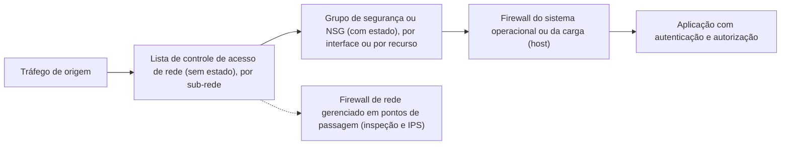

# Segmentação, Controles de Tráfego e Firewalls

> **Objetivo pedagógico:** projetar a segmentação e as regras de tráfego em nuvem: distinguir os filtros com estado (grupos de segurança, NSGs e regras de firewall da VPC) dos filtros sem estado (listas de controle de acesso de rede), compreender a ordem de avaliação e as regras padrão de cada provedor, escrever regras de privilégio mínimo (por referência a grupos, e não por endereços), usar firewalls de rede gerenciados com inspeção e prevenção de intrusões, manter a higiene das regras (revisão, remoção e verificação) e aplicar infraestrutura como código para as regras.

## 1. Camadas de filtragem



| Camada | Função | Estado | Uso típico |
|---|---|---|---|
| Lista de controle de acesso de rede (NACL) | Filtro por sub-rede; regras de permissão e de negação, avaliadas em ordem numérica | Sem estado: exige regras para tráfego de ida e de volta | Barreiras amplas de contenção (por exemplo, bloquear intervalos conhecidos) |
| Grupo de segurança (AWS), NSG (Azure) e regras de firewall da VPC (Google Cloud) | Filtro por recurso ou por interface | Com estado: o tráfego de resposta é permitido automaticamente | Controle principal de segmentação |
| Firewall de rede gerenciado | Inspeção profunda, filtros por domínio, assinaturas e prevenção de intrusões | Com estado | Pontos de passagem centrais: entre redes, na saída e na entrada |
| Firewall do host | Filtro no sistema operacional | Com estado | Defesa em profundidade; contenção de movimentação lateral |
| Controles de aplicação | Autenticação, autorização e validação | n/a | Última camada |

## 2. Modelos de avaliação nos provedores

| Aspecto | AWS | Azure | Google Cloud |
|---|---|---|---|
| Tipo de regra | Somente permissão (grupos de segurança); permissão e negação (NACLs) | Permissão e negação, com prioridade numérica | Permissão e negação, com prioridade numérica |
| Padrão de entrada | Negar | Negar tráfego da internet; permite tráfego interno da rede virtual por regras padrão | Negar entrada (regra implícita) |
| Padrão de saída | Permitir tudo, por padrão, nos grupos de segurança | Permitir saída para a internet por padrão | Permitir saída (regra implícita) |
| Ordem de avaliação | Todas as regras do grupo são avaliadas e somadas | Prioridade: menor número primeiro; a primeira correspondência prevalece | Prioridade: menor número primeiro; a primeira correspondência prevalece |
| Referência a grupos como origem e destino | Sim (grupo de segurança de origem) | Sim (grupos de segurança de aplicação e etiquetas de serviço) | Sim (etiquetas e contas de serviço) |

Pontos de atenção: o **padrão de saída permissivo** exige regras explícitas de saída em ambientes que precisam de controle (arquivo 6); regras padrão do Azure permitem tráfego interno entre sub-redes da mesma rede virtual, o que exige negações explícitas para segmentar; confirme os padrões vigentes na documentação.

## 3. Regras de privilégio mínimo

| Boa prática | Descrição |
|---|---|
| Referenciar grupos, e não endereços | Regras como "a camada de aplicação aceita a porta 8443 do grupo do balanceador" mantêm-se válidas com a elasticidade |
| Portas e protocolos específicos | Evitar "todas as portas" e "todos os protocolos" |
| Origens específicas | Evitar `0.0.0.0/0` em regras de entrada, exceto para HTTP e HTTPS em pontos públicos protegidos por WAF |
| Sem administração aberta à internet | Portas de SSH (22) e de RDP (3389) nunca abertas ao mundo; acesso por sessões gerenciadas (pasta 07) |
| Descrições e etiquetas | Cada regra com descrição, responsável e referência ao requisito |
| Regras de saída explícitas | Em redes sensíveis, negar a saída padrão e permitir apenas o necessário |
| Um grupo por função | Evitar grupos genéricos reutilizados por muitas cargas |
| Regras temporárias com prazo | Acesso excepcional com data de expiração e remoção automática |
| Evitar regras que se sobrepõem de forma confusa | Simplicidade e previsibilidade |

### 3.1 Exemplo: grupos de segurança por referência (Terraform, AWS)

```hcl
# Balanceador público: aceita HTTPS da internet
resource "aws_security_group" "balanceador" {
  name        = "sg-balanceador"
  description = "Entrada HTTPS pública, protegida por WAF"
  vpc_id      = var.vpc_id

  ingress {
    description = "HTTPS da internet"
    from_port   = 443
    to_port     = 443
    protocol    = "tcp"
    cidr_blocks = ["0.0.0.0/0"]
  }
}

# Camada de aplicação: aceita somente do balanceador
resource "aws_security_group" "aplicacao" {
  name        = "sg-aplicacao"
  description = "Aplicacao: entrada apenas do balanceador"
  vpc_id      = var.vpc_id

  ingress {
    description     = "Porta da aplicacao vinda do balanceador"
    from_port       = 8443
    to_port         = 8443
    protocol        = "tcp"
    security_groups = [aws_security_group.balanceador.id]
  }
}

# Camada de dados: aceita somente da aplicação
resource "aws_security_group" "banco" {
  name        = "sg-banco"
  description = "Banco: entrada apenas da aplicacao"
  vpc_id      = var.vpc_id

  ingress {
    description     = "PostgreSQL vindo da aplicacao"
    from_port       = 5432
    to_port         = 5432
    protocol        = "tcp"
    security_groups = [aws_security_group.aplicacao.id]
  }
}
```

O exemplo omite as regras de saída por simplicidade. Em ambientes sensíveis, remova a regra de saída padrão e declare explicitamente as saídas necessárias (para o banco, para o proxy de saída e para DNS).

## 4. Firewalls de rede gerenciados

| Provedor | Serviço | Capacidades |
|---|---|---|
| AWS | AWS Network Firewall; Gateway Load Balancer com dispositivos virtuais de terceiros | Regras com estado, filtros por domínio, regras compatíveis com assinaturas de detecção de intrusão; inserção em pontos de passagem |
| Azure | Azure Firewall (Standard e Premium); Firewall Manager | Regras de rede e de aplicação (FQDN), inteligência de ameaças, e no nível Premium, inspeção de TLS, IDPS e filtro de URL |
| Google Cloud | Cloud NGFW (Cloud Firewall) | Políticas hierárquicas, regras por etiquetas seguras, prevenção de intrusões (nível Enterprise) e filtro de FQDN |
| Terceiros | Dispositivos virtuais de rede (NVA) de fabricantes de segurança | Funcionalidades avançadas; exigem gestão de capacidade e de alta disponibilidade |

### Quando usar um firewall de rede centralizado

| Cenário | Justificativa |
|---|---|
| Inspeção do tráfego entre redes (leste a oeste) em ambientes regulados | Requisitos de inspeção e de segmentação |
| Controle de saída por domínio (FQDN) | Filtros de destino que grupos de segurança não oferecem |
| Prevenção de intrusões em pontos de entrada e de saída | Detecção de assinaturas conhecidas |
| Inspeção de tráfego criptografado, quando legalmente adequado e tecnicamente justificado | Visibilidade sobre ameaças em TLS; atenção à privacidade e ao desempenho |
| Registro centralizado e auditável | Evidências de conformidade |

Considere **custos, latência e disponibilidade**: firewalls centralizados são pontos críticos; projete redundância e capacidade.

## 5. Higiene e ciclo de vida das regras

| Atividade | Descrição | Frequência |
|---|---|---|
| Revisão de regras | Confirmar a necessidade, o dono e a justificativa de cada regra | Trimestral para regras críticas; semestral para as demais |
| Identificação de regras não usadas | Análise de registros de fluxo para regras sem tráfego | Trimestral |
| Remoção segura | Desabilitar, observar e remover | Após a revisão |
| Detecção de regras excessivas | Origens `0.0.0.0/0`, faixas amplas, portas amplas e regras de saída irrestritas | Contínua |
| Verificação por código | Políticas que reprovam regras de risco antes da implantação | A cada mudança |
| Controle de mudanças | Alterações revisadas por pares, com aprovação para regras de produção | Contínua |
| Alertas de alteração | Alerta para mudanças em regras críticas fora do pipeline | Contínua |
| Registro de exceções | Regras excepcionais com prazo e controles compensatórios | Contínua |

```bash
# AWS: grupos de segurança com regras de entrada abertas ao mundo (0.0.0.0/0 ou ::/0), por porta
aws ec2 describe-security-groups --output json > sgs.json
jq -r '.SecurityGroups[] | . as $g
  | .IpPermissions[]
  | select(any(.IpRanges[]?; .CidrIp=="0.0.0.0/0") or any(.Ipv6Ranges[]?; .CidrIpv6=="::/0"))
  | [$g.GroupId, $g.GroupName, (.IpProtocol), (.FromPort|tostring), (.ToPort|tostring)] | @tsv' sgs.json

# Azure: regras de entrada que permitem origem qualquer em um NSG
az network nsg rule list --nsg-name NSG-EXEMPLO --resource-group RG-EXEMPLO \
  --query "[?direction=='Inbound' && access=='Allow' && (sourceAddressPrefix=='*' || sourceAddressPrefix=='Internet')].{regra:name,porta:destinationPortRange,prioridade:priority}" --output table

# Google Cloud: regras de entrada com origem 0.0.0.0/0
gcloud compute firewall-rules list --filter="direction=INGRESS AND sourceRanges:0.0.0.0/0" \
  --format="table(name,network.basename(),priority,allowed[].map().firewall_rule().list())"
```

## 6. Exemplo prático: revisão de regras de uma conta de produção

| Achado | Quantidade | Ação |
|---|---|---|
| Grupos de segurança com SSH aberto para `0.0.0.0/0` | 6 | Remover; acesso por sessões gerenciadas |
| Grupos de segurança com todas as portas abertas para a rede interna | 11 | Substituir por regras por porta e por referência a grupos |
| Regras sem tráfego nos últimos 90 dias (análise de fluxos) | 48 | Desabilitar, observar por 30 dias e remover |
| Regras sem descrição ou dono | 73 | Atribuir dono e descrição; remover as órfãs |
| Saída irrestrita em sub-redes de dados | 9 sub-redes | Negar a saída padrão e permitir apenas o necessário |
| Resultado | Superfície de exposição reduzida em 82%; política de verificação no pipeline que reprova regras de entrada abertas | |

## 7. Casos de uso corporativos

- Padrões de regras de rede por camada de aplicação, com módulos de infraestrutura como código.
- Programa de higiene de regras com revisão periódica e remoção segura.
- Firewall centralizado para inspeção de saída e de tráfego entre redes.

## 8. Normas e frameworks relevantes

- NIST SP 800-41 Rev. 1 (política de firewall); NIST SP 800-53 Rev. 5 (SC-7 proteção de limites e CM-6 configuração)
- CIS Foundations Benchmarks (grupos de segurança, NSGs e regras de firewall); CIS Controls v8.1 (controle 12 e 13)
- CSA CCM v4 (IVS); ISO/IEC 27002:2022 (8.20 a 8.22); PCI DSS v4.0 (requisitos 1.x, controles de segurança de rede)
- MITRE ATT&CK: T1021 (serviços remotos), T1046, T1562.007 (desabilitar ou modificar firewall de nuvem)

## 9. Checklist operacional: regras de tráfego e firewalls

- [ ] Regras por referência a grupos e por função, e não por endereços IP, sempre que possível
- [ ] Nenhuma regra de entrada `0.0.0.0/0` para portas de administração e de bancos
- [ ] Entrada pública apenas em HTTP e HTTPS, protegida por WAF
- [ ] Saída explícita e restrita em redes sensíveis
- [ ] Cada regra com descrição, dono e justificativa
- [ ] Firewall de rede centralizado onde exigido (inspeção, FQDN e IPS), com redundância
- [ ] Revisão periódica e remoção de regras não usadas, com base em registros de fluxo
- [ ] Verificação das regras no pipeline e alerta para alterações fora do pipeline
- [ ] Registro de exceções com prazo e controles compensatórios

## 10. Referências

- Scarfone, K.; Hoffman, P. NIST SP 800-41 Rev. 1. 2009.
- Center for Internet Security. CIS Foundations Benchmarks (AWS, Azure e Google Cloud).
- Amazon Web Services. Security groups, network ACLs e AWS Network Firewall; Microsoft. Network security groups e Azure Firewall; Google Cloud. VPC firewall rules e Cloud NGFW (documentação vigente).
- PCI Security Standards Council. PCI DSS v4.0.
- Pastas 07 e 19 deste repositório (acesso por aplicação e políticas de rede em contêineres).
