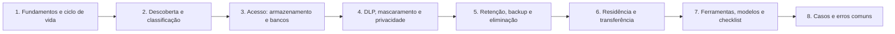

# 09 Proteção de Dados em Nuvem

## Objetivo

Proteger os dados ao longo de todo o seu ciclo de vida em ambientes de nuvem: compreender os fundamentos e a responsabilidade do cliente sobre os dados, descobrir, inventariar e classificar os dados, controlar o acesso em armazenamento e em bancos de dados, prevenir perdas e aplicar mascaramento e privacidade por desenho, definir retenção, backup e eliminação segura, e tratar residência, soberania e transferência internacional de dados, com atenção à LGPD e às normas setoriais.

## Trilha de estudo recomendada

## Conteúdo da pasta

| Ordem | Arquivo | Objetivo |
|---|---|---|
| 1 | [fundamentos-de-protecao-de-dados-em-nuvem.md](fundamentos-de-protecao-de-dados-em-nuvem.md) | Ciclo de vida, estados dos dados, responsabilidade e referenciais |
| 2 | [descoberta-inventario-e-classificacao-de-dados.md](descoberta-inventario-e-classificacao-de-dados.md) | Descoberta, dados ocultos, catálogo, esquemas de classificação e rotulagem |
| 3 | [controles-de-acesso-a-dados-armazenamento-e-bancos-de-dados.md](controles-de-acesso-a-dados-armazenamento-e-bancos-de-dados.md) | Armazenamento de objetos, volumes, compartilhamentos e bancos de dados |
| 4 | [prevencao-de-perda-de-dados-mascaramento-e-privacidade-por-desenho.md](prevencao-de-perda-de-dados-mascaramento-e-privacidade-por-desenho.md) | DLP, pseudonimização, anonimização, mascaramento e direitos dos titulares |
| 5 | [retencao-ciclo-de-vida-backup-e-eliminacao-segura.md](retencao-ciclo-de-vida-backup-e-eliminacao-segura.md) | Retenção, ciclo de vida, backups imutáveis e eliminação |
| 6 | [residencia-soberania-e-transferencia-internacional-de-dados.md](residencia-soberania-e-transferencia-internacional-de-dados.md) | Regiões, soberania, LGPD e transferência internacional |
| 7 | [ferramentas-verificacoes-modelos-e-checklist-de-protecao-de-dados.md](ferramentas-verificacoes-modelos-e-checklist-de-protecao-de-dados.md) | Verificações de somente leitura, modelos e checklist |
| 8 | [casos-de-uso-e-erros-comuns-em-protecao-de-dados.md](casos-de-uso-e-erros-comuns-em-protecao-de-dados.md) | Casos fictícios, erros comuns, exercícios e perguntas de revisão |

## Princípios da pasta

- Os dados são sempre responsabilidade do cliente, qualquer que seja o modelo de serviço
- Não se protege o que não se conhece: descobrir, inventariar e classificar vêm primeiro
- Os controles seguem a classificação: quanto mais sensível o dado, mais forte o controle
- Minimizar: coletar, copiar e reter apenas o necessário e pelo tempo necessário
- Privado por padrão: nenhum armazenamento ou banco de dados público sem justificativa
- Eliminar com segurança e comprovar: retenção e eliminação também são controles de proteção

## Relação com outras pastas

- 01 a 05: fundamentos, responsabilidade, governança, riscos e arquitetura
- 06 e 07: identidade, zero trust e acesso por atributos
- 08: segurança de rede (pontos privados e perímetro de dados)
- 10: criptografia e gestão de chaves
- 11: conformidade (LGPD e normas setoriais)
- 13 e 17: monitoramento e postura
- 22 e 23: resposta a incidentes e forense

## Referências

- Cloud Security Alliance. Security Guidance for Critical Areas of Focus in Cloud Computing v4.0, domínio de segurança de dados
- ISO/IEC 27018:2019, 27017:2015, 27701:2019 e 27002:2022
- NIST SP 800-53 Rev. 5 (famílias MP, SC e PT); NIST SP 800-88 Rev. 1; NIST Privacy Framework 1.0
- Brasil. Lei nº 13.709/2018 (LGPD); Resolução CD/ANPD nº 19/2024 (transferência internacional)
- CIS Foundations Benchmarks (seções de armazenamento e de bancos de dados)
