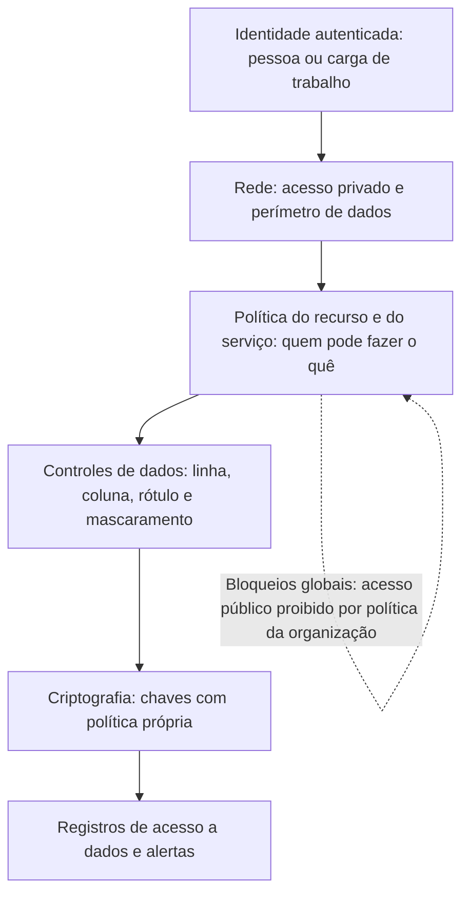

# Controles de Acesso a Dados: Armazenamento e Bancos de Dados

> **Objetivo pedagógico:** configurar e verificar os controles de acesso e de proteção dos principais repositórios de dados em nuvem: armazenamento de objetos (bloqueio de acesso público, políticas, links temporários e versionamento), volumes, instantâneos e compartilhamentos de arquivos, e bancos de dados gerenciados (acesso privado, autenticação, TLS, auditoria, controle em nível de linha e de coluna e mascaramento), com exemplos de políticas e verificações de somente leitura nos três provedores.

## 1. Camadas de controle de acesso a dados



## 2. Armazenamento de objetos

O armazenamento de objetos concentra grande parte dos incidentes de exposição de dados em nuvem, principalmente por configuração incorreta.

### 2.1 Controles principais

| Controle | Descrição |
|---|---|
| Bloqueio de acesso público | Recursos que impedem, em nível de conta e de organização, qualquer acesso público (AWS S3 Block Public Access; Azure: desabilitar o acesso anônimo a blobs; Google Cloud: prevenção de acesso público) |
| Listas de controle de acesso desabilitadas | Preferir políticas, e não ACLs por objeto (AWS: propriedade de objetos aplicada pelo dono do bucket; Google Cloud: acesso uniforme em nível de bucket) |
| Políticas de recurso mínimas | Acesso por identidade e por prefixo, com condições |
| Pontos de acesso e de extremidade privados | Acesso a partir de redes privadas (pasta 08) |
| Negar transporte sem TLS | Política que rejeita conexões sem criptografia |
| Chaves compartilhadas e tokens de acesso | Evitar chaves de conta de armazenamento compartilhadas (Azure) e preferir identidades; tokens de assinatura de acesso compartilhado (SAS) e URLs pré-assinadas com validade curta, escopo mínimo e, no Azure, delegados por identidade |
| Versionamento e proteção contra exclusão | Recuperação de alterações e de exclusões; exclusão lógica (soft delete) |
| Imutabilidade (WORM) | Retenção que impede alteração e exclusão (arquivo 5) |
| Registros de acesso a dados | Eventos de dados habilitados (por exemplo, eventos de dados do CloudTrail, registros de armazenamento do Azure e Cloud Audit Logs de acesso a dados) |
| Replicação controlada | Regras de replicação entre contas e regiões revisadas |
| Notificações e varredura | Alertas de alterações de políticas e classificação de conteúdo |

### 2.2 Exemplo: política de bucket que nega conexões sem TLS (AWS)

```json
{
  "Version": "2012-10-17",
  "Statement": [
    {
      "Sid": "NegarTransporteSemTLS",
      "Effect": "Deny",
      "Principal": "*",
      "Action": "s3:*",
      "Resource": [
        "arn:aws:s3:::bucket-exemplo",
        "arn:aws:s3:::bucket-exemplo/*"
      ],
      "Condition": {
        "Bool": { "aws:SecureTransport": "false" }
      }
    }
  ]
}
```

### 2.3 Riscos específicos de objetos

| Risco | Descrição | Mitigação |
|---|---|---|
| Bucket ou contêiner com leitura pública | Dados indexáveis na internet | Bloqueio de acesso público na organização; verificação contínua |
| Política que concede acesso a "todos os principais" | Permissões amplas por engano | Revisão de políticas; análise de acesso externo |
| Links temporários de longa validade | Acesso prolongado a quem tem o link | Validade curta; escopo mínimo; registro |
| Acesso entre contas não revisado | Contas de terceiros com acesso | Revisões periódicas; análise de acesso externo |
| Exclusão ou sobrescrita maliciosa | Perda de dados | Versionamento, imutabilidade e backup em conta separada |
| Dados de teste expostos | Dados reais em ambientes de baixa proteção | Dados sintéticos; classificação e políticas por etiqueta |

## 3. Volumes, instantâneos e compartilhamentos de arquivos

| Recurso | Riscos | Controles |
|---|---|---|
| Volumes de blocos | Dados sem criptografia; volumes órfãos | Criptografia por padrão; inventário e limpeza de volumes sem uso |
| Instantâneos e imagens | Compartilhamento com contas externas; cópias esquecidas | Bloqueio de compartilhamento público e controle de compartilhamento entre contas por política; criptografia com chaves que impedem o uso externo; ciclo de vida |
| Compartilhamentos de arquivos (NFS, SMB e serviços gerenciados) | Acesso amplo na rede; permissões herdadas | Acesso por rede privada e por identidade; permissões mínimas; criptografia em trânsito |
| Backups | Mesma conta e mesmas credenciais da produção | Contas separadas, imutabilidade e criptografia (arquivo 5) |
| Discos de máquinas descartadas | Dados residuais | Eliminação e criptografia (arquivo 5) |

## 4. Bancos de dados gerenciados

| Controle | Descrição |
|---|---|
| Acesso privado | Sem endereço público; acesso por pontos de extremidade privados e por redes autorizadas |
| Autenticação por identidade | Integração com a identidade da nuvem e do diretório, em vez de senhas locais; credenciais dinâmicas e de curta duração (pasta 06) |
| TLS obrigatório | Conexões criptografadas e versões modernas |
| Privilégio mínimo | Contas e papéis do banco com permissões por tabela e por operação; contas administrativas separadas e com elevação |
| Segregação de ambientes | Bancos de produção separados dos de teste; sem cópias de dados reais em ambientes de baixa proteção |
| Controle em nível de linha e de coluna | Políticas de segurança em nível de linha (row-level security) e permissões por coluna |
| Mascaramento dinâmico | Ocultação de campos sensíveis para perfis sem necessidade (por exemplo, o mascaramento dinâmico de dados em alguns bancos relacionais) |
| Criptografia em repouso | Padrão em serviços gerenciados; chaves gerenciadas pelo cliente para classificações elevadas (pasta 10) |
| Auditoria | Registro de conexões, de consultas privilegiadas e de alterações de esquema; fluxos de atividade do banco, quando disponíveis |
| Backups e recuperação | Pontos de recuperação, cópias protegidas e testes |
| Patches e versões | Atualizações do motor e dos componentes; versões suportadas |
| Proteção contra exclusão | Proteção contra exclusão acidental e instantâneo final antes da exclusão |
| Parâmetros seguros | Desabilitar recursos desnecessários; limites de conexão |

### 4.1 Exemplo conceitual: segurança em nível de linha (PostgreSQL)

```sql
-- Cada analista só vê os registros da sua carteira de clientes
ALTER TABLE clientes ENABLE ROW LEVEL SECURITY;

CREATE POLICY carteira_do_analista ON clientes
  FOR SELECT
  USING (carteira_id IN (SELECT carteira_id FROM acessos_analistas WHERE usuario = current_user));

-- Permissões por coluna: o perfil "analista" não lê o CPF completo
REVOKE ALL ON clientes FROM analista;
GRANT SELECT (id, nome_social, carteira_id, cidade) ON clientes TO analista;
```

O exemplo é **conceitual**: adapte ao seu motor e à sua modelagem, teste em ambiente não produtivo e combine com a autenticação por identidade e com a auditoria.

## 5. Verificações de somente leitura

```bash
# AWS: bloqueio de acesso público no nível da conta e de um bucket
aws s3control get-public-access-block --account-id 111122223333
aws s3api get-public-access-block --bucket bucket-exemplo
aws s3api get-bucket-policy-status --bucket bucket-exemplo

# AWS: criptografia padrão, versionamento e registros de acesso de um bucket
aws s3api get-bucket-encryption --bucket bucket-exemplo
aws s3api get-bucket-versioning --bucket bucket-exemplo
aws s3api get-bucket-logging --bucket bucket-exemplo

# AWS: bancos relacionais gerenciados com acesso público ou sem criptografia
aws rds describe-db-instances \
  --query "DBInstances[].[DBInstanceIdentifier,PubliclyAccessible,StorageEncrypted,Engine]" --output table

# Azure: contas de armazenamento com acesso anônimo, chave compartilhada e TLS mínimo
az storage account list \
  --query "[].{nome:name, anonimo:allowBlobPublicAccess, chaveCompartilhada:allowSharedKeyAccess, tlsMinimo:minimumTlsVersion, apenasHttps:enableHttpsTrafficOnly}" --output table

# Google Cloud: um bucket (confirme os nomes dos campos na sua versão da CLI)
gcloud storage buckets describe gs://bucket-exemplo --format="yaml(public_access_prevention,uniform_bucket_level_access)"

# Google Cloud: instâncias de banco com IP público
gcloud sql instances list --format="table(name,databaseVersion,settings.ipConfiguration.ipv4Enabled)"
```

## 6. Exemplo prático: remediação de armazenamento exposto

| Etapa | Achado | Ação |
|---|---|---|
| Detecção | Verificação de postura aponta 3 buckets com leitura pública, um deles com arquivos de clientes | Alerta crítico ao dono e ao SOC |
| Contenção | Ativação imediata do bloqueio de acesso público nos 3 buckets | Exposição encerrada em minutos |
| Investigação | Registros de acesso a dados mostram 214 requisições externas a 38 arquivos em 9 dias | Avaliação de acesso indevido; preservação de registros (pasta 23) |
| Avaliação legal | O DPO avalia risco ou dano relevante aos titulares e a comunicação (LGPD, art. 48) | Decisão documentada |
| Correção estrutural | Bloqueio de acesso público na organização por política; verificação contínua; etiquetas de classificação com política automática; eventos de dados habilitados | Prevenção |
| Lições | A exposição ocorreu por um bucket criado fora do pipeline e sem etiqueta | Criação restrita a módulos aprovados |

## 7. Casos de uso corporativos

- Linha de base de segurança para armazenamento e bancos de dados por classificação.
- Verificação contínua de acesso público, de criptografia e de registros de acesso a dados.
- Padrões de acesso por identidade, por linha e por coluna em plataformas de dados.

## 8. Normas e frameworks relevantes

- CIS Foundations Benchmarks (seções de armazenamento e de bancos de dados de AWS, Azure e Google Cloud); CIS Controls v8.1 (controle 3, proteção de dados)
- NIST SP 800-53 Rev. 5 (AC-3, AC-6, SC-28 e AU-2); CSA CCM v4 (DSP, IAM e LOG); ISO/IEC 27002:2022 (5.15, 8.3 e 8.24)
- LGPD, arts. 46 e 48; MITRE ATT&CK: T1530 (dados de repositórios de armazenamento em nuvem), T1213 (dados de repositórios de informação), T1537

## 9. Checklist operacional: acesso a dados

- [ ] Bloqueio de acesso público ativo na organização e nas contas; exceções raras e aprovadas
- [ ] ACLs por objeto desabilitadas; políticas por identidade e por prefixo
- [ ] Transporte sem TLS negado; acesso privado para dados confidenciais e restritos
- [ ] Links temporários e tokens com validade curta e escopo mínimo; chaves compartilhadas desabilitadas quando possível
- [ ] Versionamento, exclusão lógica e imutabilidade para dados críticos
- [ ] Instantâneos e imagens sem compartilhamento externo não aprovado
- [ ] Bancos de dados sem acesso público, com autenticação por identidade, TLS, auditoria e privilégio mínimo
- [ ] Controle em nível de linha e de coluna e mascaramento para dados sensíveis
- [ ] Registros de acesso a dados habilitados e centralizados, com alertas de anomalias
- [ ] Verificação contínua de postura e de acesso externo

## 10. Referências

- Center for Internet Security. CIS Foundations Benchmarks (AWS, Azure e Google Cloud).
- Amazon Web Services. Amazon S3 Block Public Access e políticas de bucket; Microsoft. Segurança do Armazenamento do Azure; Google Cloud. Cloud Storage: prevenção de acesso público e acesso uniforme (documentação vigente).
- PostgreSQL Global Development Group. Row Security Policies (documentação).
- MITRE. ATT&CK for Cloud: Data from Cloud Storage (T1530).
- Pastas 06, 08, 10 e 17 deste repositório.
