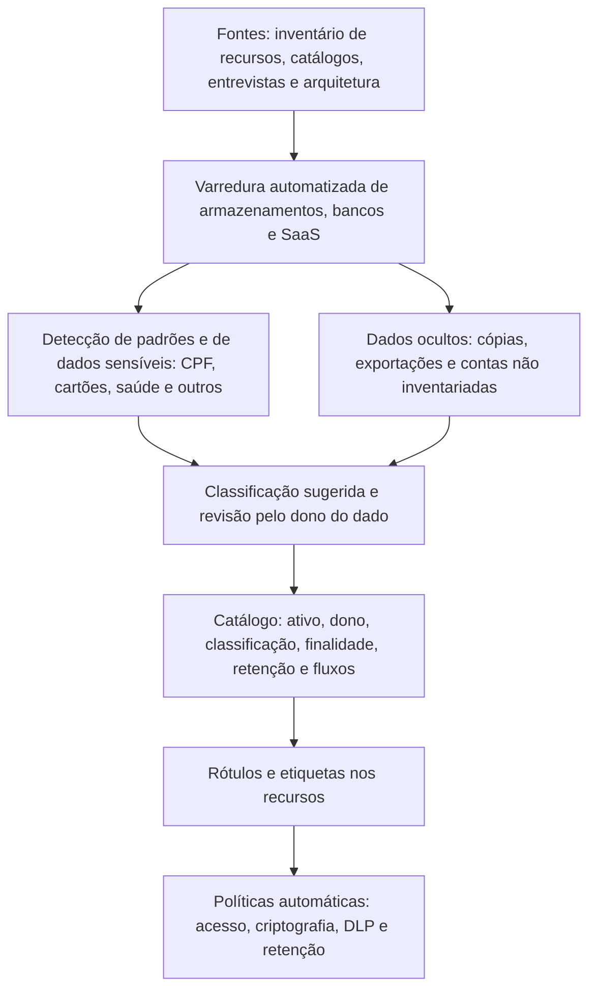

# Descoberta, Inventário e Classificação de Dados

> **Objetivo pedagógico:** descobrir onde estão os dados (inclusive os ocultos), construir o inventário e o catálogo de dados, definir um esquema de classificação com critérios objetivos (incluindo as categorias de dados pessoais da LGPD), aplicar rótulos e etiquetas que sustentem políticas automáticas, usar serviços de descoberta e de classificação dos provedores, mapear os tratamentos (registro das operações) e validar padrões de dados brasileiros, como o CPF, com um exemplo em Python.

## 1. Por que começar pela descoberta

Os controles de proteção dependem de saber **quais dados existem, onde estão, qual a sensibilidade, quem é o dono e como fluem**. Em nuvem, os dados se espalham rapidamente: cópias para testes, exportações, instantâneos e SaaS. Sem inventário, as políticas são aplicadas "às cegas".

| Pergunta | Resposta que o inventário deve dar |
|---|---|
| Que dados temos? | Tipos, volumes, sistemas e formatos |
| Onde estão? | Contas, regiões, serviços, SaaS e ambientes |
| Qual a sensibilidade? | Classificação e categorias legais (dados pessoais, sensíveis e de crianças) |
| Quem é o dono? | Proprietário do dado e custodiante técnico |
| Para que são usados? | Finalidades e bases legais |
| Para onde fluem? | Fluxos internos, parceiros e transferências internacionais |
| Por quanto tempo são retidos? | Prazos e regras de eliminação |
| Quem acessa? | Perfis, aplicações e terceiros |

## 2. Descoberta de dados



### 2.1 Fontes e técnicas

| Técnica | Descrição | Uso |
|---|---|---|
| Inventário de recursos da nuvem | Listagem de buckets, bancos, volumes, filas e instantâneos por conta e por região | Base para saber onde os dados podem estar |
| Varredura de conteúdo | Análise de amostras ou do conteúdo com padrões, dicionários e aprendizado de máquina | Descoberta de dados pessoais e sensíveis |
| Análise de esquemas e de metadados | Nomes de colunas e de tabelas (cpf, nascimento, saude) | Triagem rápida em bancos |
| Rastreio de fluxos e de linhagem | Origem, transformações e destinos | Entender cópias e derivações |
| Entrevistas e oficinas | Donos de processos e de produtos | Contexto e finalidades |
| Análise de registros de acesso | Quem acessa o quê | Identificar usos não documentados |
| Pesquisa de dados ocultos | Contas esquecidas, ambientes de teste e exportações | Reduzir a superfície |

### 2.2 Serviços de descoberta e de classificação (categorias)

| Provedor | Serviços (exemplos) |
|---|---|
| AWS | Amazon Macie (descoberta e classificação de dados sensíveis em armazenamento de objetos) |
| Microsoft | Microsoft Purview (catálogo de dados, rótulos de sensibilidade e classificação em fontes e em SaaS) |
| Google Cloud | Sensitive Data Protection (descoberta, classificação e desidentificação) |
| Terceiros | Soluções de segurança de dados (DSPM) que descobrem e classificam dados em várias nuvens |

Os nomes, os recursos e o licenciamento mudam: confirme na documentação vigente. Defina **escopo, amostragem e custos** antes de varrer grandes volumes.

## 3. Esquema de classificação

### 3.1 Níveis de classificação (exemplo)

| Nível | Definição | Exemplos | Impacto de exposição |
|---|---|---|---|
| Público | Pode ser divulgado sem restrição | Materiais de marketing, relatórios publicados | Nenhum ou baixo |
| Interno | Uso interno; exposição causa impacto limitado | Procedimentos, organogramas | Baixo a moderado |
| Confidencial | Informação de negócio ou dados pessoais comuns | Cadastros de clientes, contratos, planos | Moderado a alto |
| Restrito | Informação cuja exposição causa dano grave | Dados pessoais sensíveis, dados financeiros, segredos de negócio, credenciais, dados de crianças e de adolescentes | Alto a crítico |

### 3.2 Categorias legais da LGPD (sobrepostas à classificação)

| Categoria | Fundamento | Observações |
|---|---|---|
| Dado pessoal | Art. 5º, I | Informação relacionada a pessoa natural identificada ou identificável |
| Dado pessoal sensível | Art. 5º, II e art. 11 | Origem racial ou étnica, convicção religiosa, opinião política, filiação sindical, dado referente à saúde ou à vida sexual, dado genético ou biométrico, quando vinculado a uma pessoa natural; exige base legal específica |
| Dado de crianças e de adolescentes | Art. 14 | Tratamento no melhor interesse; exige consentimento específico dos responsáveis, em regra |
| Dado anonimizado | Art. 5º, III e art. 12 | Não é dado pessoal, salvo se o processo puder ser revertido com esforços razoáveis |
| Dado pseudonimizado | Art. 13, § 4º | Continua a ser dado pessoal: mantém-se a informação adicional separada e protegida |

Regra prática: **classificação mínima por conteúdo**. Dados sensíveis e de crianças são, no mínimo, "Restrito"; dados pessoais comuns são, no mínimo, "Confidencial".

### 3.3 Critérios para atribuir a classificação

| Critério | Pergunta |
|---|---|
| Conteúdo | Contém dados pessoais, sensíveis, financeiros, segredos ou credenciais? |
| Volume | Quantos titulares ou registros? |
| Impacto | Qual o dano em caso de exposição (financeiro, legal, reputacional e aos titulares)? |
| Obrigações | Há requisitos legais, regulatórios ou contratuais? |
| Agregação | A combinação de dados torna o conjunto mais sensível? |
| Contexto | Quem pode ter acesso e em que circunstâncias? |

A classificação é do **dono do dado**, apoiada por ferramentas automáticas e revisada periodicamente.

## 4. Rotulagem e etiquetas

| Mecanismo | Descrição | Exemplo |
|---|---|---|
| Etiquetas (tags) de recursos | Pares chave-valor em buckets, bancos, volumes e contas | `classificacao=restrito`, `dono=area-financeira`, `contem-dados-pessoais=sim` |
| Rótulos de sensibilidade em documentos e em e-mails | Marcação visível e persistente, com proteção associada (criptografia e restrições de uso) | "Confidencial: uso interno" |
| Metadados em catálogos | Classificação, finalidade e retenção por ativo | Entrada do catálogo de dados |
| Herança | Rótulos aplicados a contas, projetos ou unidades, herdados pelos recursos | Conta dedicada a dados restritos |

As etiquetas permitem **políticas automáticas**: por exemplo, exigir criptografia com chave gerenciada pelo cliente para recursos "restrito", bloquear acesso público, definir retenção e orientar o DLP. Proteja quem pode **alterar** as etiquetas de classificação, para que não sejam usadas para burlar controles (pasta 06, arquivo 3).

## 5. Mapeamento de tratamentos e registro das operações

A LGPD exige que controladores e operadores mantenham **registro das operações de tratamento** (art. 37). Em nuvem, o inventário técnico alimenta esse registro.

| Campo do registro | Origem em nuvem |
|---|---|
| Atividade de tratamento e finalidade | Dono do processo; catálogo |
| Categorias de dados e de titulares | Classificação automática e revisão |
| Base legal | Área jurídica e privacidade |
| Sistemas, contas e regiões | Inventário de recursos |
| Compartilhamentos e operadores | Contratos e integrações |
| Transferências internacionais | Regiões e fornecedores (arquivo 6) |
| Retenção e eliminação | Políticas de ciclo de vida (arquivo 5) |
| Medidas de segurança | Controles aplicados (esta pasta) |

O **relatório de impacto à proteção de dados pessoais (RIPD)** (arts. 5º, XVII e 38) deve ser considerado em tratamentos de maior risco, como os de dados sensíveis em larga escala, e pode ser solicitado pela ANPD.

## 6. Validação de padrões: exemplo com CPF

A descoberta por padrões gera falsos positivos (sequências de 11 dígitos que não são CPFs). A **validação dos dígitos verificadores** reduz o ruído. O exemplo abaixo percorre um arquivo de texto e relata os CPFs válidos, **mascarando a saída** para não reproduzir dados pessoais no relatório.

```python
# Descoberta de CPFs em um arquivo de texto, com validação dos dígitos verificadores
# Uso: python descobrir_cpf.py arquivo.txt
# Atenção: execute apenas em dados que você tem autorização para analisar e proteja o relatório gerado
import re
import sys

PADRAO_CPF = re.compile(r"\b\d{3}\.?\d{3}\.?\d{3}-?\d{2}\b")

def cpf_valido(texto: str) -> bool:
    numeros = [int(c) for c in re.sub(r"\D", "", texto)]
    if len(numeros) != 11 or len(set(numeros)) == 1:
        return False
    for posicao in (9, 10):
        soma = sum(numeros[i] * (posicao + 1 - i) for i in range(posicao))
        digito = (soma * 10 % 11) % 10
        if digito != numeros[posicao]:
            return False
    return True

def mascarar(texto: str) -> str:
    d = re.sub(r"\D", "", texto)
    return f"***.***.{d[6:9]}-{d[9:]}"

def varrer(caminho: str) -> None:
    with open(caminho, encoding="utf-8", errors="ignore") as f:
        for numero_linha, linha in enumerate(f, start=1):
            for achado in PADRAO_CPF.findall(linha):
                if cpf_valido(achado):
                    print(f"linha {numero_linha}: CPF valido {mascarar(achado)}")

if __name__ == "__main__":
    varrer(sys.argv[1])
```

Para testar, use o número sintético **529.982.247-25**, válido apenas pelo algoritmo e amplamente usado em testes. Os serviços de classificação dos provedores oferecem detectores equivalentes para CPF, CNPJ, cartões (com validação de Luhn) e outros identificadores; prefira-os em escala.

## 7. Consultas de somente leitura

```bash
# AWS: estado do Amazon Macie e trabalhos de classificação existentes
aws macie2 get-macie-session
aws macie2 list-classification-jobs --query "items[].[jobId,name,jobStatus]" --output table

# AWS: contagem de buckets e etiquetas de classificação de um bucket (retorna erro se não houver etiquetas)
aws s3api list-buckets --query "length(Buckets)"
aws s3api get-bucket-tagging --bucket bucket-exemplo --query "TagSet"
```

## 8. Exemplo prático: programa de descoberta e de classificação

| Etapa | Ação | Resultado |
|---|---|---|
| Escopo | 42 contas de nuvem e 3 SaaS principais | Plano por onda, iniciando pelas contas de produção |
| Inventário | Listagem de 1.380 buckets, 210 bancos e 3.900 volumes e instantâneos | Base para a varredura |
| Descoberta | Varredura por serviço nativo com amostragem; validação de CPF e de cartões | 61 buckets com dados pessoais; 9 com dados sensíveis |
| Dados ocultos | 27 cópias da base de clientes em contas de teste e exportações antigas | Classificadas como "Restrito"; 19 eliminadas, 8 mascaradas |
| Classificação e etiquetas | Donos revisaram as sugestões; etiquetas obrigatórias por política | 94% dos recursos de produção etiquetados em 60 dias |
| Políticas automáticas | "Restrito" exige chave gerenciada pelo cliente, acesso privado e registros de acesso a dados | Desvios detectados e corrigidos |
| Registro de operações | Atualizado a partir do catálogo e das entrevistas | Base para a RIPD e para auditorias |

## 9. Casos de uso corporativos

- Programa de descoberta e de classificação de dados, com donos e etiquetas obrigatórias.
- Redução de dados ocultos em ambientes de teste e em contas esquecidas.
- Base para o registro das operações de tratamento e para a RIPD.

## 10. Normas e frameworks relevantes

- ISO/IEC 27002:2022 (5.9 inventário, 5.12 classificação, 5.13 rotulagem); ISO/IEC 27701:2019; NIST SP 800-53 Rev. 5 (RA-2, categorização; PM-5, inventário; PT)
- CSA CCM v4 (DSP-01 a DSP-04, classificação, inventário e fluxos); NIST Privacy Framework (identificar)
- LGPD, arts. 5º, 11, 14, 37 e 38; Resolução CD/ANPD sobre agentes de tratamento e outras diretrizes aplicáveis

## 11. Checklist operacional: descoberta e classificação

- [ ] Esquema de classificação aprovado, com critérios e regras de piso para dados pessoais e sensíveis
- [ ] Inventário de recursos e de dados por conta, região e serviço
- [ ] Varredura automatizada de dados sensíveis em armazenamento, bancos e SaaS, com escopo e custos definidos
- [ ] Dados ocultos (cópias, exportações e contas esquecidas) tratados
- [ ] Donos de dados atribuídos; classificação revisada por eles
- [ ] Etiquetas e rótulos obrigatórios; proteção de quem pode alterá-los
- [ ] Políticas automáticas associadas às etiquetas (acesso, criptografia, DLP e retenção)
- [ ] Registro das operações de tratamento atualizado; RIPD para tratamentos de maior risco
- [ ] Revisão periódica da classificação e do inventário

## 12. Referências

- Brasil. Lei nº 13.709/2018, arts. 5º, 11, 14, 37 e 38.
- ISO/IEC 27002:2022, controles 5.9, 5.12 e 5.13.
- Cloud Security Alliance. CCM v4, domínio DSP. 2021.
- Amazon Web Services. Amazon Macie; Microsoft. Microsoft Purview; Google Cloud. Sensitive Data Protection (documentação vigente).
- ANPD. Guias orientativos sobre agentes de tratamento e sobre segurança da informação para agentes de pequeno porte (documentação vigente).
