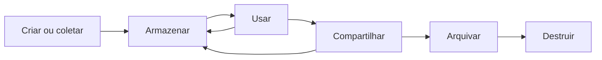

# Fundamentos de Proteção de Dados em Nuvem

> **Objetivo pedagógico:** compreender o ciclo de vida dos dados em nuvem (criação, armazenamento, uso, compartilhamento, arquivamento e destruição) e seus estados (em repouso, em trânsito e em uso), a responsabilidade do cliente sobre os dados em todos os modelos de serviço, os fatores de risco específicos de nuvem (configuração, cópias, dados ocultos, SaaS e múltiplas regiões), a relação entre segurança da informação e privacidade, e os referenciais e princípios da LGPD que orientam a proteção.

## 1. Dados em nuvem: o que muda

| Aspecto | Em ambientes locais | Em nuvem |
|---|---|---|
| Localização | Datacenters conhecidos da organização | Regiões e zonas do provedor, às vezes com replicação automática |
| Criação de armazenamento | Processo com aprovações e compras | Autoatendimento por API, em segundos |
| Cópias | Poucas e controladas | Muitas (réplicas, versões, instantâneos, caches e ambientes de teste) |
| Acesso | Rede interna como fronteira | Identidade e políticas; muitos pontos de acesso (APIs, links e serviços) |
| Exposição acidental | Exige abertura de rede | Uma política mal configurada pode expor dados à internet |
| Compartilhamento | Mais difícil e visível | Facilmente criado (links, acessos entre contas e SaaS) |
| Eliminação | Controle sobre mídias | Depende de replicação, de backups e da infraestrutura do provedor |
| Visibilidade | Inventário dos sistemas | Dados espalhados por muitos serviços e contas |

## 2. Responsabilidade sobre os dados

Em **todos** os modelos de serviço (IaaS, PaaS e SaaS), o **cliente é responsável por seus dados**: classificação, controle de acesso, configuração de proteção, retenção e conformidade legal. O provedor protege a infraestrutura e oferece os mecanismos; **não decide quem pode acessar os dados do cliente nem por quanto tempo devem ser retidos** (pasta 02).

| Responsabilidade | Provedor | Cliente |
|---|---|---|
| Proteção física e da infraestrutura de armazenamento | Sim | Não |
| Disponibilidade e durabilidade da plataforma de armazenamento | Sim, conforme os acordos de nível de serviço | Projeta a resiliência do próprio uso |
| Classificação e inventário dos dados | Não | Sim |
| Controle de acesso (identidades, papéis e políticas) | Oferece os mecanismos | Define e mantém |
| Configuração de proteção (acesso público, criptografia e versionamento) | Oferece as opções | Configura e verifica |
| Retenção, eliminação e legal hold | Oferece os recursos | Define as regras e as aplica |
| Conformidade com a LGPD e normas setoriais (como controlador ou operador) | Como operador, conforme o contrato | Como controlador, responsável final |
| Backup e recuperação dos dados do cliente | Em geral, recursos opcionais | Planeja, configura e testa |

## 3. Ciclo de vida dos dados

| Fase | Riscos principais | Controles principais |
|---|---|---|
| Criar ou coletar | Coleta excessiva; falta de classificação; coleta sem base legal | Minimização; classificação na origem; base legal e finalidade (LGPD) |
| Armazenar | Exposição pública; ausência de criptografia; permissões excessivas; cópias não controladas | Acesso privado; criptografia; controle de acesso mínimo; inventário |
| Usar | Acesso indevido; uso fora da finalidade; vazamento em análises e em logs | Acesso por atributos; mascaramento; registros de acesso |
| Compartilhar | Exposição a terceiros; links abertos; transferência internacional | Acordos; controles de saída; perímetro de dados; avaliação de transferências |
| Arquivar | Retenção além do necessário; dados esquecidos | Políticas de retenção; ciclo de vida; acesso restrito |
| Destruir | Eliminação incompleta (réplicas, backups e caches) | Procedimentos de eliminação; destruição criptográfica; verificação |

## 4. Estados dos dados

| Estado | Descrição | Proteções principais |
|---|---|---|
| Em repouso | Armazenado em discos, objetos, bancos e backups | Controle de acesso; criptografia; isolamento; backups protegidos |
| Em trânsito | Movendo-se entre sistemas, redes e usuários | TLS e IPsec; autenticação mútua; redes privadas |
| Em uso | Processado em memória e em aplicações | Controle de acesso; isolamento; computação confidencial, quando justificado; mascaramento |

A criptografia em repouso e em trânsito é detalhada na pasta 10.

## 5. Fatores de risco específicos de nuvem

| Fator | Descrição | Exemplo |
|---|---|---|
| Configuração incorreta | Acesso público, permissões amplas e proteções desligadas | Armazenamento de objetos com leitura pública |
| Dados ocultos (*shadow data*) | Cópias não inventariadas em contas esquecidas, ambientes de teste e exportações | Base de produção copiada para desenvolvimento |
| Proliferação de cópias | Réplicas, instantâneos, versões e caches | Instantâneo de disco compartilhado com conta externa |
| SaaS e integrações | Dados em muitas aplicações, com aplicativos de terceiros | Aplicativo OAuth com acesso a arquivos corporativos |
| Múltiplas regiões e jurisdições | Replicação e suporte fora do país | Dados pessoais replicados para outra região |
| Dependência de terceiros | Subprocessadores e provedores | Falha ou acesso indevido em um fornecedor |
| Credenciais comprometidas | Acesso legítimo por atacantes | Exfiltração por contas válidas |
| Dados em registros e em telemetria | Informações pessoais em logs e em eventos | CPF em registros de aplicação |
| Complexidade de eliminação | Dados replicados e em backups | Solicitação de eliminação não propagada |

## 6. Segurança da informação e privacidade

| Conceito | Foco | Instrumentos |
|---|---|---|
| Segurança da informação | Confidencialidade, integridade e disponibilidade de todas as informações | Controles técnicos e organizacionais (ISO/IEC 27001 e 27002) |
| Proteção de dados pessoais (privacidade) | Direitos dos titulares e tratamento lícito de dados pessoais | LGPD; ISO/IEC 27701; ISO/IEC 27018 |
| Relação | A segurança é condição necessária (LGPD, arts. 46 a 49), mas a privacidade exige também finalidade, minimização, transparência e direitos dos titulares | Programa integrado de governança |

### Princípios da LGPD (art. 6º) e sua tradução técnica

| Princípio | Significado | Tradução em nuvem |
|---|---|---|
| Finalidade | Tratamento para propósitos legítimos e informados | Registro de finalidades; acesso por finalidade |
| Adequação | Compatibilidade com as finalidades | Revisão de usos secundários e de análises |
| Necessidade | Limitação ao mínimo necessário | Minimização na coleta, nas cópias e nos registros |
| Livre acesso | Consulta facilitada pelo titular | Capacidade de localizar e exportar dados do titular |
| Qualidade dos dados | Exatidão e atualização | Processos de correção e de sincronização |
| Transparência | Informações claras sobre o tratamento | Avisos de privacidade e mapeamento atualizado |
| Segurança | Medidas técnicas e administrativas | Controles de acesso, criptografia, monitoramento |
| Prevenção | Medidas para evitar danos | Gestão de riscos, DLP e testes |
| Não discriminação | Sem fins discriminatórios ilícitos | Governança de usos e de análises |
| Responsabilização e prestação de contas | Demonstrar a adoção de medidas eficazes | Evidências, registros e auditorias |

## 7. Referenciais

| Referencial | Contribuição |
|---|---|
| CSA Security Guidance v4.0, domínio de segurança de dados e de criptografia | Ciclo de vida, controles e arquiteturas de proteção de dados em nuvem |
| CSA CCM v4 (DSP, CEK e LOG) | Controles de segurança e privacidade de dados |
| ISO/IEC 27018:2019 | Proteção de dados pessoais em nuvens públicas atuando como operador |
| ISO/IEC 27017:2015 | Controles de segurança específicos de nuvem |
| ISO/IEC 27701:2019 | Extensão de privacidade ao sistema de gestão de segurança da informação |
| ISO/IEC 27002:2022 | Controles 5.12 a 5.14 (classificação, rotulagem e transferência de informações), 8.10 (eliminação), 8.11 (mascaramento), 8.12 (prevenção de vazamento) e 8.13 (backup) |
| NIST SP 800-53 Rev. 5 | Famílias MP (proteção de mídia), SC (proteção de sistemas e comunicações) e PT (tratamento de informações pessoais) |
| NIST Privacy Framework 1.0 | Gestão de riscos de privacidade |
| LGPD (Lei 13.709/2018) | Arts. 6º, 11, 33 a 36, 37, 38, 46 a 49 |
| CIS Foundations Benchmarks | Linhas de base de armazenamento e de bancos de dados |

## 8. Exemplo prático: mapa de proteção do ciclo de vida de dados de clientes

| Fase | Medidas |
|---|---|
| Coleta | Formulário que coleta apenas os campos necessários; base legal registrada; classificação automática na ingestão |
| Armazenamento | Banco gerenciado com acesso por ponto privado; criptografia com chave gerenciada pela organização; sem acesso público |
| Uso | Acesso por função e por finalidade; mascaramento de campos sensíveis para analistas; registros de acesso |
| Compartilhamento | Compartilhamento com parceiros por APIs com escopo mínimo; contratos de operador; perímetro de dados contra cópias externas |
| Arquivamento | Dados inativos por mais de 24 meses migrados para camada de arquivo com acesso restrito |
| Destruição | Eliminação ao fim da retenção por regras de ciclo de vida, com destruição criptográfica e evidências |

## 9. Casos de uso corporativos

- Definição da política de proteção de dados em nuvem, com base no ciclo de vida.
- Avaliação de risco de dados de novos serviços e de fornecedores.
- Integração entre as equipes de segurança, de privacidade e de produto.

## 10. Normas e frameworks relevantes

- ISO/IEC 27001:2022, 27002:2022, 27017:2015, 27018:2019 e 27701:2019
- NIST SP 800-53 Rev. 5; NIST Privacy Framework 1.0; CSA CCM v4 e Security Guidance v4.0
- LGPD, arts. 6º, 46 a 49; Resolução CD/ANPD nº 15/2024 (comunicação de incidentes); normas setoriais aplicáveis (por exemplo, Resolução CMN 4.893/2021)

## 11. Checklist operacional: base de proteção de dados

- [ ] Política de proteção de dados em nuvem aprovada, com o ciclo de vida como estrutura
- [ ] Responsabilidades sobre dados definidas por serviço (matriz de responsabilidades)
- [ ] Princípios da LGPD traduzidos em requisitos técnicos e em processos
- [ ] Inventário e classificação dos dados como pré-requisito (arquivo 2)
- [ ] Controles por classificação definidos para armazenamento, uso, compartilhamento e eliminação
- [ ] Riscos específicos de nuvem (configuração, cópias, dados ocultos e SaaS) tratados no registro de riscos
- [ ] Equipes de segurança, de privacidade e de produto com papéis claros
- [ ] Revisão anual da política e dos controles

## 12. Referências

- Cloud Security Alliance. Security Guidance for Critical Areas of Focus in Cloud Computing v4.0. 2017.
- ISO/IEC 27018:2019. Code of practice for protection of PII in public clouds acting as PII processors.
- NIST. Privacy Framework Version 1.0. 2020.
- Brasil. Lei nº 13.709, de 14 de agosto de 2018 (LGPD).
- Cloud Security Alliance. Cloud Controls Matrix v4. 2021.
