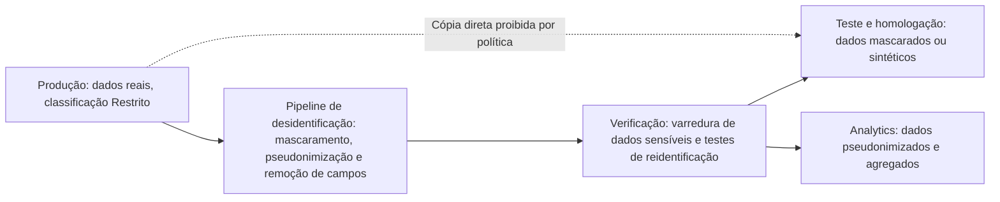

# Prevenção de Perda de Dados, Mascaramento e Privacidade por Desenho

> **Objetivo pedagógico:** prevenir vazamentos de dados com DLP e controles de compartilhamento, aplicar técnicas de desidentificação (mascaramento, tokenização, pseudonimização e anonimização) com distinção legal e técnica, usar dados sintéticos e mascarados fora da produção, evitar dados pessoais em registros e em telemetria, projetar o atendimento aos direitos dos titulares em nuvem, e aplicar a privacidade por desenho e por padrão, com exemplos em Python.

## 1. Prevenção de perda de dados (DLP)

O DLP identifica e controla o movimento de dados sensíveis para evitar vazamentos acidentais e intencionais.

| Camada | Capacidade | Exemplos |
|---|---|---|
| Armazenamento | Varredura e classificação contínua; alerta para dados sensíveis em locais indevidos | Dados pessoais em bucket de teste |
| Rede e saída | Inspeção e bloqueio de envios de dados sensíveis para destinos não autorizados | Bloqueio de upload de arquivos "Restrito" para serviços externos |
| Colaboração e e-mail | Políticas por rótulo de sensibilidade; bloqueio ou aviso ao compartilhar externamente | Impedir envio de arquivos "Restrito" a domínios externos |
| Endpoints | Controle de cópia para mídias, de impressão e de capturas | Bloqueio de cópia para USB |
| SaaS | Controles de compartilhamento, de links públicos e de aplicativos de terceiros | Detecção de planilhas com links abertos |
| APIs e saídas de aplicações | Filtragem de respostas que expõem dados em excesso | Remoção de campos sensíveis das respostas |
| Perímetro de dados | Impedir cópia para contas e redes fora da organização (pasta 08, arquivo 6) | Política de ponto de extremidade |

### Boas práticas de DLP

| Prática | Descrição |
|---|---|
| Começar em modo de monitoramento | Medir o volume e os falsos positivos antes de bloquear |
| Políticas por classificação | Regras mais rígidas para "Restrito" |
| Educar o usuário | Mensagens claras de política e de orientação |
| Fluxo de exceções | Processo com aprovação e registro |
| Integração com resposta | Alertas ao SOC e à privacidade; triagem e investigação |
| Revisão periódica | Ajuste de detectores e de políticas |
| Proporcionalidade e transparência | Comunicar o monitoramento aos colaboradores, com finalidade legítima (LGPD) |

## 2. Técnicas de desidentificação

| Técnica | Descrição | Reversível? | Status na LGPD | Uso típico |
|---|---|---|---|---|
| Mascaramento estático | Substituição ou ocultação permanente de partes do dado (por exemplo, `***.***.247-25`) | Não, se bem aplicado | Depende do resultado: pode manter o dado como pessoal | Ambientes de teste e relatórios |
| Mascaramento dinâmico | Ocultação na consulta, conforme o perfil do usuário | Os dados originais permanecem no repositório | Dado pessoal | Acesso diferenciado a produção |
| Tokenização | Substituição do valor por um token, com o valor original em um cofre separado | Sim, por quem acessa o cofre | Dado pessoal (o cofre contém o original) | Dados de cartão e identificadores |
| Pseudonimização | Substituição de identificadores diretos por pseudônimos, com a informação adicional mantida separada e protegida | Sim, com a informação adicional | Continua sendo dado pessoal (art. 13, § 4º) | Análises e pesquisas |
| Generalização e supressão | Redução de precisão (faixa etária em vez da data de nascimento) e remoção de campos | Parcial ou não | Pode contribuir para a anonimização | Estatísticas |
| Agregação | Uso de totais e de médias | Não | Em regra, dados anonimizados se não houver reidentificação razoável | Relatórios |
| Ruído e privacidade diferencial | Adição controlada de ruído a resultados ou a dados | Não | Pode sustentar a anonimização, com análise técnica | Publicação de estatísticas |
| Dados sintéticos | Dados artificiais que preservam propriedades estatísticas | Não se baseiam em titulares reais, se bem gerados | Podem não ser dados pessoais, desde que não permitam reidentificação | Testes e desenvolvimento |

### 2.1 Anonimização, pseudonimização e o risco de reidentificação

| Conceito | Orientação |
|---|---|
| Dado anonimizado (LGPD, art. 5º, III e art. 12) | Não é dado pessoal se o processo de anonimização não puder ser revertido por meios técnicos razoáveis e disponíveis. A avaliação considera custo, tempo e tecnologias |
| Pseudonimização | Mantém o dado como pessoal; é uma medida de segurança útil, mas não elimina as obrigações |
| Reidentificação por combinação | A combinação de atributos aparentemente inofensivos (CEP, data de nascimento e sexo) pode identificar pessoas: avalie técnicas como k-anonimato e verificação de unicidade |
| Identificadores de baixa entropia | CPF, telefone e datas têm poucas combinações possíveis: um *hash* simples, sem segredo, pode ser revertido por força bruta (veja o exemplo) |
| Decisão documentada | Registre o método, a avaliação de reidentificação e as salvaguardas (RIPD, quando aplicável) |

### 2.2 Exemplo em Python: pseudonimização com chave (HMAC) e mascaramento

```python
# Pseudonimização de identificadores com HMAC-SHA256 e mascaramento parcial
# A chave NÃO deve ficar no código: obtenha-a de um cofre de segredos ou de um serviço de gestão de chaves
import hashlib
import hmac
import os

def pseudonimizar(valor: str, chave: bytes) -> str:
    """Gera um pseudônimo estável e não reversível sem a chave (permite junções entre bases)."""
    normalizado = "".join(ch for ch in valor if ch.isdigit())
    return hmac.new(chave, normalizado.encode("utf-8"), hashlib.sha256).hexdigest()

def mascarar_cpf(cpf: str) -> str:
    d = "".join(ch for ch in cpf if ch.isdigit())
    return f"***.***.{d[6:9]}-{d[9:]}"

if __name__ == "__main__":
    # Para teste local, a chave vem de uma variável de ambiente (em produção, de um cofre)
    chave = os.environ["CHAVE_PSEUDONIMIZACAO"].encode("utf-8")
    cpf_teste = "529.982.247-25"          # número sintético, válido apenas pelo algoritmo
    print("Pseudonimo:", pseudonimizar(cpf_teste, chave))
    print("Mascarado: ", mascarar_cpf(cpf_teste))
```

**Por que HMAC e não apenas SHA-256?** O CPF tem cerca de 10⁹ combinações: um atacante que conheça o algoritmo gera todos os *hashes* e reverte a tabela. Com um **segredo** (a chave do HMAC), apenas quem a possui consegue recalcular os pseudônimos. Proteja e rotacione a chave, e trate-a como a "informação adicional" da pseudonimização: se for exposta, o conjunto volta a ser reidentificável.

## 3. Dados fora da produção

| Prática | Descrição |
|---|---|
| Proibir dados reais em desenvolvimento e em testes por padrão | Política e controle técnico (classificação e bloqueio) |
| Dados sintéticos | Preferidos para testes funcionais |
| Cópias mascaradas | Quando precisar de realismo: mascaramento irreversível e consistente (preserva integridade referencial) |
| Subconjuntos mínimos | Menor volume possível |
| Acesso restrito e prazo | Ambientes de teste com acesso controlado e eliminação |
| Verificação | Varredura de dados sensíveis em ambientes de teste |
| Exceções | Aprovação formal, com controles equivalentes aos de produção e prazo |



## 4. Dados pessoais em registros e em telemetria

| Risco | Controle |
|---|---|
| CPF, e-mails e tokens em registros de aplicação | Biblioteca de registro com filtros e mascaramento; revisão de código; varredura de registros |
| Corpos de requisições e de respostas registrados por completo | Registrar apenas campos necessários; excluir dados sensíveis |
| Rastreamento e telemetria com identificadores diretos | Identificadores pseudonimizados; consentimento e finalidade |
| Registros retidos por tempo excessivo | Retenção por finalidade e por obrigação legal (arquivo 5) |
| Acesso amplo aos registros | Acesso restrito, com auditoria |
| Mensagens de erro com dados | Mensagens genéricas ao usuário e detalhes protegidos nos registros internos |

## 5. Direitos dos titulares em ambientes de nuvem

A LGPD (art. 18) garante direitos como confirmação e acesso, correção, anonimização, bloqueio ou eliminação de dados desnecessários ou tratados em desconformidade, portabilidade, informação sobre compartilhamento, e revogação do consentimento.

| Direito | Desafio em nuvem | Solução de arquitetura |
|---|---|---|
| Acesso e confirmação | Dados em muitos sistemas e contas | Catálogo e identificadores comuns (com pseudonimização); fluxo de busca por titular |
| Correção | Propagação entre sistemas e cópias | Fonte autoritativa e eventos de atualização |
| Eliminação | Dados em réplicas, backups, registros e ambientes de analytics | Mapeamento de fluxos; eliminação propagada; expiração de backups; destruição criptográfica (arquivo 5) |
| Portabilidade | Exportação em formato estruturado | APIs ou rotinas de exportação seguras, com verificação de identidade do titular |
| Informação sobre compartilhamento | Terceiros e operadores | Registro das operações e dos compartilhamentos |
| Oposição e revogação | Interromper usos e comunicar a terceiros | Controle de consentimento e de finalidades; integração com os sistemas |

Defina **prazos de atendimento** conforme a regulamentação e os procedimentos da organização, **verificação segura da identidade** do solicitante (para não expor dados a terceiros) e **registro** de cada atendimento.

## 6. Privacidade por desenho e por padrão

| Princípio | Aplicação em projetos de nuvem |
|---|---|
| Proativo e preventivo | Avaliar riscos de privacidade no desenho (RIPD quando cabível) |
| Privacidade como padrão | Configurações mais protetoras por padrão: coleta mínima, acesso restrito, retenção curta |
| Incorporada ao desenho | Mascaramento, pseudonimização e controles de acesso na arquitetura |
| Funcionalidade total | Equilibrar utilidade e proteção, sem falsas dicotomias |
| Segurança de ponta a ponta | Proteção em todo o ciclo de vida |
| Visibilidade e transparência | Registro das operações e avisos claros |
| Respeito ao titular | Direitos facilitados e fluxo claro |

## 7. Exemplo prático: pipeline de dados para analytics com privacidade por desenho

| Etapa | Decisão |
|---|---|
| Ingestão | Coleta apenas dos campos necessários; classificação automática; dados sensíveis separados |
| Zona bruta | Acesso restrito a um grupo reduzido; chave exclusiva; retenção de 30 dias |
| Desidentificação | Remoção de nome e de endereço; CPF substituído por pseudônimo (HMAC com chave em cofre); datas de nascimento generalizadas em faixas etárias |
| Verificação | Teste de unicidade (nenhuma combinação de atributos identifica menos de 5 pessoas) |
| Zona de consumo | Analistas acessam apenas dados pseudonimizados e agregados; mascaramento dinâmico para campos residuais; registros de consulta |
| Exportações | Somente agregados; revisão pelo DPO; DLP nas saídas |
| Direitos dos titulares | Fluxo de exclusão propaga o pseudônimo para a zona de consumo; backups expiram em 35 dias |
| Registro e avaliação | RIPD atualizada; método de desidentificação documentado |

## 8. Casos de uso corporativos

- Programa de DLP integrado à classificação, com políticas por rótulo.
- Ambientes de teste com dados sintéticos ou mascarados, e verificação de dados reais.
- Fluxo de atendimento a direitos dos titulares com busca e eliminação em nuvem.

## 9. Normas e frameworks relevantes

- ISO/IEC 27002:2022 (8.11 mascaramento de dados e 8.12 prevenção de vazamento); ISO/IEC 20889:2018 (técnicas de desidentificação); ISO/IEC 27701:2019; NIST SP 800-53 Rev. 5 (PT e SC-28); NIST IR 8053 (desidentificação de dados pessoais)
- CSA CCM v4 (DSP); NIST Privacy Framework (controlar e comunicar); OWASP Logging Cheat Sheet
- LGPD, arts. 5º (III e XI), 6º, 12, 13, 18, 38 e 46; MITRE ATT&CK: T1048 e T1567 (exfiltração)

## 10. Checklist operacional: DLP, mascaramento e privacidade

- [ ] Política de DLP por classificação, implantada em monitoramento antes do bloqueio
- [ ] Controle de compartilhamento externo e de links públicos em colaboração e em SaaS
- [ ] Técnicas de desidentificação definidas por finalidade, com distinção entre pseudonimização e anonimização
- [ ] Pseudônimos gerados com chave protegida (HMAC), e não com *hash* simples
- [ ] Sem dados reais em ambientes de teste; dados sintéticos ou mascarados; varredura de verificação
- [ ] Registros e telemetria sem dados pessoais desnecessários; filtros de mascaramento
- [ ] Fluxo de atendimento a direitos dos titulares, com verificação de identidade e registro
- [ ] Privacidade por desenho e por padrão nos projetos; RIPD quando cabível
- [ ] Revisão periódica de detectores, de políticas e de métodos de desidentificação

## 11. Referências

- ISO/IEC 20889:2018. Privacy enhancing data de-identification terminology and classification of techniques.
- Garfinkel, S. NIST IR 8053: De-Identification of Personal Information. 2015.
- Cavoukian, A. Privacy by Design: The 7 Foundational Principles. 2009.
- Brasil. Lei nº 13.709/2018, arts. 5º, 12, 13, 18 e 38.
- OWASP. Logging Cheat Sheet (documentação).
- Pastas 06, 08 e 10 deste repositório.
