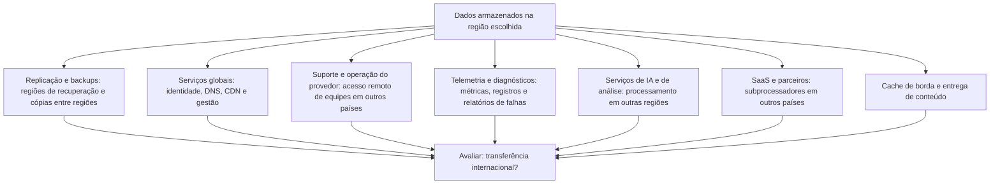
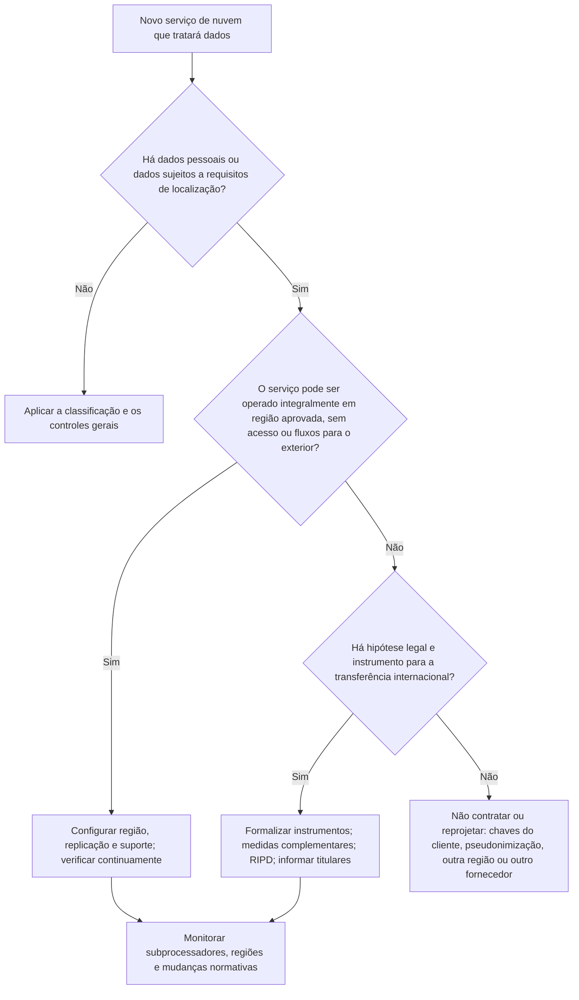

# Residência, Soberania e Transferência Internacional de Dados

> **Objetivo pedagógico:** distinguir residência, localização e soberania de dados; controlar as regiões onde os dados são armazenados e processados com políticas técnicas; identificar os fluxos que podem sair da região escolhida (suporte, telemetria, serviços globais, replicação e cache de borda); compreender as hipóteses legais de transferência internacional da LGPD e o regulamento da ANPD; avaliar o risco de acesso por autoridades estrangeiras; e adotar medidas técnicas complementares, como chaves sob controle do cliente.

> **Aviso:** este material é educacional e não constitui aconselhamento jurídico. As normas e as decisões citadas mudam; confirme a vigência e a aplicação ao caso concreto com o Jurídico e com o encarregado (DPO).

## 1. Conceitos

| Conceito | Definição |
|---|---|
| Residência de dados | Local geográfico (país ou região) onde os dados são armazenados |
| Localização de dados (*data localization*) | Exigência legal ou contratual de que determinados dados permaneçam em um território |
| Soberania de dados | Sujeição dos dados às leis e à jurisdição de um país, inclusive à possibilidade de acesso por autoridades |
| Soberania operacional | Controle sobre quem opera e administra a infraestrutura (por exemplo, pessoal local, sem acesso remoto de fora) |
| Transferência internacional de dados | Transferência de dados pessoais para país estrangeiro ou organismo internacional, inclusive o acesso a partir do exterior |
| Subprocessador | Terceiro contratado pelo operador (provedor) para tratar dados |

**Ponto-chave:** armazenar dados em uma região brasileira **não elimina** necessariamente a transferência internacional: o acesso remoto por suporte no exterior, a replicação, a telemetria e o processamento por serviços globais podem configurá-la.

## 2. Onde os dados podem sair da região



| Fluxo | Pergunta de avaliação |
|---|---|
| Replicação e backups | Quais regiões são usadas? São compatíveis com os requisitos? |
| Serviços globais | Que metadados e dados de identidade são tratados globalmente? |
| Suporte do provedor | Quem acessa? De onde? Sob que controles e aprovações? Há opções de suporte restrito à região? |
| Telemetria | Contém dados pessoais? Pode ser desativada ou limitada? |
| IA e análise | Onde o processamento ocorre? Há retenção ou uso para treinamento? |
| SaaS e parceiros | Lista de subprocessadores e países; notificação de mudanças |
| Cache e entrega de conteúdo | Dados pessoais em cache? Em quais localidades? |

## 3. Controles técnicos de localização

| Controle | Descrição | Exemplos |
|---|---|---|
| Seleção de regiões | Definir regiões aprovadas por classificação e por requisito | Lista de regiões permitidas |
| Políticas que impedem regiões não aprovadas | Impedem a criação de recursos fora das regiões permitidas | AWS: políticas de controle de serviços com a condição de região solicitada; Azure: Azure Policy de locais permitidos; Google Cloud: restrição de localização de recursos nas políticas da organização |
| Controle de replicação e de backups | Regras de replicação restritas a regiões aprovadas | Configuração de replicação entre regiões |
| Pontos de extremidade e serviços regionais | Preferir serviços regionais a globais, quando existirem | Opções regionais de serviços |
| Chaves sob controle do cliente | Chaves armazenadas em região aprovada, com controle de acesso, ou fora do provedor | Gestão de chaves externa (pasta 10) |
| Computação confidencial | Processamento em ambientes isolados, protegidos contra o acesso do operador | Instâncias de computação confidencial |
| Configurações de suporte e de telemetria | Restringir o acesso e a coleta, quando o provedor oferecer essa opção | Controles de acesso do provedor aos dados do cliente (por exemplo, aprovação de acessos de suporte) |
| Inventário e verificação | Verificação contínua de recursos fora das regiões aprovadas | Relatórios de postura |

### 3.1 Exemplo: política de controle de serviços que nega regiões não aprovadas (AWS)

```json
{
  "Version": "2012-10-17",
  "Statement": [
    {
      "Sid": "NegarRegioesNaoAprovadas",
      "Effect": "Deny",
      "NotAction": [
        "iam:*",
        "organizations:*",
        "route53:*",
        "cloudfront:*",
        "support:*",
        "sts:*"
      ],
      "Resource": "*",
      "Condition": {
        "StringNotEquals": {
          "aws:RequestedRegion": ["sa-east-1", "us-east-1"]
        }
      }
    }
  ]
}
```

A política nega ações em regiões diferentes das aprovadas, **excluindo** serviços globais que operam em uma região de referência. A lista de exceções depende dos serviços usados: revise-a, teste em uma unidade organizacional de teste e **inclua somente regiões compatíveis com os requisitos legais** (o exemplo usa regiões fictícias de aprovação, apenas ilustrativas).

## 4. Transferência internacional na LGPD

A LGPD (arts. 33 a 36) permite a transferência internacional de dados pessoais **somente** nas hipóteses previstas, entre elas:

| Hipótese (art. 33) | Resumo |
|---|---|
| Países ou organismos internacionais com grau de proteção adequado | Reconhecido pela ANPD |
| Garantias de cumprimento dos princípios e dos direitos, por meio de: cláusulas contratuais específicas, cláusulas-padrão contratuais, normas corporativas globais, selos, certificados e códigos de conduta | Instrumentos regulados pela ANPD |
| Cooperação jurídica internacional | Entre órgãos públicos de inteligência, de investigação e de persecução |
| Proteção da vida ou da incolumidade física | Hipóteses específicas |
| Autorização da ANPD | Para determinados casos |
| Compromisso em acordo de cooperação internacional | Quando aplicável |
| Execução de política pública ou atribuição legal do serviço público | Quando aplicável |
| Consentimento específico e em destaque do titular, com informação prévia sobre o caráter internacional | Uso restrito e cauteloso |
| Outras hipóteses legais (por exemplo, cumprimento de obrigação legal, execução de contrato e exercício regular de direitos) | Previstas no art. 7º, II, V e VI |

### Regulamento da ANPD

A **Resolução CD/ANPD nº 19/2024** aprovou o **Regulamento de Transferência Internacional de Dados**, que disciplina, entre outros pontos, o reconhecimento de países com nível adequado, as **cláusulas-padrão contratuais** (que devem ser adotadas de forma integral nos termos do regulamento, com prazo de adaptação para contratos existentes), as normas corporativas globais e as cláusulas contratuais específicas. Verifique o texto vigente, os modelos e os prazos.

### Passos práticos para a organização

| Passo | Atividade |
|---|---|
| 1 | Mapear fluxos que podem configurar transferência (seção 2), com o inventário e o registro das operações |
| 2 | Identificar a hipótese legal aplicável a cada fluxo e o instrumento (por exemplo, cláusulas-padrão) |
| 3 | Formalizar os instrumentos com fornecedores e subprocessadores |
| 4 | Avaliar o risco jurídico e técnico do país de destino e adotar medidas complementares |
| 5 | Documentar as decisões (RIPD, quando cabível) e informar os titulares conforme a transparência exigida |
| 6 | Monitorar mudanças de subprocessadores, de regiões e de normas |

## 5. Acesso por autoridades estrangeiras e medidas complementares

| Tema | Observação |
|---|---|
| Leis de acesso extraterritorial | Algumas jurisdições permitem que autoridades exijam dados de empresas sob sua jurisdição, mesmo que os dados estejam em outro país (por exemplo, o CLOUD Act dos Estados Unidos, de 2018, e programas de vigilância baseados em leis como a Seção 702 da FISA) |
| Decisões e referências internacionais | A decisão *Schrems II* (TJUE, C-311/18, 2020) enfatizou a necessidade de avaliar o direito do país de destino e de adotar medidas complementares; marcos de adequação, como o Quadro de Privacidade de Dados UE-EUA (2023), têm status e contestações em evolução: confirme o cenário vigente |
| Avaliação de impacto da transferência | Análise do ordenamento do país de destino, da natureza dos dados e das salvaguardas |
| Medidas técnicas complementares | Criptografia com chaves sob controle exclusivo do cliente, na jurisdição do cliente (gestão de chaves externa), pseudonimização, computação confidencial e minimização |
| Medidas contratuais | Obrigações de notificação e de contestação de pedidos, de transparência e de auditoria |
| Medidas organizacionais | Políticas de acesso e de aprovação do pessoal do provedor |

A criptografia com chaves mantidas pelo cliente é uma medida técnica robusta, mas **não resolve tudo**: o provedor pode ainda ser compelido a fornecer metadados, e o uso dos dados em claro durante o processamento exige outras proteções.

## 6. Soberania e nuvens soberanas

| Modelo | Descrição | Considerações |
|---|---|---|
| Regiões comerciais padrão | Regiões públicas do provedor | Menor custo; menor controle de jurisdição e de operação |
| Regiões com garantias de residência | Compromissos contratuais de localização e de limitação de acesso | Avaliar exceções (suporte, telemetria e serviços globais) |
| Ofertas de nuvem soberana | Infraestruturas operadas localmente, com controles de jurisdição e de pessoal, por provedores ou por parceiros locais | Funcionalidades podem ser reduzidas; custos; maturidade |
| Nuvem privada ou local | Infraestrutura própria | Maior controle; maior responsabilidade e custo |
| Arquiteturas híbridas | Dados mais sensíveis em ambiente de maior controle | Complexidade de integração |

A decisão deve ser orientada por **classificação dos dados, requisitos legais e setoriais, riscos e capacidade** da organização, e não por uma regra única.

## 7. Requisitos setoriais no Brasil (visão geral)

| Setor ou norma | Pontos relevantes |
|---|---|
| Instituições financeiras (Resolução CMN nº 4.893/2021 e Resolução BCB nº 85/2021) | Requisitos para a contratação de serviços de nuvem, inclusive os prestados no exterior, como avaliação do país, acordos de intercâmbio de informações com autoridades e acesso do regulador aos dados |
| Administração pública federal (IN GSI/PR nº 5/2021 e normas correlatas) | Requisitos para a contratação de nuvem e para o tratamento de informações classificadas |
| Saúde | Legislação e normas de proteção de dados de saúde e de prontuários |
| Seguros (Circular Susep nº 638/2021) | Requisitos de segurança cibernética para supervisionadas, inclusive nuvem |
| Telecomunicações e outros setores regulados | Normas setoriais de proteção de dados e de segurança |

Confirme os requisitos aplicáveis, as comunicações a reguladores e as eventuais restrições com o Jurídico e com a área de conformidade.

## 8. Árvore de decisão simplificada para um novo serviço de nuvem



## 9. Exemplo prático: avaliação de residência de uma plataforma de saúde

| Item | Avaliação | Decisão |
|---|---|---|
| Dados | Prontuários (dados sensíveis); estatísticas anonimizadas | Prontuários: Restrito; estatísticas: Confidencial |
| Regiões | Produção na região do Brasil; recuperação na segunda região do Brasil | Política da organização nega regiões fora do Brasil para os dados restritos |
| Suporte do provedor | Acesso remoto de equipes no exterior em casos de suporte | Contratada a opção de aprovação de acessos de suporte; chaves gerenciadas pelo cliente em região do Brasil; avaliação da transferência para o acesso residual |
| Telemetria | Métricas sem dados pessoais; registros com mascaramento | Registros de aplicação com filtros; telemetria do provedor limitada |
| Serviços globais | Identidade e DNS com tratamento de metadados em serviços globais | Avaliação documentada; sem dados clínicos; instrumentos contratuais |
| SaaS de suporte ao cliente | Subprocessador nos Estados Unidos | Cláusulas-padrão contratuais; minimização (sem dados clínicos); RIPD |
| Medidas | Pseudonimização na zona de análise; computação confidencial para o processamento de dados clínicos em modelos analíticos | Redução do risco de acesso em claro |
| Monitoramento | Verificação mensal de recursos fora do Brasil; notificação de novos subprocessadores | Gestão contínua |

## 10. Casos de uso corporativos

- Política de regiões aprovadas por classificação, aplicada por controles técnicos.
- Mapeamento de fluxos internacionais e formalização de instrumentos de transferência.
- Avaliação de ofertas soberanas ou de chaves controladas pelo cliente para dados críticos.

## 11. Normas e frameworks relevantes

- LGPD, arts. 33 a 36; Resolução CD/ANPD nº 19/2024 (Regulamento de Transferência Internacional de Dados); Resolução CD/ANPD nº 15/2024
- ISO/IEC 27018:2019 e 27017:2015; ISO/IEC 27701:2019; CSA CCM v4 (DSP e STA); ISO/IEC 27002:2022 (5.14, transferência de informações)
- Resolução CMN 4.893/2021; Resolução BCB 85/2021; IN GSI/PR 5/2021; Circular Susep 638/2021
- Referências internacionais de contexto: Regulamento Geral sobre a Proteção de Dados da UE (GDPR); decisão Schrems II (C-311/18); CLOUD Act (2018)

## 12. Checklist operacional: residência e transferência

- [ ] Regiões aprovadas definidas por classificação e por requisito legal
- [ ] Políticas técnicas impedem recursos e replicações fora das regiões aprovadas
- [ ] Fluxos para fora da região mapeados (suporte, telemetria, serviços globais, IA, SaaS e cache)
- [ ] Hipótese legal e instrumento definidos para cada transferência internacional; cláusulas-padrão aplicadas
- [ ] Avaliação do risco de acesso por autoridades estrangeiras e medidas complementares adotadas
- [ ] Chaves sob controle do cliente para dados restritos, na jurisdição adequada
- [ ] Lista de subprocessadores e notificação de mudanças acompanhadas
- [ ] RIPD e registro das operações atualizados; titulares informados conforme a transparência
- [ ] Requisitos setoriais verificados com o Jurídico e a conformidade
- [ ] Verificação contínua de recursos fora das regiões aprovadas

## 13. Referências

- Brasil. Lei nº 13.709/2018, arts. 33 a 36.
- ANPD. Resolução CD/ANPD nº 19/2024: Regulamento de Transferência Internacional de Dados e Cláusulas-Padrão Contratuais.
- Tribunal de Justiça da União Europeia. Processo C-311/18 (Schrems II). 2020.
- Estados Unidos. Clarifying Lawful Overseas Use of Data (CLOUD) Act. 2018.
- Brasil. Resolução CMN nº 4.893/2021; Resolução BCB nº 85/2021; Circular Susep nº 638/2021; IN GSI/PR nº 5/2021.
- Pastas 02, 04, 10 e 11 deste repositório.
