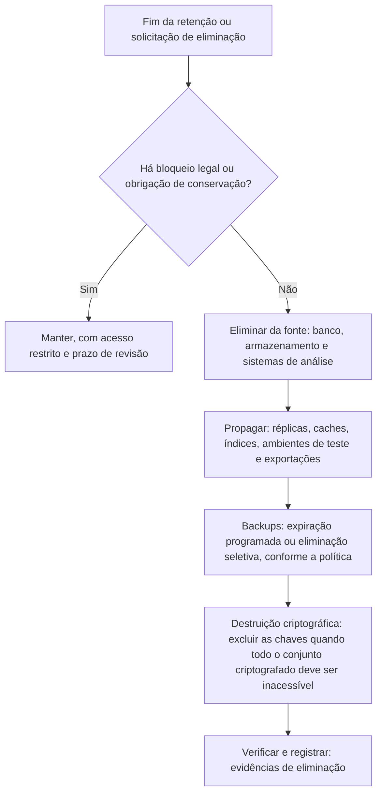

# Retenção, Ciclo de Vida, Backup e Eliminação Segura

> **Objetivo pedagógico:** definir períodos de retenção com base em obrigações legais e em finalidades, automatizar o ciclo de vida dos dados em armazenamento (transição de camadas e expiração), aplicar bloqueios legais e imutabilidade, projetar backups protegidos e testados (regra 3-2-1-1-0), compreender a eliminação segura em nuvem (destruição criptográfica e propagação a réplicas, a backups e a registros), tratar a tensão entre a eliminação a pedido do titular e a retenção de backups, e conduzir a devolução e a eliminação de dados no encerramento de contratos.

## 1. Retenção: princípios

| Princípio | Descrição |
|---|---|
| Reter pelo tempo necessário | Nem menos (obrigações legais e necessidades do negócio) nem mais (risco e custo) |
| Finalidade e base legal | A retenção depende da finalidade do tratamento e das obrigações aplicáveis (LGPD, arts. 15 e 16: término do tratamento e eliminação, com hipóteses de conservação, como cumprimento de obrigação legal ou regulatória e uso exclusivo do controlador com dados anonimizados) |
| Cronograma de retenção | Tabela por categoria de dados e por registro, aprovada por jurídico, privacidade e negócio |
| Aplicação automatizada | Regras técnicas de ciclo de vida, e não dependentes de rotinas manuais |
| Suspensão por obrigação legal (*legal hold*) | Suspensão da eliminação em investigações, litígios e auditorias |
| Registro | Evidências de aplicação e de eliminação |

### 1.1 Exemplos de referências de retenção no Brasil (consulte o Jurídico)

| Tema | Referência (exemplos) | Observação |
|---|---|---|
| Registros de conexão | Marco Civil da Internet (Lei 12.965/2014), art. 13: guarda pelo provedor de conexão por 1 ano | Aplica-se a quem se enquadra como provedor de conexão |
| Registros de acesso a aplicações | Marco Civil da Internet, art. 15: guarda por 6 meses por provedores de aplicações constituídos como pessoa jurídica que exerçam a atividade de forma organizada, profissional e com fins econômicos | Aplicabilidade depende do enquadramento |
| Documentos fiscais e contábeis | Legislação tributária e contábil, com prazos que costumam variar de 5 a 10 anos | Prazos variam por tributo e por documento |
| Documentos trabalhistas e previdenciários | Legislação trabalhista e previdenciária, com prazos específicos | Prazos variam por documento |
| Prontuários de pacientes | Normas do Conselho Federal de Medicina e legislação específica (prazo mínimo de 20 anos para prontuários em papel, e regras específicas para o eletrônico) | Confirmar com a área jurídica e com os conselhos profissionais |
| Instituições financeiras | Normas do CMN e do Banco Central sobre guarda de documentos e de registros | Prazos e escopos específicos |

Os prazos acima são **exemplos de referência**, não aconselhamento jurídico: valide a vigência e a aplicabilidade com o Jurídico antes de adotá-los.

## 2. Ciclo de vida automatizado do armazenamento

| Recurso | Descrição |
|---|---|
| Transição de camadas | Mover dados menos acessados para camadas de menor custo (acesso infrequente e arquivamento) |
| Expiração | Exclusão automática ao fim da retenção |
| Versões não atuais | Expiração de versões antigas |
| Limpeza de uploads incompletos | Remoção de partes abandonadas |
| Filtros | Por prefixo, por etiqueta e por classificação |
| Imutabilidade e *legal hold* | Impedem a expiração durante a retenção obrigatória |

Equivalentes: AWS S3 Lifecycle; Azure Blob lifecycle management; Google Cloud Storage Object Lifecycle Management.

### Exemplo: regra de ciclo de vida (AWS S3)

```json
{
  "Rules": [
    {
      "ID": "logs-transicao-e-expiracao",
      "Status": "Enabled",
      "Filter": { "Prefix": "logs/" },
      "Transitions": [
        { "Days": 90, "StorageClass": "GLACIER" }
      ],
      "Expiration": { "Days": 730 },
      "NoncurrentVersionExpiration": { "NoncurrentDays": 90 },
      "AbortIncompleteMultipartUpload": { "DaysAfterInitiation": 7 }
    }
  ]
}
```

Antes de aplicar uma regra de expiração, confirme o cronograma de retenção, a existência de bloqueios legais e o impacto em backups e em réplicas. Teste em um prefixo de baixa criticidade.

## 3. Imutabilidade e bloqueios legais

| Mecanismo | Descrição | Equivalentes |
|---|---|---|
| Modo de conformidade (WORM) | Objetos não podem ser alterados nem excluídos até o fim da retenção, nem por administradores | AWS S3 Object Lock (modo de conformidade); Azure immutable storage (retenção baseada em tempo); Google Cloud retention policies com bloqueio |
| Modo de governança | Proteção que usuários com permissões especiais podem contornar | S3 Object Lock (modo de governança) |
| Bloqueio legal (*legal hold*) | Suspensão indefinida da exclusão até a liberação | Recursos equivalentes nos três provedores |
| Cofres de backup imutáveis | Cofres que impedem exclusão e alteração de pontos de recuperação | AWS Backup Vault Lock; imutabilidade de cofres de backup no Azure e no Google Cloud |

**Atenção:** o modo de conformidade **não pode ser desfeito** durante o período; um erro de configuração (por exemplo, período excessivo) pode gerar custos e problemas legais. Teste primeiro em ambiente controlado.

## 4. Backups: proteção e teste

### 4.1 Regra 3-2-1-1-0

| Elemento | Significado |
|---|---|
| 3 | Três cópias dos dados |
| 2 | Em dois tipos de mídia ou de serviço diferentes |
| 1 | Uma cópia fora do domínio principal (outra conta, região ou provedor) |
| 1 | Uma cópia imutável |
| 0 | Zero erros após a verificação de restauração |

### 4.2 Requisitos de backup para dados em nuvem

| Requisito | Descrição |
|---|---|
| Escopo | Bancos, armazenamentos, configurações e segredos de recuperação; SaaS também (a responsabilidade pelo backup de SaaS costuma ser do cliente) |
| Isolamento | Contas e credenciais distintas das de produção; sem relação de confiança que permita apagar os backups a partir da produção |
| Criptografia | Backups criptografados, com chaves protegidas e recuperáveis |
| Imutabilidade | Retenção protegida contra alteração e exclusão |
| Retenção em camadas | Diário, semanal, mensal e anual, conforme a criticidade |
| Testes de restauração | Periódicos, com RTO e RPO medidos (pasta 05, arquivo 5) |
| Verificação de integridade | Varreduras e somas de verificação |
| Residência | Cópias em regiões compatíveis com os requisitos legais (arquivo 6) |
| Retenção compatível com a política | Backups não devem prolongar indevidamente a retenção de dados pessoais |

```bash
# AWS: configuração de bloqueio de objetos e planos de backup (somente leitura)
aws s3api get-object-lock-configuration --bucket backups-exemplo
aws backup list-backup-plans --query "BackupPlansList[].[BackupPlanName,BackupPlanId]" --output table
aws backup list-backup-vaults --query "BackupVaultList[].[BackupVaultName,Locked]" --output table
```

## 5. Eliminação segura em nuvem

Em nuvem, o cliente **não controla as mídias físicas**: a eliminação é lógica e criptográfica, e o provedor é responsável por sanitizar as mídias antes de reutilizá-las ou de descartá-las, conforme suas certificações (por exemplo, com base em diretrizes como o NIST SP 800-88).



### 5.1 Destruição criptográfica

| Aspecto | Descrição |
|---|---|
| Conceito | Tornar os dados irrecuperáveis ao excluir **todas as cópias das chaves** que os protegem |
| Quando usar | Eliminação de grandes volumes, de volumes de blocos, de instantâneos e de ambientes inteiros; término de contratos |
| Requisitos | Dados protegidos por chaves **exclusivas** do conjunto a eliminar; controle sobre as chaves (chaves gerenciadas pelo cliente); inventário de todas as cópias das chaves |
| Cuidados | Agendar a exclusão com período de espera para evitar acidentes; confirmar que não há outros dados protegidos pela mesma chave; verificar que as cópias de backup também dependem da mesma chave ou estão cobertas |
| Evidência | Registros de agendamento e de exclusão das chaves; relatório de verificação |

Detalhes de gestão de chaves: pasta 10.

### 5.2 Propagação da eliminação

| Local | Risco de resíduo | Ação |
|---|---|---|
| Replicações entre regiões e entre contas | Dados permanecem na réplica | Incluir réplicas nas rotinas de eliminação |
| Caches, índices e motores de busca | Dados derivados | Invalidar e reconstruir |
| Ambientes de análise e de testes | Cópias antigas | Inventário e eliminação |
| Registros e telemetria | Dados pessoais em registros | Retenção curta e mascaramento |
| Backups | Dados permanecem até a expiração | Política de expiração; "colocar fora de uso" até a expiração |
| Dados em SaaS e em parceiros | Terceiros mantêm dados | Cláusulas contratuais, solicitações e confirmações |
| Instantâneos e imagens | Cópias esquecidas | Ciclo de vida e inventário |

### 5.3 Eliminação a pedido do titular e backups

Quando um titular solicita a eliminação, dados em **backups imutáveis** não podem ser alterados individualmente. Abordagens usuais:

| Abordagem | Descrição |
|---|---|
| Expiração programada | Os backups expiram em prazo curto e definido (por exemplo, 35 dias), após o qual o dado desaparece |
| Colocar fora de uso | Registro das eliminações solicitadas, reaplicadas após qualquer restauração, para que o dado não volte à produção |
| Comunicar o prazo | Informar ao titular o prazo em que o dado deixará de existir nos backups |
| Documentar a base | Registrar a justificativa e as salvaguardas (RIPD e política de retenção) |

## 6. Encerramento de contratos e saída de fornecedores

| Etapa | Atividades |
|---|---|
| Planejamento | Estratégia de saída; formatos de exportação; prazos (pasta 04, arquivo 6) |
| Devolução | Exportação dos dados em formato aberto, com verificação de integridade |
| Eliminação pelo fornecedor | Solicitação formal de eliminação de todos os dados, inclusive backups, e de subprocessadores |
| Evidências | Certificado ou declaração de eliminação, com prazos e escopo |
| Destruição criptográfica | Exclusão das chaves sob controle do cliente |
| Revogação de acessos | Remoção de identidades, de integrações e de segredos |
| Verificação | Confirmação de que os dados não permanecem acessíveis |

## 7. Exemplo prático: política de retenção e eliminação de uma plataforma de clientes

| Categoria | Retenção | Mecanismo | Eliminação |
|---|---|---|---|
| Cadastro ativo de clientes | Enquanto a relação existir | Banco em produção | Ao término da relação e do prazo legal, anonimização ou eliminação |
| Contratos e documentos fiscais | Prazo legal aplicável (definido pelo Jurídico) | Bucket com imutabilidade e *legal hold* | Expiração automática ao fim do prazo |
| Registros de acesso a aplicações | 6 meses, ou prazo definido pela política e pelo enquadramento legal | Ciclo de vida do armazenamento de registros | Expiração automática |
| Registros de segurança | 12 meses online e 24 meses em arquivo | Transição de camada e expiração | Expiração |
| Backups | 35 dias diários; 12 meses mensais; cofre imutável em conta separada | Cofre de backup com bloqueio | Expiração programada |
| Ambientes de teste | Sem dados reais; dados sintéticos | Pipeline de dados sintéticos | Recriação periódica |
| Solicitações de eliminação de titulares | Atendimento em prazo definido pela política | Fluxo de eliminação com propagação; registro de "fora de uso" para backups | Backups expiram em até 35 dias |
| Encerramento com fornecedor | Eliminação em até 30 dias, com certificado | Cláusula contratual e destruição criptográfica | Verificação e evidências |

## 8. Casos de uso corporativos

- Cronograma de retenção aprovado e aplicado por regras técnicas de ciclo de vida.
- Backups imutáveis e isolados, com testes de restauração periódicos.
- Procedimento de eliminação com destruição criptográfica e evidências.

## 9. Normas e frameworks relevantes

- ISO/IEC 27002:2022 (8.10 exclusão de informações, 8.13 backup, 5.33 proteção de registros); ISO 22301:2019; NIST SP 800-88 Rev. 1 (sanitização de mídias); NIST SP 800-53 Rev. 5 (MP-6, CP-9 e SI-12)
- CSA CCM v4 (DSP-16 retenção, arquivamento e eliminação; BCR-08 backup); CIS Controls v8.1 (controle 11, recuperação de dados)
- LGPD, arts. 15, 16, 18 e 46; Marco Civil da Internet (Lei 12.965/2014), arts. 13 e 15; normas setoriais de guarda de documentos

## 10. Checklist operacional: retenção, backup e eliminação

- [ ] Cronograma de retenção aprovado (jurídico, privacidade e negócio), por categoria de dados
- [ ] Regras de ciclo de vida automatizadas, testadas e etiquetadas por classificação
- [ ] Imutabilidade e bloqueios legais definidos para dados com retenção obrigatória, com configuração testada
- [ ] Backups 3-2-1-1-0, isolados, criptografados e com testes de restauração registrados
- [ ] Procedimento de eliminação com propagação a réplicas, caches, ambientes de teste e exportações
- [ ] Destruição criptográfica para conjuntos de dados com chaves exclusivas, com período de espera
- [ ] Tratamento das eliminações solicitadas por titulares em relação aos backups
- [ ] Encerramento de contratos com devolução, eliminação certificada e revogação de acessos
- [ ] Evidências de retenção e de eliminação guardadas
- [ ] Revisão anual do cronograma e das regras

## 11. Referências

- Kissel, R. et al. NIST SP 800-88 Rev. 1: Guidelines for Media Sanitization. 2014.
- Brasil. Lei nº 13.709/2018, arts. 15 e 16; Lei nº 12.965/2014 (Marco Civil da Internet), arts. 13 e 15.
- ISO 22301:2019; ISO/IEC 27002:2022.
- Amazon Web Services. S3 Lifecycle, S3 Object Lock e AWS Backup Vault Lock; Microsoft. Armazenamento imutável e gerenciamento de ciclo de vida; Google Cloud. Object Lifecycle Management e políticas de retenção (documentação vigente).
- Pastas 04, 05 e 10 deste repositório.
