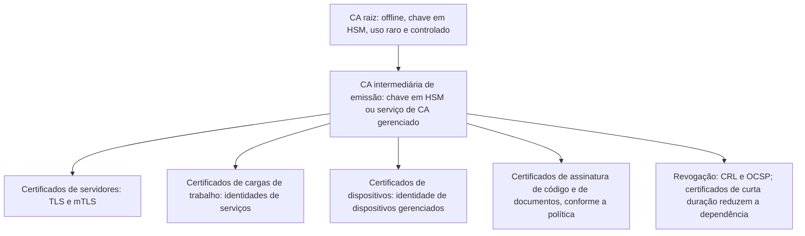

# Certificados, PKI e Assinatura Digital

> **Objetivo pedagógico:** compreender a infraestrutura de chaves públicas (PKI) em nuvem: autoridades certificadoras públicas e privadas, hierarquia e proteção das chaves raiz, ciclo de vida de certificados, assinatura de código, de imagens de contêineres e de documentos, uso de chaves de serviços de gestão de chaves para assinar, tokens assinados (JWT) e rotação de chaves públicas, e o contexto legal brasileiro de assinaturas eletrônicas (ICP-Brasil e Lei 14.063/2020).

## 1. Conceitos de PKI

| Elemento | Descrição |
|---|---|
| Certificado digital | Documento assinado por uma autoridade que vincula uma chave pública a uma identidade (domínio, organização ou pessoa) |
| Autoridade certificadora (CA) | Entidade que emite e assina certificados |
| CA raiz | Topo da cadeia de confiança; sua chave privada deve ser protegida ao máximo e usada raramente |
| CA intermediária (subordinada) | Emite os certificados do dia a dia; a raiz permanece offline |
| Autoridade de registro | Verifica a identidade antes da emissão |
| Cadeia de certificação | Sequência do certificado final até a raiz confiável |
| Lista de revogação (CRL) e protocolo OCSP | Mecanismos para informar certificados revogados |
| Âncora de confiança | Certificados raiz aceitos pelo cliente (lojas de confiança dos sistemas e dos navegadores) |
| Transparência de certificados | Registros públicos de certificados emitidos, para detectar emissões indevidas |



## 2. Autoridades públicas e privadas

| Tipo | Uso | Exemplos e opções |
|---|---|---|
| CA pública | Certificados para serviços expostos a clientes e a terceiros, confiados por navegadores e sistemas | Autoridades comerciais e gratuitas (por exemplo, com o protocolo ACME); certificados gerenciados dos provedores de nuvem |
| CA privada | Certificados internos (mTLS entre serviços, dispositivos, VPN e sistemas internos), confiados apenas dentro da organização | AWS Private CA; Google Cloud Certificate Authority Service; no Azure, soluções de CA privada com Key Vault e produtos de parceiros ou o serviço de certificados do Windows Server; ferramentas de código aberto e de terceiros |
| ICP-Brasil | Certificados com validade jurídica estabelecida pela legislação brasileira, emitidos por autoridades credenciadas | Certificados de pessoas e de organizações para assinatura de documentos, para assinatura de código e para relacionamento com o poder público |

### Boas práticas para CAs privadas

| Prática | Descrição |
|---|---|
| Raiz offline | A CA raiz opera isolada, ligada apenas em cerimônias de emissão de intermediárias, com registro e múltiplos responsáveis |
| Chaves em HSM | Chaves das CAs em módulos validados |
| Hierarquia por finalidade | Intermediárias separadas por tipo de certificado e por ambiente, para limitar o impacto de um comprometimento |
| Políticas de emissão | Quem pode solicitar, para quais nomes, com que validade e com que extensões |
| Validade curta | Certificados de cargas com validade de horas ou de dias |
| Revogação e distribuição de CRL e OCSP | Disponíveis e monitorados |
| Auditoria | Registro de todas as emissões e revogações |
| Plano de comprometimento da CA | Procedimentos de revogação, de reemissão e de comunicação |
| Gestão de âncoras de confiança | Distribuição controlada do certificado raiz aos sistemas |

## 3. Ciclo de vida dos certificados

| Fase | Controles |
|---|---|
| Solicitação | Autenticação do solicitante; validação do nome (propriedade do domínio ou da identidade da carga) |
| Emissão | Automática, por identidade; sem chaves privadas transitando por e-mail ou por planilhas |
| Instalação | Chaves privadas geradas no local de uso ou protegidas em HSM e em serviços de chaves |
| Monitoramento | Inventário, alertas de expiração e verificação de configuração |
| Renovação | Automática, antes do vencimento; teste da renovação |
| Revogação | Para comprometimento, mudança de titularidade ou fim de uso |
| Destruição | Eliminação das chaves privadas e remoção dos certificados |

Veja a automação e o monitoramento de expiração no arquivo 4, seção 8, e o inventário no arquivo 7.

### Inspeção de certificados (somente leitura)

```bash
# Exibir os principais campos de um certificado em arquivo
openssl x509 -in certificado.pem -noout -subject -issuer -dates -serial -fingerprint -sha256

# Exibir as extensões (nomes alternativos, uso da chave e restrições)
openssl x509 -in certificado.pem -noout -ext subjectAltName,keyUsage,extendedKeyUsage,basicConstraints

# Obter e inspecionar o certificado servido por um endereço próprio
openssl s_client -connect exemplo.org:443 -servername exemplo.org </dev/null 2>/dev/null | openssl x509 -noout -subject -issuer -dates
```

## 4. Assinatura de artefatos de software e de imagens de contêineres

A assinatura de artefatos garante **integridade** (o artefato não foi alterado) e **origem** (quem o construiu), e é uma defesa central contra ataques à cadeia de suprimentos (pasta 21).

| Elemento | Descrição |
|---|---|
| Assinatura de imagens de contêineres | Assinar as imagens ao fim do pipeline; o cluster só executa imagens com assinatura válida (políticas de admissão) |
| Assinatura de pacotes e de binários | Assinatura de código de bibliotecas e de executáveis |
| Atestações de build e proveniência | Registro assinado de como o artefato foi construído (níveis do SLSA) |
| Chaves de assinatura em serviços de chaves | A chave privada nunca sai do serviço; a assinatura ocorre por chamadas controladas |
| Assinatura sem chaves de longa duração | Uso de identidades de curta duração e de registros de transparência (por exemplo, o fluxo sem chaves do Sigstore) |
| Verificação | Cada consumidor verifica a assinatura e a identidade do assinante antes de usar o artefato |

### Exemplo: assinar e verificar uma imagem com uma chave em serviço de gestão de chaves (cosign)

```bash
# Assinar a imagem (pelo resumo imutável) com uma chave assimétrica mantida no AWS KMS
cosign sign --key awskms:///alias/chave-assinatura-imagens registro.exemplo.org/extratos@sha256:RESUMO_DA_IMAGEM

# Verificar a assinatura antes de implantar
cosign verify --key awskms:///alias/chave-assinatura-imagens registro.exemplo.org/extratos@sha256:RESUMO_DA_IMAGEM
```

Referencie as imagens **pelo resumo (digest)** e não por etiquetas mutáveis. O cosign suporta chaves em outros serviços (Azure Key Vault e Google Cloud KMS) por URIs específicos; consulte a documentação para o formato vigente. Em pipelines, configure permissões mínimas para a identidade que assina (pasta 06) e proteja a chave de assinatura com política própria e registros de uso.

## 5. Chaves de assinatura em serviços de gestão de chaves

| Operação | Descrição |
|---|---|
| Chaves assimétricas no KMS ou no HSM | A chave privada é gerada e permanece no serviço; as aplicações enviam resumos para assinatura (Sign) e verificam com a chave pública (Verify) |
| Controle de acesso | Quem pode assinar é definido por política; separação entre administradores e assinantes |
| Registro | Cada assinatura gera um registro de uso |
| Algoritmos | ECDSA (P-256 e P-384) e RSA-PSS; verificar o suporte do serviço |
| Rotação | Novas versões de chaves e publicação das chaves públicas; manter as públicas antigas para verificar assinaturas antigas |
| Casos de uso | Assinatura de artefatos, de tokens, de documentos, de atualizações de firmware e de registros de auditoria |

## 6. Tokens assinados e rotação de chaves públicas (JWT e JWKS)

| Aspecto | Boa prática |
|---|---|
| Algoritmos | Usar algoritmos assimétricos (ES256 ou RS256 com chaves fortes) para tokens consumidos por vários serviços; rejeitar o algoritmo "none" e fixar os algoritmos aceitos |
| Validação | Verificar assinatura, emissor, público, validade e escopos |
| Publicação de chaves | Conjunto de chaves públicas (JWKS) em um endereço confiável, com identificador de chave (kid) |
| Rotação | Publicar a nova chave antes de começar a assinar com ela; manter a antiga até que os tokens emitidos expirem |
| Validade curta | Tokens de curta duração reduzem a janela de uso indevido |
| Proteção da chave de assinatura | Em HSM ou serviço de chaves |
| Revogação | Por expiração curta e por listas de revogação ou por introspecção, quando necessário |

## 7. Assinatura de documentos e contexto legal brasileiro

> **Aviso:** orientações gerais, sem caráter jurídico. Confirme a aplicação ao caso concreto com o Jurídico.

| Norma | Pontos relevantes |
|---|---|
| Medida Provisória nº 2.200-2/2001 (ICP-Brasil) | Instituiu a Infraestrutura de Chaves Públicas Brasileira; documentos assinados com certificados ICP-Brasil têm presunção de veracidade em relação aos signatários; admite outros meios de comprovação de autoria e de integridade, desde que aceitos pelas partes |
| Lei nº 14.063/2020 | Dispõe sobre o uso de assinaturas eletrônicas em interações com entes públicos, em atos de pessoas jurídicas e em questões de saúde; define as assinaturas eletrônicas **simples**, **avançada** e **qualificada** (esta, baseada em certificado ICP-Brasil) |
| Escolha do tipo de assinatura | Depende do risco, da exigência legal do ato e do que as partes aceitarem; atos com exigência de assinatura qualificada exigem certificado ICP-Brasil |
| Certificados ICP-Brasil | Tipos A1 (armazenado em software) e A3 (em dispositivo criptográfico); proteger a chave privada e controlar o uso |
| Carimbo do tempo | Comprova a existência do documento em determinado momento |
| Preservação de longo prazo | Formatos e processos para manter a verificabilidade ao longo do tempo |

Em nuvem, **chaves de certificados ICP-Brasil de pessoas e de organizações** devem ser protegidas em dispositivos criptográficos ou em serviços de assinatura em nuvem credenciados, com controle de uso, de autorização e de registro.

## 8. Exemplo prático: modernização da PKI de uma empresa de pagamentos

| Situação inicial | Ação | Resultado |
|---|---|---|
| CA privada com a chave raiz em um servidor sempre ligado | Nova hierarquia: raiz offline com chave em HSM e duas intermediárias (cargas de trabalho e dispositivos) em serviço de CA gerenciado | Redução do risco de comprometimento da raiz |
| Certificados internos de 3 anos, emitidos manualmente | Emissão automática por identidade de carga, validade de 24 horas e renovação automática | Rotação contínua, sem intervenção manual |
| Imagens de contêineres sem assinatura | Assinatura no pipeline com chave em KMS e admissão apenas de imagens assinadas | Execução de artefatos não verificados bloqueada |
| Tokens assinados com chave compartilhada simétrica | Tokens assinados com ES256, chave no HSM, JWKS publicado e rotação trimestral | Verificação por consumidores sem acesso à chave |
| Contratos assinados por imagens de assinatura | Assinatura qualificada com certificados ICP-Brasil para contratos que exigem; assinatura avançada para os demais | Validade jurídica adequada ao risco |
| Resultado | Zero incidentes de certificados expirados em 12 meses; auditoria sem achados de gestão de chaves da PKI | |

## 9. Casos de uso corporativos

- Hierarquia de CA privada para mTLS, dispositivos e VPN, com emissão automatizada.
- Assinatura e verificação de artefatos e de imagens no pipeline de entrega.
- Estratégia de assinatura eletrônica de documentos com os níveis adequados de validade jurídica.

## 10. Normas e frameworks relevantes

- NIST SP 800-57 (gestão de chaves); NIST SP 800-32 (introdução à PKI); NIST SP 800-89 (assinaturas digitais); NIST FIPS 186-5 (padrão de assinaturas digitais); RFC 5280 (perfil de certificados X.509)
- CA/Browser Forum Baseline Requirements (certificados públicos); SLSA; Sigstore; NIST SP 800-218 (SSDF)
- ISO/IEC 27002:2022 (8.24); CSA CCM v4 (CEK); ICP-Brasil (Documentos de Princípios e Políticas de Certificação do ITI)
- Brasil. MP 2.200-2/2001; Lei 14.063/2020

## 11. Checklist operacional: certificados e assinatura

- [ ] Hierarquia de CA definida (raiz offline, intermediárias por finalidade), com chaves em HSM
- [ ] Política de emissão de certificados (quem, para que nomes, validade e extensões)
- [ ] Emissão e renovação automáticas; certificados de curta duração para cargas de trabalho
- [ ] Inventário de certificados e alertas de expiração; monitoramento de transparência de certificados
- [ ] Procedimento de revogação e de comprometimento de CA testado
- [ ] Artefatos e imagens assinados no pipeline; verificação obrigatória antes da implantação
- [ ] Chaves de assinatura em serviço de chaves, com política de acesso e registros
- [ ] Tokens com algoritmos fixos, validação completa e rotação de chaves públicas
- [ ] Estratégia de assinatura eletrônica de documentos alinhada à legislação e validada pelo Jurídico
- [ ] Revisão anual da PKI e das políticas

## 12. Referências

- Cooper, D. et al. RFC 5280: Internet X.509 Public Key Infrastructure Certificate and CRL Profile. IETF, 2008.
- NIST. FIPS 186-5: Digital Signature Standard (DSS). 2023.
- Brasil. Medida Provisória nº 2.200-2/2001; Lei nº 14.063/2020.
- Sigstore e SLSA (documentação); Amazon Web Services. AWS Private CA; Google Cloud. Certificate Authority Service (documentação vigente).
- Pastas 06, 08 e 21 deste repositório.
