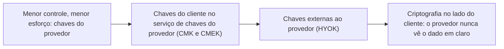
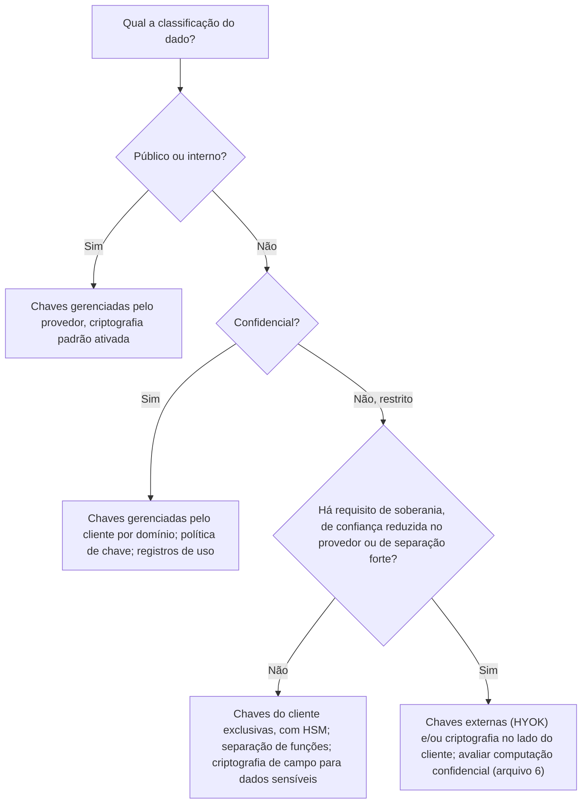

# Criptografia em Repouso e no Lado do Cliente

> **Objetivo pedagógico:** escolher e configurar a criptografia em repouso em nuvem: distinguir chaves gerenciadas pelo provedor, chaves gerenciadas pelo cliente (CMK e CMEK), chaves fornecidas pelo cliente e criptografia no lado do cliente, entender o que cada modo protege, aplicar a criptografia em discos, em objetos, em bancos de dados (TDE e criptografia de campo) e em backups, implementar a criptografia em envelope no código com bibliotecas validadas e decidir o modo adequado por classificação de dados.

## 1. Modos de criptografia em repouso

| Modo | Quem gera e controla a chave | Quem criptografa | Exemplos |
|---|---|---|---|
| Chaves gerenciadas pelo provedor | O provedor, de forma transparente | O serviço | S3 com SSE-S3; Azure Storage com chaves gerenciadas pela Microsoft; criptografia padrão do Google Cloud |
| Chaves gerenciadas pelo cliente no serviço de chaves do provedor (CMK e CMEK) | O cliente define a política, a rotação e o ciclo de vida; o material fica no KMS do provedor | O serviço, usando a chave do cliente | S3 com SSE-KMS; Azure com chaves do cliente em Key Vault; Google Cloud CMEK |
| Chaves fornecidas pelo cliente em cada requisição | O cliente envia a chave a cada operação; o provedor não a armazena | O serviço, durante a operação | S3 SSE-C; chaves fornecidas pelo cliente no Azure Storage; CSEK do Google Cloud (em descontinuação para novos usos em alguns serviços) |
| Chaves externas (HYOK) | Gestor de chaves fora do provedor, sob controle do cliente | O serviço, consultando o gestor externo a cada uso | AWS XKS; Google Cloud EKM; integrações de HSM externo |
| Criptografia no lado do cliente | O cliente, antes de enviar os dados ao provedor | A aplicação do cliente | AWS Encryption SDK; Google Tink; bibliotecas de criptografia de aplicação |



## 2. O que cada modo protege

| Cenário de ameaça | Provedor | Cliente (CMK) | Externas | Lado do cliente |
|---|---|---|---|---|
| Roubo de mídia no datacenter | Protege | Protege | Protege | Protege |
| Erro de permissão que expõe o objeto a identidades sem acesso à chave | Não protege se a identidade tiver permissão de leitura | **Protege**, se a política da chave exigir permissão específica | Protege | Protege |
| Comprometimento de uma credencial com permissão de leitura **e** de uso da chave | Não protege | Não protege | Não protege (ao usar a chave remota) | Protege se o atacante não tiver a chave do cliente |
| Controle do cliente sobre a revogação do acesso do provedor aos dados | Não | Parcial (desabilitar a chave) | Sim (revogar no gestor externo) | Sim |
| Separação de funções entre administradores de dados e de chaves | Não | Sim | Sim | Sim |
| Pedido de autoridade ao provedor | Provedor entrega dados em claro, se tiver acesso | Provedor pode usar a chave sob ordem, dependendo do arranjo | Mais difícil | Mais difícil: o provedor só tem texto cifrado |
| Funcionalidades do serviço (busca, indexação e processamento no provedor) | Total | Total | Total, com dependência do gestor | **Limitadas**: o provedor não consegue processar dados cifrados |
| Complexidade e disponibilidade | Baixa | Baixa a moderada | Alta | Alta |

**Conclusão prática:** as chaves do provedor atendem a **conformidade básica** e ao risco de mídia; as chaves do cliente adicionam **separação de funções, política própria e auditoria**; as externas e o lado do cliente atendem a requisitos de **soberania e de confiança reduzida no provedor**, com custo operacional.

## 3. Criptografia por tipo de recurso

### 3.1 Discos e volumes

| Provedor | Mecanismo | Boas práticas |
|---|---|---|
| AWS | Criptografia de volumes EBS e de instantâneos, com opção de criptografia por padrão na conta e na região | Ativar a criptografia por padrão; usar chaves do cliente para classificações elevadas; migrar volumes antigos não criptografados copiando instantâneos criptografados |
| Azure | Criptografia do lado do servidor de discos gerenciados (chaves da plataforma ou do cliente, por conjuntos de criptografia de disco); criptografia no host; Azure Disk Encryption (em processo de descontinuação anunciada: confirme o cronograma e a alternativa recomendada) | Preferir criptografia do lado do servidor com chaves do cliente e criptografia no host quando houver requisito de criptografia de ponta a ponta até o host |
| Google Cloud | Criptografia padrão de discos persistentes; opção de CMEK | Usar CMEK para classificações elevadas |

### 3.2 Armazenamento de objetos

| Prática | Descrição |
|---|---|
| Criptografia padrão no bucket ou na conta | Garantir que novos objetos sejam sempre criptografados |
| Chaves do cliente por classificação | Chaves distintas por domínio de dados |
| Chaves de bucket (otimização de custos de chamadas ao KMS) | Reduzem o volume de chamadas ao serviço de chaves em volumes altos |
| Política de bucket que exige criptografia | Negar gravações sem a criptografia exigida |
| Integridade | Somas de verificação adicionais para dados críticos |
| Replicação | Garantir a criptografia no destino, com chaves da região de destino |

### 3.3 Bancos de dados

| Mecanismo | Descrição | Proteção |
|---|---|---|
| Criptografia transparente de dados (TDE) e criptografia de armazenamento do serviço gerenciado | Criptografa arquivos de dados, de registros e backups no armazenamento | Mídia e acesso ao arquivo; **não protege** contra consultas autorizadas |
| Criptografia de coluna ou de campo no banco | Colunas sensíveis cifradas; a chave é controlada por outro papel | Protege contra administradores do banco, conforme a configuração |
| Criptografia de campo na aplicação | A aplicação cifra os campos antes de gravar | Administradores do banco e do provedor não veem o dado em claro |
| Recursos de criptografia com chaves protegidas no cliente (como as colunas "sempre cifradas" em alguns motores) | O motor processa dados cifrados sem expor a chave ao servidor | Alto nível de proteção, com limitações de consulta |
| Tokenização | Substituição do dado por token, com o original em cofre | Redução do escopo e de acessos |

### 3.4 Backups, registros e outros

| Recurso | Orientação |
|---|---|
| Backups | Criptografados com chaves próprias, em conta separada; chaves de recuperação protegidas e testadas |
| Registros | Criptografados em repouso; mascaramento de dados sensíveis (pasta 09) |
| Filas e mensagens | Criptografia do serviço com chaves do cliente para dados sensíveis |
| Segredos | Cofre com chaves do cliente |
| Instantâneos e imagens | Criptografia com chaves que limitem o compartilhamento externo |

## 4. Criptografia no lado do cliente: exemplo de criptografia em envelope

```python
# Criptografia em envelope com AWS KMS e AES-256-GCM
# Requer: pip install boto3 cryptography
# A chave de dados em claro existe apenas em memória durante a operação; a chave cifrada é guardada com o dado
import os
import boto3
from cryptography.hazmat.primitives.ciphers.aead import AESGCM

kms = boto3.client("kms")

def cifrar(dados: bytes, id_da_chave: str, contexto: dict) -> dict:
    resposta = kms.generate_data_key(KeyId=id_da_chave, KeySpec="AES_256", EncryptionContext=contexto)
    chave_de_dados = resposta["Plaintext"]
    nonce = os.urandom(12)                                  # nonce de 96 bits, único para cada operação
    contexto_bytes = repr(sorted(contexto.items())).encode("utf-8")   # dados autenticados associados
    cifrado = AESGCM(chave_de_dados).encrypt(nonce, dados, contexto_bytes)
    return {"chave_cifrada": resposta["CiphertextBlob"], "nonce": nonce, "dados": cifrado, "contexto": contexto}

def decifrar(pacote: dict) -> bytes:
    resposta = kms.decrypt(CiphertextBlob=pacote["chave_cifrada"], EncryptionContext=pacote["contexto"])
    contexto_bytes = repr(sorted(pacote["contexto"].items())).encode("utf-8")
    return AESGCM(resposta["Plaintext"]).decrypt(pacote["nonce"], pacote["dados"], contexto_bytes)

if __name__ == "__main__":
    contexto = {"aplicacao": "extratos", "ambiente": "teste"}
    pacote = cifrar(b"dados sinteticos de teste", "alias/chave-de-teste", contexto)
    print(decifrar(pacote))
```

Pontos de atenção do exemplo:

| Ponto | Explicação |
|---|---|
| Uma chave de dados por objeto | Evita a reutilização da chave com muitos nonces e limita o impacto de um comprometimento |
| Nonce único por operação | Nunca reutilize o par (chave, nonce) no AES-GCM |
| Contexto autenticado | Vincula o texto cifrado ao uso (aplicação e ambiente) |
| Memória da chave em claro | Linguagens com coleta de lixo não garantem o apagamento da chave na memória; para requisitos elevados, use HSM, enclaves ou bibliotecas de baixo nível |
| Preferir bibliotecas de mais alto nível | O AWS Encryption SDK, o Google Tink e o Azure SDK implementam formatos, contextos e boas práticas, evitando erros de implementação |
| Tratamento de erros e limites | Tratar falhas do serviço de chaves, limites de taxa e latência |

## 5. Decisão por classificação de dados



| Classificação | Modo mínimo | Complementos |
|---|---|---|
| Público | Padrão do provedor | Integridade |
| Interno | Padrão do provedor | Acesso restrito |
| Confidencial | Chaves do cliente por domínio | Registros de uso de chaves; acesso privado |
| Restrito | Chaves do cliente exclusivas, protegidas por HSM | Criptografia de campo; separação de funções; chaves em região aprovada; alertas |
| Restrito com requisito de soberania | Chaves externas e/ou criptografia no lado do cliente | Computação confidencial; plano de continuidade e de revogação |

## 6. Verificações de somente leitura

```bash
# AWS: criptografia de volumes por padrão e volumes sem criptografia
aws ec2 get-ebs-encryption-by-default
aws ec2 describe-volumes --filters Name=encrypted,Values=false --query "Volumes[].[VolumeId,Size,State]" --output table

# AWS: criptografia padrão de buckets e chave usada
aws s3api get-bucket-encryption --bucket bucket-exemplo \
  --query "ServerSideEncryptionConfiguration.Rules[0].ApplyServerSideEncryptionByDefault"

# AWS: bancos relacionais e chaves usadas
aws rds describe-db-instances --query "DBInstances[].[DBInstanceIdentifier,StorageEncrypted,KmsKeyId]" --output table

# Azure: conjuntos de criptografia de disco e discos
az disk-encryption-set list --query "[].{nome:name, rg:resourceGroup, tipo:encryptionType}" --output table
az disk list --query "[].{nome:name, criptografia:encryption.type}" --output table

# Google Cloud: discos com chave do cliente (campo vazio indica chave padrão do Google)
gcloud compute disks list --format="table(name,zone.basename(),diskEncryptionKey.kmsKeyName)"
```

## 7. Exemplo prático: classificação, chaves e criptografia por recurso

| Recurso | Classificação | Modo de criptografia | Observações |
|---|---|---|---|
| Intranet e materiais públicos | Público e interno | Chaves do provedor | Sem custos adicionais de chaves |
| Bucket de documentos de clientes | Confidencial | CMK por domínio, chave de bucket ativada | Registros de uso de chave; política exige a criptografia na gravação |
| Banco de pagamentos | Restrito | CMK exclusiva com HSM; criptografia de campo para número de cartão (tokenização) | Chaves de campo controladas por outro papel; backups com chave própria |
| Prontuários e dados de saúde | Restrito com requisito de soberania | CMK exclusiva em região do Brasil; criptografia no lado da aplicação para campos clínicos | Chaves replicadas na região de recuperação do Brasil; teste de decifração semestral |
| Backups imutáveis | Restrito | Chave de backup própria, em conta separada | Cópia protegida da chave de recuperação |
| Resultado | Dados restritos protegidos por camadas de chaves e de controle de acesso; custo adicional de chaves inferior a 2% do custo da infraestrutura de dados | | |

## 8. Casos de uso corporativos

- Definição do padrão de criptografia em repouso por classificação de dados.
- Migração de volumes e de bancos de dados não criptografados.
- Implementação de criptografia de campo e tokenização em plataformas de pagamentos e de saúde.

## 9. Normas e frameworks relevantes

- NIST SP 800-111 (criptografia de armazenamento); NIST SP 800-57; NIST SP 800-53 Rev. 5 (SC-28, proteção de informações em repouso)
- CSA CCM v4 (CEK e DSP); ISO/IEC 27002:2022 (8.24 e 8.11); PCI DSS v4.0 (requisito 3.5, proteção de dados armazenados da conta)
- CIS Foundations Benchmarks (criptografia de volumes, de armazenamento e de bancos de dados); OWASP Cryptographic Storage Cheat Sheet
- LGPD, art. 46; MITRE ATT&CK: T1530 e T1486 (impacto de criptografia de dados por atacantes)

## 10. Checklist operacional: criptografia em repouso

- [ ] Criptografia em repouso ativada por padrão em contas e regiões (volumes, objetos, bancos e backups)
- [ ] Modo de criptografia definido por classificação de dados
- [ ] Chaves do cliente por domínio para dados confidenciais e restritos; HSM para restritos
- [ ] Políticas que exigem a criptografia na gravação e impedem alternativas fracas
- [ ] Criptografia de campo ou tokenização para dados altamente sensíveis
- [ ] Criptografia no lado do cliente com bibliotecas validadas, quando exigida
- [ ] Backups e réplicas com criptografia e chaves protegidas nas regiões adequadas
- [ ] Volumes e bancos legados migrados para criptografia
- [ ] Verificação contínua de recursos sem criptografia ou com modo inferior ao exigido
- [ ] Testes de recuperação com as chaves

## 11. Referências

- Scarfone, K. et al. NIST SP 800-111: Guide to Storage Encryption Technologies for End User Devices. 2007.
- Amazon Web Services. AWS Encryption SDK; Google. Tink (documentação); Microsoft. Criptografia do Azure em repouso (documentação vigente).
- Amazon Web Services; Microsoft; Google Cloud. Documentação de criptografia de discos, de armazenamento e de bancos de dados (versões vigentes).
- OWASP. Cryptographic Storage Cheat Sheet.
- Pastas 05, 09 e 13 deste repositório.
