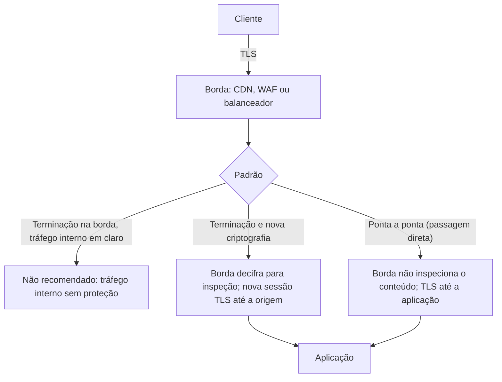

# Criptografia em Trânsito: TLS, mTLS e VPN

> **Objetivo pedagógico:** proteger dados em trânsito em ambientes de nuvem: configurar o TLS (versões, suítes de cifras, sigilo perfeito adiante, HSTS e validação de certificados), escolher onde terminar e reiniciar a criptografia, impor TLS em serviços gerenciados e em bancos de dados, implantar autenticação mútua entre serviços (mTLS), configurar VPN IPsec e MACsec para conectividade híbrida, automatizar certificados e verificar a configuração com ferramentas de teste.

## 1. Onde a criptografia em trânsito se aplica

| Trecho | Protocolo típico | Observações |
|---|---|---|
| Usuários para a borda (internet) | TLS 1.2 ou 1.3 | HTTPS obrigatório; HSTS |
| Borda para a origem (CDN e balanceador para a aplicação) | TLS | Evitar HTTP em claro entre a borda e a origem |
| Entre serviços (leste a oeste) | TLS ou TLS mútuo | A rede interna não é confiável (zero trust, pasta 07) |
| Aplicação para bancos de dados e filas | TLS com validação do certificado do servidor | Impor TLS no serviço |
| Aplicação para serviços do provedor (APIs, armazenamento e chaves) | TLS | Os SDKs usam HTTPS por padrão; impor por política |
| Ambientes locais para a nuvem | IPsec (VPN), MACsec ou TLS | Criptografar mesmo em conexões dedicadas, conforme o requisito |
| Administração (SSH, RDP e consoles) | SSH, TLS e sessões gerenciadas | Sem protocolos em claro |
| Entre regiões e provedores | TLS ou VPN | Replicação com criptografia |

## 2. Configuração do TLS

| Parâmetro | Recomendação |
|---|---|
| Versões | TLS 1.3 preferencial; TLS 1.2 como mínimo; desabilitar SSL 2.0, SSL 3.0, TLS 1.0 e 1.1 |
| Troca de chaves | ECDHE (efêmera), com **sigilo perfeito adiante** (*forward secrecy*) |
| Suítes de cifras | AES-GCM e ChaCha20-Poly1305; evitar CBC, RC4 e 3DES |
| Certificados | Chaves ECDSA P-256 ou RSA de 2048 bits no mínimo (3072 quando exigido); assinatura SHA-256 ou superior; validade curta |
| Cadeia de certificados | Servir a cadeia completa e correta |
| HSTS | Forçar HTTPS nos navegadores, com `includeSubDomains` após validação |
| Grampeamento OCSP (*OCSP stapling*) | Melhora a validação de revogação e a privacidade |
| Retomada de sessão | Configurar com chaves de tíquetes rotacionadas |
| Compressão | Desabilitada em TLS (ataques como CRIME e BREACH exigem atenção em HTTP) |
| Renegociação insegura | Desabilitada |
| Validação do cliente | Clientes validam o certificado do servidor (nome, cadeia, validade e revogação); nunca desabilitar a verificação para "fazer funcionar" |

### Exemplo de configuração de servidor (nginx), baseada em perfil intermediário amplamente usado

```
ssl_protocols TLSv1.2 TLSv1.3;
ssl_prefer_server_ciphers off;
ssl_ciphers ECDHE-ECDSA-AES128-GCM-SHA256:ECDHE-RSA-AES128-GCM-SHA256:ECDHE-ECDSA-AES256-GCM-SHA384:ECDHE-RSA-AES256-GCM-SHA384:ECDHE-ECDSA-CHACHA20-POLY1305:ECDHE-RSA-CHACHA20-POLY1305;
ssl_session_timeout 1d;
ssl_session_cache shared:SSL:10m;
ssl_session_tickets off;
ssl_stapling on;
ssl_stapling_verify on;
add_header Strict-Transport-Security "max-age=63072000; includeSubDomains" always;
```

Use o gerador de configuração de TLS mantido pela Mozilla (perfis moderno, intermediário e antigo) para obter configurações atualizadas para o seu servidor, e valide-as com as ferramentas da seção 7. As políticas de TLS de balanceadores e de CDNs (por exemplo, as políticas de segurança de balanceadores) são selecionadas por nome: escolha a política que exige TLS 1.2 ou superior.

## 3. Padrões de terminação de TLS



| Padrão | Vantagens | Cuidados |
|---|---|---|
| Terminação na borda, tráfego interno em claro | Simplicidade | Não recomendado para dados sensíveis: o tráfego interno fica exposto |
| Terminação e nova criptografia (re-encrypt) | Permite WAF e inspeção na borda e mantém a criptografia até a origem | Gestão de certificados em dois pontos; a borda vê o conteúdo em claro |
| Passagem direta (ponta a ponta) | Confidencialidade máxima até a aplicação | Sem inspeção na borda; WAF limitado |

Escolha pelo risco e pelos requisitos: para dados sensíveis e para ambientes regulados, use pelo menos o padrão de **nova criptografia** até a origem.

## 4. Impor TLS em serviços gerenciados

| Serviço | Como impor |
|---|---|
| Armazenamento de objetos (AWS) | Política de bucket que nega requisições sem TLS (`aws:SecureTransport`) (pasta 09, arquivo 3) |
| Contas de armazenamento (Azure) | Exigir transferência segura (somente HTTPS) e versão mínima de TLS |
| Armazenamento (Google Cloud) | Uso de HTTPS por padrão nas APIs; políticas e restrições de organização conforme necessário |
| Bancos de dados relacionais | Parâmetros que exigem conexões criptografadas (por exemplo, `rds.force_ssl` no PostgreSQL gerenciado da AWS; `require_secure_transport` no MySQL; opções de exigência de SSL nos serviços equivalentes de Azure e Google Cloud); clientes validando o certificado do servidor |
| Filas, mensageria e caches | Habilitar TLS no cluster e nos clientes; negar conexões sem TLS |
| Balanceadores e gateways | Políticas de TLS que exijam versão mínima 1.2; redirecionamento de HTTP para HTTPS |
| Contêineres e Kubernetes | TLS entre componentes do plano de controle; ingressos com TLS; malha de serviços para mTLS |

Políticas organizacionais podem **impedir a criação** de recursos sem TLS ou com políticas de TLS fracas (pasta 03).

## 5. TLS mútuo (mTLS) entre serviços

No mTLS, **cliente e servidor** apresentam certificados e se autenticam mutuamente, o que permite que o servidor saiba **qual carga de trabalho** está chamando e aplique autorização por identidade (pasta 07).

| Elemento | Prática |
|---|---|
| Identidade das cargas | Certificados por serviço, com identidades padronizadas (por exemplo, o padrão SPIFFE) |
| Emissão automática | Autoridade certificadora privada e emissão por identidade da carga, sem intervenção manual |
| Curta duração | Certificados de horas ou de poucos dias, com renovação automática |
| Malha de serviços | Aplicação transparente de mTLS entre serviços e autorização por identidade |
| Rotação e revogação | Rotação frequente; revogação por expiração curta e por remoção da identidade |
| Observabilidade | Monitorar falhas de handshake e expirações |
| Desempenho | Retomada de sessões e conexões persistentes |

## 6. VPN e conectividade híbrida

| Tecnologia | Parâmetros recomendados | Observações |
|---|---|---|
| IPsec (IKEv2) | AES-GCM de 128 ou 256 bits; grupos Diffie-Hellman de pelo menos 14 (2048 bits) ou curvas elípticas (grupos 19 e 20, por exemplo); sigilo perfeito adiante; autenticação por certificados ou por chaves compartilhadas fortes | Evitar IKEv1, 3DES, DH de grupos fracos e SHA-1; túneis redundantes |
| MACsec (camada 2) | Criptografia de enlaces dedicados entre o ambiente local e o provedor, quando disponível (conexões de alta capacidade) | Protege o enlace físico; requer suporte nos equipamentos |
| IPsec sobre conexão dedicada | Criptografia de ponta a ponta sobre enlaces privados | Opção quando MACsec não está disponível |
| Acesso remoto de usuários | Acesso por aplicação com TLS (ZTNA) ou VPN com autenticação forte | Preferir o acesso por aplicação (pasta 07) |
| Políticas de segurança nos provedores | Configurar propostas de IKE e de IPsec explícitas (algoritmos e grupos), em vez de aceitar todos os padrões | Revisar após atualizações |

Os detalhes de topologia, de redundância e de roteamento estão na pasta 08.

## 7. Verificação e testes da configuração de TLS (em sistemas próprios ou autorizados)

```bash
# Verificar a negociação de versões e a cadeia de certificados (sistema próprio ou autorizado)
openssl s_client -connect exemplo.org:443 -servername exemplo.org -tls1_2 </dev/null 2>/dev/null | head -n 20
openssl s_client -connect exemplo.org:443 -servername exemplo.org -tls1_3 </dev/null 2>/dev/null | grep -E "Protocol|Cipher"

# Confirmar que versões antigas são recusadas (o comando deve falhar, indicando que TLS 1.0 não é aceito)
openssl s_client -connect exemplo.org:443 -servername exemplo.org -tls1 </dev/null

# Ferramentas de varredura de configuração de TLS (execute somente em sistemas que você administra ou está autorizado a testar)
testssl.sh exemplo.org
sslyze exemplo.org
nmap --script ssl-enum-ciphers -p 443 exemplo.org
```

| O que verificar | Critério de aprovação |
|---|---|
| Versões aceitas | Somente TLS 1.2 e 1.3 |
| Suítes de cifras | Somente AEAD com ECDHE |
| Certificado | Nome correto, cadeia completa, validade adequada e algoritmos seguros |
| HSTS e cabeçalhos | HSTS presente com prazo longo |
| Vulnerabilidades conhecidas | Sem vulnerabilidades de protocolo e de implementação |
| Renegociação e compressão | Desabilitadas |

Os testes ativos devem ser executados **apenas em sistemas próprios ou autorizados** e em conformidade com as políticas do provedor.

## 8. Automação de certificados e monitoramento de expiração

| Prática | Descrição |
|---|---|
| Emissão e renovação automáticas | Certificados gerenciados pelos provedores (AWS Certificate Manager, certificados gerenciados do Azure e Google Certificate Manager) e protocolo ACME para outros casos |
| Validade curta | Reduz a janela de exposição e força a automação |
| Inventário de certificados | Todos os certificados, proprietários, domínios, datas de expiração e locais de instalação (arquivo 7) |
| Alertas de expiração | Alertas a 60, 30, 14 e 7 dias, com escalonamento |
| Transparência de certificados | Monitoramento de certificados emitidos indevidamente para os seus domínios |
| Revogação | Procedimento para comprometimento da chave privada |
| Proteção das chaves privadas | Em serviços de chaves ou em HSM; nunca em repositórios |
| Teste de renovação | Verificar a renovação automática antes do vencimento |

Falhas de renovação de certificados estão entre as causas mais comuns de **interrupções evitáveis** (veja o caso 3 no arquivo 8).

## 9. Exemplo prático: padronização de TLS em uma instituição financeira

| Item | Situação inicial | Ação | Resultado |
|---|---|---|---|
| Borda | TLS 1.0 e 1.1 habilitados em 6 balanceadores | Política de TLS com versão mínima 1.2 e suítes AEAD; HSTS | Varredura sem versões fracas |
| Origem | Tráfego em claro entre balanceadores e aplicações | Nova criptografia até a origem, com certificados privados | Tráfego interno criptografado |
| Bancos de dados | 11 instâncias aceitando conexões sem TLS | Parâmetros que exigem TLS; clientes validando certificados | Conexões em claro bloqueadas |
| Entre serviços | Autenticação por chaves de API | mTLS com certificados de curta duração por malha de serviços | Autenticação por identidade da carga |
| VPN com o ambiente local | IKEv1 com 3DES em um túnel antigo | IKEv2 com AES-GCM, DH grupo 20 e túneis redundantes | Túnel atualizado |
| Certificados | 140 certificados em planilha, 9 expirados no último ano | Emissão automática, inventário centralizado e alertas | Zero expirações em 12 meses |

## 10. Casos de uso corporativos

- Padrão de TLS e de mTLS para toda a organização, com políticas aplicadas por código.
- Automação e inventário de certificados, com monitoramento de expiração.
- Modernização de VPNs e de conexões híbridas com parâmetros criptográficos atuais.

## 11. Normas e frameworks relevantes

- NIST SP 800-52 Rev. 2 (TLS); NIST SP 800-77 Rev. 1 (VPN IPsec); NIST SP 800-53 Rev. 5 (SC-8, SC-13 e SC-23); RFC 8446 (TLS 1.3) e RFC 5246 (TLS 1.2); RFC 7525 (recomendações para TLS)
- CSA CCM v4 (CEK, IVS e DSP); ISO/IEC 27002:2022 (8.20 e 8.24); PCI DSS v4.0 (requisito 4, proteção de dados do titular do cartão em redes abertas)
- CIS Foundations Benchmarks (balanceadores, armazenamento e bancos de dados); OWASP Transport Layer Security Cheat Sheet
- MITRE ATT&CK: T1040 (captura de tráfego de rede), T1557 (adversário no meio), T1573 (canal criptografado)

## 12. Checklist operacional: criptografia em trânsito

- [ ] TLS 1.2 como mínimo e TLS 1.3 preferencial na borda; protocolos e suítes fracos desabilitados
- [ ] Sigilo perfeito adiante, HSTS e certificados com algoritmos e validade adequados
- [ ] Criptografia até a origem para dados sensíveis (nova criptografia ou ponta a ponta)
- [ ] TLS imposto em serviços gerenciados e em bancos de dados; clientes validam o certificado do servidor
- [ ] mTLS e identidades de cargas para serviços críticos, com certificados de curta duração
- [ ] VPNs com IKEv2, AES-GCM e grupos DH fortes; MACsec ou IPsec em enlaces dedicados conforme o requisito
- [ ] Certificados emitidos e renovados automaticamente, com inventário e alertas de expiração
- [ ] Varreduras periódicas de configuração de TLS em sistemas próprios
- [ ] Políticas organizacionais que impedem recursos sem TLS ou com políticas fracas
- [ ] Revisão semestral dos parâmetros criptográficos

## 13. Referências

- McKay, K.; Cooper, D. NIST SP 800-52 Rev. 2. 2019.
- Frankel, S. et al. NIST SP 800-77 Rev. 1. 2020.
- Rescorla, E. RFC 8446: The Transport Layer Security (TLS) Protocol Version 1.3. IETF, 2018.
- Mozilla. Server Side TLS e SSL Configuration Generator (documentação).
- OWASP. Transport Layer Security Cheat Sheet.
- Pastas 07, 08 e 09 deste repositório.
