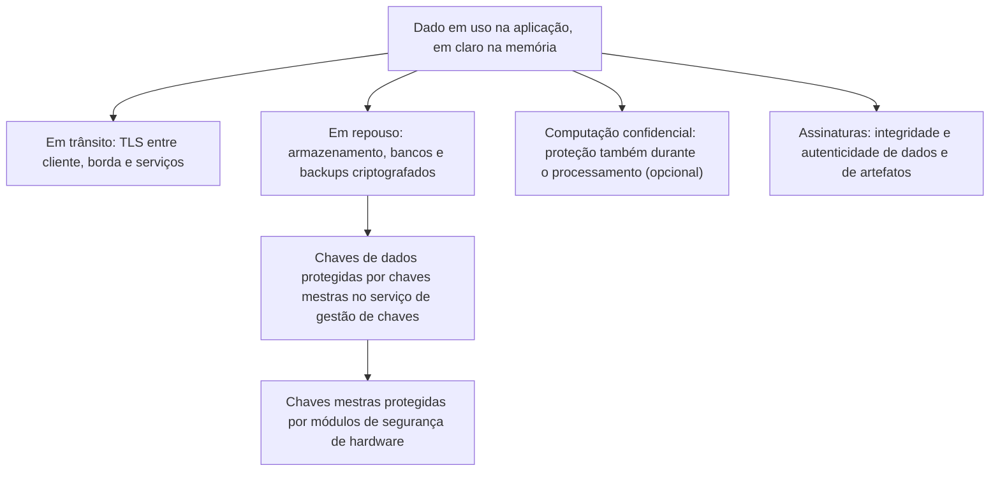

# Fundamentos de Criptografia em Nuvem

> **Objetivo pedagógico:** compreender as primitivas criptográficas usadas em nuvem (criptografia simétrica e assimétrica, funções de hash, códigos de autenticação, assinaturas digitais e derivação de chaves), escolher algoritmos e tamanhos de chave adequados, entender a criptografia autenticada e os riscos de reutilização de números de uso único, conhecer a validação de módulos criptográficos (FIPS 140-3), definir o modelo de ameaças da criptografia em repouso, em trânsito e em uso, e preparar a organização para a agilidade criptográfica e para a transição pós-quântica.

## 1. O que a criptografia protege (e o que não protege)

A criptografia transforma dados de modo que apenas quem possui a chave correta possa acessá-los ou verificar sua integridade e origem. Em nuvem, ela é uma das camadas de proteção, **não a única**.

| Ameaça | A criptografia ajuda? | Observação |
|---|---|---|
| Roubo de mídia ou acesso físico à infraestrutura | Sim | Principal ameaça tratada pela criptografia em repouso com chaves do provedor |
| Interceptação de tráfego na rede | Sim | TLS, IPsec e MACsec |
| Acesso por credenciais válidas, por exemplo, uma conta comprometida com permissão de leitura | **Não, por si só** | A decifração é transparente para quem tem permissão de usar a chave e de acessar o dado |
| Acesso indevido por configuração incorreta de permissões | Parcialmente | Se a chave tiver política própria e restrita, o acesso ao dado exige também acesso à chave |
| Acesso de administradores do provedor | Depende do modelo de chaves | Chaves sob controle exclusivo do cliente reduzem esse risco (arquivo 6) |
| Exigências de autoridades estrangeiras sobre o provedor | Parcialmente | Chaves do cliente fora da jurisdição do provedor dificultam o acesso ao conteúdo (pasta 09, arquivo 6) |
| Adulteração de dados | Sim, com autenticação | Códigos de autenticação, criptografia autenticada e assinaturas |
| Vazamento por erro de aplicação (resposta com dados em excesso) | Não | Controle de acesso e validação |
| Malware e ransomware com acesso ao sistema | Não | O atacante usa os dados já decifrados em uso; ransomware criptografa por conta própria |

**Regra:** a criptografia reduz o impacto de determinadas falhas, mas a decisão de quem pode **usar a chave** é a decisão de quem pode **ler o dado**.

## 2. Estados dos dados e criptografia

| Estado | Mecanismos principais | Onde é tratado |
|---|---|---|
| Em repouso | Criptografia de discos, de objetos, de bancos e de backups; criptografia de campo e no lado do cliente | Arquivo 3 |
| Em trânsito | TLS 1.2 e 1.3, TLS mútuo, IPsec e MACsec | Arquivo 4 |
| Em uso | Computação confidencial, enclaves e ambientes de execução confiáveis | Arquivo 6 |
| Em assinatura e integridade | Assinaturas digitais, códigos de autenticação e certificados | Arquivo 5 |

## 3. Primitivas criptográficas

| Primitiva | Função | Exemplos recomendados | Uso em nuvem |
|---|---|---|---|
| Criptografia simétrica | Confidencialidade com uma chave compartilhada | AES com chaves de 128 ou 256 bits; ChaCha20 | Dados em repouso, volumes, bancos e criptografia em envelope |
| Criptografia autenticada (AEAD) | Confidencialidade e integridade juntas | AES-GCM; ChaCha20-Poly1305 | Modo recomendado para novos usos |
| Criptografia assimétrica (chave pública) | Troca de chaves e assinaturas sem segredo compartilhado | RSA de 3072 bits ou mais; curvas elípticas (P-256, P-384, Ed25519) | Certificados, TLS, assinatura de artefatos |
| Troca de chaves | Estabelecer chaves de sessão | ECDHE (efêmera), com sigilo perfeito adiante | TLS e VPN |
| Funções de hash | Resumo de tamanho fixo para integridade | SHA-256, SHA-384, SHA-512, SHA-3 | Verificação de integridade, assinaturas |
| Código de autenticação de mensagem (MAC) | Integridade e autenticidade com chave secreta | HMAC-SHA-256 | Pseudonimização, tokens e autenticação de requisições |
| Assinatura digital | Autenticidade, integridade e não repúdio | ECDSA, EdDSA, RSA-PSS | Certificados, código, imagens de contêineres, documentos |
| Derivação de chaves a partir de senhas | Tornar a força bruta cara | Argon2id, scrypt, bcrypt, PBKDF2 (com parâmetros adequados) | Armazenamento de senhas (responsabilidade do provedor de identidade) |
| Derivação de chaves a partir de chaves | Gerar subchaves | HKDF | Hierarquias de chaves e protocolos |
| Geradores de números aleatórios | Fonte de aleatoriedade criptográfica | Geradores do sistema operacional e de módulos validados | Geração de chaves e de números de uso único |

### 3.1 Algoritmos e práticas a evitar

| Evitar | Motivo | Substituir por |
|---|---|---|
| DES e 3DES | Tamanho de bloco e de chave insuficientes | AES |
| RC4 | Vulnerabilidades graves | AES-GCM ou ChaCha20-Poly1305 |
| MD5 e SHA-1 em assinaturas e em integridade com adversário | Colisões práticas | SHA-256 ou superior |
| RSA de 1024 bits ou menos | Fatoração viável | RSA de 3072 bits ou curvas elípticas |
| Modos de cifra sem autenticação (ECB, CBC sem MAC) | Vazamento de padrões e ataques de adulteração | Modos AEAD |
| Protocolos SSL 2.0, SSL 3.0, TLS 1.0 e TLS 1.1 | Vulnerabilidades conhecidas | TLS 1.2 e TLS 1.3 |
| Geração de chaves com aleatoriedade fraca (`rand()`, horário e valores previsíveis) | Chaves adivinháveis | Fontes criptográficas seguras |
| Criar algoritmos ou protocolos próprios | Fraquezas não detectadas | Bibliotecas padronizadas e revisadas |
| Chaves e segredos no código-fonte | Exposição | Serviços de gestão de chaves e de segredos (pasta 06) |

Consulte o NIST SP 800-131A (transição de algoritmos e de tamanhos de chave) e as recomendações vigentes dos órgãos de segurança nacionais para os parâmetros atuais.

## 4. Criptografia autenticada e números de uso único

O AES-GCM é amplamente usado por ser rápido e fornecer confidencialidade e integridade. Porém, tem uma restrição crítica:

| Regra | Consequência da violação |
|---|---|
| Nunca reutilizar o par (chave, nonce) | Exposição do conteúdo e da chave de autenticação, permitindo a falsificação de mensagens |
| Usar nonces de 96 bits, gerados com cuidado (aleatórios com limite de uso por chave, ou contadores) | Colisões ao cifrar volumes muito grandes com a mesma chave |
| Respeitar os limites de volume por chave | Perda de segurança ao exceder os limites recomendados |
| Autenticar os dados associados (contexto) | Impede que o texto cifrado seja usado em outro contexto |

Por isso, os serviços de gestão de chaves usam **chaves de dados distintas** para cada objeto ou volume (criptografia em envelope, arquivo 2) e as bibliotecas de alto nível (como o AWS Encryption SDK e o Google Tink) tratam esses detalhes. Prefira-as a implementações manuais.

## 5. Tamanhos de chave e força de segurança

| Força de segurança (bits) | Simétrica | Hash (resistência a colisão) | RSA (módulo) | Curvas elípticas |
|---|---|---|---|---|
| 112 | 3DES (descontinuado) | SHA-224 | 2048 | 224 |
| 128 | AES-128 | SHA-256 | 3072 | 256 (P-256) |
| 192 | AES-192 | SHA-384 | 7680 | 384 (P-384) |
| 256 | AES-256 | SHA-512 | 15360 | 512 (P-521) |

Orientação prática: **AES-256** para dados de longa duração e para classificações elevadas; **P-256 ou P-384** (ou Ed25519) para assinaturas e trocas de chaves; **RSA de 3072 bits** quando exigido por compatibilidade. A força efetiva depende da implementação e da proteção das chaves.

## 6. Validação de módulos criptográficos

| Padrão | Descrição |
|---|---|
| FIPS 140-3 (e 140-2, em transição) | Programa de validação de módulos criptográficos, com níveis de segurança de 1 a 4; o nível 3 inclui proteção física contra adulteração e autenticação baseada em identidade |
| Common Criteria | Avaliação de segurança de produtos |
| Programas nacionais | Certificações aceitas por reguladores e por governos |
| Uso em nuvem | Serviços de gestão de chaves e HSMs dos provedores indicam os módulos validados e os níveis; verifique o certificado, a versão e o escopo da validação |

A validação aplica-se a **módulos e versões específicos**: confirme que o serviço e a configuração utilizados estão no escopo do certificado, quando houver requisito regulatório.

## 7. Agilidade criptográfica e a transição pós-quântica

Computadores quânticos suficientemente poderosos poderiam quebrar algoritmos de chave pública atuais (RSA e curvas elípticas). Mesmo antes de existirem, o risco de **"coletar agora e decifrar depois"** (*harvest now, decrypt later*) afeta dados de longa vida.

| Elemento | Descrição |
|---|---|
| Padrões do NIST (agosto de 2024) | FIPS 203 (ML-KEM, para troca de chaves), FIPS 204 (ML-DSA, para assinaturas) e FIPS 205 (SLH-DSA, assinaturas baseadas em hash) |
| Cronograma de transição | O NIST publicou rascunhos de diretrizes de transição prevendo a descontinuação de algoritmos de chave pública vulneráveis (RSA e curvas elípticas) ao longo da próxima década; acompanhe a versão final |
| Algoritmos simétricos e hash | AES-256 e SHA-384 ou superior são considerados resistentes, com margem |
| Abordagem híbrida | Combinar algoritmos clássicos e pós-quânticos em TLS e em troca de chaves durante a transição; já suportada por parte de bibliotecas e de serviços |
| Agilidade criptográfica | Projetar sistemas para trocar algoritmos sem reescrever aplicações (configuração central, bibliotecas abstratas e inventário) |

### Plano de preparação

| Passo | Atividade |
|---|---|
| 1 | Inventariar o uso de criptografia (algoritmos, bibliotecas, certificados e chaves): "lista de materiais criptográficos" (arquivo 7) |
| 2 | Identificar dados de longa vida e sensíveis a "coletar agora e decifrar depois" |
| 3 | Priorizar a troca de chaves em TLS e em VPN (confidencialidade) e depois as assinaturas |
| 4 | Acompanhar a oferta de provedores e de bibliotecas com algoritmos pós-quânticos e híbridos |
| 5 | Exigir agilidade criptográfica em novos projetos e em contratos de fornecedores |
| 6 | Testar a compatibilidade e o desempenho em ambientes de teste |

## 8. Exemplo prático: escolhas criptográficas para uma plataforma de pagamentos

| Necessidade | Escolha | Justificativa |
|---|---|---|
| Dados em repouso (banco e objetos) | AES-256, com chaves gerenciadas pelo cliente em serviço de gestão de chaves | Classificação "restrito"; separação de funções |
| Campos sensíveis (número de cartão) | Criptografia de campo ou tokenização, com chaves dedicadas | Redução do escopo da conformidade (PCI DSS) e de acessos |
| Tráfego externo | TLS 1.3 preferencial e 1.2 como mínimo, com sigilo perfeito | Requisitos de segurança e de conformidade |
| Tráfego entre serviços | TLS mútuo com certificados de curta duração | Autenticação entre cargas |
| Assinatura de imagens e de artefatos | Assinatura com chaves em serviço de gestão de chaves (ECDSA P-256) | Integridade da cadeia de suprimentos |
| Pseudonimização de identificadores | HMAC-SHA-256 com chave em cofre | Resistência à reversão por força bruta |
| Preparação pós-quântica | Inventário criptográfico, TLS híbrido quando disponível e agilidade em bibliotecas | Dados de longa vida |

## 9. Casos de uso corporativos

- Definição do padrão corporativo de criptografia (algoritmos, tamanhos e protocolos aprovados).
- Avaliação de serviços e de fornecedores quanto à criptografia e à validação de módulos.
- Programa de agilidade criptográfica e de transição pós-quântica.

## 10. Normas e frameworks relevantes

- NIST SP 800-57 Part 1 Rev. 5; NIST SP 800-131A; NIST SP 800-175B (uso de mecanismos criptográficos); NIST FIPS 140-3; NIST FIPS 197 (AES); NIST SP 800-38D (GCM)
- NIST FIPS 203, 204 e 205; NIST IR 8547 (transição para criptografia pós-quântica, edição vigente)
- ISO/IEC 27002:2022 (8.24, uso de criptografia); CSA CCM v4 (CEK); PCI DSS v4.0 (requisitos 3 e 4); OWASP Cryptographic Storage Cheat Sheet
- LGPD, art. 46 (medidas técnicas de segurança)

## 11. Checklist operacional: base de criptografia

- [ ] Padrão corporativo de criptografia aprovado (algoritmos, tamanhos de chave e protocolos)
- [ ] Algoritmos e protocolos fracos proibidos e detectados
- [ ] Uso de bibliotecas e de serviços validados; nenhuma criptografia própria
- [ ] Criptografia autenticada (AEAD) para novos usos; regras de nonces respeitadas
- [ ] Requisitos de validação de módulos (FIPS 140) identificados e verificados quando aplicáveis
- [ ] Modelo de ameaças da criptografia documentado por classificação de dados
- [ ] Inventário criptográfico iniciado e dados de longa vida identificados
- [ ] Plano de agilidade criptográfica e de transição pós-quântica
- [ ] Revisão anual do padrão

## 12. Referências

- Barker, E. NIST SP 800-57 Part 1 Rev. 5. 2020.
- Barker, E.; Roginsky, A. NIST SP 800-131A Rev. 2. 2019.
- NIST. FIPS 203, FIPS 204 e FIPS 205. 2024.
- Ferguson, N.; Schneier, B.; Kohno, T. Cryptography Engineering. Wiley, 2010.
- OWASP. Cryptographic Storage Cheat Sheet.
- Pastas 05, 06 e 09 deste repositório.
