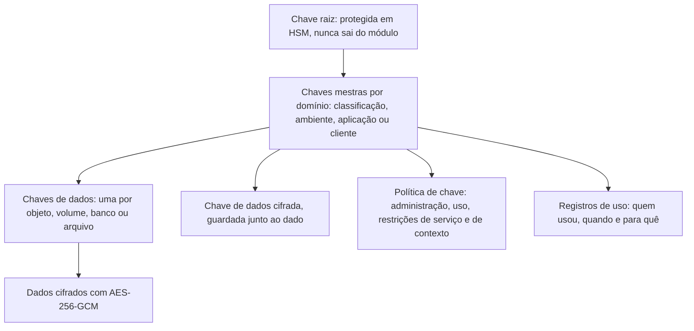
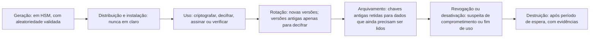

# Gestão de Chaves: KMS, HSM e Hierarquia de Chaves

> **Objetivo pedagógico:** operar a gestão de chaves em nuvem: compreender os serviços de gestão de chaves (KMS) e os módulos de segurança de hardware (HSM) dos três provedores, a criptografia em envelope e a hierarquia de chaves, o ciclo de vida das chaves, a separação entre administradores e usuários das chaves, as políticas de acesso, a rotação, a proteção contra exclusão acidental ou maliciosa, a resiliência (chaves em várias regiões) e o registro de auditoria, com exemplos de políticas e de verificações de somente leitura.

## 1. Serviços de gestão de chaves por provedor

| Aspecto | AWS | Azure | Google Cloud |
|---|---|---|---|
| Serviço de gestão de chaves | AWS KMS | Azure Key Vault (chaves) | Cloud KMS |
| HSM gerenciado de uso compartilhado | Chaves do KMS protegidas por HSMs validados | Key Vault Premium (chaves protegidas por HSM) | Cloud HSM (nível de proteção HSM no Cloud KMS) |
| HSM dedicado | AWS CloudHSM (cluster dedicado, controle exclusivo do cliente) | Azure Managed HSM (HSM dedicado, de locatário único) | Cloud HSM e opções de HSM dedicado (consulte a oferta vigente) |
| Chaves externas | Armazenamento de chaves externo (XKS) e armazenamento de chaves personalizado | Integração com HSMs externos (por parceiros) | Cloud EKM (chaves em gestores externos) |
| Chaves de dados | Geradas pelo KMS e devolvidas cifradas (GenerateDataKey) | Encapsulamento e desencapsulamento de chaves (wrap e unwrap) | Encapsulamento por chaves do KMS; geração local |
| Geração automática e padronizada | Chaves gerenciadas pela AWS e chaves gerenciadas pelo cliente | Chaves gerenciadas pela plataforma e chaves gerenciadas pelo cliente | Chaves padrão do Google, CMEK e Autokey (criação automatizada de chaves por recurso) |
| Isolamento | Por conta e por região | Por cofre e por região | Por projeto, por anel de chaves e por local |

Os nomes, os níveis de validação e os recursos mudam: confirme na documentação vigente.

## 2. Criptografia em envelope e hierarquia de chaves

Na **criptografia em envelope**, os dados são cifrados por uma **chave de dados** (simétrica, local e rápida), e a chave de dados é cifrada (encapsulada) por uma **chave mestra** protegida no serviço de gestão de chaves.



| Vantagem | Descrição |
|---|---|
| Desempenho | Os dados em volume são cifrados localmente; apenas a chave de dados vai ao serviço |
| Rotação simplificada | Trocar a chave mestra exige recifrar apenas as chaves de dados, e não os dados |
| Revogação | Desabilitar ou excluir a chave mestra impede a decifração das chaves de dados |
| Isolamento | Chaves por domínio limitam o alcance de um comprometimento |
| Auditoria | Cada uso da chave mestra é registrado |

### Contexto de criptografia (dados autenticados associados)

Muitos serviços aceitam um **contexto de criptografia**, pares chave-valor autenticados e registrados que vinculam o texto cifrado ao seu uso (por exemplo, `aplicacao=extratos`, `ambiente=prod`). A decifração só ocorre se o mesmo contexto for apresentado. Use-o para **impedir o uso indevido de chaves entre aplicações** e para enriquecer os registros de auditoria.

## 3. Ciclo de vida das chaves (NIST SP 800-57)



| Fase | Controles |
|---|---|
| Geração | Em serviço ou HSM validado; tamanhos e algoritmos do padrão corporativo; sem geração em estações de trabalho |
| Distribuição | Nunca em claro; importação de material de chave (BYOK) com proteção do envelope e comprovação de origem |
| Uso | Políticas de acesso mínimo; separação de funções; contexto de criptografia; limites de uso por serviço |
| Rotação | Automática e periódica; imediata em caso de suspeita; planejamento para chaves de assinatura (publicação de novas chaves públicas) |
| Arquivamento | Versões antigas mantidas desativadas para decifração, enquanto houver dados que dependam delas |
| Revogação | Procedimento de emergência para desativar chaves comprometidas, com avaliação do impacto na disponibilidade |
| Destruição | Agendada, com período de espera, com aprovação e registro; apenas quando todos os dados dependentes já foram eliminados ou recifrados |

## 4. Separação de funções e políticas de chaves

| Função | Pode | Não pode |
|---|---|---|
| Administrador de chaves | Criar, desabilitar, agendar exclusão, alterar políticas e configurar a rotação | Usar a chave para cifrar ou decifrar dados |
| Usuário da chave (aplicação ou serviço) | Cifrar, decifrar, gerar chaves de dados e assinar, conforme a política | Administrar a chave nem alterar a política |
| Auditor | Ler registros e configurações | Alterar ou usar a chave |
| Administrador de dados | Gerir os dados e os recursos que usam a chave | Alterar a política da chave |

### 4.1 Exemplo: política de chave com separação de funções (AWS KMS)

```json
{
  "Version": "2012-10-17",
  "Id": "politica-chave-extratos",
  "Statement": [
    {
      "Sid": "HabilitarPoliticasDeIdentidadeDaConta",
      "Effect": "Allow",
      "Principal": { "AWS": "arn:aws:iam::111122223333:root" },
      "Action": "kms:*",
      "Resource": "*"
    },
    {
      "Sid": "AdministracaoDaChave",
      "Effect": "Allow",
      "Principal": { "AWS": "arn:aws:iam::111122223333:role/AdminChaves" },
      "Action": [
        "kms:Create*", "kms:Describe*", "kms:Enable*", "kms:List*", "kms:Put*",
        "kms:Update*", "kms:Revoke*", "kms:Disable*", "kms:Get*",
        "kms:ScheduleKeyDeletion", "kms:CancelKeyDeletion", "kms:TagResource", "kms:UntagResource"
      ],
      "Resource": "*"
    },
    {
      "Sid": "UsoDaChavePelaAplicacao",
      "Effect": "Allow",
      "Principal": { "AWS": "arn:aws:iam::111122223333:role/AplicacaoExtratos" },
      "Action": ["kms:Encrypt", "kms:Decrypt", "kms:GenerateDataKey", "kms:DescribeKey"],
      "Resource": "*",
      "Condition": {
        "StringEquals": { "kms:EncryptionContext:aplicacao": "extratos" }
      }
    }
  ]
}
```

**Atenção:** a primeira instrução (conta raiz) habilita o uso de políticas de identidade e evita perder o acesso à chave, mas concede à conta a possibilidade de delegar acessos por IAM. Para separar funções de forma rigorosa, combine-a com **políticas organizacionais** que impeçam identidades comuns de administrar chaves ou de usá-las fora do esperado, e monitore as alterações. Teste as políticas em ambiente de laboratório: uma política de chave incorreta pode tornar a chave inacessível.

## 5. Rotação de chaves

| Tipo de chave | Prática |
|---|---|
| Chaves mestras de criptografia simétrica | Rotação automática periódica (por exemplo, anual, com o período configurável conforme o serviço); versões antigas permanecem disponíveis para decifração |
| Chaves de dados | Uma por objeto ou por volume; a rotação da mestra não exige recifrar os dados |
| Rotação por demanda | Procedimento imediato para suspeita de comprometimento |
| Chaves assimétricas e de assinatura | Rotação planejada, com publicação das novas chaves públicas e período de transição (por exemplo, em conjuntos de chaves públicas JWKS) |
| Chaves importadas (BYOK) | A rotação é responsabilidade do cliente: planejar a importação de novo material |
| Chaves no HSM dedicado | Processos próprios de rotação e de backup do cluster |

Rotacionar a chave mestra **não** recifra os dados existentes automaticamente em todos os serviços: entenda o comportamento de cada serviço. Para recifrar dados antigos com nova chave (por exemplo, por exigência normativa), é necessário um processo específico.

## 6. Proteção contra exclusão acidental ou maliciosa

A exclusão de uma chave torna os dados cifrados por ela **irrecuperáveis**. É um risco de disponibilidade e uma técnica de ataque (destruição de dados).

| Provedor | Mecanismos de proteção |
|---|---|
| AWS KMS | Exclusão agendada com período de espera de 7 a 30 dias; possibilidade de desabilitar a chave antes; alarmes para eventos de exclusão agendada; políticas de negação para `kms:ScheduleKeyDeletion` fora do papel autorizado |
| Azure Key Vault | Exclusão lógica (soft delete) e proteção contra limpeza (purge protection), que impede a remoção definitiva durante a retenção; controles de acesso por RBAC |
| Google Cloud KMS | Destruição agendada de versões de chaves, com período de espera (padrão longo, configurável); possibilidade de desativar versões |

| Controle adicional | Descrição |
|---|---|
| Alerta imediato para agendamento de exclusão e para desabilitação | Detecção por registros de auditoria |
| Aprovação por duas pessoas | Procedimento para exclusão de chaves de produção |
| Política organizacional | Impedir a exclusão de chaves por identidades comuns |
| Inventário de dependências | Saber quais dados dependem de cada chave antes de qualquer exclusão |
| Backup e replicação de chaves | Chaves em várias regiões para continuidade e recuperação (seção 7) |

## 7. Resiliência e continuidade das chaves

| Cenário | Estratégia |
|---|---|
| Falha de uma região | Chaves replicadas em várias regiões (por exemplo, chaves de várias regiões do AWS KMS), alinhadas à residência exigida |
| Recuperação em outra conta ou região | Chaves e políticas disponíveis na região de recuperação; teste de decifração nas condições de desastre |
| Perda do acesso administrativo | Contas de emergência e procedimentos de recuperação (pasta 06, arquivo 4) |
| Limites de taxa do serviço | Cache seguro de chaves de dados com validade curta; reduzir o volume de chamadas; solicitar aumento de cotas |
| Dependência do serviço de chaves | Planejar a degradação (por exemplo, manter dados em cache já decifrados por prazo limitado, conforme o risco) e testar o comportamento sob falha |
| Chaves externas (HYOK) | O indisponibilidade do gestor externo impede o acesso aos dados: arquitetura e acordos de nível de serviço adequados (arquivo 6) |

## 8. Auditoria e monitoramento

| Registro | Uso |
|---|---|
| Operações de uso (Encrypt, Decrypt, GenerateDataKey, Sign) | Detectar uso anômalo por identidade, origem, volume e contexto |
| Operações administrativas (criação, alteração de política, desabilitação, exclusão agendada e rotação) | Detectar abuso e mudanças não autorizadas |
| Falhas de acesso negado | Sinal de tentativas indevidas |
| Concessões (grants) e associações a serviços | Revisar acessos delegados |
| Integração com o SIEM | Alertas e investigação |

Detecções prioritárias: **exclusão agendada de chave**, **alteração de política de chave**, **uso de chave por identidade não habitual**, **picos de decifração** e **desabilitação de chaves**.

## 9. Verificações de somente leitura

```bash
# AWS KMS: chaves, estado, rotação e política
aws kms list-keys --query "Keys[].KeyId" --output text
aws kms describe-key --key-id ID-DA-CHAVE --query "KeyMetadata.[KeyId,KeyState,KeyManager,KeySpec,MultiRegion]"
aws kms get-key-rotation-status --key-id ID-DA-CHAVE
aws kms get-key-policy --key-id ID-DA-CHAVE --policy-name default --query Policy --output text

# Azure Key Vault: proteção contra exclusão, modelo de autorização e acesso à rede
az keyvault list --query "[].name" --output tsv
az keyvault show --name COFRE-EXEMPLO \
  --query "{exclusaoLogica:properties.enableSoftDelete, protecaoPurga:properties.enablePurgeProtection, rbac:properties.enableRbacAuthorization, redePublica:properties.publicNetworkAccess}"
az keyvault key list --vault-name COFRE-EXEMPLO --query "[].{nome:name, ativa:attributes.enabled, expira:attributes.expires}" --output table
az keyvault key rotation-policy show --vault-name COFRE-EXEMPLO --name CHAVE-EXEMPLO

# Google Cloud KMS: anéis de chaves, chaves e rotação
gcloud kms keyrings list --location=southamerica-east1
gcloud kms keys list --keyring=ANEL-EXEMPLO --location=southamerica-east1 --format="table(name,purpose,rotationPeriod,nextRotationTime)"
gcloud kms keys describe CHAVE-EXEMPLO --keyring=ANEL-EXEMPLO --location=southamerica-east1
```

## 10. Exemplo prático: reestruturação da gestão de chaves de uma instituição financeira

| Situação inicial | Ação | Resultado |
|---|---|---|
| Uma única chave mestra para todos os dados da conta; administradores também usavam a chave | Chaves por domínio (classificação e aplicação), com políticas que separam administradores e usuários | Raio de impacto reduzido; funções separadas |
| Rotação inexistente | Rotação automática anual e procedimento de rotação imediata | Chaves rotacionadas; teste do procedimento de emergência |
| Chaves sem proteção contra exclusão | Período de espera máximo, alertas, aprovação por duas pessoas e política que impede a exclusão por identidades comuns | Proteção contra destruição acidental ou maliciosa |
| Sem chaves na região de recuperação | Chaves de várias regiões para sistemas críticos; teste de decifração no exercício de recuperação | RTO validado |
| Registros de uso não monitorados | Detecções para exclusão agendada, alteração de política e uso anômalo | Alerta em minutos |
| Resultado | Em um exercício de comprometimento de uma conta de desenvolvimento, as chaves de produção permaneceram inacessíveis; a tentativa de agendar a exclusão foi bloqueada e alertada | |

## 11. Casos de uso corporativos

- Arquitetura de chaves por domínio de dados, com separação de funções.
- Procedimentos de rotação, de revogação e de recuperação de chaves, com testes.
- Monitoramento de operações de chaves e de alterações de políticas.

## 12. Normas e frameworks relevantes

- NIST SP 800-57 Part 1 Rev. 5 (gestão de chaves), Part 2 (práticas de gestão) e Part 3 (aplicações); NIST SP 800-130 (projeto de sistemas de gestão de chaves); NIST FIPS 140-3
- CSA CCM v4 (CEK-01 a CEK-21); ISO/IEC 27002:2022 (8.24); NIST SP 800-53 Rev. 5 (SC-12 e SC-13); PCI DSS v4.0 (requisito 3.6 e 3.7)
- MITRE ATT&CK: T1485 (destruição de dados), T1531 (remoção de acesso a contas), T1552 (credenciais não protegidas)

## 13. Checklist operacional: gestão de chaves

- [ ] Arquitetura de chaves por domínio (classificação, ambiente e aplicação), com criptografia em envelope
- [ ] Administradores, usuários e auditores de chaves separados por política
- [ ] Contexto de criptografia usado para vincular o uso das chaves às aplicações
- [ ] Rotação automática configurada e procedimento de rotação imediata testado
- [ ] Proteção contra exclusão: período de espera, alertas, política e aprovação por duas pessoas
- [ ] Chaves replicadas ou recuperáveis na região de recuperação; teste de decifração nos exercícios
- [ ] Limites de cotas e comportamento sob falha do serviço de chaves tratados
- [ ] Registros de uso e de administração centralizados, com detecções prioritárias
- [ ] Inventário de chaves com proprietário, finalidade e dados dependentes
- [ ] Revisão semestral das políticas de chaves

## 14. Referências

- Barker, E. NIST SP 800-57 Part 1 Rev. 5. 2020; Part 2 Rev. 1. 2019.
- Barker, E. et al. NIST SP 800-130: A Framework for Designing Cryptographic Key Management Systems. 2013.
- Amazon Web Services. AWS KMS Developer Guide e AWS CloudHSM; Microsoft. Azure Key Vault e Managed HSM; Google Cloud. Cloud KMS e Cloud HSM (documentação vigente).
- PCI Security Standards Council. PCI DSS v4.0.
- Pastas 05, 06 e 13 deste repositório.
