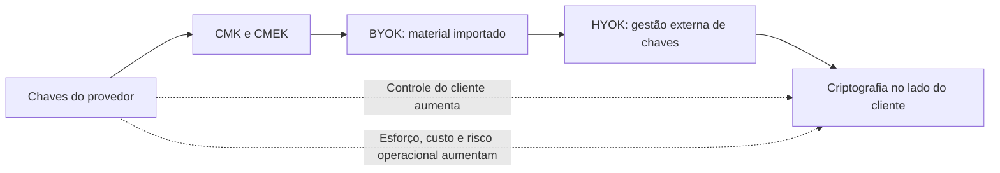
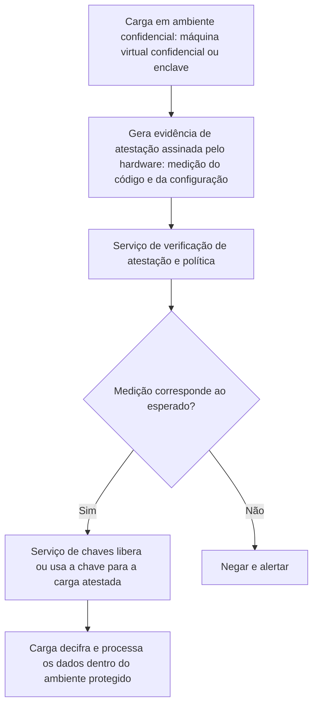

# Modelos de Controle de Chaves: BYOK, HYOK e Computação Confidencial

> **Objetivo pedagógico:** escolher o nível de controle sobre as chaves de criptografia em nuvem (chaves do provedor, do cliente no serviço de chaves do provedor, importadas pelo cliente — BYOK —, mantidas fora do provedor — HYOK ou gestão externa de chaves — e criptografia no lado do cliente), compreender as garantias reais e as limitações de cada modelo, os custos de disponibilidade e de operação, a justificativa e o controle de acesso do provedor às chaves, o papel da computação confidencial para proteger dados em uso com liberação de chaves condicionada à atestação, e preparar planos de revogação e de continuidade.

## 1. Espectro de controle sobre as chaves

| Modelo | Descrição | Onde está a chave | Garantia principal | Principais custos e riscos |
|---|---|---|---|---|
| 1. Chaves do provedor | O provedor gera, guarda e usa as chaves, de forma transparente | Serviço do provedor | Proteção contra mídia roubada | Nenhum controle do cliente sobre a política e a revogação |
| 2. Chaves do cliente no KMS do provedor (CMK e CMEK) | O cliente define política, rotação, desativação e auditoria; o material fica no serviço do provedor | KMS ou HSM do provedor | Separação de funções, auditoria e capacidade de desabilitar a chave | O provedor opera o serviço; confiança no provedor e no seu serviço |
| 3. BYOK (traga sua própria chave) | O cliente gera o material de chave fora do provedor e o **importa** para o serviço de chaves | KMS do provedor (cópia); original sob guarda do cliente | Origem e geração controladas pelo cliente; possibilidade de reimportar e de eliminar a cópia no provedor | Responsabilidade pela geração segura, backup e rotação; o material fica, após a importação, no provedor |
| 4. HYOK (mantenha sua própria chave) ou gestão externa de chaves | O material **nunca sai** de um gestor de chaves ou HSM sob controle do cliente; o provedor chama o gestor a cada uso | Gestor externo (HSM do cliente ou de terceiro) | O provedor não possui a chave: revogar no gestor interrompe imediatamente o acesso | Latência e disponibilidade dependem do gestor externo; complexidade; funcionalidades limitadas |
| 5. Criptografia no lado do cliente | O cliente cifra antes de enviar; o provedor só recebe texto cifrado | Sob controle exclusivo do cliente | O provedor nunca tem acesso ao dado em claro | Funcionalidades limitadas do serviço (busca e processamento); responsabilidade total |



## 2. Ofertas por provedor (categorias)

| Modelo | AWS | Azure | Google Cloud |
|---|---|---|---|
| CMK e CMEK | AWS KMS (chaves gerenciadas pelo cliente) | Chaves do cliente em Key Vault e Managed HSM | Cloud KMS e Cloud HSM (CMEK) |
| BYOK | Importação de material de chave para o KMS; chaves em armazenamento personalizado com CloudHSM | Importação de chaves protegidas por HSM (BYOK) para Key Vault Premium e Managed HSM | Importação de chaves para o Cloud KMS |
| HYOK e gestão externa | Armazenamento de chaves externo (XKS), com gestores de parceiros | Gestão de chaves de parceiros e criptografia de chave dupla em serviços específicos | Cloud EKM, com gestores de parceiros |
| Lado do cliente | AWS Encryption SDK e bibliotecas | Bibliotecas de criptografia de aplicação | Tink e bibliotecas de criptografia de aplicação |
| Computação confidencial | AWS Nitro Enclaves e instâncias com proteção de memória | Máquinas virtuais confidenciais e contêineres confidenciais | Confidential VMs e Confidential GKE Nodes |

Os nomes, as garantias e as integrações mudam: confirme na documentação vigente.

## 3. Garantias reais e limitações

| Tema | Observação |
|---|---|
| "O provedor não pode ler os meus dados" | Depende do modelo: em CMK, o serviço **pode** usar a chave sob a política definida (e sob ordem legal, dependendo do arranjo); em HYOK, o provedor precisa consultar o gestor externo a cada uso, e a revogação no gestor interrompe o acesso; no lado do cliente, o provedor só tem texto cifrado |
| Dados em uso | Mesmo com chaves externas, em algum momento o serviço do provedor precisa do dado em claro para processá-lo (por exemplo, um banco que decifra para consultar). A computação confidencial reduz esse risco |
| Metadados | Nomes, tamanhos, padrões de acesso e quem acessa o quê podem permanecer visíveis ao provedor |
| Revogar a chave = indisponibilidade | A capacidade de revogação é um poder de **corte de acesso**, que também é um risco de continuidade para o próprio cliente |
| Dependência de disponibilidade externa | A falha do gestor externo ou da conectividade com ele impede a leitura de dados |
| Jurisdição do gestor externo | A localização e o operador do gestor de chaves definem a jurisdição aplicável (pasta 09, arquivo 6) |
| Complexidade e erros | Mais componentes e mais pontos de falha; maior necessidade de especialização |
| Funcionalidades | Alguns serviços não suportam todos os modelos; verifique a compatibilidade por serviço |

## 4. Quando usar cada modelo

| Critério | Modelo sugerido |
|---|---|
| Dados públicos e internos, sem requisito específico | Chaves do provedor |
| Dados confidenciais, com requisito de separação de funções e de auditoria | Chaves do cliente (CMK e CMEK) |
| Requisito de geração e de origem controladas pelo cliente, por política ou por norma | BYOK |
| Requisito de soberania, de confiança reduzida no provedor ou de poder de revogação imediata, com capacidade operacional | HYOK ou gestão externa de chaves |
| Dados extremamente sensíveis em que o provedor não deve ter acesso nunca | Criptografia no lado do cliente, com avaliação das limitações |
| Processamento de dados sensíveis em ambientes do provedor com proteção durante o uso | Computação confidencial, com liberação de chaves por atestação |
| Requisitos regulatórios específicos (por exemplo, de instituições financeiras e do setor público) | Conforme a norma e a avaliação de risco; consulte a conformidade e o Jurídico |

**Princípio:** o modelo deve ser proporcional ao risco e à capacidade de operar com segurança. Um modelo mais forte operado de forma frágil pode **reduzir** a segurança e a disponibilidade.

## 5. Justificativa e condições de acesso do provedor às chaves

| Mecanismo | Descrição |
|---|---|
| Condições de uso de chaves por serviço e por conta | Restringir o uso da chave a determinados serviços, contas e redes (por exemplo, as condições de serviço intermediário e de conta chamadora do AWS KMS) |
| Justificativas de acesso a chaves (Google Key Access Justifications) | Cada pedido de uso da chave externa pelo provedor traz uma justificativa (por exemplo, requisição do cliente ou acesso de suporte), e o gestor externo pode **aprovar ou negar automaticamente** |
| Aprovação de acessos de suporte | Controles de acesso do provedor aos dados do cliente com aprovação explícita (por exemplo, os recursos de aprovação de acessos de suporte oferecidos por alguns provedores) |
| Políticas de rede e de identidade para o uso de chaves | Origens permitidas e identidades autorizadas |
| Registros | Registro de cada uso e alertas de anomalias |

### Exemplo: restringir o uso de uma chave ao serviço de armazenamento de uma conta e região (AWS KMS)

```json
{
  "Sid": "UsoDaChaveSomentePeloArmazenamentoDaConta",
  "Effect": "Allow",
  "Principal": { "AWS": "arn:aws:iam::111122223333:role/AplicacaoExtratos" },
  "Action": ["kms:Encrypt", "kms:Decrypt", "kms:GenerateDataKey*", "kms:DescribeKey"],
  "Resource": "*",
  "Condition": {
    "StringEquals": {
      "kms:ViaService": "s3.sa-east-1.amazonaws.com",
      "kms:CallerAccount": "111122223333"
    }
  }
}
```

A condição impede que a chave seja usada diretamente por outras vias que não sejam o serviço de armazenamento indicado, na região e na conta indicadas. Este é um trecho de política de chave: integre-o à política completa (arquivo 2) e teste em laboratório.

## 6. Computação confidencial (dados em uso)

A computação confidencial protege os dados **durante o processamento**, executando as cargas em **ambientes de execução confiáveis** (TEE) com **memória criptografada** e isolada do sistema operacional hospedeiro, do hipervisor e, em princípio, do operador do provedor.

| Elemento | Descrição |
|---|---|
| Tecnologias | Extensões de hardware de fabricantes de processadores (por exemplo, AMD SEV-SNP e Intel TDX para máquinas virtuais confidenciais; enclaves, como Intel SGX e os Nitro Enclaves da AWS) |
| Atestação remota | O ambiente prova, com assinatura de hardware, **qual código** está rodando e em **qual configuração**; o verificador confirma antes de liberar segredos |
| Liberação de chaves condicionada à atestação | O serviço de chaves só entrega ou usa a chave se a atestação do ambiente corresponder à política (por exemplo, o resumo da imagem do enclave) |
| Casos de uso | Processamento de dados altamente sensíveis em nuvem pública; análise colaborativa entre organizações sem expor dados; proteção de modelos e de propriedade intelectual |
| Limitações | Desempenho e compatibilidade; superfície de ataque do TEE (vulnerabilidades de canais laterais e de microarquitetura); confiança nos fabricantes e na cadeia de atestação; disponibilidade de serviços |
| Ecossistema | Confidential Computing Consortium (Linux Foundation) |



### Exemplo conceitual: chave que só pode ser usada por um enclave atestado (AWS KMS)

```json
{
  "Sid": "UsoSomentePorEnclaveAtestado",
  "Effect": "Allow",
  "Principal": { "AWS": "arn:aws:iam::111122223333:role/FuncaoDoEnclave" },
  "Action": ["kms:Decrypt"],
  "Resource": "*",
  "Condition": {
    "StringEqualsIgnoreCase": {
      "kms:RecipientAttestation:ImageSha384": "RESUMO_SHA384_DA_IMAGEM_DO_ENCLAVE"
    }
  }
}
```

O exemplo é **conceitual**: o resumo (SHA-384) da imagem do enclave é fictício; a condição faz com que o KMS só atenda a pedidos acompanhados de atestação válida do enclave esperado. Consulte a documentação para os campos e o fluxo completos (a resposta do KMS é cifrada para o enclave). Em outros provedores, mecanismos equivalentes liberam chaves de forma condicionada à atestação (por exemplo, a liberação segura de chaves no Azure).

## 7. Revogação, continuidade e saída

| Cenário | Plano |
|---|---|
| Suspeita de comprometimento do ambiente ou do provedor | Procedimento de revogação imediata (desabilitar a chave ou revogar no gestor externo), com avaliação do impacto na disponibilidade |
| Ordem ou exigência legal inesperada | Avaliação jurídica; capacidade de contestar; chaves sob jurisdição adequada |
| Falha do gestor externo de chaves | Alta disponibilidade do gestor, acordos de nível de serviço, múltiplas instâncias e regiões, e plano de degradação |
| Saída do provedor | Exportação de dados, recifragem com novas chaves, destruição criptográfica das chaves antigas (pasta 09, arquivo 5) |
| Perda de chaves | Backup protegido do material de chave (BYOK) e de chaves de recuperação, com guarda em custódia dividida; testes de recuperação |
| Testes | Exercício de revogação em ambiente controlado: medir o tempo de corte e o tempo de recuperação |

## 8. Exemplo prático: escolha de modelo para três cargas de uma instituição de saúde

| Carga | Classificação e requisito | Modelo escolhido | Justificativa |
|---|---|---|---|
| Portal institucional | Público | Chaves do provedor | Sem requisito adicional |
| Prontuários eletrônicos | Restrito, dados sensíveis, jurisdição do Brasil | CMK exclusiva com HSM em região do Brasil; criptografia de campo para campos clínicos; BYOK avaliado e descartado por complexidade sem ganho adicional | Separação de funções, auditoria e residência |
| Análises clínicas colaborativas com um parceiro de pesquisa | Restrito, dados pseudonimizados de duas instituições | Computação confidencial com atestação e chaves liberadas apenas ao ambiente atestado; resultados agregados | Processamento conjunto sem exposição dos dados brutos a cada parte nem ao operador da nuvem |
| Resultado | Dados em uso protegidos para a carga colaborativa; custo adicional limitado a uma carga específica; plano de revogação testado | | |

## 9. Casos de uso corporativos

- Matriz de decisão do modelo de controle de chaves por classificação, por requisito legal e por capacidade operacional.
- Implementação de gestão externa de chaves para dados de soberania crítica, com plano de disponibilidade.
- Pilotos de computação confidencial para análises colaborativas e para dados altamente sensíveis.

## 10. Normas e frameworks relevantes

- NIST SP 800-57; NIST SP 800-53 Rev. 5 (SC-12, SC-13 e SC-28); ISO/IEC 27002:2022 (8.24); CSA CCM v4 (CEK-03, CEK-04 e CEK-21)
- Confidential Computing Consortium (documentos técnicos); IETF RATS (arquitetura de atestação remota, RFC 9334)
- Requisitos setoriais e de soberania aplicáveis (por exemplo, Resolução CMN 4.893/2021 e Resolução BCB 85/2021 para instituições financeiras; normas do setor público); LGPD, arts. 33 a 36 e 46
- MITRE ATT&CK: T1552, T1555 (credenciais em armazenamentos), T1486

## 11. Checklist operacional: controle de chaves

- [ ] Matriz de decisão do modelo de controle de chaves aprovada (classificação, requisito legal e capacidade)
- [ ] Modelos aplicados proporcionais ao risco, com custos e riscos de disponibilidade avaliados
- [ ] BYOK: geração segura, backup, custódia dividida e plano de rotação por reimportação
- [ ] HYOK: alta disponibilidade do gestor externo, acordos de nível de serviço e testes de falha
- [ ] Condições de uso das chaves por serviço, conta, região e identidade
- [ ] Controles de acesso de suporte do provedor aos dados, com aprovação e registro, quando disponíveis
- [ ] Computação confidencial avaliada para dados em uso de alta sensibilidade, com atestação e liberação condicionada de chaves
- [ ] Plano de revogação e de continuidade testado, com tempos medidos
- [ ] Jurisdição dos gestores de chaves documentada
- [ ] Revisão anual do modelo e das garantias contratuais

## 12. Referências

- Birkholz, H. et al. RFC 9334: Remote ATtestation procedureS (RATS) Architecture. IETF, 2023.
- Confidential Computing Consortium. A Technical Analysis of Confidential Computing (documento técnico).
- Amazon Web Services. AWS KMS External Key Store e Nitro Enclaves; Microsoft. Azure Confidential Computing e Managed HSM; Google Cloud. Cloud EKM, Key Access Justifications e Confidential Computing (documentação vigente).
- Pastas 05, 09 e 11 deste repositório.
