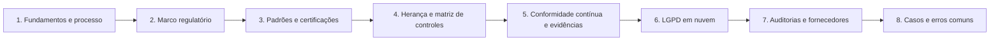

# 11 Conformidade em Nuvem

## Objetivo

Estruturar e operar um programa de conformidade para ambientes de nuvem que atenda a obrigações legais, regulatórias, contratuais e normativas: compreender os fundamentos e o processo de conformidade, mapear o marco regulatório brasileiro e internacional, usar padrões, certificações e relatórios de provedores, aplicar a herança de controles e construir a matriz de conformidade, automatizar a conformidade contínua e as evidências, operacionalizar a LGPD em nuvem (operadores, contratos e incidentes) e conduzir auditorias e avaliações de fornecedores.

## Trilha de estudo recomendada

## Conteúdo da pasta

| Ordem | Arquivo | Objetivo |
|---|---|---|
| 1 | [fundamentos-de-conformidade-em-nuvem.md](fundamentos-de-conformidade-em-nuvem.md) | Conceitos, responsabilidade pela conformidade, processo e registro de obrigações |
| 2 | [marco-regulatorio-brasileiro-e-internacional.md](marco-regulatorio-brasileiro-e-internacional.md) | LGPD, normas setoriais, setor público e referências internacionais |
| 3 | [padroes-certificacoes-e-relatorios-de-provedores.md](padroes-certificacoes-e-relatorios-de-provedores.md) | ISO, SOC 2, PCI DSS, CSA STAR e leitura de relatórios de provedores |
| 4 | [heranca-de-controles-mapeamento-e-matriz-de-conformidade.md](heranca-de-controles-mapeamento-e-matriz-de-conformidade.md) | Controles herdados, compartilhados e do cliente; mapeamento entre referenciais |
| 5 | [conformidade-continua-evidencias-e-automacao.md](conformidade-continua-evidencias-e-automacao.md) | Políticas como código, painéis de conformidade e gestão de evidências |
| 6 | [lgpd-em-nuvem-operadores-contratos-e-incidentes.md](lgpd-em-nuvem-operadores-contratos-e-incidentes.md) | Papéis, contratos com operadores, encarregado, RIPD e comunicação de incidentes |
| 7 | [auditorias-avaliacao-de-fornecedores-modelos-e-checklist.md](auditorias-avaliacao-de-fornecedores-modelos-e-checklist.md) | Auditorias de nuvem, diligência de fornecedores, modelos e checklist |
| 8 | [casos-de-uso-e-erros-comuns-em-conformidade-em-nuvem.md](casos-de-uso-e-erros-comuns-em-conformidade-em-nuvem.md) | Casos fictícios, erros comuns, exercícios e perguntas de revisão |

## Princípios da pasta

- A conformidade é responsabilidade da organização: a certificação do provedor não a transfere
- Conformidade e segurança se reforçam, mas não são sinônimos: cumprir requisitos não elimina riscos
- Comece pelas obrigações aplicáveis e mapeie controles uma vez para atender a vários requisitos
- Evidências automatizadas, completas e verificáveis valem mais do que declarações
- Conformidade é contínua: o ambiente de nuvem muda todos os dias
- O Jurídico e a privacidade participam da interpretação das normas; a segurança implementa e comprova

## Relação com outras pastas

- 01 a 05: fundamentos, responsabilidade, governança, riscos e arquitetura
- 06 a 10: controles técnicos de identidade, rede, dados e criptografia
- 12: controles de segurança em nuvem
- 13 e 17: monitoramento e gestão de postura
- 16 e 29: avaliações e auditorias de segurança em nuvem
- 22 e 23: resposta a incidentes e forense (comunicações obrigatórias)
- 27 e 28: métricas e roteiro

## Aviso

Este material é educacional e **não constitui aconselhamento jurídico**. Normas, prazos e interpretações mudam; confirme a vigência, o texto atual e a aplicação ao caso concreto com o Jurídico, com o encarregado (DPO) e com a área de conformidade.

## Referências

- Brasil. Lei nº 13.709/2018 (LGPD); Lei nº 12.965/2014 (Marco Civil da Internet)
- Resolução CMN nº 4.893/2021; Resolução BCB nº 85/2021; Circular Susep nº 638/2021; IN GSI/PR nº 5/2021
- ISO/IEC 27001:2022, 27017:2015, 27018:2019 e 27701:2019; AICPA SOC 2; PCI DSS v4.0.1
- Cloud Security Alliance. Cloud Controls Matrix v4 e programa STAR
- NIST SP 800-53 Rev. 5; NIST SP 800-53A Rev. 5
