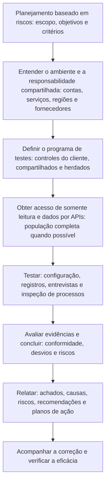
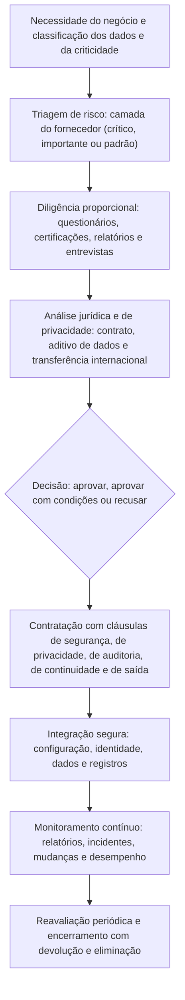

# Auditorias, Avaliação de Fornecedores, Modelos e Checklist

> **Objetivo pedagógico:** conduzir e receber auditorias em ambientes de nuvem (internas, externas, de certificação e de reguladores), adaptar o enfoque de auditoria à responsabilidade compartilhada e à automação, estruturar a avaliação de fornecedores de nuvem (diligência, questionários, análise de relatórios, cláusulas e monitoramento contínuo), tratar o direito de auditoria sobre provedores, e usar modelos (solicitação de evidências, programa de auditoria, questionário de diligência e plano de ação) e um checklist de conformidade em nuvem.

## 1. Tipos de auditoria e de avaliação

| Tipo | Quem conduz | Objetivo | Frequência |
|---|---|---|---|
| Auditoria interna | Auditoria interna (3ª linha) | Avaliação independente do desenho e da eficácia dos controles e da conformidade | Conforme o plano anual baseado em riscos |
| Autoavaliação de controles | 1ª e 2ª linhas | Verificação periódica pelos donos dos controles | Trimestral ou semestral |
| Auditoria de certificação (ISO/IEC 27001 e outras) | Organismo de certificação acreditado | Certificar o sistema de gestão (estágios 1 e 2; auditorias de manutenção anuais; recertificação a cada três anos) | Ciclo de três anos |
| Atestação (SOC 2) | Auditor independente (CPA) | Opinião sobre desenho e eficácia dos controles em um período | Anual |
| Avaliação de conformidade com padrão da indústria (PCI DSS) | Avaliador qualificado ou autoavaliação | Validar o cumprimento do padrão | Anual |
| Inspeção ou fiscalização de reguladores | Reguladores (ANPD, Banco Central, Susep e outros) | Verificar o cumprimento de normas | Conforme o regulador |
| Auditoria de clientes | Clientes e seus auditores | Verificar o cumprimento de requisitos contratuais | Conforme o contrato |
| Avaliação de fornecedores | Gestão de fornecedores, segurança e conformidade | Diligência na contratação e monitoramento | Na contratação e anual (críticos) |

## 2. Auditoria em ambiente de nuvem: enfoque

| Aspecto | Adaptação para nuvem |
|---|---|
| Entendimento do ambiente | Mapear contas, assinaturas, regiões, serviços, dados e dependências antes de testar |
| Responsabilidade compartilhada | Auditar os controles do **cliente**; para controles herdados, avaliar os **relatórios do provedor** e os CUEC |
| Acesso do auditor | Identidades de **leitura** (por exemplo, papéis de auditoria e de visualização de segurança), com registro de uso e prazo; sem acesso a dados desnecessários |
| População e amostragem | Preferir a **população completa** por APIs e por consultas; usar amostras apenas quando necessário, com critério |
| Integridade dos dados de auditoria | Registrar comandos, data, hora (UTC) e identidade; guardar as saídas com hash (arquivo 5) |
| Controles automáticos | Avaliar o desenho, a cobertura e a integridade das regras e das políticas como código |
| Mudanças contínuas | Considerar o histórico de configuração e o estado em datas relevantes |
| Dados pessoais | Evitar coletar conteúdo de dados pessoais; trabalhar com configurações e metadados |
| Independência | O auditor não opera os controles que avalia |

### 2.1 Áreas e testes típicos em auditorias de nuvem (visão geral)

| Área | Objetivo de controle | Teste e evidência (exemplos) |
|---|---|---|
| Governança e responsabilidades | Papéis, políticas e matriz de responsabilidade definidos | Revisão de políticas, de contratos e de matrizes; entrevistas |
| Identidade e acesso (pasta 06) | MFA forte; privilégio mínimo; revisão de acessos; contas de emergência | Consultas de configuração de MFA, de papéis e de acessos privilegiados; relatórios de revisões |
| Proteção de dados (pasta 09) | Classificação, acesso, retenção e eliminação | Inventário; configurações de bloqueio de acesso público; regras de ciclo de vida |
| Criptografia e chaves (pasta 10) | Criptografia por padrão; gestão de chaves | Verificações de volumes, de bancos e de chaves; políticas de chaves; rotação |
| Rede (pasta 08) | Segmentação; exposição; registros de fluxo | Grupos de segurança abertos; registros de fluxo habilitados |
| Registro e monitoramento (pasta 13) | Registros centralizados, retidos e protegidos; alertas | Configuração de trilhas; retenção; testes de alertas |
| Gestão de mudanças e de configuração | Mudanças autorizadas e testadas; infraestrutura como código | Amostras de mudanças; revisão de pipelines; verificação de desvios |
| Continuidade e backup | RTO e RPO; backups testados | Relatórios de testes de recuperação; configuração de backups imutáveis |
| Resposta a incidentes | Plano, papéis e testes | Planos, registros de incidentes e de exercícios |
| Fornecedores | Diligência e monitoramento | Avaliações, relatórios SOC 2 e CUEC |
| Privacidade e conformidade | Registro de operações, RIPD, direitos e incidentes | Registros, relatórios e atendimento de solicitações |

Detalhes de auditorias técnicas de segurança em nuvem: pasta 29.

## 3. Avaliação de fornecedores de nuvem

### 3.1 Ciclo de vida

### 3.2 Camadas de diligência (resumo; ver também a pasta 04, arquivo 6)

| Camada | Diligência típica |
|---|---|
| Crítico | Questionário completo (por exemplo, CAIQ ou SIG), análise de relatórios SOC 2 Tipo II e ISO/IEC 27001, avaliação de CUEC, resumo de testes de intrusão, avaliação de continuidade e de saída, entrevistas, cláusulas negociadas e reavaliação anual |
| Importante | Questionário reduzido, certificações e relatórios, contrato com cláusulas-padrão, reavaliação a cada dois anos |
| Padrão | Avaliação simplificada e cláusulas-padrão |

### 3.3 Questionários e fontes

| Fonte | Uso |
|---|---|
| CAIQ (CSA) | Questionário de consenso baseado no CCM, usado por provedores e publicado no STAR Registry |
| SIG (Shared Assessments) | Questionário padronizado de avaliação de terceiros, com níveis de profundidade |
| Questionários próprios | Para requisitos específicos (LGPD, normas setoriais e arquitetura) |
| Relatórios e certificados | SOC 2, ISO, PCI DSS, resumos de testes de intrusão e políticas |
| Centros de confiança e páginas de status | Informações públicas e histórico de incidentes |
| Avaliações externas | Classificações de segurança de terceiros (use com cautela e valide) |
| Entrevistas e demonstrações | Verificação de práticas e de controles |

### 3.4 Direito de auditoria sobre provedores

| Tema | Realidade e prática |
|---|---|
| Limitação prática | Grandes provedores de nuvem raramente permitem auditorias individuais em seus datacenters; oferecem **relatórios de terceiros, auditorias agrupadas e documentação** |
| Reguladores | Cláusulas que garantem acesso do regulador e da organização às informações e aos locais, quando exigido pela norma setorial |
| Alternativas | Relatórios independentes; participação em auditorias agrupadas; revisões documentais; testes do cliente no seu próprio uso (testes de intrusão conforme as políticas do provedor) |
| Cláusulas úteis | Fornecimento de relatórios atuais, notificação de mudanças relevantes, resposta a questionários, colaboração em auditorias e em investigações, correção de desvios |
| Subcontratados | Repassar as obrigações e permitir a verificação por relatórios |

### 3.5 Monitoramento contínuo de fornecedores

| Atividade | Frequência |
|---|---|
| Revisão de relatórios (SOC 2 e ISO) e de CUEC | Anual, com acompanhamento de cartas de transição |
| Acompanhamento de incidentes, de comunicados de segurança e de mudanças de serviços | Contínuo |
| Revisão de subcontratados e de regiões | Semestral |
| Reavaliação de riscos do fornecedor crítico | Anual |
| Acompanhamento do desempenho e dos acordos de nível de serviço | Mensal ou trimestral |
| Teste de planos de saída e de continuidade | Conforme a criticidade (pasta 04, arquivo 6) |

## 4. Modelos

### 4.1 Lista de solicitação de evidências (PBC) para uma auditoria de nuvem

| Nº | Evidência solicitada | Controle ou requisito | Responsável | Prazo | Formato | Situação |
|---|---|---|---|---|---|---|
| 1 | Inventário de contas e de assinaturas, com proprietários | Governança | | | Planilha | |
| 2 | Configuração de MFA e lista de contas privilegiadas | Identidade | | | Relatório por API | |
| 3 | Políticas organizacionais de bloqueio de acesso público e de regiões aprovadas | Dados e residência | | | Exportação de políticas | |
| 4 | Configuração de criptografia e de chaves (rotação e proteção contra exclusão) | Criptografia | | | Relatório por API | |
| 5 | Configuração de registros de auditoria e retenção | Monitoramento | | | Exportação de configuração | |
| 6 | Relatório de teste de restauração de backups do último período | Continuidade | | | Relatório | |
| 7 | Registro de incidentes e de exercícios do período | Resposta a incidentes | | | Registro | |
| 8 | Avaliações dos fornecedores críticos e relatórios SOC 2 analisados | Fornecedores | | | Relatórios | |
| 9 | Registro das operações de tratamento e RIPD | Privacidade | | | Documentos | |

### 4.2 Programa de auditoria (por controle)

| Controle | Objetivo | Procedimento de teste | Evidência | Critério de conformidade | Resultado | Referência |
|---|---|---|---|---|---|---|
| IAM-03 | MFA resistente a phishing para privilegiados | Listar os administradores e verificar os métodos de autenticação registrados | Relatório de métodos por usuário | 100% com método resistente a phishing | | Pasta 06 |

### 4.3 Questionário de diligência de fornecedor de nuvem (estrutura)

| Seção | Perguntas-chave |
|---|---|
| Informações gerais | Serviços, regiões, clientes de referência, situação financeira e seguros |
| Certificações e relatórios | ISO/IEC 27001, 27017, 27018 e 27701; SOC 2 Tipo II; PCI DSS; CSA STAR; escopo e período |
| Governança de segurança | Políticas, papéis, programa de gestão de riscos e auditoria interna |
| Identidade e acesso | MFA, privilégio mínimo, acesso de funcionários a dados de clientes, aprovação e registros |
| Proteção de dados | Classificação, criptografia (chaves do cliente e externas), segregação entre clientes, retenção e eliminação |
| Residência e subprocessadores | Regiões, suporte remoto, telemetria, suboperadores e países |
| Resiliência | RTO e RPO, redundância, testes de recuperação e histórico de incidentes de disponibilidade |
| Resposta a incidentes | Plano, prazo de notificação, contatos e histórico de incidentes de segurança |
| Desenvolvimento seguro | Ciclo de desenvolvimento, testes de intrusão, gestão de vulnerabilidades e cadeia de suprimentos |
| Privacidade | Papéis (operador ou controlador), uso de dados para finalidades próprias, atendimento a direitos e aditivo de dados |
| Auditoria e conformidade | Direito de auditoria, acesso de reguladores, relatórios disponíveis |
| Saída | Exportação de dados, formatos, prazos, eliminação e certificado |

### 4.4 Plano de ação de conformidade

| ID | Lacuna ou achado | Requisito ou controle | Risco | Ação corretiva | Responsável | Prazo | Evidência de correção | Situação |
|---|---|---|---|---|---|---|---|---|
| PAC-001 | | | | | | | | |

## 5. Checklist de conformidade em nuvem

**Escopo:** ____________________
**Responsável:** ____________________
**Data:** ____________________

### 5.1 Obrigações e controles

- [ ] Registro de obrigações (legais, regulatórias, contratuais e normativas) atualizado e revisado
- [ ] Matriz de conformidade com responsabilidade (provedor, compartilhado ou cliente), dono, evidência e situação
- [ ] Controles herdados com escopo dos relatórios e CUEC verificados
- [ ] Riscos de não conformidade integrados ao registro de riscos

### 5.2 Evidências e monitoramento

- [ ] Verificação contínua de controles técnicos, com painel e alertas
- [ ] Evidências coletadas de forma automática, com metadados, hashes e repositório imutável
- [ ] Fluxo de desvios e de exceções com prazos e escalonamento
- [ ] Indicadores de conformidade reportados

### 5.3 Privacidade e fornecedores

- [ ] Papéis da LGPD, contratos de tratamento de dados, suboperadores e transferências avaliados
- [ ] Encarregado, RIPD, fluxo de direitos dos titulares e procedimento de comunicação de incidentes operacionais
- [ ] Avaliação de fornecedores por camada, com análise de relatórios e monitoramento contínuo
- [ ] Cláusulas de auditoria, de acesso do regulador, de continuidade e de saída

### 5.4 Auditorias

- [ ] Plano de auditorias baseado em riscos; acesso de somente leitura para auditores
- [ ] Planos de ação para achados, com acompanhamento até o encerramento
- [ ] Revisão anual do programa de conformidade

## 6. Resultado da verificação

| Resultado | Condição |
|---|---|
| Conforme | Todos os itens aplicáveis marcados |
| Conforme com ressalvas | Pendências sem descumprimento de obrigação legal ou regulatória, com plano de ação e prazos |
| Não conforme | Descumprimento de obrigação legal ou regulatória, ausência de contratos de tratamento com provedores, de procedimento de incidentes ou de evidências de controles críticos; corrigir com prioridade e avaliar comunicações obrigatórias |

**Assinatura do responsável:** ____________________
**Assinatura do revisor:** ____________________

## 7. Exemplo prático: preparação para uma auditoria de certificação ISO/IEC 27001 em nuvem

| Etapa | Ação | Resultado |
|---|---|---|
| Escopo | SGSI da plataforma, contas de produção, 3 regiões e 5 fornecedores críticos | Escopo claro e alinhado ao ambiente real |
| Matriz e declaração de aplicabilidade | Controles do Anexo A mapeados, com responsabilidade e evidências | 93 controles avaliados; 11 não aplicáveis, com justificativa |
| Evidências | Repositório contínuo com manifestos; consultas de somente leitura para os auditores | Evidências atuais e íntegras |
| Fornecedores | Relatórios SOC 2 e ISO dos provedores analisados, com CUEC mapeados | Controles herdados sustentados |
| Auditoria interna e análise crítica | Auditoria interna dos controles de nuvem e análise crítica pela direção | 4 não conformidades menores tratadas antes da auditoria |
| Estágio 2 | Auditores testaram a população de contas por consultas e entrevistaram os donos | Sem não conformidades maiores; 2 observações |
| Resultado | Certificação concedida; esforço de coleta reduzido em cerca de 50% em relação ao ciclo anterior | |

## 8. Casos de uso corporativos

- Programa anual de auditorias de nuvem baseadas em riscos, com acesso de leitura e dados por API.
- Processo padronizado de diligência e de monitoramento de fornecedores de nuvem.
- Preparação para auditorias de certificação, de clientes e de reguladores.

## 9. Normas e frameworks relevantes

- ISO 19011:2018 (auditoria de sistemas de gestão); ISO/IEC 27007 (auditoria de SGSI); ISO/IEC 27006 (requisitos para organismos de certificação); ISO/IEC 27036-4:2016 (fornecedores de nuvem)
- NIST SP 800-53A Rev. 5 (avaliação de controles); ISACA ITAF e COBIT 2019; IIA International Standards for the Professional Practice of Internal Auditing
- CSA CCM v4, CAIQ e STAR; Shared Assessments SIG; AICPA SOC 2 e SSAE 18
- LGPD; normas setoriais de gestão de terceiros e de auditoria (confirme as aplicáveis)

## 10. Referências

- ISO 19011:2018. Guidelines for auditing management systems.
- ISACA. IT Audit Framework (ITAF), 4. ed. 2020.
- Cloud Security Alliance. CAIQ v4 e STAR Registry; Shared Assessments. SIG.
- Joint Task Force. NIST SP 800-53A Rev. 5. 2022.
- Pastas 02, 04, 06, 09, 10, 13 e 29 deste repositório.
