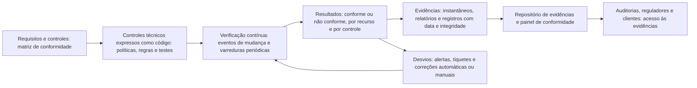
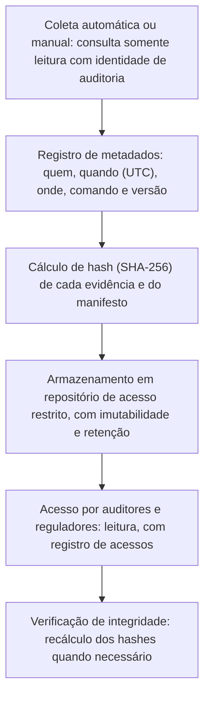

# Conformidade Contínua, Evidências e Automação

> **Objetivo pedagógico:** passar da conformidade "de ponto no tempo" para a conformidade contínua: usar políticas como código, regras de configuração e painéis de conformidade dos provedores, detectar desvios, automatizar a coleta de evidências com qualidade (suficientes, relevantes, confiáveis e atuais), preservar a integridade e a cadeia de guarda das evidências, gerir exceções e medir a conformidade com indicadores, com comandos de somente leitura e um exemplo em Python de empacotamento de evidências.

## 1. Do ponto no tempo à conformidade contínua

| Abordagem tradicional | Conformidade contínua |
|---|---|
| Coleta manual de evidências antes de cada auditoria | Evidências geradas e guardadas automaticamente, o tempo todo |
| Amostras pequenas e antigas | Verificação de toda a população de recursos |
| Desvios descobertos meses depois | Desvios detectados em minutos ou em horas |
| Planilhas e capturas de tela | Dados de APIs, com data, origem e integridade |
| Esforço concentrado e estressante | Esforço distribuído e previsível |
| A conformidade é "um projeto" | A conformidade é uma capacidade operacional |



## 2. Mecanismos de verificação por provedor

| Capacidade | AWS | Azure | Google Cloud |
|---|---|---|---|
| Regras de configuração | AWS Config (regras gerenciadas e personalizadas) e pacotes de conformidade (conformance packs) | Azure Policy (definições e iniciativas de conformidade) | Políticas da organização e verificações do Security Command Center |
| Painéis de conformidade por padrão | AWS Security Hub (padrões como AWS Foundational Security Best Practices, CIS, PCI DSS e NIST SP 800-53) | Defender for Cloud (painel de conformidade regulatória com iniciativas internas de vários padrões) | Security Command Center (monitoramento de conformidade, na camada Premium ou Enterprise) |
| Registro de alterações de configuração | AWS Config (histórico de configuração) | Azure Resource Graph e histórico de alterações | Cloud Asset Inventory (histórico de ativos) |
| Políticas preventivas | Políticas de controle de serviços e de recursos | Efeitos de negação do Azure Policy | Restrições da política da organização |
| Gestão de evidências e de auditoria | AWS Audit Manager | Microsoft Purview Compliance Manager | Ferramentas de conformidade do Google Cloud e soluções de terceiros |
| Resposta e correção automáticas | Ações de remediação do Config e automações | Tarefas de remediação do Azure Policy | Automações a partir de achados |

Os nomes, as camadas de licenciamento e os recursos mudam: confirme na documentação vigente. Soluções de terceiros de **conformidade contínua** consolidam a coleta entre nuvens, SaaS e processos.

## 3. Políticas como código

| Prática | Descrição |
|---|---|
| Controle técnico = política testável | Cada controle técnico da matriz tem uma regra que o verifica |
| Preventivas, detectivas e corretivas | Impedir (negar a criação), detectar (alertar) e corrigir (remediar) |
| Versionamento e revisão | Políticas em repositório, com revisão por pares e testes |
| Implantação gradual | Modo de auditoria antes de negar; unidades de teste antes da organização inteira |
| Exceções formais | Exceções com prazo, dono e controles compensatórios (pasta 03) |
| Cobertura | Regras mapeadas aos requisitos (matriz) e à população total de recursos |
| Ferramentas de código | Open Policy Agent, Checkov, tfsec e políticas nativas, no pipeline e no ambiente |

### Consultas de somente leitura sobre o estado de conformidade

```bash
# AWS: padrões habilitados no Security Hub, pacotes de conformidade e regras não conformes do AWS Config
aws securityhub get-enabled-standards --query "StandardsSubscriptions[].[StandardsArn,StandardsStatus]" --output table
aws configservice describe-conformance-packs --query "ConformancePackDetails[].ConformancePackName" --output table
aws configservice get-compliance-summary-by-config-rule
aws configservice describe-compliance-by-config-rule --compliance-types NON_COMPLIANT \
  --query "ComplianceByConfigRules[].ConfigRuleName" --output table

# Azure: atribuições de políticas, resumo de conformidade e padrões regulatórios no Defender for Cloud
az policy assignment list --query "[].{nome:displayName, escopo:scope}" --output table
az policy state summarize --query "results.{recursosNaoConformes:nonCompliantResources, politicasNaoConformes:nonCompliantPolicies}"
az security regulatory-compliance-standards list --query "[].{padrao:name, estado:state, aprovados:passedControls, reprovados:failedControls}" --output table

# Google Cloud: políticas da organização em vigor
gcloud org-policies list --organization=123456789012
```

## 4. Qualidade das evidências

| Atributo | Descrição | Como garantir |
|---|---|---|
| Suficiência | Cobre toda a população ou uma amostra adequada | Coleta automática da população completa |
| Relevância | Relaciona-se diretamente ao controle e ao requisito | Mapeamento de cada evidência ao controle |
| Confiabilidade | Origem confiável e protegida contra alteração | Dados de APIs e de registros imutáveis; hashes; acesso restrito |
| Atualidade | Dentro do período avaliado | Data e hora (UTC) e frequência definidas |
| Rastreabilidade | É possível saber como e por quem foi gerada | Metadados: fonte, comando, identidade e versão da política |
| Reprodutibilidade | O auditor pode reproduzir a obtenção | Consultas documentadas e versionadas |
| Confidencialidade | Evidências não expõem dados pessoais ou segredos | Mascaramento; acesso mínimo; sem conteúdo de dados |

### Tipos de evidências

| Tipo | Exemplos |
|---|---|
| Configuração | Exportações de configurações e resultados de regras (por exemplo, criptografia ativada) |
| Registros | Registros de auditoria, de acesso e de mudanças |
| Documentos | Políticas, procedimentos, contratos, atas e treinamentos |
| Relatórios | Relatórios de varreduras, de testes de intrusão, de revisões de acesso e de testes de recuperação |
| Amostras | Tíquetes de mudança, aprovações e incidentes |
| Declarações | Atestados e cartas de gestão (menor valor, devem ser complementados) |

## 5. Cadeia de guarda e integridade das evidências



### Exemplo em Python: empacotar evidências com manifesto e hashes

```python
# Gera um manifesto com os hashes SHA-256 e os metadados dos arquivos de evidência de uma pasta
# Uso: python empacotar_evidencias.py ./evidencias/controle-CRI-01 "CRI-01" "analista.exemplo"
import datetime
import hashlib
import json
import pathlib
import sys

def sha256_do_arquivo(caminho: pathlib.Path) -> str:
    h = hashlib.sha256()
    with caminho.open("rb") as f:
        for bloco in iter(lambda: f.read(1024 * 1024), b""):
            h.update(bloco)
    return h.hexdigest()

def empacotar(pasta: str, controle: str, responsavel: str) -> None:
    raiz = pathlib.Path(pasta)
    itens = []
    for arquivo in sorted(p for p in raiz.rglob("*") if p.is_file() and p.name != "manifesto.json"):
        itens.append({
            "arquivo": str(arquivo.relative_to(raiz)),
            "tamanho_bytes": arquivo.stat().st_size,
            "sha256": sha256_do_arquivo(arquivo),
        })
    manifesto = {
        "controle": controle,
        "responsavel": responsavel,
        "gerado_em_utc": datetime.datetime.now(datetime.timezone.utc).isoformat(),
        "arquivos": itens,
    }
    texto = json.dumps(manifesto, indent=2, ensure_ascii=False)
    (raiz / "manifesto.json").write_text(texto, encoding="utf-8")
    hash_manifesto = hashlib.sha256(texto.encode("utf-8")).hexdigest()
    print(f"Manifesto gerado com {len(itens)} arquivos. SHA-256 do manifesto: {hash_manifesto}")

if __name__ == "__main__":
    empacotar(sys.argv[1], sys.argv[2], sys.argv[3])
```

Armazene o manifesto e o hash dele em local **separado e imutável** (por exemplo, um armazenamento com retenção protegida), para que alterações posteriores sejam detectáveis. O roteiro não inclui conteúdo de dados pessoais: colete configurações e relatórios, e não dados de clientes.

## 6. Gestão de desvios e exceções

| Atividade | Descrição |
|---|---|
| Classificação por severidade | Criticidade do requisito e do dado afetado |
| Tíquete automático para o dono do recurso | Prazos por severidade (por exemplo, 7 dias para críticos e 30 para altos) |
| Remediação automática, quando segura | Correção imediata de configurações de baixo risco (por exemplo, ativar criptografia em um recurso novo) |
| Exceções | Registro formal, com justificativa, controles compensatórios, aprovador e expiração (pasta 03) |
| Escalonamento | Desvios vencidos sobem ao comitê |
| Análise de causa | Desvios recorrentes indicam falhas de processo ou de modelo de infraestrutura |
| Melhoria | Correção dos módulos e dos pipelines para evitar a recorrência |

## 7. Indicadores de conformidade contínua

| Indicador | Definição | Meta típica |
|---|---|---|
| Percentual de controles técnicos com verificação automatizada | Controles com regra automática ÷ controles técnicos | Acima de 70% |
| Percentual de recursos conformes | Recursos conformes ÷ população avaliada | Acima de 95% nos controles críticos |
| Tempo médio de correção de desvios | Da detecção à correção, por severidade | Críticos: até 7 dias |
| Desvios abertos vencidos | Desvios além do prazo | Zero para críticos |
| Idade média das evidências | Dias desde a última coleta | Dentro da frequência definida |
| Percentual de controles com evidência atual | Controles com evidência dentro do prazo ÷ total | Acima de 95% |
| Exceções ativas e vencidas | Contagem | Vencidas: zero |
| Esforço de preparação de auditorias | Horas por auditoria | Em redução |
| Achados de auditoria repetidos | Mesmos achados em ciclos consecutivos | Zero |

## 8. Exemplo prático: implantação de conformidade contínua para ISO/IEC 27001 e PCI DSS

| Etapa | Ação | Resultado |
|---|---|---|
| Mapeamento | 138 controles; 61 técnicos candidatos à automação | Prioridade para os 61 |
| Regras | Pacotes de conformidade e iniciativas de políticas alinhados à matriz; regras personalizadas para controles específicos | 52 controles com verificação automatizada |
| Painel | Painel por controle, por requisito e por dono | Visibilidade em tempo real |
| Evidências | Coleta diária por consultas de somente leitura; manifestos e hashes; repositório imutável | Evidências contínuas e íntegras |
| Desvios | Tíquetes automáticos e remediação para 9 regras de baixo risco | Tempo médio de correção de 12 para 3 dias |
| Auditoria | Auditores acessaram o repositório e o painel (somente leitura) | Esforço de preparação reduzido em 55% |
| Resultado | A auditoria de manutenção da ISO/IEC 27001 não teve não conformidades; a avaliação do PCI DSS reutilizou 70% das evidências | |

## 9. Casos de uso corporativos

- Painel de conformidade em tempo real, por padrão, por controle e por dono.
- Repositório de evidências automatizado, com integridade e acesso para auditores.
- Detecção e correção contínuas de desvios de configuração.

## 10. Normas e frameworks relevantes

- NIST SP 800-137 (monitoramento contínuo de segurança da informação); NIST SP 800-53A Rev. 5 (avaliação de controles); NIST SP 800-92 (gestão de logs)
- ISO/IEC 27001:2022 (9.1, monitoramento, medição, análise e avaliação; 9.2, auditoria interna); ISO 37301:2021
- CSA CCM v4 (A&A, auditoria e garantia); ISACA ITAF (estrutura de garantia de TI); NIST CSF 2.0 (GV.OV e ID.IM)

## 11. Checklist operacional: conformidade contínua

- [ ] Controles técnicos da matriz com regras de verificação automatizadas (preventivas, detectivas e corretivas)
- [ ] Painéis de conformidade por padrão e por dono, integrados aos provedores
- [ ] Coleta automática de evidências por identidade de auditoria somente leitura
- [ ] Metadados, hashes e manifestos; repositório de acesso restrito e imutável
- [ ] Evidências sem dados pessoais nem segredos; mascaramento quando necessário
- [ ] Fluxo de desvios com severidade, prazo, tíquetes e escalonamento
- [ ] Exceções formais com expiração e controles compensatórios
- [ ] Indicadores de conformidade acompanhados e reportados
- [ ] Revisão trimestral das regras, das evidências e da cobertura

## 12. Referências

- Dempsey, K. et al. NIST SP 800-137: Information Security Continuous Monitoring (ISCM). 2011.
- Joint Task Force. NIST SP 800-53A Rev. 5: Assessing Security and Privacy Controls. 2022.
- ISACA. IT Audit Framework (ITAF), 4. ed. 2020.
- Amazon Web Services. AWS Config, AWS Security Hub e AWS Audit Manager; Microsoft. Azure Policy e Microsoft Defender for Cloud; Google Cloud. Security Command Center e políticas da organização (documentação vigente).
- Pastas 03, 13 e 17 deste repositório.
