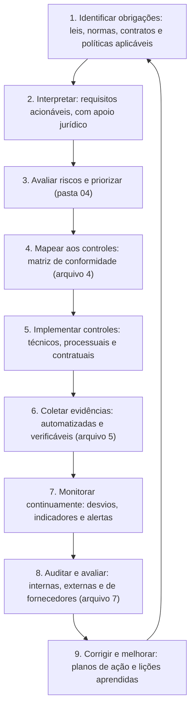

# Fundamentos de Conformidade em Nuvem

> **Objetivo pedagógico:** compreender o que é conformidade (legal, regulatória, contratual e normativa), por que a nuvem a torna diferente (responsabilidade compartilhada, dados distribuídos, mudança contínua e terceiros), distinguir conformidade de segurança, estruturar o processo de gestão de conformidade (identificar obrigações, interpretar, mapear controles, implementar, evidenciar, monitorar e auditar), manter um registro de obrigações e organizar papéis nas três linhas.

## 1. O que é conformidade

Conformidade é a **aderência demonstrável** da organização a um conjunto de requisitos. Em nuvem, as fontes de requisitos são várias:

| Fonte | Natureza | Exemplos |
|---|---|---|
| Leis | Obrigatória, com sanções legais | LGPD; Marco Civil da Internet; Lei nº 14.063/2020 |
| Regulamentos setoriais | Obrigatória para entidades supervisionadas | Resolução CMN 4.893/2021; Resolução BCB 85/2021; Circular Susep 638/2021 |
| Normas e orientações da administração pública | Obrigatória para órgãos e entidades | IN GSI/PR nº 5/2021 |
| Contratos | Obrigação contratual, com penalidades | Cláusulas de clientes, de parceiros e de seguradoras |
| Padrões da indústria | Obrigatória por contrato ou por adesão | PCI DSS para dados de cartões |
| Normas voluntárias e certificações | Voluntária, com valor de mercado | ISO/IEC 27001; SOC 2 |
| Políticas internas | Obrigatória por decisão da organização | Políticas de segurança, de privacidade e de nuvem |

## 2. Conformidade e segurança

| Aspecto | Conformidade | Segurança |
|---|---|---|
| Pergunta central | Atendemos aos requisitos aplicáveis e conseguimos demonstrá-lo? | Estamos protegidos contra as ameaças reais? |
| Referência | Requisitos externos e internos | Riscos e ameaças |
| Evidência | Documentação, registros e testes | Eficácia dos controles contra ataques |
| Limite | Requisitos mínimos podem ficar defasados em relação às ameaças | Pode não atender a requisitos formais |
| Relação | A conformidade é um **piso**, e não um teto | A segurança baseada em riscos costuma superar o piso |

Uma organização pode estar **em conformidade e insegura** (controles formais sem eficácia) ou **segura e não conforme** (controles eficazes sem documentação ou sem atender a exigências específicas). O objetivo é **ambos**.

## 3. O que muda em nuvem

| Fator | Efeito na conformidade |
|---|---|
| Responsabilidade compartilhada | Parte dos controles é do provedor, parte do cliente; a conformidade final é do cliente (pasta 02) |
| Dados distribuídos em regiões, em contas e em SaaS | Dificuldade de mapear fluxos, locais e transferências internacionais (pasta 09) |
| Mudança contínua e autoatendimento | A conformidade de um dia pode ser perdida no seguinte (desvio de configuração) |
| Dependência de terceiros | Avaliação de provedores e de subcontratados; direitos de auditoria limitados |
| Contratos padronizados | Pouco espaço para negociar cláusulas; necessidade de avaliar as lacunas |
| Evidências | Muitas são geradas por APIs e por registros, o que permite automação |
| Reguladores | Expectativas específicas sobre contratação de nuvem, resiliência e saída |
| Escala e velocidade | Auditorias por amostragem manual tornam-se insuficientes |

## 4. Responsabilidade pela conformidade

| Elemento | Provedor | Cliente |
|---|---|---|
| Conformidade da infraestrutura do provedor com padrões (ISO, SOC e outros) | Obtém e mantém as certificações | Avalia e usa os relatórios como evidência de controles herdados |
| Configuração e uso conformes dos serviços | Oferece mecanismos | **Configura e comprova** |
| Proteção de dados pessoais como controlador | Não | **Responsável final** (LGPD) |
| Proteção de dados pessoais como operador | Responde como operador pelos tratamentos que realiza | Controla instruções e fiscaliza |
| Comunicação de incidentes a autoridades | Notifica o cliente, conforme o contrato | Comunica à ANPD, a reguladores e a titulares, conforme a norma |
| Atendimento a reguladores setoriais | Colabora conforme o contrato | Responsável perante o regulador |

**A certificação do provedor não torna o cliente conforme.** Os relatórios do provedor cobrem a infraestrutura e os serviços; o uso do cliente (contas, identidades, dados, configurações e processos) precisa ter seus próprios controles e evidências.

## 5. Processo de gestão de conformidade

| Etapa | Entregáveis |
|---|---|
| Identificar obrigações | Registro de obrigações (seção 6) |
| Interpretar | Requisitos reescritos como declarações verificáveis, com decisões do Jurídico documentadas |
| Avaliar riscos | Riscos de não conformidade priorizados e integrados ao registro de riscos |
| Mapear | Matriz de controles e de requisitos, com a responsabilidade (provedor, compartilhada ou cliente) |
| Implementar | Políticas, padrões, configurações, contratos e treinamentos |
| Coletar evidências | Repositório de evidências, com origem, data e integridade |
| Monitorar | Painel de conformidade; alertas de desvios |
| Auditar | Relatórios de auditoria e planos de correção |
| Melhorar | Atualização dos controles e dos requisitos |

## 6. Registro de obrigações de conformidade

| ID | Obrigação | Fonte e referência | Aplicabilidade (escopo, sistemas e dados) | Requisito acionável | Responsável | Controles associados | Evidências | Prazo e frequência | Situação |
|---|---|---|---|---|---|---|---|---|---|
| OBR-001 | Comunicar incidentes de segurança com risco ou dano relevante à ANPD e aos titulares | LGPD, art. 48; Resolução CD/ANPD nº 15/2024 | Todos os tratamentos de dados pessoais | Processo de triagem e de comunicação no prazo regulamentar | DPO e segurança | Playbook de incidentes; registro de incidentes | Registros e simulações | 3 dias úteis a partir do conhecimento do incidente (confirme a norma) | Em operação |
| OBR-002 | Manter registro das operações de tratamento | LGPD, art. 37 | Controlador e operador | Registro atualizado e acessível | DPO | Inventário e catálogo de dados | Registro e revisões | Revisão semestral | Em operação |

Mantenha o registro **sob responsabilidade do Jurídico e da conformidade**, com a participação de segurança, de privacidade e dos donos de produtos. Revise-o quando surgirem normas ou contratos novos.

## 7. Papéis nas três linhas

| Linha | Papel na conformidade de nuvem |
|---|---|
| 1ª linha: gestão e equipes técnicas (produto, plataforma, TI e segurança operacional) | Implementam e operam os controles; geram evidências; corrigem desvios |
| 2ª linha: conformidade, privacidade (DPO), riscos e segurança como função de supervisão | Interpretam os requisitos; definem padrões e a matriz de controles; monitoram e reportam |
| 3ª linha: auditoria interna | Avalia de forma independente o desenho e a eficácia dos controles e do programa de conformidade |

Outros atores: **Jurídico** (interpretação, contratos e comunicação com autoridades), **encarregado (DPO)** (canal com a ANPD e com os titulares), **compras e gestão de fornecedores** (diligência e contratos), **direção e comitês** (apetite e prestação de contas).

## 8. Exemplo prático: obrigações de uma fintech que usa nuvem pública

| Obrigação | Fonte | Implicação em nuvem |
|---|---|---|
| Proteção de dados pessoais de clientes | LGPD | Classificação, controles de acesso, criptografia, retenção, direitos dos titulares |
| Política de segurança cibernética e contratação de serviços de nuvem | Normas do CMN e do BCB aplicáveis à instituição | Avaliação do provedor, cláusulas contratuais, comunicação ao regulador, planos de continuidade e de saída |
| Proteção de dados de cartões | PCI DSS | Segmentação, criptografia e evidências do ambiente de dados de cartão |
| Requisitos de clientes corporativos | Contratos | Certificação ISO/IEC 27001 e relatório SOC 2 Tipo II |
| Continuidade de negócios | Norma setorial e ISO 22301 | RTO e RPO, testes de recuperação e estratégia de saída |
| Retenção de registros | Marco Civil e normas setoriais | Políticas de retenção e de ciclo de vida |

## 9. Casos de uso corporativos

- Criação do registro de obrigações e da matriz de conformidade para a adoção de nuvem.
- Avaliação de conformidade antes da contratação de novos serviços de nuvem.
- Preparação para auditorias, certificações e inspeções de reguladores.

## 10. Normas e frameworks relevantes

- ISO/IEC 27001:2022 (cláusulas 4.2 e 6.1.3 e controle 5.31, requisitos legais, estatutários, regulamentares e contratuais; 5.36, conformidade com políticas e normas); ISO 37301:2021 (sistemas de gestão de conformidade)
- NIST CSF 2.0 (GV.OC, contexto organizacional e requisitos legais); COSO ERM 2017; IIA Three Lines Model
- CSA CCM v4 (domínio A&A, auditoria e garantia; GRC); COBIT 2019

## 11. Checklist operacional: base de conformidade

- [ ] Registro de obrigações (legais, regulatórias, contratuais e normativas) criado, com responsável e revisão
- [ ] Interpretação das normas documentada com o Jurídico e a privacidade
- [ ] Responsabilidade pela conformidade definida por serviço (provedor, compartilhada ou cliente)
- [ ] Riscos de não conformidade integrados ao registro de riscos
- [ ] Matriz de controles e de requisitos mantida (arquivo 4)
- [ ] Evidências coletadas de forma sistemática e verificável (arquivo 5)
- [ ] Papéis das três linhas e do encarregado definidos
- [ ] Revisão do registro de obrigações pelo menos a cada seis meses e a cada mudança normativa

## 12. Referências

- ISO 37301:2021. Compliance management systems: Requirements with guidance for use.
- ISO/IEC 27001:2022, controles 5.31 e 5.36.
- The Institute of Internal Auditors. The IIA's Three Lines Model. 2020.
- Cloud Security Alliance. Cloud Controls Matrix v4. 2021.
- Pastas 02, 03 e 04 deste repositório.
