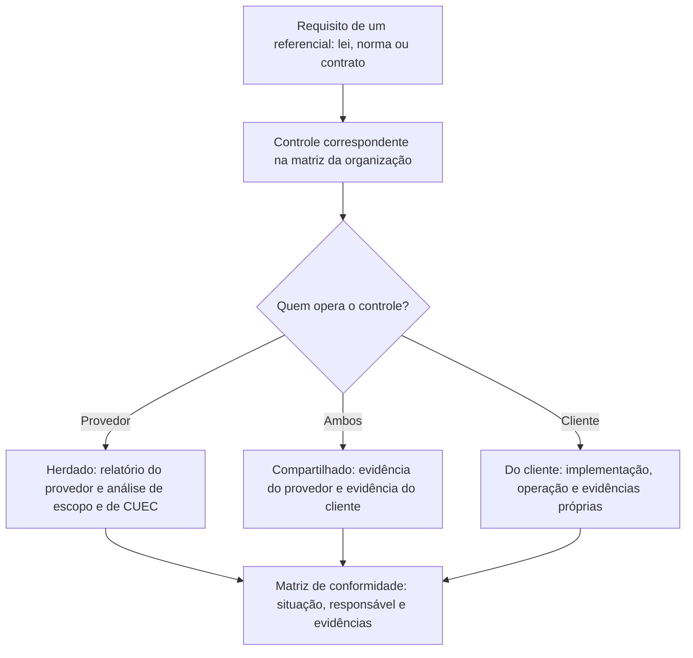

# Herança de Controles, Mapeamento e Matriz de Conformidade

> **Objetivo pedagógico:** aplicar o modelo de controles herdados, compartilhados e do cliente em nuvem, mapear requisitos de várias fontes a um conjunto único de controles ("cumprir uma vez, atender a muitos"), construir e manter a matriz de conformidade (requisito, controle, responsabilidade, implementação, evidência e situação), usar os mapeamentos entre referenciais (CCM, NIST, ISO e outros) e analisar lacunas com uma consulta em DuckDB.

## 1. Modelo de herança de controles

Em nuvem, cada controle de um referencial pode ser classificado em um dos três tipos de responsabilidade:

| Tipo | Descrição | Exemplo | Como evidenciar |
|---|---|---|---|
| Herdado do provedor | O provedor implementa e opera integralmente; o cliente herda | Segurança física dos datacenters; sanitização de mídias físicas | Relatórios do provedor (SOC 2, ISO), com análise do escopo |
| Compartilhado | O provedor oferece parte e o cliente completa | Criptografia de dados: o provedor oferece o mecanismo; o cliente configura e gere as chaves | Relatório do provedor para a parte dele; configuração e registros do cliente para a parte do cliente |
| Do cliente | O cliente implementa e opera integralmente | Classificação de dados; gestão de identidades; revisões de acesso; resposta a incidentes da organização | Evidências próprias do cliente |



**Atenção:** a herança só vale se o **escopo do relatório do provedor** cobrir os serviços e as regiões que a organização usa e se os **controles complementares do cliente (CUEC)** forem cumpridos. Controles "herdados" sem verificação são uma causa frequente de lacunas de conformidade.

## 2. Matrizes de responsabilidade dos provedores

| Provedor | Material de apoio (exemplos; confirme a disponibilidade) |
|---|---|
| AWS | Modelo de responsabilidade compartilhada; guias de conformidade do cliente (mapeiam controles de normas a práticas e a serviços); matrizes de responsabilidade para programas como o PCI DSS |
| Microsoft | Modelo de responsabilidade compartilhada; Service Trust Portal; matrizes de responsabilidade por serviço; mapeamentos de conformidade no Defender for Cloud e no Azure Policy |
| Google Cloud | Modelo de responsabilidade compartilhada (shared fate); guias e mapeamentos de conformidade por padrão |
| Todos | Os relatórios SOC 2 e ISO descrevem os controles do provedor e os CUEC |

## 3. Mapeamento entre referenciais

O mapeamento reduz o esforço: **um controle bem implementado atende a vários requisitos**.

| Fonte de mapeamento | Descrição |
|---|---|
| CSA CCM v4 | Mapeamentos oficiais para ISO/IEC 27001, 27002, 27017 e 27018, NIST SP 800-53, PCI DSS, CIS e outros |
| NIST OLIR (Online Informative References) | Programa de referências informativas que relacionam controles do NIST (CSF e SP 800-53) a outros padrões |
| Mapeamentos do NIST CSF 2.0 | Referências cruzadas para normas da família ISO e outras |
| Mapeamentos publicados pelos provedores | Relações entre serviços, controles e normas |
| Mapeamentos próprios | Relações entre as obrigações brasileiras (LGPD e normas setoriais) e os controles da organização |

### 3.1 Exemplo de mapeamento de um controle

Controle da organização: **CRI-01, "Dados confidenciais e restritos em repouso são criptografados com chaves gerenciadas pelo cliente"**.

| Referencial | Requisito relacionado |
|---|---|
| ISO/IEC 27002:2022 | 8.24 (uso de criptografia) e 5.14 (transferência de informações), conforme o escopo |
| CSA CCM v4 | CEK (criptografia e gestão de chaves) e DSP |
| NIST SP 800-53 Rev. 5 | SC-28 (proteção de informações em repouso) e SC-12 (gestão de chaves) |
| PCI DSS v4.0.1 | Requisito 3 (proteção de dados da conta armazenados) |
| LGPD | Art. 46 (medidas técnicas de segurança) |
| Normas setoriais | Requisitos de proteção de dados das normas de segurança cibernética aplicáveis |
| Provedor | Serviço de gestão de chaves e criptografia de armazenamento (parte compartilhada) |

Os identificadores dos requisitos mudam entre versões dos padrões: **mantenha a versão de cada referencial** na matriz.

## 4. Matriz de conformidade

### 4.1 Estrutura

| Campo | Descrição |
|---|---|
| ID do controle | Identificador do controle da organização |
| Descrição e objetivo | O que o controle faz e por quê |
| Requisitos atendidos | Lista de requisitos de leis, normas e contratos, com referência e versão |
| Responsabilidade | Provedor (herdado), compartilhado ou cliente |
| Dono do controle | Área responsável |
| Implementação | Como é implementado (políticas, configurações, processos e ferramentas) |
| Evidência | Tipo, origem, frequência e local de armazenamento |
| Método de teste | Como se verifica a eficácia (automático, amostral ou revisão) |
| Situação | Implementado, parcial, não implementado, não aplicável ou herdado (com análise concluída) |
| Última verificação | Data e resultado |
| Lacunas e plano de ação | Pendências, responsáveis e prazos |

### 4.2 Análise de lacunas com DuckDB

`matriz_conformidade.csv` (fictício):

```
controle_id,descricao,iso27002,ccm,nist80053,pci,lgpd,responsabilidade,dono,situacao,ultima_evidencia
CRI-01,Criptografia em repouso com chaves do cliente,8.24,CEK-03,SC-28,3.5,art.46,compartilhado,Seguranca,implementado,2026-10-30
IAM-03,MFA resistente a phishing para privilegiados,8.5,IAM-14,IA-2,8.4,art.46,cliente,Identidade,parcial,2026-09-12
LOG-02,Registros de auditoria centralizados e retidos,8.15,LOG-01,AU-2,10.2,art.46,compartilhado,Seguranca,implementado,2026-06-01
FIS-01,Segurança física dos datacenters,7.1,DCS-02,PE-3,9.2,art.46,provedor,,herdado,
PRI-05,Registro das operações de tratamento atualizado,5.34,DSP-05,PT-2,,art.37,cliente,Privacidade,nao_implementado,
```

```sql
-- Lacunas: controles não implementados ou parciais, sem dono, herdados sem análise do relatório, ou com evidência antiga (mais de 90 dias)
SELECT controle_id, descricao, responsabilidade, situacao,
       CASE WHEN situacao IN ('nao_implementado','parcial') THEN 'implementacao incompleta' END AS achado_situacao,
       CASE WHEN dono IS NULL OR dono = '' THEN 'sem dono' END AS achado_dono,
       CASE WHEN responsabilidade <> 'provedor' AND (ultima_evidencia IS NULL OR ultima_evidencia = '') THEN 'sem evidencia' END AS achado_evidencia,
       CASE WHEN ultima_evidencia <> '' AND date_diff('day', CAST(ultima_evidencia AS DATE), DATE '2026-11-20') > 90 THEN 'evidencia antiga' END AS achado_atualidade
FROM read_csv_auto('matriz_conformidade.csv')
WHERE situacao IN ('nao_implementado','parcial')
   OR dono IS NULL OR dono = ''
   OR (responsabilidade <> 'provedor' AND (ultima_evidencia IS NULL OR ultima_evidencia = ''))
   OR (ultima_evidencia <> '' AND date_diff('day', CAST(ultima_evidencia AS DATE), DATE '2026-11-20') > 90)
ORDER BY controle_id;

-- Cobertura por requisito da LGPD: quantos controles sustentam cada dispositivo
SELECT lgpd AS dispositivo, count(*) AS controles,
       count(*) FILTER (WHERE situacao = 'implementado' OR situacao = 'herdado') AS implementados
FROM read_csv_auto('matriz_conformidade.csv')
GROUP BY lgpd
ORDER BY dispositivo;
```

A data de referência do exemplo (2026-11-20) é fictícia: use a data da sua avaliação.

## 5. Boas práticas de construção da matriz

| Prática | Descrição |
|---|---|
| Um conjunto de controles da organização, mapeado a muitos requisitos | Evitar matrizes paralelas por norma |
| Controles escritos como declarações verificáveis | Cada controle deve poder ser testado e evidenciado |
| Controles atribuídos a um dono | Responsabilidade clara |
| Tipos de responsabilidade explícitos | Provedor, compartilhado ou cliente, com a análise de escopo e de CUEC |
| Versões dos referenciais registradas | Mapeamentos acompanham as atualizações |
| Matriz integrada ao registro de riscos | Lacunas geram riscos e planos de ação |
| Controles técnicos ligados a verificações automáticas | Políticas como código e relatórios de postura (arquivo 5) |
| Revisão periódica | Revisão anual e a cada mudança normativa ou de arquitetura |
| Simplicidade | Evitar centenas de controles redundantes: priorizar o que reduz o risco e atende a requisitos |

## 6. Exemplo prático: construção da matriz de uma plataforma de pagamentos

| Etapa | Ação | Resultado |
|---|---|---|
| Levantamento | 6 fontes: LGPD, norma do CMN e do BCB, PCI DSS v4.0.1, ISO/IEC 27001, contratos de clientes e política interna | 412 requisitos brutos |
| Consolidação | Agrupamento em controles da organização, com os mapeamentos do CCM v4 e do NIST como base | 138 controles únicos |
| Responsabilidade | 21 herdados do provedor, 54 compartilhados e 63 do cliente | Análise dos relatórios do provedor para 75 controles |
| Verificação de CUEC | 14 controles complementares do provedor, 3 sem controle correspondente no cliente | Controles criados |
| Implementação | 109 implementados, 19 parciais e 10 não implementados | Plano de ação priorizado por risco |
| Automação | 61 controles técnicos ligados a verificações automáticas | Evidências contínuas |
| Resultado | Uma única campanha de coleta de evidências atendeu a auditorias de ISO/IEC 27001, de PCI DSS e de clientes, reduzindo o esforço em cerca de 40% | |

## 7. Casos de uso corporativos

- Matriz única de controles para atender a várias normas e a auditorias de clientes.
- Verificação sistemática dos controles herdados e dos controles complementares dos relatórios dos provedores.
- Painel de cobertura por requisito para a direção e para reguladores.

## 8. Normas e frameworks relevantes

- CSA CCM v4 (mapeamentos); NIST CSF 2.0 e NIST SP 800-53 Rev. 5; NIST OLIR; ISO/IEC 27001:2022 (6.1.3, tratamento de riscos e Declaração de Aplicabilidade) e 27002:2022
- PCI DSS v4.0.1; CIS Controls v8.1; COBIT 2019
- LGPD; normas setoriais aplicáveis

## 9. Checklist operacional: herança e matriz

- [ ] Conjunto único de controles da organização, mapeado aos requisitos aplicáveis, com versões dos referenciais
- [ ] Responsabilidade por controle definida (provedor, compartilhado ou cliente)
- [ ] Controles herdados analisados com escopo e CUEC verificados
- [ ] Cada controle com dono, método de teste, evidência e situação
- [ ] Lacunas registradas como riscos e planos de ação
- [ ] Controles técnicos conectados a verificações automáticas
- [ ] Matriz atualizada a cada mudança normativa, de serviços ou de arquitetura
- [ ] Revisão anual completa da matriz

## 10. Referências

- Cloud Security Alliance. CCM v4 e mapeamentos para outros padrões. 2021.
- NIST. National Online Informative References (OLIR) Program; NIST SP 800-53 Rev. 5 e SP 800-53A Rev. 5.
- ISO/IEC 27001:2022, cláusula 6.1.3.
- AWS, Microsoft e Google Cloud. Modelos de responsabilidade compartilhada e guias de conformidade (documentação vigente).
- Pastas 02 e 12 deste repositório.
