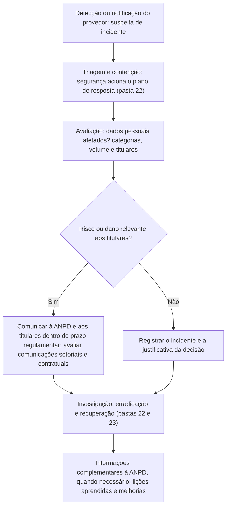

# LGPD em Nuvem: Operadores, Contratos e Incidentes

> **Objetivo pedagógico:** operacionalizar a LGPD em ambientes de nuvem: identificar os papéis (controlador, operador e suboperador) em arranjos com provedores de IaaS, PaaS e SaaS, definir o conteúdo mínimo de contratos de tratamento de dados com provedores, atribuir as responsabilidades do encarregado, conduzir o relatório de impacto, tratar solicitações de titulares, responder a incidentes de segurança com comunicação à ANPD e aos titulares dentro do prazo regulamentar, e entender o regime de responsabilidade e de sanções.

> **Aviso:** conteúdo educacional, sem caráter jurídico. Os prazos, os formulários e as interpretações da ANPD mudam: confirme o texto vigente das normas e consulte o Jurídico e o encarregado.

## 1. Papéis na LGPD em arranjos de nuvem

| Papel | Definição (LGPD, art. 5º) | Em nuvem |
|---|---|---|
| Controlador | A quem competem as decisões referentes ao tratamento de dados pessoais | A organização que decide finalidades e meios (por exemplo, a empresa que usa a nuvem para tratar dados de seus clientes) |
| Operador | Quem realiza o tratamento em nome do controlador | Em geral, o provedor de nuvem (IaaS, PaaS e SaaS), quando trata dados do cliente conforme as instruções dele |
| Suboperador | Operador contratado pelo operador | Subcontratados do provedor (por exemplo, serviços de suporte, de infraestrutura e de telemetria) |
| Encarregado | Pessoa indicada para ser canal entre o controlador, os titulares e a ANPD | Função obrigatória do controlador, em regra (com dispensas previstas em regulamentação para agentes de pequeno porte) |
| Titular | Pessoa natural a quem se referem os dados | Clientes, colaboradores, usuários e outros |

### Pontos de atenção na qualificação

| Situação | Observação |
|---|---|
| Provedor trata dados do cliente apenas para prestar o serviço, sob instruções | Operador |
| Provedor usa dados do cliente para **finalidades próprias** (por exemplo, melhoria de produtos, publicidade ou treinamento de modelos), por decisão própria | Pode atuar como **controlador** quanto a esse tratamento: avalie o contrato e as configurações |
| Dados de contas, de faturamento e de telemetria do provedor | O provedor pode ser controlador desses dados |
| Cliente que também é operador (por exemplo, um SaaS que processa dados de seus clientes em nuvem) | A organização é operador em relação aos seus clientes e controladora ou cooperadora em relação a outros dados; a cadeia de contratos deve refletir isso |
| Controladoria conjunta | Quando duas organizações decidem conjuntamente as finalidades e os meios: definir responsabilidades por contrato |

A qualificação é **fática e contratual**, não apenas formal: depende de quem decide as finalidades e os meios essenciais do tratamento.

## 2. Contratos de tratamento de dados com provedores

Os provedores de nuvem oferecem **aditivos de tratamento de dados** padronizados (por exemplo, os aditivos de proteção de dados da AWS, da Microsoft e do Google Cloud). Avalie-os em relação às exigências da LGPD e às necessidades do cliente.

| Cláusula | Conteúdo esperado |
|---|---|
| Objeto, natureza e finalidade | Descrição do tratamento, dos dados, das categorias de titulares e da duração |
| Instruções do controlador | O operador trata os dados somente conforme as instruções documentadas (LGPD, art. 39) |
| Confidencialidade | Compromisso das pessoas autorizadas a tratar os dados |
| Medidas de segurança | Medidas técnicas e administrativas (LGPD, art. 46), com referência a anexos de segurança e a certificações |
| Suboperadores | Lista, autorização geral ou específica, notificação de mudanças e direito de objeção; transferência das mesmas obrigações aos suboperadores |
| Transferência internacional | Regiões, hipóteses e instrumentos (cláusulas-padrão, quando aplicável) (pasta 09, arquivo 6) |
| Assistência ao controlador | Apoio ao atendimento de direitos dos titulares, à elaboração do RIPD e à resposta a autoridades |
| Notificação de incidentes | Prazo curto para comunicar o controlador (por exemplo, "sem demora injustificada" e com prazo máximo definido), com informações úteis |
| Auditoria e informações | Fornecimento de informações e relatórios para demonstrar conformidade; direitos de auditoria, ainda que mediante relatórios de terceiros e procedimentos |
| Devolução e eliminação | Devolução ou eliminação dos dados ao término, com certificação (pasta 09, arquivo 5) |
| Responsabilidade e indenização | Limites e responsabilidades; a responsabilidade perante os titulares e a ANPD não pode ser afastada por contrato |
| Cooperação com autoridades | Procedimentos para pedidos de acesso por autoridades, com notificação ao cliente, quando legalmente possível |
| Resiliência e continuidade | Acordos de nível de serviço e compromissos de recuperação (pasta 04, arquivo 6) |

### Lista de verificação de lacunas comuns nos contratos padronizados

| Lacuna | Medida |
|---|---|
| Prazo de notificação de incidentes longo ou indefinido | Negociar prazo ou compensar com monitoramento próprio e cláusulas adicionais |
| Autorização geral de suboperadores sem notificação | Exigir notificação e direito de objeção, ou lista consultável com alertas |
| Uso de dados para finalidades próprias do provedor | Verificar e desabilitar, quando possível; avaliar a qualificação do provedor |
| Falta de menção ao regime brasileiro | Solicitar o aditivo adequado à LGPD e à ANPD |
| Direito de auditoria restrito | Exigir relatórios de terceiros e acesso a informações; para setores regulados, cláusulas de acesso do regulador |
| Transferências para países sem instrumento | Aplicar as cláusulas-padrão e avaliar medidas complementares |

## 3. Encarregado (DPO)

| Aspecto | Orientação |
|---|---|
| Indicação e divulgação | O controlador indica o encarregado e divulga publicamente sua identidade e seus contatos (LGPD, art. 41) |
| Atividades | Aceitar reclamações e comunicações de titulares, prestar esclarecimentos, receber comunicações da ANPD, orientar colaboradores e contratados e executar as demais atribuições definidas |
| Regulamentação | A Resolução CD/ANPD nº 18/2024 trata da atuação do encarregado, incluindo requisitos de independência e de recursos |
| Em nuvem | Participar da avaliação de novos serviços, dos contratos com provedores, da resposta a incidentes e do RIPD |
| Evitar conflitos | Atribuições que não gerem conflito de interesses com a função (confirme os critérios na regulamentação) |

## 4. Relatório de impacto à proteção de dados pessoais (RIPD)

| Aspecto | Orientação |
|---|---|
| Conceito | Documentação dos processos de tratamento que podem gerar riscos às liberdades civis e aos direitos fundamentais, com medidas de mitigação (LGPD, arts. 5º, XVII e 38) |
| Quando considerar | Tratamentos de maior risco: dados sensíveis, dados de crianças, larga escala, decisões automatizadas, novas tecnologias, monitoramento sistemático e transferências internacionais; a ANPD pode solicitá-lo |
| Conteúdo mínimo | Descrição dos tipos de dados, metodologia de coleta e de garantia da segurança, análise de medidas, salvaguardas e mecanismos de mitigação (art. 38, parágrafo único) |
| Em nuvem | Incluir regiões, fornecedores, suboperadores, criptografia, controle de chaves, retenção e transferência internacional (modelo no arquivo 7 da pasta 09) |
| Atualização | Revisar a cada mudança relevante (novo serviço, nova região ou novo fornecedor) |

## 5. Direitos dos titulares em nuvem

O tratamento dos direitos (LGPD, art. 18) em ambientes de nuvem está detalhado na pasta 09, arquivo 4. Pontos de conformidade:

| Ponto | Orientação |
|---|---|
| Canal e fluxo | Canal acessível, com verificação de identidade e registro de solicitações |
| Prazos | Cumprir os prazos legais e regulamentares (confirme os prazos vigentes) |
| Operadores | Contratos que obriguem o provedor a auxiliar; instruções claras |
| Evidências | Registro de cada solicitação, decisão e atendimento |
| Exceções | Retenção por obrigação legal ou por exercício regular de direitos, com justificativa |

## 6. Incidentes de segurança e comunicação

### 6.1 Fundamentos

| Tema | Orientação |
|---|---|
| Obrigação | O controlador deve comunicar à ANPD e ao titular a ocorrência de incidente de segurança que possa acarretar **risco ou dano relevante** aos titulares (LGPD, art. 48) |
| Regulamento | A Resolução CD/ANPD nº 15/2024 regulamenta a comunicação: define critérios de risco ou dano relevante, o prazo, o conteúdo e o registro. Pelo regulamento, a comunicação à ANPD e aos titulares deve ocorrer em **três dias úteis** a partir do conhecimento de que o incidente afetou dados pessoais (confirme o texto vigente) |
| Registro | O controlador deve manter o registro dos incidentes, inclusive os não comunicados, por prazo mínimo definido no regulamento (confirme, por exemplo, cinco anos) |
| Operador | O operador deve comunicar o controlador sem demora, conforme o contrato; a comunicação à ANPD e aos titulares é do controlador |
| Outras comunicações | Reguladores setoriais (por exemplo, o Banco Central, para instituições supervisionadas), clientes por contrato, seguradoras e autoridades policiais, conforme o caso |

### 6.2 Critérios para risco ou dano relevante (visão geral)

O regulamento considera relevantes, em geral, os incidentes que possam afetar significativamente interesses e direitos fundamentais dos titulares e que envolvam, por exemplo: dados sensíveis, dados de crianças, adolescentes ou idosos, dados financeiros, dados de autenticação, dados protegidos por sigilo, ou dados em larga escala. Avalie cada caso com o encarregado e o Jurídico, documentando a decisão.

### 6.3 Linha do tempo de resposta

### 6.4 Conteúdo da comunicação (visão geral)

| Elemento | Descrição |
|---|---|
| Descrição da natureza e da categoria dos dados afetados | O que foi exposto |
| Número de titulares afetados | Estimativa, se ainda não exata |
| Medidas técnicas e de segurança utilizadas | Proteções existentes (por exemplo, criptografia) |
| Riscos relacionados ao incidente | Possíveis consequências aos titulares |
| Motivos da demora, se aplicável | Quando a comunicação não for imediata |
| Medidas adotadas ou a adotar | Para reverter ou mitigar os efeitos |
| Contato do encarregado | Canal para informações |

### 6.5 Preparação em nuvem

| Item | Prática |
|---|---|
| Registros disponíveis | Registros de auditoria e de acesso a dados habilitados e retidos, para estimar o alcance (pasta 13) |
| Contatos do provedor | Canais de segurança e de privacidade do provedor, com o SLA de notificação |
| Matriz de responsabilidades | Quem faz o quê entre o cliente e o provedor (pasta 02, arquivo 4) |
| Modelos de comunicação | Modelos aprovados para a ANPD e para os titulares |
| Simulações | Exercícios de mesa com cenários de nuvem (bucket exposto e conta comprometida), medindo o tempo de decisão |
| Decisão documentada | Critérios e registro da decisão de comunicar ou não |
| Preservação de evidências | Procedimentos forenses (pasta 23) |

## 7. Responsabilidade e sanções

| Tema | Pontos relevantes |
|---|---|
| Responsabilidade civil | O controlador ou o operador que causar dano em razão do tratamento irregular é obrigado a repará-lo (LGPD, art. 42); o operador responde solidariamente quando descumprir a legislação ou não seguir as instruções lícitas do controlador; controladores diretamente envolvidos no dano respondem solidariamente |
| Sanções administrativas (art. 52) | Advertência; multa simples de até 2% do faturamento da pessoa jurídica, limitada a R$ 50 milhões por infração; multa diária; publicização da infração; bloqueio e eliminação dos dados; suspensão parcial do funcionamento do banco de dados e da atividade de tratamento; proibição parcial ou total de atividades |
| Dosimetria | A Resolução CD/ANPD nº 4/2023 detalha os critérios de aplicação de sanções (gravidade, boa-fé, vantagem, condição econômica, reincidência, cooperação, medidas de mitigação, adoção de política de boas práticas e de governança, entre outros) |
| Fatores atenuantes | Programa de governança em privacidade, medidas de segurança, resposta rápida e cooperação com a ANPD |
| Outras exposições | Ações do Ministério Público e do consumidor; reputação; contratos; reguladores setoriais |

## 8. Comparação rápida: LGPD e GDPR (para operações internacionais)

| Tema | LGPD | GDPR |
|---|---|---|
| Bases legais | 10 bases (art. 7º), incluindo proteção do crédito | 6 bases (art. 6º) |
| Encarregado | Em regra obrigatório para controladores (art. 41) | Obrigatório em hipóteses específicas (art. 37) |
| Comunicação de incidentes | À ANPD e aos titulares em caso de risco ou dano relevante; prazo regulamentar de 3 dias úteis | À autoridade em 72 horas, salvo se improvável o risco (art. 33); aos titulares em caso de alto risco (art. 34) |
| Transferência internacional | Arts. 33 a 36; regulamento da ANPD | Arts. 44 a 49 |
| Multas | Até 2% do faturamento no Brasil, limitado a R$ 50 milhões por infração | Até 20 milhões de euros ou 4% do faturamento global anual, o que for maior |
| Operadores | Arts. 39 e 42 | Art. 28 (exigências detalhadas de contrato) |

## 9. Exemplo prático: avaliação de um novo SaaS de análise de clientes

| Item | Avaliação | Decisão |
|---|---|---|
| Papéis | O fornecedor atua como operador; a organização é controladora | Contrato de tratamento de dados necessário |
| Uso de dados pelo fornecedor | O contrato padrão permite o uso de dados agregados para melhoria de produtos | Negociar a exclusão ou desabilitar; avaliar qualificação como controlador para esse uso |
| Suboperadores e países | Dois suboperadores nos Estados Unidos e um na Irlanda | Cláusulas-padrão aplicáveis; lista de suboperadores com notificação de mudanças |
| Segurança | Certificação ISO/IEC 27001 e relatório SOC 2 Tipo II; criptografia com chaves do fornecedor | Aceitável para dados confidenciais; dados restritos ficam fora do escopo |
| Incidentes | Notificação em até 72 horas | Negociar 24 horas; incluir o contato 24x7 |
| RIPD | Tratamento de perfis de consumo em larga escala | RIPD elaborado e aprovado pelo encarregado |
| Direitos dos titulares | API de busca e de exclusão por titular | Integrada ao fluxo de direitos |
| Eliminação | Devolução e exclusão em 30 dias, com certificado | Cláusula incluída |
| Decisão | Aprovado com condições, restrito aos dados confidenciais | |

## 10. Casos de uso corporativos

- Modelo de aditivo de tratamento de dados e lista de verificação para avaliar contratos de provedores.
- Procedimento de comunicação de incidentes com critérios, modelos e simulações para cenários de nuvem.
- RIPD para tratamentos em nuvem, integrado à avaliação de novos serviços.

## 11. Normas e frameworks relevantes

- LGPD, arts. 5º, 6º, 7º, 11, 14, 18, 33 a 38, 39, 41, 42, 46 a 52; Resoluções CD/ANPD nº 2/2022, 4/2023, 15/2024, 18/2024 e 19/2024
- ISO/IEC 27701:2019 (papéis de controlador e de operador); ISO/IEC 27018:2019; ISO/IEC 29134:2023 (avaliação de impacto à privacidade); NIST Privacy Framework
- GDPR (arts. 28, 32 a 34 e 44 a 49) para operações internacionais

## 12. Checklist operacional: LGPD em nuvem

- [ ] Papéis (controlador, operador e suboperador) definidos para cada serviço de nuvem e documentados
- [ ] Contratos de tratamento de dados com provedores avaliados contra a lista de cláusulas e as lacunas tratadas
- [ ] Suboperadores e países de tratamento listados; mudanças monitoradas
- [ ] Encarregado indicado, divulgado e envolvido em novos serviços, contratos e incidentes
- [ ] RIPD para tratamentos de maior risco, atualizado a cada mudança relevante
- [ ] Fluxo de direitos dos titulares operacional em nuvem, com prazos e registros
- [ ] Procedimento de comunicação de incidentes (ANPD, titulares e reguladores) com critérios, modelos e prazos, testado em simulações
- [ ] Registro de incidentes, inclusive os não comunicados, com a justificativa
- [ ] Registros de auditoria e de acesso a dados habilitados para estimar o alcance de incidentes
- [ ] Programa de governança em privacidade documentado e revisado

## 13. Referências

- Brasil. Lei nº 13.709/2018, arts. 5º a 7º, 11, 14, 18, 33 a 52.
- ANPD. Resoluções CD/ANPD nº 2/2022, 4/2023, 15/2024, 18/2024 e 19/2024; guias orientativos (documentação vigente).
- União Europeia. Regulamento (UE) 2016/679 (GDPR).
- ISO/IEC 27701:2019; ISO/IEC 29134:2023.
- Pastas 02, 09, 22 e 23 deste repositório.
