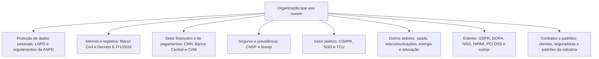

# Marco Regulatório Brasileiro e Internacional

> **Objetivo pedagógico:** conhecer as principais normas aplicáveis ao uso de nuvem no Brasil (LGPD e regulamentos da ANPD, Marco Civil da Internet, normas de instituições financeiras, de seguradoras e de pagamentos, normas do setor público e de outros setores) e as referências internacionais mais relevantes para organizações brasileiras com operações ou clientes no exterior (GDPR, DORA, NIS2, HIPAA e outras), entendendo o que cada uma exige da organização, o que implica em nuvem e como acompanhar mudanças.

> **Aviso:** este material é educacional e **não constitui aconselhamento jurídico**. As normas são resumidas e mudam com frequência; **confirme o texto vigente e a aplicabilidade com o Jurídico e com a área de conformidade**. Os artigos citados servem de ponto de partida.

## 1. Mapa regulatório

## 2. Lei Geral de Proteção de Dados (Lei nº 13.709/2018)

### 2.1 Obrigações centrais para quem usa nuvem

| Tema | Dispositivos | O que exige |
|---|---|---|
| Princípios | Art. 6º | Finalidade, adequação, necessidade, livre acesso, qualidade, transparência, segurança, prevenção, não discriminação, responsabilização e prestação de contas |
| Bases legais | Arts. 7º e 11 | Todo tratamento precisa de base legal; dados sensíveis têm hipóteses específicas |
| Crianças e adolescentes | Art. 14 | Tratamento no melhor interesse; consentimento específico dos responsáveis, em regra |
| Direitos dos titulares | Arts. 17 a 22 | Acesso, correção, anonimização, bloqueio, eliminação, portabilidade e informação |
| Agentes de tratamento | Arts. 37 a 45 | Registro das operações; relatório de impacto; encarregado; responsabilidade e ressarcimento de danos |
| Segurança e boas práticas | Arts. 46 a 51 | Medidas de segurança técnicas e administrativas; comunicação de incidentes; programas de governança em privacidade |
| Transferência internacional | Arts. 33 a 36 | Hipóteses legais e instrumentos (pasta 09, arquivo 6) |
| Fiscalização e sanções | Arts. 52 a 54 | Advertência, multas (de até 2% do faturamento, limitadas a R$ 50 milhões por infração), publicização, bloqueio e eliminação de dados, e suspensão de atividades |

### 2.2 Regulamentos da ANPD relevantes (exemplos, confirme o texto vigente)

| Regulamento | Tema |
|---|---|
| Resolução CD/ANPD nº 2/2022 | Agentes de tratamento de pequeno porte |
| Resolução CD/ANPD nº 4/2023 | Dosimetria e aplicação de sanções administrativas |
| Resolução CD/ANPD nº 15/2024 | Comunicação de incidentes de segurança (prazo, conteúdo e registro) |
| Resolução CD/ANPD nº 18/2024 | Atuação do encarregado pelo tratamento de dados pessoais |
| Resolução CD/ANPD nº 19/2024 | Transferência internacional de dados e cláusulas-padrão contratuais |
| Guias orientativos da ANPD | Agentes de tratamento e encarregado; segurança da informação para agentes de pequeno porte; tratamento de dados por agentes públicos e outros |

O detalhamento da LGPD em nuvem (papéis, contratos e incidentes) está no arquivo 6.

## 3. Marco Civil da Internet (Lei nº 12.965/2014) e Decreto nº 8.771/2016

| Tema | Pontos relevantes |
|---|---|
| Registros de conexão e de acesso a aplicações | Guarda por prazos definidos (arts. 13 e 15), para quem se enquadra como provedor de conexão ou de aplicações, e requisitos de sigilo |
| Responsabilidade de provedores | Regras de responsabilização por conteúdo de terceiros e por ordem judicial |
| Padrões de segurança e de sigilo de registros | O Decreto nº 8.771/2016 indica diretrizes: controle estrito de acesso, mecanismos de autenticação, inventário de acessos e técnicas de gestão de registros que garantam a inviolabilidade (por exemplo, criptografia ou proteção equivalente) |
| Neutralidade e privacidade | Princípios gerais, com impacto em aplicações e em telemetria |

## 4. Setor financeiro e de pagamentos

| Norma | Resumo do que trata |
|---|---|
| Resolução CMN nº 4.893/2021 | Política de segurança cibernética e requisitos para a contratação de serviços de processamento e armazenamento de dados e de computação em nuvem, para instituições financeiras e demais autorizadas pelo Banco Central |
| Resolução BCB nº 85/2021 | Equivalente, para as instituições de pagamento autorizadas pelo Banco Central |
| Resolução CMN nº 4.557/2017 | Estrutura de gerenciamento de riscos e de capital |
| Resolução CMN nº 4.943/2021 e normas correlatas sobre gerenciamento de riscos e continuidade | Continuidade de negócios e gestão de riscos operacionais (confirme as normas aplicáveis) |
| Normas do Banco Central sobre o Sistema Financeiro Aberto (Open Finance) e o Pix | Requisitos de segurança e de proteção de dados em arranjos específicos |
| Normas da CVM | Requisitos para participantes do mercado de capitais (confirme as normas aplicáveis) |

### Pontos típicos das normas de segurança cibernética e de nuvem

| Tema | Expectativa |
|---|---|
| Política de segurança cibernética | Aprovada pela direção, com princípios, diretrizes, controles, classificação de dados e de incidentes e revisão anual |
| Plano de ação e de resposta a incidentes | Cenários, procedimentos, comunicação e registro de incidentes relevantes |
| Contratação de serviços de nuvem | Avaliação da relevância do serviço; práticas de governança e de gestão proporcionais; verificação da capacidade do prestador (certificações, controles e conformidade); análise de riscos |
| Serviços prestados no exterior | Exigências adicionais: avaliação do país e da existência de acordos de troca de informações entre o Banco Central e as autoridades supervisoras |
| Cláusulas contratuais | Acesso do regulador, segregação de dados, continuidade, notificação de incidentes, subcontratação e término do contrato |
| Comunicação ao Banco Central | Comunicação da contratação de serviços relevantes, nos termos e prazos da norma |
| Relatório anual | Relatório sobre a implementação do plano de ação e de resposta a incidentes |
| Continuidade e saída | Planos de continuidade, testes e estratégia de saída (pasta 04, arquivo 6) |

Verifique as **atualizações recentes** das resoluções do CMN e do Banco Central sobre segurança cibernética, terceirização e resiliência: normas desse setor são alteradas com frequência. Pesquise o texto consolidado vigente antes de aplicar.

## 5. Seguros, previdência e capitalização

| Norma | Resumo |
|---|---|
| Circular Susep nº 638/2021 | Requisitos de segurança cibernética para seguradoras, entidades abertas de previdência complementar, sociedades de capitalização e resseguradores locais, inclusive sobre contratação de serviços de nuvem |
| Normas do CNSP e da Susep sobre gestão de riscos e controles internos | Estruturas de controle e de gestão de riscos |

## 6. Setor público

| Norma | Resumo |
|---|---|
| IN GSI/PR nº 5/2021 | Requisitos mínimos de segurança da informação para uso de soluções de computação em nuvem pelos órgãos e entidades da administração pública federal (classificação da informação, tipos de dados, localização e modelos de serviço) |
| Normas da Secretaria de Governo Digital (SGD) | Modelos de contratação de nuvem e programas de privacidade e de segurança da informação (por exemplo, o PPSI e as portarias correlatas); confirme as normas vigentes |
| Decreto nº 9.637/2018 | Política Nacional de Segurança da Informação |
| Estratégia e política nacionais de cibersegurança | Diretrizes nacionais (por exemplo, a Estratégia Nacional de Segurança Cibernética e a Política Nacional de Cibersegurança); confirme as normas vigentes |
| Decisões do TCU | Referências e acórdãos sobre auditoria e contratação de TI e de nuvem |
| LGPD, capítulo IV | Tratamento de dados pelo poder público |

## 7. Outros setores (exemplos)

| Setor | Normas e pontos relevantes (confirme a vigência) |
|---|---|
| Saúde | LGPD (dados sensíveis); Lei nº 13.787/2018 (digitalização e guarda de prontuários, com requisitos de segurança e de preservação); normas dos conselhos profissionais |
| Telecomunicações | Regulamento de segurança cibernética aplicada ao setor de telecomunicações da Anatel (Resolução nº 740/2020) |
| Energia e infraestruturas críticas | Normas setoriais de segurança cibernética (por exemplo, as da ANEEL e do ONS, para o setor elétrico) |
| Educação e serviços ao consumidor | LGPD; Código de Defesa do Consumidor (responsabilidade pelo fato do serviço e deveres de informação) |
| Assinaturas e documentos eletrônicos | MP nº 2.200-2/2001; Lei nº 14.063/2020 (pasta 10, arquivo 5) |

## 8. Referências internacionais relevantes

| Norma | Escopo | Relevância para organizações brasileiras |
|---|---|---|
| GDPR (Regulamento (UE) 2016/679) | Proteção de dados na União Europeia, com alcance extraterritorial | Aplica-se a quem oferece bens ou serviços ou monitora titulares na UE; exige contratos com operadores (art. 28), segurança (art. 32), notificação de violações em 72 horas (art. 33) e regras de transferência (arts. 44 a 49) |
| DORA (Regulamento (UE) 2022/2554) | Resiliência operacional digital do setor financeiro da UE, com regras para riscos de terceiros de TIC, inclusive nuvem | Relevante para fornecedores de TIC e para grupos com atividades na UE |
| Diretiva NIS2 (Diretiva (UE) 2022/2555) | Segurança de redes e sistemas em setores essenciais e importantes, inclusive provedores de computação em nuvem | Relevante para fornecedores e clientes com operações na UE |
| HIPAA (Estados Unidos) | Proteção de informações de saúde | Acordos com associados de negócio (BAA) com provedores de nuvem |
| PCI DSS v4.0.1 | Proteção de dados de cartões de pagamento | Exigência contratual de bandeiras e de adquirentes |
| FedRAMP (Estados Unidos) | Autorização de serviços de nuvem para o governo federal dos EUA | Relevante para fornecedores que atendem ao governo dos EUA |
| C5 (Alemanha, BSI) | Catálogo de critérios de conformidade para serviços de nuvem | Referência de mercado na Alemanha |
| Esquemas de certificação de nuvem da União Europeia | Esquema europeu de certificação de segurança de serviços de nuvem em desenvolvimento | Acompanhar a evolução |
| Leis estaduais e setoriais dos EUA (por exemplo, a CCPA e a CPRA da Califórnia) | Privacidade do consumidor | Relevante para quem trata dados de residentes dos EUA |
| CLOUD Act (EUA) e leis de acesso governamental | Acesso a dados mantidos por provedores sob jurisdição dos EUA | Avaliação de riscos de transferência e de soberania (pasta 09, arquivo 6) |

## 9. Como acompanhar mudanças normativas

| Prática | Descrição |
|---|---|
| Responsável pelo monitoramento | Jurídico e conformidade, com apoio de segurança e privacidade |
| Fontes oficiais | Diário Oficial da União, sites da ANPD, do Banco Central, do CMN, da Susep, da CVM, do GSI/PR e da SGD |
| Serviços de monitoramento regulatório | Assinaturas de alertas e boletins de entidades setoriais |
| Rotina de avaliação | Classificar cada mudança por impacto (nenhum, baixo, médio e alto), com prazos de adequação |
| Registro | Atualizar o registro de obrigações e a matriz de controles |
| Comunicação | Informar as áreas afetadas e definir planos de ação |
| Participação setorial | Associações, fóruns e consultas públicas |

## 10. Exemplo prático: leitura de uma norma para controles de nuvem

Exemplo (ilustrativo): "contratar serviço relevante de nuvem exige avaliar a capacidade do prestador e prever cláusulas de acesso do regulador."

| Passo | Resultado |
|---|---|
| Requisito acionável | Antes da contratação, avaliar o provedor (certificações, controles, conformidade e situação financeira) e registrar a decisão; o contrato deve garantir acesso do regulador aos dados e às informações do serviço |
| Controles associados | Processo de diligência de fornecedores (arquivo 7); cláusulas-padrão no modelo de contrato (pasta 02, arquivo 5); análise de riscos de terceiros (pasta 04, arquivo 6) |
| Evidências | Relatório de avaliação, parecer da conformidade e do Jurídico, cópia do contrato com as cláusulas, comunicação ao regulador, quando aplicável |
| Responsável | Compras, segurança, conformidade e Jurídico |
| Frequência | Na contratação e a cada renovação; reavaliação anual do fornecedor crítico |

## 11. Casos de uso corporativos

- Mapeamento do marco regulatório aplicável por área de negócio e por país de operação.
- Avaliação regulatória de projetos de adoção de nuvem e de novos fornecedores.
- Acompanhamento de mudanças normativas com plano de adequação.

## 12. Normas e frameworks relevantes

- Brasil: LGPD; Marco Civil da Internet e Decreto nº 8.771/2016; normas do CMN, do Banco Central, da CVM, da Susep, do GSI/PR e de outros reguladores setoriais
- Internacional: GDPR; DORA; NIS2; HIPAA; PCI DSS; FedRAMP; C5
- ISO/IEC 27001:2022 (5.31, requisitos legais, estatutários, regulamentares e contratuais)

## 13. Checklist operacional: marco regulatório

- [ ] Normas aplicáveis identificadas por atividade, por setor e por país, com o Jurídico
- [ ] Obrigações traduzidas em requisitos acionáveis e registradas (arquivo 1)
- [ ] Requisitos específicos de contratação de nuvem do setor tratados (diligência, cláusulas e comunicações)
- [ ] Obrigações de comunicação (ANPD, reguladores e titulares) definidas, com prazos e responsáveis
- [ ] Processo de monitoramento de mudanças normativas com fontes e responsáveis
- [ ] Avaliação de impacto e plano de adequação para cada mudança relevante
- [ ] Revisão semestral do mapa regulatório

## 14. Referências

- Brasil. Lei nº 13.709/2018; Lei nº 12.965/2014; Decreto nº 8.771/2016; Lei nº 13.787/2018; Lei nº 14.063/2020.
- Banco Central do Brasil e CMN. Resolução CMN nº 4.893/2021; Resolução BCB nº 85/2021; Resolução CMN nº 4.557/2017.
- Susep. Circular nº 638/2021; GSI/PR. Instrução Normativa nº 5/2021.
- ANPD. Resoluções CD/ANPD nº 2/2022, 4/2023, 15/2024, 18/2024 e 19/2024.
- União Europeia. GDPR; Regulamento (UE) 2022/2554 (DORA); Diretiva (UE) 2022/2555 (NIS2).
