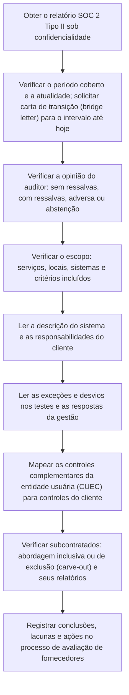

# Padrões, Certificações e Relatórios de Provedores

> **Objetivo pedagógico:** compreender os principais padrões e certificações usados em conformidade de nuvem (ISO/IEC 27001, 27017, 27018, 27701 e 22301; SOC 1, SOC 2 e SOC 3; PCI DSS; CSA STAR e CCM; FedRAMP e C5), distinguir certificação, atestação e autoavaliação, saber onde obter os relatórios dos três grandes provedores e lê-los criticamente (escopo, período, opinião, exceções, controles complementares do cliente e subcontratados), e decidir quais certificações a própria organização deve buscar.

## 1. Tipos de garantia

| Tipo | Descrição | Exemplos |
|---|---|---|
| Autoavaliação | A organização declara a aderência a um catálogo de controles | CSA STAR Nível 1 (questionário CAIQ) |
| Certificação | Organismo acreditado audita o sistema de gestão e emite um certificado, com validade e auditorias de acompanhamento | ISO/IEC 27001, 27017, 27018, 27701 e 22301 |
| Atestação (relatório de auditor independente) | Auditor independente emite um relatório sobre controles em um escopo e em um período | SOC 1, SOC 2 e SOC 3 (AICPA) |
| Avaliação de conformidade com um padrão da indústria | Avaliador qualificado emite relatório ou atestado de conformidade | PCI DSS (relatório de conformidade e atestado de conformidade) |
| Autorização governamental | Programa de autorização para uso por governos | FedRAMP |
| Esquemas nacionais ou regionais | Catálogos de critérios com auditoria independente | C5 (Alemanha) |

## 2. Padrões ISO/IEC relevantes

| Padrão | Foco | Observações para nuvem |
|---|---|---|
| ISO/IEC 27001:2022 | Sistema de gestão de segurança da informação (SGSI), com Anexo A de 93 controles | Certificação do SGSI de um escopo definido; o prazo de transição da versão de 2013 para a de 2022 terminou em outubro de 2025 |
| ISO/IEC 27002:2022 | Guia de controles de segurança da informação | Base do Anexo A |
| ISO/IEC 27017:2015 | Controles de segurança específicos de nuvem para provedores e para clientes | Esclarece as responsabilidades compartilhadas |
| ISO/IEC 27018:2019 | Proteção de informações de identificação pessoal em nuvens públicas atuando como operador | Relevante para operadores de dados pessoais |
| ISO/IEC 27701:2019 | Extensão de privacidade do SGSI (sistema de gestão de informações de privacidade) | Apoia a LGPD e o GDPR, como controlador e como operador |
| ISO 22301:2019 | Sistema de gestão de continuidade de negócios | Resiliência e recuperação |
| ISO/IEC 42001:2023 | Sistema de gestão de inteligência artificial | Relevante para serviços de IA em nuvem |
| ISO/IEC 27036-4:2016 | Segurança em relacionamentos com fornecedores: serviços de nuvem | Gestão de fornecedores |

Pontos de atenção: o **escopo do certificado** define o que está coberto (serviços, locais e processos); a **Declaração de Aplicabilidade** mostra os controles considerados; a certificação tem **validade de três anos**, com auditorias de manutenção anuais.

## 3. Relatórios SOC (AICPA)

| Relatório | Foco | Público |
|---|---|---|
| SOC 1 | Controles relevantes para a **demonstração financeira** de clientes | Clientes e seus auditores financeiros |
| SOC 2 | Controles relacionados a **segurança, disponibilidade, integridade do processamento, confidencialidade e privacidade** (critérios dos serviços de confiança) | Clientes, parceiros e reguladores, sob acordo de confidencialidade |
| SOC 3 | Versão resumida e pública do SOC 2 | Público geral |

| Tipo | Significado |
|---|---|
| Tipo I | Opina sobre o **desenho** dos controles em uma **data específica** |
| Tipo II | Opina sobre o desenho e sobre a **eficácia operacional** em um **período** (geralmente de 6 a 12 meses) |

Prefira relatórios **Tipo II** e atuais: o Tipo I tem valor limitado como evidência de operação.

### 3.1 Como ler criticamente um relatório SOC 2

| Elemento | O que verificar |
|---|---|
| Período e data | Cobre um período contínuo e recente? Há lacunas até hoje? |
| Opinião | Sem ressalvas? Se houver ressalvas, em quais controles? |
| Escopo | Os serviços e as regiões que a organização usa estão incluídos? |
| Critérios | Que critérios foram avaliados (segurança, disponibilidade, confidencialidade, privacidade e integridade do processamento)? |
| Exceções | Quais testes falharam? Qual a gravidade e o que a gestão fez? |
| CUEC (controles complementares da entidade usuária) | Quais controles o **cliente** deve operar para que os controles do provedor sejam eficazes? Cada CUEC deve ter um controle correspondente e evidências no cliente |
| Subcontratados | Estão incluídos ou excluídos? Há relatórios deles? |
| Mudanças relevantes | Mudanças de sistemas, de organização ou incidentes durante o período |
| Uso restrito | Os relatórios são confidenciais; respeitar os termos de uso |

## 4. PCI DSS (Payment Card Industry Data Security Standard)

| Aspecto | Descrição |
|---|---|
| Versão vigente | PCI DSS v4.0.1 (a v4.0 foi aposentada em 31 de dezembro de 2024; os requisitos que eram "futuros" tornaram-se obrigatórios em 31 de março de 2025) |
| Escopo | Sistemas que armazenam, processam ou transmitem dados de titulares de cartão e sistemas conectados |
| Responsabilidade em nuvem | O provedor pode ser validado como prestador de serviços; o cliente continua responsável por seu uso. A matriz de responsabilidades do provedor (por requisito) é essencial |
| Redução de escopo | Segmentação, tokenização e criptografia de ponta a ponta |
| Validação | Autoavaliação (SAQ) ou avaliação por avaliador qualificado (QSA), conforme o nível do comerciante ou do prestador |

## 5. CSA STAR e Cloud Controls Matrix

| Elemento | Descrição |
|---|---|
| Cloud Controls Matrix (CCM) v4 | Catálogo de 197 controles em 17 domínios, com mapeamentos para outros padrões |
| CAIQ | Questionário de iniciativa de avaliação de consenso, derivado do CCM, usado em avaliações de fornecedores |
| STAR Nível 1 | Autoavaliação publicada no registro público da CSA |
| STAR Nível 2 | Auditoria de terceiro: certificação STAR (baseada na ISO/IEC 27001 com o CCM) ou atestação STAR (baseada no SOC 2 com o CCM) |
| STAR Nível 3 | Monitoramento contínuo (conceito em evolução) |
| Registro | O STAR Registry público lista os fornecedores e seu nível de garantia |

## 6. Outros esquemas

| Esquema | Observações |
|---|---|
| FedRAMP | Programa dos EUA para autorizar serviços de nuvem do governo federal (níveis de impacto baixo, moderado e alto); relevante para fornecedores que atendem esse mercado |
| C5 (BSI, Alemanha) | Catálogo de critérios para serviços de nuvem, com relatório de auditor |
| Esquemas nacionais de outros países | Programas de avaliação de provedores adotados por governos |
| NIST SP 800-53 e CSF | Catálogos de controles usados como referência de implementação |
| CIS Benchmarks | Linhas de base técnicas de configuração |

## 7. Onde obter os relatórios dos provedores

| Provedor | Portal | Conteúdo típico |
|---|---|---|
| AWS | AWS Artifact | Relatórios SOC, certificados ISO, relatórios de conformidade de vários programas, acordos (como o de tratamento de dados) |
| Microsoft | Service Trust Portal | Relatórios de auditoria, certificados, guias de conformidade e avaliações de risco |
| Google Cloud | Compliance Resource Center | Certificações, relatórios, mapeamentos e guias de conformidade |
| SaaS e outros fornecedores | Centros de confiança (*trust centers*) | Relatórios, certificados, questionários e políticas |

O acesso a relatórios confidenciais costuma exigir uma conta e a aceitação de **termos de confidencialidade**. Controle internamente quem os acessa e como são armazenados.

## 8. Qual certificação a organização deve buscar

| Necessidade | Opção típica |
|---|---|
| Demonstrar um sistema de gestão de segurança a clientes e a parceiros | ISO/IEC 27001 (e 27017 e 27018, para nuvem) |
| Clientes dos EUA e de grandes empresas pedem um relatório de controles | SOC 2 Tipo II |
| Demonstrar maturidade de privacidade | ISO/IEC 27701 |
| Tratamento de dados de cartão | PCI DSS |
| Mercado de nuvem e transparência | CSA STAR |
| Continuidade de negócios | ISO 22301 |
| Atender a requisitos setoriais | As exigências da norma setorial e os relatórios aceitos pelo regulador |

A decisão deve basear-se em **requisitos de clientes e de reguladores, em riscos e em custo-benefício**, e não apenas no valor de marketing. Uma certificação com escopo pequeno e sem relação com o ambiente real tem pouco valor de garantia.

## 9. Exemplo prático: avaliação dos relatórios de um provedor de dados analíticos em nuvem

| Item | Achado | Decisão |
|---|---|---|
| Certificação ISO/IEC 27001 | Escopo exclui a região de uso da organização | Solicitar o escopo ampliado ou avaliar controles adicionais |
| SOC 2 Tipo II | Período de 12 meses, terminado há 5 meses; opinião sem ressalvas; carta de transição disponível | Aceitável, com a carta de transição |
| Exceções | 2 exceções em revisão de acessos privilegiados, com remediação concluída | Verificar a evidência da correção |
| CUEC | 9 controles complementares; 3 sem controle correspondente na organização | Criar os controles e evidências no cliente |
| Subcontratados | Provedor de infraestrutura incluído por carve-out; sem relatório obtido | Solicitar o relatório do subcontratado |
| ISO/IEC 27018 e 27701 | Não possui | Compensar com cláusulas contratuais, RIPD e verificação adicional |
| Decisão | Aprovar com condições: carta de transição, relatório do subcontratado, três controles no cliente e cláusulas de tratamento de dados | |

## 10. Casos de uso corporativos

- Seleção de certificações da própria organização com base em requisitos de clientes e de reguladores.
- Processo padronizado de análise de relatórios SOC 2, ISO e PCI DSS de fornecedores.
- Mapeamento de CUEC para controles do cliente.

## 11. Normas e frameworks relevantes

- ISO/IEC 27001:2022, 27017:2015, 27018:2019, 27701:2019 e 22301:2019; ISO/IEC 17021-1 (requisitos para organismos de certificação); ISO/IEC 42001:2023
- AICPA. Trust Services Criteria (2017, com pontos de foco revisados em 2022); SSAE 18 (SOC 1 e SOC 2); ISAE 3402 e ISAE 3000
- PCI DSS v4.0.1; CSA CCM v4 e STAR; FedRAMP; C5; NIST SP 800-53 Rev. 5

## 12. Checklist operacional: padrões e relatórios

- [ ] Requisitos de clientes e de reguladores levantados para decidir as certificações da organização
- [ ] Escopo das certificações alinhado ao ambiente real (serviços, locais e processos)
- [ ] Processo padronizado de obtenção e de análise de relatórios de provedores (SOC 2, ISO e PCI DSS)
- [ ] Preferência por relatórios Tipo II e atuais, com carta de transição
- [ ] CUEC mapeados para controles e evidências no cliente
- [ ] Subcontratados avaliados (relatórios ou avaliação direta)
- [ ] Relatórios confidenciais armazenados e acessados conforme os termos de uso
- [ ] Calendário de renovação de certificados e de relatórios dos fornecedores
- [ ] Revisão anual da estratégia de certificações

## 13. Referências

- American Institute of Certified Public Accountants. SOC 2: Trust Services Criteria. 2017 (revisão de 2022).
- ISO/IEC 27001:2022; ISO/IEC 27017:2015; ISO/IEC 27018:2019; ISO/IEC 27701:2019.
- PCI Security Standards Council. PCI DSS v4.0.1. 2024.
- Cloud Security Alliance. CCM v4, CAIQ v4 e STAR Registry.
- Amazon Web Services. AWS Artifact; Microsoft. Service Trust Portal; Google Cloud. Compliance Resource Center (documentação vigente).
