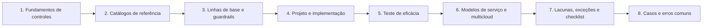

# 12 Controles de Segurança em Nuvem

## Objetivo

Projetar, implementar, testar e manter o conjunto de controles de segurança de um ambiente de nuvem: compreender os tipos e os atributos dos controles, escolher e combinar catálogos de referência (CSA CCM, CIS, NIST e ISO), estabelecer linhas de base e guardrails por camada, escrever controles verificáveis e implementá-los como código, testar a eficácia com evidências e com validação baseada em ataques, adaptar os controles aos modelos de serviço (IaaS, PaaS, SaaS) e a ambientes multicloud, e gerir lacunas, exceções e controles compensatórios.

## Trilha de estudo recomendada

## Conteúdo da pasta

| Ordem | Arquivo | Objetivo |
|---|---|---|
| 1 | [fundamentos-de-controles-de-seguranca-em-nuvem.md](fundamentos-de-controles-de-seguranca-em-nuvem.md) | Tipos, atributos, ciclo de vida e princípios de projeto de controles |
| 2 | [catalogos-de-controles-ccm-cis-nist-e-iso.md](catalogos-de-controles-ccm-cis-nist-e-iso.md) | Catálogos de referência, comparação e critérios de escolha |
| 3 | [linhas-de-base-de-seguranca-e-guardrails-por-camada.md](linhas-de-base-de-seguranca-e-guardrails-por-camada.md) | Linha de base mínima de 30 controles, com implementação por provedor |
| 4 | [projeto-selecao-e-implementacao-de-controles.md](projeto-selecao-e-implementacao-de-controles.md) | Seleção por riscos, especificação, módulos seguros por padrão e políticas como código |
| 5 | [teste-de-eficacia-e-garantia-de-controles.md](teste-de-eficacia-e-garantia-de-controles.md) | Eficácia de desenho e de operação, testes automatizados e validação por ataques |
| 6 | [controles-por-modelo-de-servico-saas-e-multicloud.md](controles-por-modelo-de-servico-saas-e-multicloud.md) | Controles em IaaS, PaaS, SaaS e consistência entre nuvens |
| 7 | [lacunas-excecoes-controles-compensatorios-modelos-e-checklist.md](lacunas-excecoes-controles-compensatorios-modelos-e-checklist.md) | Gestão de lacunas, controles compensatórios, modelos e checklist |
| 8 | [casos-de-uso-e-erros-comuns-em-controles-de-seguranca-em-nuvem.md](casos-de-uso-e-erros-comuns-em-controles-de-seguranca-em-nuvem.md) | Casos fictícios, erros comuns, exercícios e perguntas de revisão |

## Princípios da pasta

- Controles existem para tratar riscos: sem risco identificado, o controle é custo sem propósito
- Preferir controles preventivos e automáticos; usar detectivos e corretivos em camadas
- Seguro por padrão: o caminho mais fácil deve ser o caminho seguro
- Todo controle tem dono, evidência e teste; controle sem teste é suposição
- Menos controles bem operados superam muitos controles mal operados
- Lacunas e exceções são gerenciadas formalmente, com prazo e controles compensatórios

## Relação com outras pastas

- 03 e 04: governança, guardrails e riscos (que controles são necessários)
- 05 a 10: arquitetura e controles técnicos detalhados (identidade, rede, dados e criptografia)
- 11: conformidade (matriz de controles e evidências)
- 13: monitoramento e registros
- 14 a 18: ameaças, vulnerabilidades, avaliações, postura e proteção de cargas
- 21: DevSecOps (controles como código)
- 27 a 29: métricas, roteiro e auditorias

## Referências

- CSA. Cloud Controls Matrix v4
- CIS Controls v8.1 e CIS Foundations Benchmarks
- NIST SP 800-53 Rev. 5, SP 800-53A Rev. 5 e SP 800-53B; NIST CSF 2.0
- ISO/IEC 27002:2022 e ISO/IEC 27017:2015
- MITRE ATT&CK for Cloud; MITRE Center for Threat-Informed Defense, Security Stack Mappings
