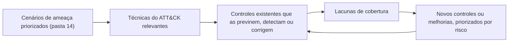

# Catálogos de Controles: CCM, CIS, NIST e ISO

> **Objetivo pedagógico:** conhecer os principais catálogos de controles aplicáveis à nuvem (CSA Cloud Controls Matrix v4, CIS Controls v8.1 e CIS Foundations Benchmarks, NIST SP 800-53 Rev. 5 e CSF 2.0, ISO/IEC 27002:2022 e 27017, e os benchmarks dos provedores), compreender a estrutura, a granularidade e o uso de cada um, compará-los, escolher uma combinação adequada ao contexto e usar os mapeamentos de ameaças (MITRE ATT&CK) para validar a cobertura.

## 1. Visão geral dos catálogos

| Catálogo | Origem | Foco | Granularidade | Melhor uso |
|---|---|---|---|---|
| CSA Cloud Controls Matrix (CCM) v4 | Cloud Security Alliance | Controles específicos de nuvem, com responsabilidades entre provedor e cliente | 197 controles em 17 domínios | Base de controles de nuvem e avaliação de provedores (CAIQ e STAR) |
| CIS Controls v8.1 | Center for Internet Security | Ações priorizadas de defesa cibernética, por grupos de implementação | 18 controles e 153 salvaguardas | Priorização prática; programas em fase de maturação |
| CIS Foundations Benchmarks | Center for Internet Security | Configurações seguras de provedores e de serviços | Recomendações técnicas por provedor, com perfis de nível 1 e 2 | Linhas de base técnicas verificáveis |
| NIST SP 800-53 Rev. 5 | NIST | Catálogo abrangente de controles de segurança e de privacidade | 20 famílias, com mais de mil controles e melhorias | Programas formais, setor público e ambientes regulados |
| NIST CSF 2.0 | NIST | Estrutura de resultados de cibersegurança | 6 funções, categorias e subcategorias | Governança e comunicação de programas de segurança |
| ISO/IEC 27002:2022 | ISO e IEC | Controles de segurança da informação (apoia a ISO/IEC 27001) | 93 controles em 4 temas | Certificação e programas de gestão |
| ISO/IEC 27017:2015 | ISO e IEC | Orientação adicional para serviços de nuvem | Controles da 27002 com orientações específicas e 7 controles adicionais | Complemento de nuvem à ISO/IEC 27001 |
| Benchmarks e padrões dos provedores | AWS, Microsoft e Google Cloud | Recomendações específicas por provedor | Controles por serviço, com verificações automatizadas | Implementação e verificação contínuas |

## 2. CSA Cloud Controls Matrix (CCM) v4

| Domínio | Sigla |
|---|---|
| Auditoria e garantia | A&A |
| Segurança de aplicações e de interfaces | AIS |
| Continuidade de negócios e resiliência operacional | BCR |
| Controle de mudanças e gestão de configuração | CCC |
| Criptografia e gestão de chaves | CEK |
| Segurança de datacenters | DCS |
| Segurança e privacidade do ciclo de vida de dados | DSP |
| Governança, riscos e conformidade | GRC |
| Recursos humanos | HRS |
| Gestão de identidades e de acessos | IAM |
| Interoperabilidade e portabilidade | IPY |
| Segurança de infraestrutura e de virtualização | IVS |
| Registro e monitoramento | LOG |
| Gestão de incidentes, descoberta eletrônica e forense em nuvem | SEF |
| Gestão da cadeia de suprimentos, transparência e responsabilização | STA |
| Gestão de ameaças e de vulnerabilidades | TVM |
| Gestão universal de endpoints | UEM |

**Características:** cada controle indica a **responsabilidade** (provedor, cliente ou compartilhada), traz mapeamentos para outros padrões (ISO, NIST, PCI DSS e outros) e alimenta o questionário CAIQ e o programa STAR. É o catálogo mais direto para **avaliar provedores e definir responsabilidades**.

## 3. CIS Controls v8.1 e grupos de implementação

| Controle | Tema |
|---|---|
| 1 | Inventário e controle de ativos corporativos |
| 2 | Inventário e controle de ativos de software |
| 3 | Proteção de dados |
| 4 | Configuração segura de ativos e de software |
| 5 | Gestão de contas |
| 6 | Gestão do controle de acesso |
| 7 | Gestão contínua de vulnerabilidades |
| 8 | Gestão de registros de auditoria |
| 9 | Proteções de e-mail e de navegadores |
| 10 | Defesas contra malware |
| 11 | Recuperação de dados |
| 12 | Gestão de infraestrutura de rede |
| 13 | Monitoramento e defesa de rede |
| 14 | Conscientização e treinamento em segurança |
| 15 | Gestão de provedores de serviço |
| 16 | Segurança de aplicações |
| 17 | Gestão de resposta a incidentes |
| 18 | Testes de intrusão |

| Grupo de implementação | Perfil | Salvaguardas (aprox.) |
|---|---|---|
| IG1 | Higiene cibernética essencial, para organizações com recursos limitados | 56 |
| IG2 | Organizações com mais recursos e dados sensíveis | 130 (cumulativo) |
| IG3 | Organizações com maior exposição a ameaças avançadas | 153 (cumulativo) |

A versão 8.1 (2024) manteve as 153 salvaguardas e incluiu a função de **governança** na estrutura. O CIS também publica **guias complementares para ambientes de nuvem** que interpretam os controles para serviços de nuvem.

### CIS Foundations Benchmarks

| Característica | Descrição |
|---|---|
| Escopo | Linhas de base de configuração para AWS, Azure, Google Cloud e outros (por serviço e por produto) |
| Perfis | **Nível 1**: recomendações práticas, com baixo impacto operacional; **Nível 2**: defesa em profundidade, para ambientes de maior segurança, com maior impacto |
| Estrutura | Seções por área: identidade, registros, monitoramento, rede, armazenamento, bancos de dados e outros; cada recomendação traz justificativa, auditoria (como verificar) e remediação (como corrigir) |
| Uso | Verificação contínua por serviços nativos de postura e por ferramentas de terceiros (pasta 17) |

## 4. NIST SP 800-53 Rev. 5 e CSF 2.0

| Aspecto | NIST SP 800-53 Rev. 5 | NIST CSF 2.0 |
|---|---|---|
| Natureza | Catálogo detalhado de controles | Estrutura de alto nível de resultados desejados |
| Organização | 20 famílias (por exemplo, AC controle de acesso, AU auditoria, CM gestão de configuração, IA identificação e autenticação, IR resposta a incidentes, SC proteção de sistemas e de comunicações, SI integridade de sistemas e de informações, SR gestão de riscos da cadeia de suprimentos, PT tratamento de informações pessoais) | 6 funções: Governar, Identificar, Proteger, Detectar, Responder e Recuperar |
| Linhas de base | Baixa, moderada e alta (SP 800-53B), mais uma linha de base de privacidade | Perfis (atual e alvo) definidos pela organização |
| Avaliação | NIST SP 800-53A define procedimentos de avaliação (examinar, entrevistar e testar) | Relacionado por referências informativas |
| Uso | Setor público, ambientes regulados, programas formais e referência técnica | Governança, comunicação com a direção e avaliação de maturidade |

O NIST mantém **referências informativas** (OLIR) que relacionam o CSF e o 800-53 a outros padrões, e o **MITRE ATT&CK Mappings Explorer** relaciona controles do 800-53 a técnicas de ataque.

## 5. ISO/IEC 27002:2022 e 27017:2015

| Tema (27002:2022) | Número de controles |
|---|---|
| Organizacionais | 37 |
| Pessoas | 8 |
| Físicos | 14 |
| Tecnológicos | 34 |

| Aspecto | Descrição |
|---|---|
| Relação com a ISO/IEC 27001 | O Anexo A da 27001:2022 lista os mesmos 93 controles; a 27002 traz o detalhamento e as orientações |
| Atributos | Tipo, propriedades, conceitos de cibersegurança, capacidades operacionais e domínios (seção 2.3 do arquivo 1) |
| Controles novos em 2022 | Inteligência de ameaças, segurança da informação para o uso de serviços em nuvem, prontidão de TIC para a continuidade de negócios, monitoramento da segurança física, gestão de configuração, exclusão de informações, mascaramento de dados, prevenção de vazamento de dados, atividades de monitoramento, filtragem da web e codificação segura |
| ISO/IEC 27017:2015 | Orientações de implementação para nuvem sobre controles existentes e **sete controles adicionais** (por exemplo, responsabilidades compartilhadas, remoção de ativos do cliente, segregação em ambientes virtuais compartilhados, configuração de máquinas virtuais, administração operacional de nuvem, monitoramento de atividades e alinhamento de redes virtuais e físicas) |

## 6. Benchmarks e padrões dos provedores

| Provedor | Padrões e referências (confirme a disponibilidade) | Verificação automatizada |
|---|---|---|
| AWS | AWS Foundational Security Best Practices (padrão do Security Hub); AWS Well-Architected Framework (pilar de segurança) | Security Hub e AWS Config |
| Microsoft | Microsoft Cloud Security Benchmark (sucessor do Azure Security Benchmark); Well-Architected Framework (pilar de segurança) | Defender for Cloud e Azure Policy |
| Google Cloud | Cloud Security Foundations Blueprint; Well-Architected Framework (pilar de segurança) | Security Command Center e políticas da organização |
| Todos | Mapeamentos para CIS, NIST, ISO e PCI DSS | Painéis de conformidade regulatória |

Os padrões dos provedores são **práticos e acionáveis**, pois vêm com verificações automáticas, mas são específicos de cada provedor: em ambientes multicloud, use um catálogo comum como camada de governança (arquivo 6).

## 7. Mapeamento de ameaças e validação de cobertura

| Recurso | Uso |
|---|---|
| MITRE ATT&CK for Cloud | Táticas e técnicas de atacantes em nuvem, para verificar se os controles cobrem as técnicas relevantes |
| Security Stack Mappings (MITRE Center for Threat-Informed Defense) | Relacionam os recursos de segurança nativos de AWS, Azure e Google Cloud a técnicas do ATT&CK e indicam a eficácia de cada controle |
| Mappings Explorer | Relaciona controles do NIST SP 800-53 e de outros catálogos a técnicas do ATT&CK |
| Análise de cobertura | Para cada técnica relevante ao seu cenário de ameaças, identificar os controles preventivos, detectivos e corretivos e as lacunas |

## 8. Como escolher e combinar catálogos

| Critério | Orientação |
|---|---|
| Exigência regulatória, contratual ou de certificação | Usar o catálogo exigido (por exemplo, ISO/IEC 27002 para certificação da 27001; PCI DSS para cartões; 800-53 no setor público dos EUA) |
| Maturidade e recursos da organização | Organizações em início: CIS Controls IG1 e linhas de base dos provedores; organizações maduras: CCM, 800-53 e ISO |
| Foco em nuvem | CCM v4, ISO/IEC 27017 e benchmarks dos provedores |
| Comunicação com a direção | NIST CSF 2.0 (funções e perfis) |
| Verificação técnica contínua | CIS Foundations Benchmarks e padrões dos provedores |
| Multicloud | Catálogo comum (CCM ou conjunto próprio) com implementações por provedor |
| Esforço e redundância | **Escolher um catálogo base** e mapear os demais, em vez de implementar vários em paralelo |

### Estratégia recomendada

1. Escolha um **catálogo-base** compatível com os requisitos externos (por exemplo, ISO/IEC 27002 e CCM v4).
2. Defina a **linha de base técnica** com os benchmarks do CIS e dos provedores (arquivo 3).
3. **Mapeie** os requisitos externos (LGPD, normas setoriais, PCI DSS e contratos) aos controles da organização (pasta 11, arquivo 4).
4. Use o **CIS Controls** e o **ATT&CK** para priorizar e validar a cobertura.
5. Ajuste (*tailoring*): documente os controles não aplicáveis ou adaptados, com justificativa.

## 9. Exemplo prático: escolha de catálogos para uma fintech

| Necessidade | Escolha |
|---|---|
| Certificação ISO/IEC 27001 exigida por clientes | ISO/IEC 27002:2022 como catálogo-base e ISO/IEC 27017 para nuvem |
| Avaliações de fornecedores e de clientes em formato CAIQ | CCM v4 para o mapeamento e as respostas |
| Linha de base técnica em AWS e em Azure | CIS Foundations Benchmarks (nível 1 em produção e nível 2 para dados restritos) e padrões dos provedores com verificação contínua |
| Pagamentos com cartão | PCI DSS v4.0.1 (mapeado ao catálogo-base) |
| Normas do setor financeiro e LGPD | Mapeamento aos controles do catálogo-base |
| Priorização do roteiro | CIS Controls IG2 e análise de cobertura do ATT&CK |
| Reporte à direção | NIST CSF 2.0 (perfil atual e alvo) |
| Resultado | 138 controles da organização, mapeados a 6 fontes; uma só campanha de evidências atende às auditorias | |

## 10. Casos de uso corporativos

- Seleção do catálogo-base e do conjunto de linhas de base técnicas.
- Análise de cobertura de ameaças com o ATT&CK para priorizar investimentos.
- Alinhamento entre catálogos para reduzir redundâncias em auditorias.

## 11. Normas e frameworks relevantes

- CSA CCM v4 e CAIQ v4; CIS Controls v8.1 e CIS Foundations Benchmarks; NIST SP 800-53 Rev. 5, 800-53A e 800-53B; NIST CSF 2.0
- ISO/IEC 27001:2022, 27002:2022 e 27017:2015
- MITRE ATT&CK for Cloud; MITRE Center for Threat-Informed Defense, Security Stack Mappings; NIST OLIR

## 12. Checklist operacional: catálogos

- [ ] Catálogo-base escolhido, com a justificativa (requisitos, maturidade e contexto)
- [ ] Linhas de base técnicas definidas (CIS e provedores), com perfis por classificação
- [ ] Mapeamento entre o catálogo-base e os requisitos externos (pasta 11)
- [ ] Controles não aplicáveis ou adaptados documentados, com justificativa
- [ ] Análise de cobertura de ameaças (ATT&CK) realizada e lacunas priorizadas
- [ ] Versões dos catálogos registradas e atualizadas
- [ ] Revisão anual da escolha de catálogos

## 13. Referências

- Cloud Security Alliance. Cloud Controls Matrix v4. 2021.
- Center for Internet Security. CIS Controls v8.1 (2024) e CIS Foundations Benchmarks (versões vigentes).
- Joint Task Force. NIST SP 800-53 Rev. 5. 2020; NIST. Cybersecurity Framework 2.0. 2024.
- ISO/IEC 27002:2022; ISO/IEC 27017:2015.
- MITRE. ATT&CK for Cloud; MITRE Center for Threat-Informed Defense. Security Stack Mappings (documentação).
