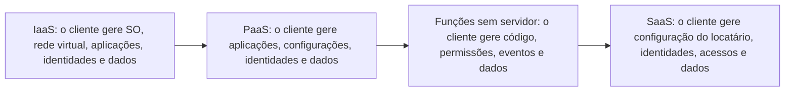
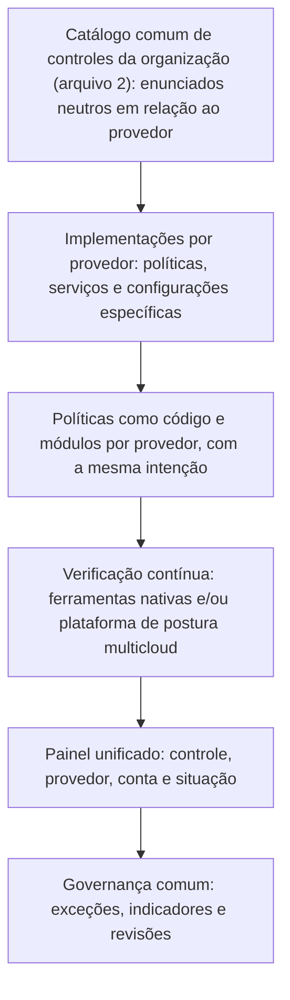

# Controles por Modelo de Serviço, SaaS e Multicloud

> **Objetivo pedagógico:** adaptar o conjunto de controles ao modelo de serviço (IaaS, PaaS, serviços sem servidor, bancos de dados gerenciados e SaaS), compreender como a responsabilidade do cliente muda e quais controles passam a depender principalmente de **configuração**, tratar a segurança de SaaS (postura, identidade, compartilhamento, aplicativos conectados e registros) com linhas de base de referência, e manter **consistência de controles em ambientes multicloud** com catálogo comum, políticas como código e ferramentas de postura, evitando o "mínimo denominador comum".

## 1. A responsabilidade muda com o modelo de serviço

| Modelo | O provedor controla | O cliente controla | Controles de maior peso |
|---|---|---|---|
| IaaS | Infraestrutura física, virtualização | Sistema operacional, patches, rede virtual, aplicações, identidades e dados | Endurecimento, gestão de patches, segmentação, registros e identidade |
| PaaS (inclui bancos gerenciados) | Plataforma, sistema operacional e componentes do serviço | Configuração do serviço, identidades, rede, dados e aplicações | Configuração segura, acesso privado, identidade, criptografia e registros |
| Sem servidor (FaaS) | Ambiente de execução e escala | Código, dependências, permissões das funções, eventos e dados | Permissões mínimas, validação de entradas, dependências e segredos |
| SaaS | Aplicação e infraestrutura | Configuração do locatário, identidades, acessos, compartilhamento, aplicativos conectados e dados | Identidade, configuração, DLP, registros e gestão de aplicativos conectados |

**Regra prática:** quanto mais "alto" o modelo de serviço, menos controles de infraestrutura e mais controles de **configuração, identidade e dados**.

## 2. Controles em IaaS

| Área | Controles principais |
|---|---|
| Sistema operacional | Imagens endurecidas (benchmarks do CIS), patches, sem serviços desnecessários, agentes de segurança e de registros |
| Identidade da instância | Funções e identidades gerenciadas; metadados protegidos (IMDSv2); sem chaves locais |
| Rede | Grupos de segurança mínimos; sem administração exposta; segmentação (pasta 08) |
| Armazenamento | Volumes criptografados; instantâneos controlados |
| Gestão de configuração | Infraestrutura como código; detecção de desvios |
| Vulnerabilidades | Varredura contínua e correção por prazos (pasta 15) |
| Registros e detecção | Registros do sistema, EDR e alertas (pasta 13) |
| Backup e recuperação | Backups isolados e testados |

## 3. Controles em PaaS e bancos de dados gerenciados

| Área | Controles principais |
|---|---|
| Configuração do serviço | Linhas de base do CIS e do provedor por serviço; desabilitar acesso público |
| Acesso | Pontos privados; autenticação por identidade; privilégio mínimo |
| Criptografia | Em repouso e em trânsito (TLS imposto); chaves do cliente, conforme a classificação |
| Registros | Auditoria do serviço habilitada e centralizada |
| Atualizações | Versões suportadas e janelas de manutenção; atenção a descontinuações |
| Segredos | Cofre e credenciais dinâmicas |
| Backups | Retenção, imutabilidade e testes |
| Isolamento | Contas, redes e perfis de acesso separados por ambiente |

## 4. Controles em funções sem servidor e em contêineres gerenciados

| Área | Controles principais |
|---|---|
| Permissões | Um papel por função, com permissões mínimas (sem curingas) |
| Entradas e eventos | Validação de entradas; autenticação e autorização dos acionadores |
| Dependências | Varredura e fixação de versões; cadeia de suprimentos (pasta 21) |
| Segredos | Cofre; sem segredos em variáveis em texto claro |
| Limites | Tempo, memória e concorrência; proteção contra abuso e custos |
| Rede | Acesso privado a recursos; saída controlada |
| Registros | Registros estruturados e rastreabilidade |
| Contêineres | Imagens mínimas e assinadas; admissão por política; isolamento (pastas 19 e 20) |

## 5. Segurança de SaaS

Em SaaS, o provedor protege a aplicação, mas **a configuração do locatário e o uso são do cliente**. Os incidentes de SaaS costumam envolver identidades comprometidas, compartilhamentos excessivos e aplicativos conectados com permissões amplas.

### 5.1 Controles de linha de base para SaaS

| Domínio | Controles |
|---|---|
| Identidade | SSO obrigatório; MFA resistente a phishing para administradores e MFA para todos; bloqueio de autenticação legada; contas de emergência |
| Administração | Poucos administradores, papéis mínimos, elevação sob demanda; contas administrativas separadas |
| Compartilhamento e acesso externo | Restrição de compartilhamento externo e de links públicos; revisão de convidados; expiração de acessos |
| Aplicativos conectados (OAuth) | Aprovação administrativa para consentimentos; revisão periódica; revogação de aplicativos não usados ou de risco |
| Proteção de dados | Rótulos de sensibilidade, DLP, criptografia com chaves do cliente quando disponível, retenção |
| E-mail e colaboração | Proteções contra phishing e falsificação (SPF, DKIM e DMARC); regras de encaminhamento externo restritas |
| Dispositivos | Acesso condicionado à conformidade do dispositivo; acesso limitado para dispositivos não gerenciados |
| Registros | Registros de auditoria habilitados, retidos e enviados ao SIEM |
| Configuração | Verificação contínua do locatário contra linhas de base |
| Fornecedor | Avaliação, contrato e relatórios (pasta 11) |

### 5.2 Ferramentas e referências

| Referência ou ferramenta | Uso |
|---|---|
| CISA SCuBA (Secure Cloud Business Applications) | Linhas de base de configuração segura para Microsoft 365 e Google Workspace, com ferramentas de avaliação (ScubaGear e ScubaGoggles) |
| Guias de endurecimento do fornecedor e do CIS | Linhas de base para as principais aplicações de SaaS |
| Gestão da postura de segurança de SaaS (SSPM) | Soluções que verificam continuamente as configurações de SaaS e os aplicativos conectados |
| CASB e SSE | Visibilidade e controles de acesso e de dados para o uso de aplicações de nuvem |
| Registros de auditoria do SaaS | Detecção de abuso (acessos incomuns, exportações em massa e novas regras de encaminhamento) |

Verifique o escopo e a disponibilidade das ferramentas na documentação vigente.

## 6. Controles em multicloud

Organizações que usam mais de um provedor enfrentam **inconsistência de controles**, de terminologia e de ferramentas.

| Desafio | Consequência |
|---|---|
| Serviços e termos diferentes | Equipes aplicam controles de forma distinta |
| Modelos de identidade e de permissões distintos | Dificuldade de privilégio mínimo consistente |
| Ferramentas de segurança por provedor | Visibilidade fragmentada |
| Competências divididas | Lacunas de conhecimento |
| Políticas e linhas de base diferentes | Níveis de segurança desiguais |

### 6.1 Estratégia de consistência

| Prática | Descrição |
|---|---|
| Enunciados independentes de provedor | "Os armazenamentos de objetos com dados confidenciais ou restritos não permitem acesso público" |
| Implementações específicas | O controle é implementado com os mecanismos de cada provedor (arquivo 3, seção 3) |
| Linha de base comum com perfis por provedor | O mesmo nível de segurança, aproveitando recursos nativos |
| Identidade centralizada | Um provedor de identidade corporativo federado a todos os provedores |
| Registros e detecção centralizados | SIEM e plataformas de dados de segurança |
| Plataforma de postura multicloud (opcional) | Visão unificada; avaliar o custo e a cobertura em relação às ferramentas nativas |
| Infraestrutura como código com módulos equivalentes | Módulos por provedor que implementam os mesmos controles |
| Competências | Treinamento e centro de excelência |

### 6.2 Evitando o "mínimo denominador comum"

Uma abordagem que usa apenas os recursos comuns a todos os provedores perde **recursos de segurança nativos** mais fortes. Prefira: **intenção comum, implementação nativa**. Quando um provedor oferece um controle mais forte, use-o e documente a equivalência nos demais.

## 7. Exemplo prático: matriz de controles de armazenamento em três provedores

Controle da organização: **CTL-DAT-017, "Armazenamentos de objetos com dados confidenciais ou restritos não permitem acesso público e exigem criptografia com chaves do cliente e TLS"**.

| Elemento | AWS | Azure | Google Cloud |
|---|---|---|---|
| Bloqueio de acesso público | S3 Block Public Access (conta e organização) | Desabilitar acesso anônimo a blobs na conta e por política | Prevenção de acesso público e política da organização |
| Criptografia com chave do cliente | SSE-KMS com chave do cliente | Chaves do cliente em Key Vault ou Managed HSM | CMEK com Cloud KMS |
| TLS obrigatório | Política de bucket com `aws:SecureTransport` | Transferência segura e TLS mínimo na conta | HTTPS por padrão; políticas conforme necessário |
| Registros de acesso a dados | Eventos de dados do CloudTrail | Registros de diagnóstico do armazenamento | Registros de auditoria de acesso a dados |
| Verificação contínua | AWS Config e Security Hub | Azure Policy e Defender for Cloud | Security Command Center |
| Módulo de infraestrutura como código | Módulo de bucket seguro | Módulo de conta de armazenamento segura | Módulo de bucket seguro |
| Evidência | Resultados do Config e relatório de conformidade | Estado do Azure Policy | Achados e relatórios do SCC |

## 8. Exemplo prático: SaaS de colaboração

| Verificação | Achado | Ação |
|---|---|---|
| Administradores | 14 administradores globais permanentes | Reduzir a 3 elegíveis com elevação sob demanda, além de 2 contas de emergência |
| MFA | Administradores com notificação simples | MFA resistente a phishing para todos os administradores |
| Compartilhamento externo | Links públicos permitidos para todos; 1.200 arquivos com links públicos | Restringir links públicos; revisar e remover; DLP por rótulo |
| Aplicativos conectados | 86 aplicativos com permissões de leitura de arquivos e e-mails, 31 sem uso | Exigir aprovação administrativa; revogar os 31 sem uso; revisão trimestral |
| Regras de e-mail | 9 regras de encaminhamento externo automático | Bloquear o encaminhamento externo automático; investigar as regras |
| Registros | Retenção padrão curta, sem envio ao SIEM | Estender a retenção e integrar ao SIEM |
| Resultado | Pontuação de configuração do locatário de 48% para 91% em 8 semanas | |

## 9. Casos de uso corporativos

- Catálogo comum de controles com implementações por provedor e por modelo de serviço.
- Programa de segurança de SaaS (SSPM), com linhas de base e revisão de aplicativos conectados.
- Painel unificado de conformidade de controles em ambientes multicloud.

## 10. Normas e frameworks relevantes

- CSA CCM v4 (IVS, IAM, DSP, AIS e STA); CSA Security Guidance v4.0; ISO/IEC 27017:2015; NIST SP 800-145 (modelos de serviço) e SP 800-210
- CISA SCuBA; CIS Benchmarks (Microsoft 365, Google Workspace e plataformas de SaaS); OWASP SaaS Security (documentação)
- CIS Foundations Benchmarks por provedor; NIST CSF 2.0

## 11. Checklist operacional: modelos de serviço e multicloud

- [ ] Responsabilidade por controle definida por modelo de serviço (IaaS, PaaS, FaaS e SaaS)
- [ ] Controles de IaaS, de PaaS e de funções implementados e verificados conforme os arquivos anteriores
- [ ] Linha de base de SaaS aplicada (identidade, administração, compartilhamento, aplicativos conectados, DLP e registros)
- [ ] Inventário de SaaS e de aplicativos conectados, com revisão periódica
- [ ] Catálogo comum de controles com enunciados neutros e implementações por provedor
- [ ] Identidade, registros e detecção centralizados entre provedores
- [ ] Módulos de infraestrutura como código equivalentes por provedor
- [ ] Verificação contínua e painel unificado de controles
- [ ] Recursos nativos mais fortes aproveitados e equivalências documentadas
- [ ] Revisão semestral da consistência entre provedores

## 12. Referências

- Mell, P.; Grance, T. NIST SP 800-145: The NIST Definition of Cloud Computing. 2011.
- CISA. Secure Cloud Business Applications (SCuBA) Project (documentação).
- Cloud Security Alliance. Security Guidance for Critical Areas of Focus in Cloud Computing v4.0. 2017.
- Center for Internet Security. CIS Benchmarks para provedores e para SaaS (versões vigentes).
- Pastas 02, 11, 17 e 18 deste repositório.
