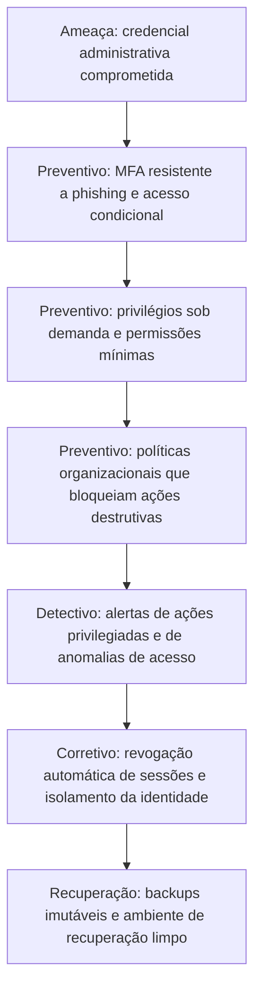
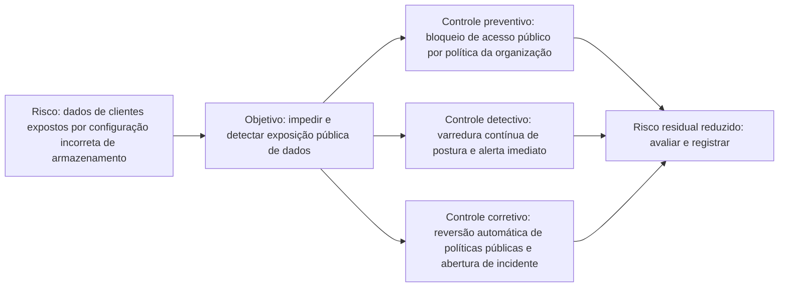
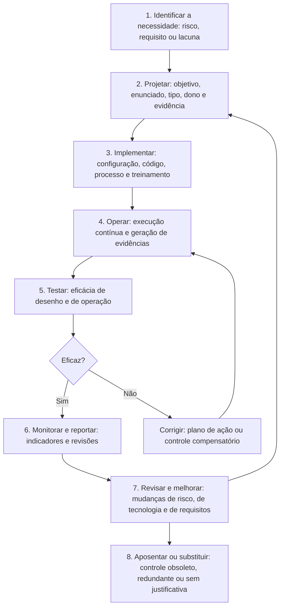

# Fundamentos de Controles de Segurança em Nuvem

> **Objetivo pedagógico:** compreender o que é um controle de segurança, distinguir objetivo de controle e controle, classificar os controles por função (preventivo, detectivo, corretivo, dissuasório e compensatório) e por natureza (técnico, administrativo e físico), conhecer os atributos usados pelos catálogos (por exemplo, os da ISO/IEC 27002:2022), entender o ciclo de vida dos controles, os níveis de automação e os princípios de projeto (defesa em profundidade, seguro por padrão e simplicidade), e relacionar controles a riscos e a requisitos de conformidade.

## 1. O que é um controle

Um **controle de segurança** é uma medida que **modifica o risco**: reduz a probabilidade de um evento, reduz o impacto, ou torna o evento detectável e recuperável. Pode ser uma política, um procedimento, uma configuração, um mecanismo técnico ou uma prática.

| Conceito | Definição | Exemplo |
|---|---|---|
| Objetivo de controle | O resultado de segurança que se deseja alcançar | "Somente pessoas autorizadas acessam dados restritos" |
| Controle | A medida concreta que contribui para o objetivo | "Acesso a dados restritos exige MFA resistente a phishing e é concedido por papel, com revisão trimestral" |
| Salvaguarda | Termo usado em alguns catálogos (por exemplo, no CIS Controls) para a ação específica dentro de um controle | "Estabelecer e manter um inventário de contas" |
| Requisito | Exigência externa ou interna que o controle ajuda a atender | "Proteger dados pessoais com medidas técnicas" (LGPD, art. 46) |
| Linha de base | Conjunto mínimo de controles ou de configurações obrigatórias | Linha de base de 30 controles (arquivo 3) |
| Evidência | Prova de que o controle existe e funciona | Relatório de configuração, registro de revisão ou resultado de teste |

## 2. Classificação dos controles

### 2.1 Por função

| Função | Objetivo | Exemplos em nuvem |
|---|---|---|
| Preventivo | Impedir que o evento ocorra | Política que nega buckets públicos; MFA resistente a phishing; segmentação de rede |
| Detectivo | Identificar que o evento ocorreu ou está ocorrendo | Alertas de uso da conta raiz; detecção de anomalias em registros; varredura de postura |
| Corretivo | Limitar o impacto e restaurar o estado | Isolamento automático de uma instância comprometida; restauração de backups; rotação de credenciais |
| Dissuasório | Desencorajar tentativas | Avisos de monitoramento; sanções disciplinares; transparência sobre registros |
| Compensatório | Substituir temporariamente um controle que não pode ser implementado | Monitoramento reforçado e acesso restrito quando não é possível aplicar MFA em um sistema legado |
| De recuperação | Restabelecer operações | Planos de continuidade; ambientes de recuperação |

### 2.2 Por natureza

| Natureza | Descrição | Exemplos |
|---|---|---|
| Técnico (lógico) | Implementado em tecnologia | Criptografia, controle de acesso, firewalls e políticas de configuração |
| Administrativo (organizacional) | Políticas, processos e papéis | Política de segurança; revisão de acessos; gestão de fornecedores; treinamento |
| Físico | Proteção do ambiente físico | Segurança de datacenters (herdada do provedor, na maioria dos casos) |

### 2.3 Atributos usados pelos catálogos

A ISO/IEC 27002:2022 associa a cada controle **atributos** que facilitam a filtragem e a análise:

| Atributo | Valores |
|---|---|
| Tipo de controle | Preventivo, detectivo e corretivo |
| Propriedades da segurança da informação | Confidencialidade, integridade e disponibilidade |
| Conceitos de cibersegurança | Identificar, proteger, detectar, responder e recuperar |
| Capacidades operacionais | Governança, gestão de ativos, proteção da informação, segurança de recursos humanos, segurança física, segurança de sistemas e de redes, segurança de aplicações, configuração segura, gestão de identidade e de acesso, gestão de ameaças e de vulnerabilidades, continuidade, segurança de relacionamentos com fornecedores, conformidade legal e de requisitos, gestão de eventos de segurança e garantia da segurança da informação |
| Domínios de segurança | Governança e ecossistema, proteção, defesa e resiliência |

O NIST CSF 2.0 organiza os resultados em seis funções: **Governar, Identificar, Proteger, Detectar, Responder e Recuperar**.

## 3. Defesa em profundidade e combinação de controles

Nenhum controle é perfeito. A segurança vem da **combinação em camadas**, de modo que a falha de um seja coberta por outro.

| Princípio | Aplicação |
|---|---|
| Camadas independentes | Controles que não compartilham o mesmo ponto de falha (por exemplo, identidade, rede e dados) |
| Preferir preventivos e automáticos | Impedem o evento sem depender de pessoas |
| Detectivos e corretivos para o que escapa | Reduzem o tempo de permanência e o dano |
| Cobertura do ciclo de vida | Antes (projeto), durante (operação) e depois (resposta e recuperação) |
| Proporcionalidade | Controles mais fortes para ativos de maior criticidade e classificação |

## 4. Controles e riscos

Os controles devem ser selecionados para **tratar riscos identificados** (pasta 04):

| Relação | Descrição |
|---|---|
| Risco → objetivo de controle | O que precisa ser garantido para reduzir o risco |
| Objetivo → controles | Um ou mais controles de tipos diferentes |
| Controles → requisitos | Os mesmos controles atendem a vários requisitos de conformidade (pasta 11) |
| Controles → evidências e testes | Como se comprova a eficácia (arquivo 5) |
| Resultados dos testes → risco residual | A eficácia verificada reduz o risco; a ineficácia o mantém ou o eleva |

## 5. Ciclo de vida de um controle

## 6. Níveis de automação

| Nível | Descrição | Exemplo | Características |
|---|---|---|---|
| Manual | Executado por pessoas, com registro manual | Revisão de acessos por planilha | Sujeito a erros e a atrasos; difícil de escalar |
| Semiautomático | Ferramentas apoiam, mas há etapas manuais | Relatório automático de acessos, com decisão e remoção manuais | Menos esforço; ainda depende de pessoas |
| Automático | Executado e verificado por código ou por serviço | Política que nega buckets públicos e verifica continuamente | Consistente, escalável e com evidências contínuas |
| Autônomo (autocorretivo) | Detecta e corrige sozinho, com salvaguardas | Reversão automática de configuração não conforme de baixo risco | Resposta rápida; exige limites e reversibilidade |

Em nuvem, a meta é **automatizar o máximo possível dos controles técnicos**, mantendo controles administrativos bem definidos para o que depende de julgamento.

## 7. Atributos de um bom controle

| Atributo | Descrição |
|---|---|
| Claro e específico | Um enunciado sem ambiguidades: quem, o quê, quando e como |
| Verificável | É possível testá-lo e evidenciá-lo |
| Mapeado a risco e a requisito | Existe por uma razão documentada |
| Com dono | Uma pessoa ou área responsável |
| Proporcional | Custo e impacto operacional compatíveis com a redução de risco |
| Utilizável | Não gera tantos atritos que as pessoas o contornem |
| Resiliente | Continua eficaz diante de mudanças e de falhas parciais |
| Mensurável | Tem indicadores de eficácia e de cobertura |
| Atual | Revisado periodicamente |

## 8. Exemplo prático: do risco ao conjunto de controles

Risco: "Credenciais de administradores de nuvem comprometidas por phishing levam à destruição de dados e a vazamentos."

| Controle | Função | Natureza | Automação | Evidência |
|---|---|---|---|---|
| MFA resistente a phishing para privilegiados | Preventivo | Técnico | Automático (política do provedor de identidade) | Relatório de métodos de autenticação |
| Elevação sob demanda de privilégios | Preventivo | Técnico e administrativo | Semiautomático (aprovação) | Registros de ativação |
| Política organizacional que nega exclusão de registros e de chaves | Preventivo | Técnico | Automático | Exportação da política |
| Alertas de ações privilegiadas e de uso da conta raiz | Detectivo | Técnico | Automático | Regras e testes de alerta |
| Playbook de revogação de sessões e de chaves | Corretivo | Administrativo e técnico | Semiautomático | Playbook e exercícios |
| Backups imutáveis em conta isolada | Recuperação | Técnico | Automático | Relatórios de backup e de restauração |
| Treinamento e simulações de phishing | Preventivo e dissuasório | Administrativo | Semiautomático | Registros de treinamento |

## 9. Casos de uso corporativos

- Definição do modelo de controles da organização: tipos, atributos, donos e evidências.
- Revisão do portfólio de controles para eliminar redundâncias e lacunas.
- Base para a linha de base, o teste de eficácia e a matriz de conformidade.

## 10. Normas e frameworks relevantes

- ISO/IEC 27002:2022 (estrutura, atributos e controles); ISO/IEC 27001:2022 (cláusula 6.1.3, seleção de controles e Declaração de Aplicabilidade); ISO/IEC 27017:2015
- NIST SP 800-53 Rev. 5 (famílias de controles) e SP 800-53B (linhas de base); NIST CSF 2.0 (funções e categorias)
- CIS Controls v8.1; CSA CCM v4; COBIT 2019

## 11. Checklist operacional: base de controles

- [ ] Modelo de controles definido: tipos, atributos, dono, evidência e método de teste
- [ ] Controles selecionados a partir de riscos e de requisitos, e não por lista genérica
- [ ] Combinação de controles preventivos, detectivos, corretivos e de recuperação por risco crítico
- [ ] Preferência por automação nos controles técnicos; níveis de automação registrados
- [ ] Ciclo de vida dos controles definido (projeto, operação, teste, revisão e aposentadoria)
- [ ] Rastreabilidade entre risco, controle, requisito e evidência
- [ ] Revisão anual do portfólio de controles

## 12. Referências

- ISO/IEC 27002:2022. Information security, cybersecurity and privacy protection: Information security controls.
- Joint Task Force. NIST SP 800-53 Rev. 5: Security and Privacy Controls for Information Systems and Organizations. 2020.
- NIST. Cybersecurity Framework 2.0. 2024.
- Center for Internet Security. CIS Controls v8.1. 2024.
- Pastas 03, 04 e 11 deste repositório.
