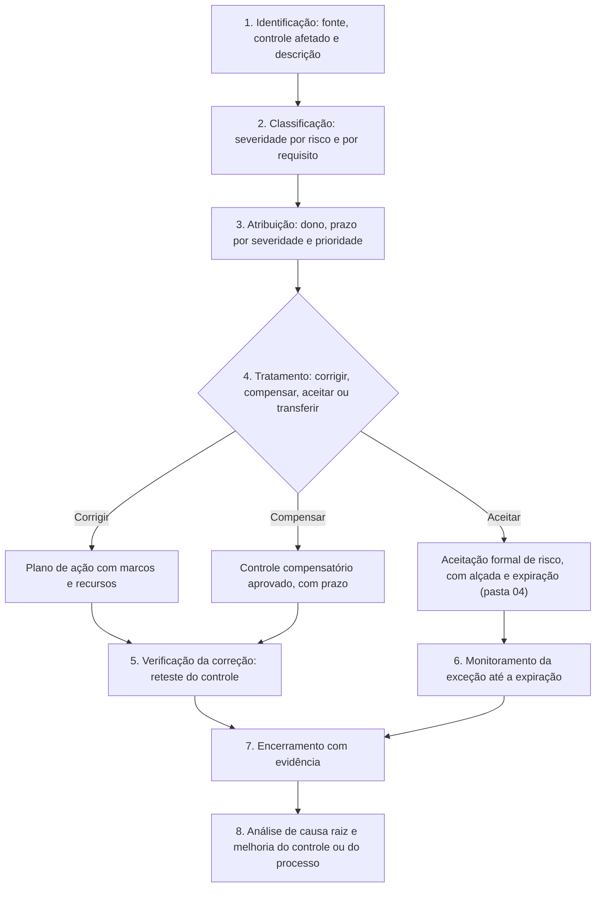

# Lacunas, Exceções, Controles Compensatórios, Modelos e Checklist

> **Objetivo pedagógico:** gerir o ciclo de vida de lacunas de controles (identificação, classificação, plano de correção, prazos por severidade e encerramento), aplicar critérios rigorosos para aceitar controles compensatórios, conduzir exceções formais com prazo e revisão, tratar desvios recorrentes pela causa raiz, rationalizar controles obsoletos ou redundantes, calcular o envelhecimento e o descumprimento de prazos com DuckDB, e usar modelos (registro de lacunas, ficha de controle compensatório e plano de ação) e um checklist do programa de controles.

## 1. Fontes de lacunas

| Fonte | Exemplos |
|---|---|
| Testes de eficácia (arquivo 5) | Controles parcialmente eficazes ou ineficazes |
| Verificações contínuas de postura | Desvios de configuração |
| Auditorias internas e externas | Achados e observações (pasta 29) |
| Avaliações de riscos | Riscos sem controle adequado (pasta 04) |
| Testes de intrusão, equipe roxa e emulação | Técnicas não impedidas nem detectadas (pasta 16) |
| Incidentes e quase-incidentes | Controles que falharam ou não existiam (pasta 22) |
| Mudanças normativas | Novos requisitos sem controle (pasta 11) |
| Avaliações de fornecedores | Controles herdados sem sustentação |
| Mudanças tecnológicas | Novos serviços sem controles definidos |

## 2. Ciclo de vida de uma lacuna



### Prazos de correção por severidade (referência)

| Severidade | Critério (exemplos) | Prazo de correção |
|---|---|---|
| Crítica | Exposição de dados restritos; ausência de MFA em privilegiados; administração exposta à internet | Imediato a 7 dias |
| Alta | Controle crítico parcialmente eficaz; lacuna regulatória com prazo próximo | Até 30 dias |
| Média | Controle importante com desvios; falta de evidência recorrente | Até 90 dias |
| Baixa | Melhoria de eficiência ou de documentação | Até 180 dias |

Os prazos são **referências**; defina os seus conforme o apetite de risco e as exigências normativas, e **escalone** lacunas vencidas ao comitê.

## 3. Controles compensatórios

Um **controle compensatório** substitui, temporariamente, um controle que não pode ser implementado como exigido, por limitação técnica ou de negócio legítima e documentada. **Não** é um atalho para evitar a correção.

### 3.1 Critérios para aceitar um controle compensatório (inspirados nas diretrizes do PCI DSS)

| Critério | Pergunta |
|---|---|
| Atender à intenção e ao rigor | O controle compensatório atinge o **objetivo** do controle original, com **nível de defesa equivalente**? |
| Oferecer defesa equivalente | A proteção é comparável à que o controle original proporcionaria? |
| Ser adicional (*above and beyond*) | Vai **além** do que já é exigido por outros controles? (Não pode ser apenas o cumprimento de requisitos existentes.) |
| Ser proporcional ao risco adicional | Considera o risco extra criado pela ausência do controle original |
| Ter limitação legítima e documentada | Há uma restrição técnica ou de negócio demonstrável? |
| Ser verificável e testado | Há evidências e testes de eficácia? |
| Ter prazo e plano de substituição | Existe data de expiração e plano para o controle definitivo? |
| Ter aprovação por alçada adequada | Aprovado por quem tem autoridade, com parecer da 2ª linha |

### 3.2 Exemplo: sistema legado sem suporte a MFA

| Elemento | Descrição |
|---|---|
| Controle original | MFA resistente a phishing para todos os acessos privilegiados (BSL-08) |
| Limitação | Sistema legado de um fornecedor que não suporta a autenticação moderna; migração prevista em 9 meses |
| Compensações | Acesso somente por um bastião com MFA forte e sessão gravada; sem exposição direta; contas de uso individual; alertas de qualquer acesso fora da janela de manutenção; revisão semanal dos registros; segmentação do sistema em rede isolada |
| Riscos residuais | Risco médio, reduzido de crítico; sem a autenticação do próprio sistema |
| Prazo e plano | Validade de 9 meses, revisão trimestral; migração do sistema ou substituição |
| Aprovação | Diretor da área, com parecer da 2ª linha e ciência do comitê |
| Verificação | Teste mensal do bastião e dos alertas; relatório de revisão |

## 4. Exceções formais

Detalhes de governança de exceções: pasta 03. Elementos de conformidade com controles:

| Elemento | Prática |
|---|---|
| Registro único | Todas as exceções em um registro com ID, controle, justificativa, risco e controles compensatórios |
| Alçada | Por nível de risco residual (pasta 04, arquivo 2) |
| Prazo máximo | Por nível (por exemplo, 90 dias para risco médio e 30 dias para alto) |
| Revisão e renovação | Renovação exige nova justificativa; limite de renovações |
| Alertas de vencimento | Notificação a 30, 15 e 7 dias |
| Verificação técnica | O estado da exceção refletido em ferramentas (por exemplo, etiquetas e exclusões temporárias de políticas, com prazo) |
| Indicadores | Número de exceções, idade média, vencidas e recorrentes |

## 5. Causa raiz e desvios recorrentes

Desvios que se repetem indicam **falha de processo, de modelo de infraestrutura ou de capacitação**, e não apenas de execução.

| Sinal | Causa possível | Ação |
|---|---|---|
| Mesmo desvio em várias contas | Módulo ou padrão inadequado; falta de guardrail preventivo | Corrigir o módulo; implantar política preventiva |
| Desvios concentrados em uma equipe | Falta de conhecimento ou de ferramentas | Treinamento e suporte; caminho pavimentado |
| Exceções renovadas repetidamente | Controle impraticável ou prazo irreal | Reprojetar o controle ou a arquitetura |
| Desvios que reaparecem após correção | Correção manual, sem tratamento da origem | Corrigir no código de infraestrutura |
| Alertas ignorados | Excesso de falsos positivos | Ajustar detecções |

Técnicas: **cinco porquês**, análise de Ishikawa e revisão sem culpa (*blameless*). Registre as causas e acompanhe as ações de melhoria.

## 6. Racionalização de controles

| Situação | Ação |
|---|---|
| Controle sem risco ou requisito associado | Aposentar, com justificativa |
| Controles redundantes (mesmo objetivo, mesmo ponto de falha) | Consolidar |
| Controle substituído por guardrail automático | Aposentar o procedimento manual |
| Controle ineficaz e sem melhoria viável | Substituir |
| Controle de baixo valor e alto custo | Avaliar o custo-benefício |
| Controles não utilizados | Remover e atualizar a matriz |

Realize a rationalização anual, com revisão por riscos e por requisitos.

## 7. Análise de lacunas com DuckDB

`lacunas.csv` (fictício):

```
id,controle,descricao,severidade,abertura,prazo,situacao,dono,tratamento
GAP-001,BSL-08,MFA resistente a phishing ausente em 3 contas privilegiadas,critica,2026-10-20,2026-10-27,aberta,Identidade,corrigir
GAP-002,BSL-17,Bucket de teste com acesso publico,alta,2026-10-05,2026-11-04,aberta,Plataforma,corrigir
GAP-003,BSL-23,Instancias legadas sem IMDSv2,media,2026-08-10,2026-11-08,aberta,Operacoes,compensar
GAP-004,BSL-11,Revisao de acessos do 3o trimestre incompleta,media,2026-10-01,2026-12-30,aberta,Seguranca,corrigir
GAP-005,BSL-21,Restauracao de backup nao testada em 6 meses,alta,2026-07-15,2026-08-14,encerrada,Operacoes,corrigir
```

```sql
-- Lacunas abertas: idade, atraso em relação ao prazo e prioridade para escalonamento (data de referência: 2026-11-20)
SELECT id, controle, severidade, dono, tratamento,
       date_diff('day', CAST(abertura AS DATE), DATE '2026-11-20') AS idade_dias,
       greatest(date_diff('day', CAST(prazo AS DATE), DATE '2026-11-20'), 0) AS atraso_dias,
       CASE WHEN CAST(prazo AS DATE) < DATE '2026-11-20' THEN 'VENCIDA' ELSE 'NO PRAZO' END AS situacao_prazo
FROM read_csv_auto('lacunas.csv')
WHERE situacao = 'aberta'
ORDER BY CASE severidade WHEN 'critica' THEN 1 WHEN 'alta' THEN 2 WHEN 'media' THEN 3 ELSE 4 END, atraso_dias DESC;

-- Indicadores: lacunas abertas por severidade e quantas estão vencidas
SELECT severidade,
       count(*) AS abertas,
       count(*) FILTER (WHERE CAST(prazo AS DATE) < DATE '2026-11-20') AS vencidas
FROM read_csv_auto('lacunas.csv')
WHERE situacao = 'aberta'
GROUP BY severidade;
```

A data de referência do exemplo é fictícia: use a data da sua análise.

## 8. Modelos

### 8.1 Registro de lacunas de controles

| ID | Controle | Descrição | Fonte | Severidade | Risco associado | Dono | Abertura | Prazo | Tratamento | Situação | Evidência de encerramento |
|---|---|---|---|---|---|---|---|---|---|---|---|
| GAP-001 | | | | | | | | | | | |

### 8.2 Ficha de controle compensatório

| Campo | Preenchimento |
|---|---|
| ID, controle original e requisito | |
| Limitação técnica ou de negócio (descrição e evidência) | |
| Objetivo do controle original | |
| Controles compensatórios propostos | |
| Justificativa de equivalência (intenção e rigor) | |
| Demonstração de que vai além dos controles já exigidos | |
| Risco residual (antes e depois) | |
| Verificação e teste (método e frequência) | |
| Prazo, plano de substituição e responsável | |
| Aprovações (dono, 2ª linha e comitê, conforme a alçada) | |

### 8.3 Plano de ação de lacuna

| Campo | Preenchimento |
|---|---|
| ID da lacuna e controle | |
| Ação específica e mensurável | |
| Responsável e recursos | |
| Marcos e data final | |
| Dependências | |
| Risco residual esperado | |
| Verificação de eficácia (teste de reexecução) | |
| Situação e evidências | |

### 8.4 Registro de revisão e de racionalização de controles

| Data | Controle | Resultado da revisão (manter, ajustar, consolidar ou aposentar) | Justificativa | Responsável | Atualização da matriz (sim ou não) |
|---|---|---|---|---|---|
| | | | | | |

## 9. Checklist do programa de controles de segurança em nuvem

**Escopo:** ____________________
**Responsável:** ____________________
**Data:** ____________________

### 9.1 Estrutura

- [ ] Modelo de controles definido (tipos, atributos, donos, evidências e testes)
- [ ] Catálogo-base escolhido e mapeado aos requisitos (arquivo 2 e pasta 11)
- [ ] Linha de base mínima aprovada, com níveis por classificação e guardrails implantados (arquivo 3)
- [ ] Módulos de infraestrutura como código seguros por padrão (arquivo 4)

### 9.2 Operação e testes

- [ ] Controles técnicos verificados continuamente e controles manuais testados por amostragem
- [ ] Validação por ataques em laboratório e equipe roxa, com lacunas registradas
- [ ] Eficácia classificada e integrada ao registro de riscos
- [ ] Consistência entre provedores e em SaaS verificada (arquivo 6)

### 9.3 Lacunas e melhoria

- [ ] Registro único de lacunas, com severidade, dono, prazo e escalonamento
- [ ] Controles compensatórios aprovados com critérios rigorosos, prazo e testes
- [ ] Exceções formais com alçada, expiração e revisão
- [ ] Análise de causa raiz de desvios recorrentes
- [ ] Rationalização anual do portfólio de controles
- [ ] Indicadores de cobertura, eficácia, lacunas e exceções reportados à direção

## 10. Resultado da verificação

| Resultado | Condição |
|---|---|
| Conforme | Todos os itens aplicáveis marcados |
| Conforme com ressalvas | Pendências sem lacunas críticas vencidas, com plano de ação e prazos |
| Não conforme | Lacunas críticas vencidas, controles críticos não testados, exceções vencidas sem renovação, ou ausência de linha de base; corrigir com prioridade |

**Assinatura do responsável:** ____________________
**Assinatura do revisor:** ____________________

## 11. Exemplo prático: gestão de lacunas ao longo de um ano

| Indicador | Início | Após 12 meses |
|---|---|---|
| Lacunas críticas abertas | 9 | 0 |
| Lacunas altas vencidas | 21 | 2 |
| Exceções ativas | 64 | 23 |
| Exceções vencidas | 17 | 0 |
| Controles compensatórios | 12, sem testes | 7, todos testados e com prazo |
| Desvios recorrentes tratados por causa raiz | 0 | 14 (módulos corrigidos e guardrails preventivos) |
| Controles rationalizados | n/a | 22 aposentados ou consolidados |
| Efeito | Redução de incidentes de configuração em 71%; esforço de evidências em auditorias reduzido em 35% | |

## 12. Casos de uso corporativos

- Registro único de lacunas e de exceções com escalonamento automático por prazos.
- Política de controles compensatórios com critérios rigorosos e testes.
- Revisão anual do portfólio de controles, com rationalização.

## 13. Normas e frameworks relevantes

- PCI DSS v4.0.1 (planilha de controles compensatórios, apêndice); ISO/IEC 27001:2022 (10.2, não conformidade e ação corretiva; 6.1.3, tratamento de riscos); ISO 31000:2018
- NIST SP 800-53 Rev. 5 (CA-5, plano de ação e marcos; CA-7, monitoramento contínuo; PM-4); NIST SP 800-30 (riscos); COBIT 2019
- ISACA ITAF (relatórios e acompanhamento de achados); IIA Standards (acompanhamento de planos de ação)

## 14. Referências

- PCI Security Standards Council. PCI DSS v4.0.1, Apêndices B e C (Compensating Controls). 2024.
- ISO/IEC 27001:2022, cláusula 10.
- Joint Task Force. NIST SP 800-53 Rev. 5. 2020.
- Ohno, T. Toyota Production System. Productivity Press, 1988 (os cinco porquês).
- Pastas 03, 04, 11 e 29 deste repositório.
