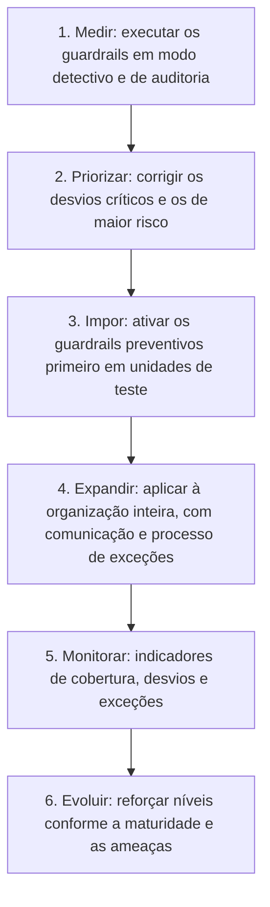

# Linhas de Base de Segurança e Guardrails por Camada

> **Objetivo pedagógico:** estabelecer uma linha de base mínima de 30 controles de segurança em nuvem organizada por camada (organização e contas, identidade, rede, dados, computação, contêineres e funções, DevSecOps, e resposta e resiliência), distinguir guardrails preventivos de detectivos, mapear a implementação nos três provedores, usar políticas como código para impor controles (exemplos em Azure Policy e em política de controle de serviços da AWS), e aplicar a linha de base de forma gradual e proporcional à classificação dos ambientes.

## 1. Linha de base e guardrails

| Conceito | Definição |
|---|---|
| Linha de base | Conjunto mínimo de controles obrigatórios para todos os ambientes (ou por nível de classificação) |
| Guardrail preventivo | Controle que **impede** a ação não conforme (por exemplo, políticas que negam a criação de recursos fora das regras) |
| Guardrail detectivo | Controle que **detecta e alerta** sobre desvios (por exemplo, regras de configuração e varreduras de postura) |
| Guardrail corretivo | Controle que **corrige automaticamente**, com salvaguardas |
| Caminho pavimentado (*paved road*) | Módulos e padrões aprovados que já incorporam os controles, tornando o caminho seguro o mais fácil (pasta 03) |

Princípio: aplicar **preventivos onde o risco é alto e a regra é clara**, **detectivos onde há necessidade de flexibilidade**, e **corretivos** quando a correção automática é segura e reversível.

## 2. Linha de base mínima: 30 controles

Os controles abaixo são um **ponto de partida**: adapte-os à classificação dos dados, aos riscos e aos requisitos da sua organização. A coluna "Pasta" indica onde cada tema é detalhado.

### 2.1 Organização e contas

| ID | Controle | Tipo | Pasta |
|---|---|---|---|
| BSL-01 | Estrutura multiconta (ou equivalente) com contas separadas de segurança, de registros, de rede e de recuperação, e separação entre produção e não produção | Preventivo | 05 |
| BSL-02 | Conta raiz ou proprietário protegida: MFA físico, sem chaves de acesso, e-mail dedicado e alertas de uso | Preventivo e detectivo | 06 |
| BSL-03 | Políticas organizacionais que negam: desabilitar registros, sair da organização e usar regiões não aprovadas | Preventivo | 03 e 05 |
| BSL-04 | Trilhas de auditoria organizacionais centralizadas em conta de registros, imutáveis e com retenção definida | Preventivo e detectivo | 13 |
| BSL-05 | Serviços nativos de detecção e de postura habilitados em todas as contas e regiões | Detectivo | 13 e 17 |
| BSL-06 | Etiquetas obrigatórias (dono, classificação de dados, ambiente e centro de custo) em todos os recursos | Preventivo e detectivo | 03 e 09 |

### 2.2 Identidade

| ID | Controle | Tipo | Pasta |
|---|---|---|---|
| BSL-07 | Federação com o provedor de identidade corporativo (SSO); sem usuários locais permanentes, exceto contas de emergência | Preventivo | 06 |
| BSL-08 | MFA resistente a phishing para contas privilegiadas e para o plano de controle | Preventivo | 06 |
| BSL-09 | Sem chaves de longa duração: identidades gerenciadas e federação para cargas e pipelines | Preventivo | 06 |
| BSL-10 | Acesso privilegiado sob demanda, com aprovação, prazo e registro | Preventivo | 06 |
| BSL-11 | Revisão trimestral de acessos privilegiados e a dados restritos | Detectivo | 06 |

### 2.3 Rede

| ID | Controle | Tipo | Pasta |
|---|---|---|---|
| BSL-12 | Nenhuma porta de administração (SSH e RDP) exposta à internet; acesso por sessões autenticadas | Preventivo | 08 |
| BSL-13 | Negar por padrão; segmentação por função; pontos privados para serviços gerenciados | Preventivo | 08 |
| BSL-14 | Registros de fluxo habilitados em todas as redes de produção | Detectivo | 08 |
| BSL-15 | Saída controlada e DNS filtrado em redes sensíveis | Preventivo | 08 |
| BSL-16 | CDN, WAF e proteção contra negação de serviço em aplicações públicas | Preventivo | 08 |

### 2.4 Dados

| ID | Controle | Tipo | Pasta |
|---|---|---|---|
| BSL-17 | Bloqueio de acesso público a armazenamento por política da organização | Preventivo | 09 |
| BSL-18 | Criptografia em repouso por padrão; chaves do cliente para dados confidenciais e restritos | Preventivo | 10 |
| BSL-19 | TLS 1.2 como mínimo, imposto na borda e em serviços gerenciados | Preventivo | 10 |
| BSL-20 | Registros de acesso a dados habilitados para dados restritos, com alertas | Detectivo | 09 e 13 |
| BSL-21 | Backups isolados, imutáveis, criptografados e com restauração testada | Corretivo | 09 |
| BSL-22 | Chaves de criptografia com proteção contra exclusão, rotação e política de separação de funções | Preventivo | 10 |

### 2.5 Computação

| ID | Controle | Tipo | Pasta |
|---|---|---|---|
| BSL-23 | Imagens endurecidas e atualizadas; serviço de metadados de instância com sessão obrigatória (IMDSv2 na AWS) | Preventivo | 18 |
| BSL-24 | Gestão de patches e varredura contínua de vulnerabilidades, com prazos por severidade | Preventivo e detectivo | 15 |
| BSL-25 | Sem segredos em código ou em imagens; cofre de segredos com rotação e varredura | Preventivo e detectivo | 06 e 21 |

### 2.6 Contêineres, funções e DevSecOps

| ID | Controle | Tipo | Pasta |
|---|---|---|---|
| BSL-26 | Imagens de contêineres assinadas, de origem verificada, e admissão por política | Preventivo | 19 e 21 |
| BSL-27 | Funções sem servidor e cargas com papéis de permissões mínimas | Preventivo | 18 |
| BSL-28 | Infraestrutura como código com verificação de políticas no pipeline e revisão por pares | Preventivo | 21 |

### 2.7 Resposta e resiliência

| ID | Controle | Tipo | Pasta |
|---|---|---|---|
| BSL-29 | Plano de resposta a incidentes de nuvem, contatos do provedor e playbooks testados | Corretivo | 22 |
| BSL-30 | Recuperação testada por criticidade, com RTO e RPO medidos | Corretivo | 05 |

## 3. Implementação por provedor (exemplos)

| Controle | AWS | Azure | Google Cloud |
|---|---|---|---|
| BSL-03 (regiões, registros e saída da organização) | Políticas de controle de serviços | Azure Policy (locais permitidos) e políticas de grupos de gerenciamento | Políticas da organização (localização de recursos) |
| BSL-04 (trilhas centralizadas) | Trilha organizacional (CloudTrail) para a conta de registros | Configurações de diagnóstico e log de atividade para um espaço de trabalho central | Coletores agregados em nível de organização (Cloud Audit Logs) |
| BSL-05 (detecção e postura) | GuardDuty, Security Hub e Config | Defender for Cloud | Security Command Center |
| BSL-08 e BSL-09 (identidade forte e sem chaves) | Federação e IAM Identity Center; políticas de identidade | Acesso condicional e identidades gerenciadas | Federação de identidade de cargas; política que impede chaves de contas de serviço |
| BSL-12 (sem administração exposta) | Grupos de segurança sem SSH e RDP abertos; sessões gerenciadas | NSGs; Azure Bastion | Regras de firewall; acesso por túnel autenticado (IAP) |
| BSL-17 (sem acesso público) | S3 Block Public Access na conta e na organização | Desabilitar acesso anônimo a blobs; Azure Policy | Prevenção de acesso público em Cloud Storage |
| BSL-18 (criptografia por padrão) | Criptografia padrão de volumes e de buckets; KMS | Criptografia de discos e de armazenamento; chaves do cliente | CMEK; criptografia padrão |
| BSL-23 (IMDSv2) | Condição que exige tokens de metadados (arquivo 3, seção 4) | n/a (identidades gerenciadas) | Metadados protegidos e contas de serviço restritas |
| BSL-26 (imagens assinadas) | Verificação de assinaturas e políticas de admissão | Políticas de admissão e Azure Policy para clusters | Autorização binária |

## 4. Exemplos de políticas como código

### 4.1 Azure Policy: exigir transferência segura (somente HTTPS) em contas de armazenamento

```json
{
  "properties": {
    "displayName": "Exigir transferência segura em contas de armazenamento",
    "policyType": "Custom",
    "mode": "Indexed",
    "description": "Nega a criação ou a atualização de contas de armazenamento que aceitem tráfego sem HTTPS.",
    "policyRule": {
      "if": {
        "allOf": [
          { "field": "type", "equals": "Microsoft.Storage/storageAccounts" },
          { "field": "Microsoft.Storage/storageAccounts/supportsHttpsTrafficOnly", "equals": "false" }
        ]
      },
      "then": { "effect": "deny" }
    }
  }
}
```

Implante primeiro com o efeito **auditoria** (`audit`) para medir o impacto e só depois altere para `deny`.

### 4.2 AWS: política de controle de serviços que exige o IMDSv2 em novas instâncias

```json
{
  "Version": "2012-10-17",
  "Statement": [
    {
      "Sid": "ExigirIMDSv2NasInstancias",
      "Effect": "Deny",
      "Action": "ec2:RunInstances",
      "Resource": "arn:aws:ec2:*:*:instance/*",
      "Condition": {
        "StringNotEquals": { "ec2:MetadataHttpTokens": "required" }
      }
    }
  ]
}
```

A política nega a criação de instâncias que não exijam sessões para o serviço de metadados, reduzindo o risco de roubo de credenciais por vulnerabilidades de requisição forjada do lado do servidor. Teste em uma unidade organizacional de laboratório: sistemas legados podem depender do comportamento antigo.

### 4.3 Verificação de infraestrutura como código no pipeline (exemplo de comando)

```bash
# Varredura de modelos de infraestrutura como código antes da implantação (ferramentas de código aberto; escolha a de sua preferência)
checkov -d ./infra --framework terraform --compact
trivy config ./infra
```

O pipeline deve **reprovar** a implantação quando houver violações de controles críticos da linha de base, com um processo de exceções para casos justificados (pasta 03).

## 5. Aplicação gradual e proporcional

| Nível de classificação do ambiente | Controles da linha de base | Observações |
|---|---|---|
| Laboratório e experimentação (sem dados reais) | Controles de organização e de identidade (BSL-01 a BSL-11), registros e limites de custo | Flexibilidade com guardrails mínimos |
| Não produção com dados sintéticos | Linha de base completa, com exceções simples | Padrões do pipeline |
| Produção de dados internos e confidenciais | Linha de base completa e verificada continuamente | Exceções formais |
| Produção de dados restritos e sistemas críticos | Linha de base completa mais controles reforçados (chaves exclusivas, perímetro de dados, acesso privado e testes de recuperação) | Sem exceções sem aprovação do comitê |

### Estratégia de implantação



## 6. Verificação da linha de base (somente leitura)

```bash
# AWS: política de bloqueio de acesso público na conta, trilhas organizacionais e serviços de detecção
aws s3control get-public-access-block --account-id 111122223333
aws cloudtrail describe-trails --query "trailList[].[Name,IsOrganizationTrail,IsMultiRegionTrail,LogFileValidationEnabled]" --output table
aws guardduty list-detectors
aws securityhub describe-hub

# Azure: políticas atribuídas e resumo de conformidade
az policy assignment list --query "[].{nome:displayName, escopo:scope}" --output table
az policy state summarize --query "results.{recursosNaoConformes:nonCompliantResources}"

# Google Cloud: políticas da organização e coletores de registros
gcloud org-policies list --organization=123456789012
gcloud logging sinks list --organization=123456789012
```

## 7. Exemplo prático: implantação da linha de base em uma organização com 40 contas

| Fase | Ação | Resultado |
|---|---|---|
| Medição | 30 controles em modo detectivo nas 40 contas | Cobertura inicial: 52% dos controles em conformidade |
| Priorização | 11 desvios críticos (portas de administração abertas, buckets públicos e MFA ausente em privilegiados) | Correção em 30 dias |
| Imposição | Guardrails preventivos (acesso público, regiões, registros, IMDSv2) em unidade de teste e depois na organização | Novos desvios dessas classes reduzidos a quase zero |
| Caminho pavimentado | Módulos de infraestrutura como código com os controles incorporados | 85% das novas implantações usando os módulos |
| Exceções | 14 exceções formais, com prazo e controles compensatórios | Controle de desvios |
| Resultado | Conformidade da linha de base: 52% para 96% em 6 meses; incidentes de configuração incorreta reduzidos em 78% | |

## 8. Casos de uso corporativos

- Definição da linha de base mínima e dos níveis por classificação de ambiente.
- Implantação de guardrails preventivos e detectivos por código.
- Painel de conformidade da linha de base por conta, por unidade e por controle.

## 9. Normas e frameworks relevantes

- CIS Foundations Benchmarks (AWS, Azure e Google Cloud); CIS Controls v8.1 (IG1 e IG2); CSA CCM v4 (IVS, IAM, DSP, LOG e CEK)
- NIST SP 800-53B (linhas de base); NIST SP 800-128 (gestão de configuração de segurança); ISO/IEC 27002:2022 (8.9, gestão de configuração)
- Padrões dos provedores: AWS Foundational Security Best Practices, Microsoft Cloud Security Benchmark e Cloud Security Foundations Blueprint

## 10. Checklist operacional: linha de base

- [ ] Linha de base mínima aprovada e versionada, com níveis por classificação de ambiente
- [ ] Cada controle com tipo, dono, implementação por provedor e verificação
- [ ] Guardrails preventivos para os riscos críticos e de regra clara (acesso público, regiões, registros e saída da organização)
- [ ] Guardrails detectivos e painel de conformidade da linha de base
- [ ] Módulos de infraestrutura como código ("caminho pavimentado") com os controles incorporados
- [ ] Verificação de políticas no pipeline; reprovação por violações críticas
- [ ] Implantação gradual: medir, priorizar, impor e expandir
- [ ] Processo de exceções formais com prazo e controles compensatórios
- [ ] Revisão semestral da linha de base

## 11. Referências

- Center for Internet Security. CIS Foundations Benchmarks (AWS, Azure e Google Cloud).
- Souppaya, M.; Scarfone, K. NIST SP 800-128: Guide for Security-Focused Configuration Management of Information Systems. 2011.
- Amazon Web Services. AWS Foundational Security Best Practices; Microsoft. Microsoft Cloud Security Benchmark; Google Cloud. Security Foundations Blueprint (documentação vigente).
- Documentação do Azure Policy, das políticas de controle de serviços da AWS e das políticas da organização do Google Cloud.
- Pastas 03, 05, 06, 08, 09 e 10 deste repositório.
