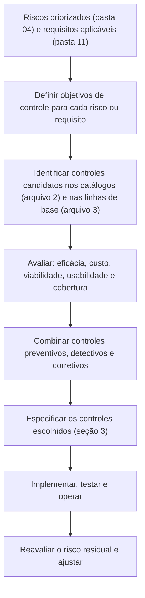

# Projeto, Seleção e Implementação de Controles

> **Objetivo pedagógico:** selecionar controles com base em riscos e em requisitos, escrever enunciados de controle claros e verificáveis, especificar cada controle (objetivo, tipo, dono, frequência, automação, evidência e teste), estruturar a hierarquia de documentos (política, padrão, procedimento e orientação), implementar controles como código em módulos seguros por padrão, equilibrar eficácia, custo e usabilidade, tratar sobreposições e conflitos, e evitar modos comuns de falha de controles.

## 1. Processo de seleção de controles



| Critério de seleção | Pergunta |
|---|---|
| Eficácia | Quanto o controle reduz a probabilidade ou o impacto do risco específico? |
| Cobertura | O controle trata vários riscos ou requisitos ao mesmo tempo? |
| Custo total | Implementação, operação, licenciamento e esforço de evidências |
| Viabilidade | Competências, tempo, dependências e compatibilidade com a arquitetura |
| Usabilidade | O impacto sobre as equipes e sobre os usuários é aceitável? Haverá contornos? |
| Verificabilidade | É possível testá-lo e evidenciá-lo de forma automática? |
| Independência | Falha independentemente dos demais controles do mesmo risco? |
| Responsabilidade | Quem opera: cliente, provedor ou ambos? |

## 2. Escrever bons enunciados de controle

Um bom enunciado responde: **quem**, **o quê**, **onde**, **quando** (frequência) e **como se verifica**.

| Enunciado fraco | Problema | Enunciado melhor |
|---|---|---|
| "Os dados devem ser protegidos." | Vago e não verificável | "Todos os armazenamentos de objetos com dados classificados como confidencial ou restrito têm bloqueio de acesso público ativo e criptografia com chaves gerenciadas pelo cliente; a conformidade é verificada continuamente por regras automáticas." |
| "O acesso deve ser controlado." | Sem escopo, sem frequência e sem evidência | "O dono de cada aplicação revisa, a cada trimestre, os acessos privilegiados e os acessos a dados restritos; os acessos não confirmados são removidos em até 5 dias úteis, e o relatório da revisão é arquivado no repositório de evidências." |
| "Usar MFA." | Sem escopo nem tipo | "Contas com papéis privilegiados na nuvem exigem MFA resistente a phishing; a verificação é diária, por relatório de métodos de autenticação, com tolerância zero." |
| "Os backups devem ser testados." | Sem frequência, critério ou dono | "A equipe de operações restaura, a cada trimestre, um backup de cada sistema de camada 0 e 1 em ambiente isolado, mede o RTO e o RPO e registra o resultado; falhas geram ação corretiva em até 10 dias." |

## 3. Especificação de um controle

| Campo | Descrição | Exemplo |
|---|---|---|
| ID | Identificador único e estável | CTL-DAT-017 |
| Título | Nome curto | Bloqueio de acesso público a armazenamento |
| Objetivo | Resultado de segurança desejado | Impedir a exposição pública de dados |
| Enunciado | Texto verificável (seção 2) | "Todos os armazenamentos de objetos..." |
| Risco(s) tratado(s) | Referência ao registro de riscos | R-NUV-003 |
| Requisitos atendidos | Leis, normas e contratos | LGPD art. 46; ISO/IEC 27002 8.3; CCM DSP; PCI DSS 7 |
| Tipo e função | Preventivo, detectivo ou corretivo; técnico ou administrativo | Preventivo e técnico |
| Responsabilidade | Provedor, compartilhada ou cliente | Cliente |
| Dono | Área e pessoa | Plataforma de nuvem |
| Escopo | Contas, ambientes e dados | Todas as contas de produção e de não produção |
| Implementação | Como é feito | Política da organização + módulo de infraestrutura + regra de verificação |
| Frequência | Contínua, diária ou periódica | Contínua |
| Automação | Manual, semiautomática ou automática | Automática |
| Evidência | Tipo, origem e local | Exportação da política e relatório de conformidade, no repositório de evidências |
| Teste | Como se verifica a eficácia | Teste de criação de bucket público em conta de teste: deve ser negado |
| Exceções | Condições e aprovações | Somente com aprovação do comitê, prazo máximo de 90 dias |
| Indicadores | Métricas de cobertura e eficácia | 100% das contas com bloqueio ativo |
| Última revisão e próxima | Datas | |

## 4. Hierarquia de documentos

| Nível | Documento | Característica | Exemplo |
|---|---|---|---|
| 1 | Política | Princípios e diretrizes de alto nível, aprovados pela direção; estáveis | Política de proteção de dados em nuvem |
| 2 | Padrão | Requisitos obrigatórios e mensuráveis | "Dados restritos exigem chaves gerenciadas pelo cliente e acesso privado" |
| 3 | Procedimento | Passos para executar uma atividade | Procedimento de revisão de acessos privilegiados |
| 4 | Orientação (guideline) | Recomendações e boas práticas, não obrigatórias | Guia de escolha de modelos de chaves |
| 5 | Implementação técnica | Código, módulos e configurações | Módulo de infraestrutura e políticas como código |

Evite política e padrão em excesso: **poucos documentos, claros e atualizados**, ligados a controles testáveis.

## 5. Implementação como código: módulos seguros por padrão

O "caminho pavimentado" incorpora os controles no módulo, de modo que **quem usa o módulo herda a conformidade**.

```hcl
# Módulo de armazenamento de objetos "seguro por padrão" (Terraform, AWS)
# Incorpora: bloqueio de acesso público, criptografia com chave do cliente, versionamento e TLS obrigatório
variable "nome"            { type = string }
variable "chave_kms_arn"   { type = string }
variable "classificacao"   { type = string }
variable "dono"            { type = string }

resource "aws_s3_bucket" "this" {
  bucket = var.nome
  tags = {
    classificacao = var.classificacao
    dono          = var.dono
  }
}

resource "aws_s3_bucket_public_access_block" "this" {
  bucket                  = aws_s3_bucket.this.id
  block_public_acls       = true
  block_public_policy     = true
  ignore_public_acls      = true
  restrict_public_buckets = true
}

resource "aws_s3_bucket_server_side_encryption_configuration" "this" {
  bucket = aws_s3_bucket.this.id
  rule {
    apply_server_side_encryption_by_default {
      sse_algorithm     = "aws:kms"
      kms_master_key_id = var.chave_kms_arn
    }
    bucket_key_enabled = true
  }
}

resource "aws_s3_bucket_versioning" "this" {
  bucket = aws_s3_bucket.this.id
  versioning_configuration { status = "Enabled" }
}

data "aws_iam_policy_document" "somente_tls" {
  statement {
    sid       = "NegarTransporteSemTLS"
    effect    = "Deny"
    actions   = ["s3:*"]
    resources = [aws_s3_bucket.this.arn, "${aws_s3_bucket.this.arn}/*"]
    principals {
      type        = "*"
      identifiers = ["*"]
    }
    condition {
      test     = "Bool"
      variable = "aws:SecureTransport"
      values   = ["false"]
    }
  }
}

resource "aws_s3_bucket_policy" "this" {
  bucket = aws_s3_bucket.this.id
  policy = data.aws_iam_policy_document.somente_tls.json
}
```

O módulo é **ilustrativo**: ajuste-o aos requisitos (registros de acesso, replicação e retenção) e à versão do provedor. Publique os módulos em um registro interno, com versionamento, testes e documentação, e trate-os como **produto** da plataforma.

### Boas práticas para módulos e padrões

| Prática | Descrição |
|---|---|
| Controles não desabilitáveis por parâmetros comuns | Opções de enfraquecimento exigem exceção formal |
| Testes automatizados | Testes de políticas e de infraestrutura (por exemplo, testes de conformidade em pipeline) |
| Versões e *changelog* | Atualizações controladas e comunicação de mudanças |
| Documentação e exemplos | Facilitam a adoção |
| Suporte e canal | Equipe responsável e fluxo de solicitações |
| Métricas de adoção | Percentual de recursos criados por módulos aprovados |

## 6. Eficácia, custo e usabilidade

| Tensão | Abordagem |
|---|---|
| Segurança versus produtividade | Automatizar e simplificar; guardrails em vez de aprovações manuais; autoatendimento seguro |
| Custo versus risco | Concentrar controles caros onde o risco é maior (classificação e criticidade) |
| Rigidez versus flexibilidade | Níveis por classificação e processo de exceções |
| Controles em excesso | Rationalizar: remover redundâncias e controles sem risco associado |
| Contornos (*workarounds*) | Investigar a causa: se o controle é muito oneroso, reprojetá-lo |

## 7. Sobreposições, conflitos e dependências

| Situação | Tratamento |
|---|---|
| Vários controles para o mesmo objetivo | Aceitável se forem independentes (defesa em profundidade); redundante se forem idênticos |
| Controles conflitantes entre equipes | Decisão do comitê de arquitetura; registrar em ADR (pasta 05) |
| Dependência entre controles | Documentar; um controle que depende de outro herda sua fragilidade |
| Controles herdados | Verificar o escopo e os CUEC (pasta 11, arquivo 3) |
| Mudanças de arquitetura | Reavaliar os controles afetados |

## 8. Modos comuns de falha de controles

| Modo de falha | Exemplo | Mitigação |
|---|---|---|
| Existe no papel, não na prática | Política exige MFA, mas há exclusões amplas | Testes de operação; verificação por dados reais |
| Cobertura parcial | Controle aplicado em algumas contas e não em outras | Verificação da população completa |
| Configuração incorreta | Regra implantada com condição errada | Testes de aceitação e revisão por pares |
| Desvio ao longo do tempo | Recurso criado fora do pipeline | Verificação contínua e correção |
| Dependência de uma pessoa | Revisão feita por uma só pessoa | Automação e responsáveis alternativos |
| Alertas ignorados | Detecção sem resposta | Triagem, responsáveis e indicadores de resposta |
| Excesso de falsos positivos | Equipe desativa regras | Ajuste e priorização |
| Contornos legítimos | Pessoas usam atalhos por causa do atrito | Reprojetar para usabilidade |
| Controle sem dono | Ninguém corrige falhas | Dono obrigatório |
| Evidência inexistente ou inconsistente | Auditoria considera o controle ineficaz | Evidências automáticas |

## 9. Exemplo prático: projeto do controle de revisão de acessos privilegiados

| Etapa | Resultado |
|---|---|
| Risco | R-NUV-002: permissões excessivas e contas privilegiadas mal governadas |
| Objetivo | Garantir que somente quem precisa mantenha privilégios elevados |
| Enunciado | "Os donos de aplicação revisam trimestralmente os acessos privilegiados; os não confirmados são removidos em até 5 dias úteis; o relatório e as remoções são arquivados." |
| Tipo e automação | Detectivo com ação corretiva; semiautomático (relatório automático, decisão humana e remoção automática) |
| Dono | Gestão de identidades (processo) e donos de aplicações (decisão) |
| Evidências | Relatório gerado pela plataforma de governança, decisões e comprovante das remoções |
| Teste | Reexecução: sorteio de 10 acessos removidos e verificação da remoção efetiva; verificação da taxa de conclusão |
| Indicadores | Taxa de conclusão no prazo (meta de 95%); acessos revogados e removidos (100%) |
| Resultado | Privilégios permanentes reduzidos em 63% no primeiro ano |

## 10. Casos de uso corporativos

- Padronização da especificação de controles e da biblioteca de controles da organização.
- Biblioteca de módulos de infraestrutura como código "seguros por padrão".
- Revisão e racionalização de portfólios de controles com baixa eficácia ou alta redundância.

## 11. Normas e frameworks relevantes

- ISO/IEC 27001:2022 (6.1.3, planejamento do tratamento de riscos e Declaração de Aplicabilidade; 7.5, informação documentada); ISO/IEC 27002:2022 (5.1, políticas; 8.9, gestão de configuração; 8.25 a 8.28, desenvolvimento seguro)
- NIST SP 800-53 Rev. 5 (controles e melhorias; famílias PL e SA); NIST SP 800-218 (SSDF); NIST SP 800-160 Vol. 1 (princípios de projeto)
- COBIT 2019; CSA CCM v4 (GRC e CCC)

## 12. Checklist operacional: projeto e implementação

- [ ] Controles selecionados a partir de riscos e requisitos, com critérios de eficácia, custo e usabilidade
- [ ] Enunciados claros e verificáveis; especificação completa por controle (dono, frequência, evidência e teste)
- [ ] Hierarquia de documentos definida; poucos documentos, claros e atualizados
- [ ] Módulos de infraestrutura como código seguros por padrão, versionados, testados e publicados
- [ ] Controles críticos verificados no pipeline e no ambiente
- [ ] Sobreposições, dependências e conflitos tratados e documentados
- [ ] Modos de falha conhecidos monitorados (cobertura, desvio e alertas ignorados)
- [ ] Rationalização anual do portfólio de controles

## 13. Referências

- ISO/IEC 27001:2022. Information security management systems: Requirements.
- Ross, R. et al. NIST SP 800-160 Vol. 1 Rev. 1. 2022.
- Dodge, J. et al. NIST SP 800-218: SSDF Version 1.1. 2022.
- HashiCorp. Terraform: Module Development (documentação).
- Pastas 03, 04, 05 e 21 deste repositório.
