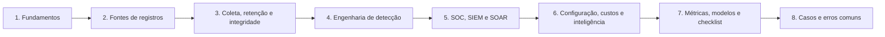

# 13 Monitoramento de Segurança em Nuvem

## Objetivo

Construir a capacidade de enxergar, detectar e investigar eventos de segurança em ambientes de nuvem: compreender os fundamentos do monitoramento e a diferença entre observabilidade e monitoramento de segurança, mapear as fontes de registros e de telemetria de cada provedor, projetar a coleta centralizada com retenção e integridade, desenvolver detecções como código mapeadas ao ATT&CK, operar o SOC com SIEM e SOAR, complementar a visibilidade com configuração, custos, superfície externa e inteligência de ameaças, e medir a eficácia com indicadores.

## Trilha de estudo recomendada

## Conteúdo da pasta

| Ordem | Arquivo | Objetivo |
|---|---|---|
| 1 | [fundamentos-de-monitoramento-de-seguranca-em-nuvem.md](fundamentos-de-monitoramento-de-seguranca-em-nuvem.md) | Objetivos, tipos de telemetria, ciclo de detecção, modelos de SOC e desafios da nuvem |
| 2 | [fontes-de-registros-e-telemetria-por-provedor.md](fontes-de-registros-e-telemetria-por-provedor.md) | Catálogo de fontes, padrões habilitados ou não e verificações de somente leitura |
| 3 | [arquitetura-de-coleta-centralizacao-retencao-e-integridade.md](arquitetura-de-coleta-centralizacao-retencao-e-integridade.md) | Pipeline, esquemas de normalização, armazenamento em camadas, retenção e integridade |
| 4 | [engenharia-de-deteccao-casos-de-uso-e-regras.md](engenharia-de-deteccao-casos-de-uso-e-regras.md) | Ciclo de vida de detecções, regras Sigma, casos de uso de nuvem e testes |
| 5 | [operacao-do-soc-siem-soar-e-triagem.md](operacao-do-soc-siem-soar-e-triagem.md) | Triagem, playbooks, automação segura, caça a ameaças e MDR |
| 6 | [monitoramento-de-configuracao-custos-superficie-externa-e-inteligencia.md](monitoramento-de-configuracao-custos-superficie-externa-e-inteligencia.md) | Desvios de configuração, anomalias de custo, superfície externa e inteligência de ameaças |
| 7 | [metricas-modelos-e-checklist-de-monitoramento.md](metricas-modelos-e-checklist-de-monitoramento.md) | Indicadores, maturidade, modelos e checklist |
| 8 | [casos-de-uso-e-erros-comuns-em-monitoramento-de-seguranca.md](casos-de-uso-e-erros-comuns-em-monitoramento-de-seguranca.md) | Casos fictícios, erros comuns, exercícios e perguntas de revisão |

## Princípios da pasta

- Sem registros não há detecção, investigação nem prova: habilitar, centralizar, reter e proteger vêm antes de detectar
- Cobertura antes de volume: poucas fontes críticas bem integradas valem mais que muitas fontes sem uso
- Detecções são código: versionadas, revisadas, testadas e mapeadas a técnicas de ataque
- Alerta sem resposta é ruído: cada detecção tem dono, severidade, procedimento e prazo
- Registros contêm dados pessoais e segredos: minimizar, proteger e controlar o acesso
- Medir para melhorar: tempo de detecção, de resposta, cobertura e qualidade

## Relação com outras pastas

- 05: arquitetura (conta de registros e de segurança)
- 06 e 08: detecções de identidade e de rede em detalhe
- 09 e 10: registros de acesso a dados e de uso de chaves
- 11: conformidade (retenção e evidências)
- 12: controles e validação de detecções por emulação
- 14 a 18: ameaças, vulnerabilidades, postura e proteção de cargas
- 22 e 23: resposta a incidentes e forense
- 27 e 28: métricas e roteiro

## Referências

- Kent, K.; Souppaya, M. NIST SP 800-92: Guide to Computer Security Log Management. 2006 (e revisão em curso)
- NIST SP 800-137: Information Security Continuous Monitoring. 2011; NIST CSF 2.0, função Detectar (DE)
- ISO/IEC 27002:2022, controles 8.15 a 8.17; CSA CCM v4, domínio LOG
- MITRE ATT&CK for Cloud; Open Cybersecurity Schema Framework (OCSF); Sigma
- CIS Controls v8.1, controles 8 e 13
