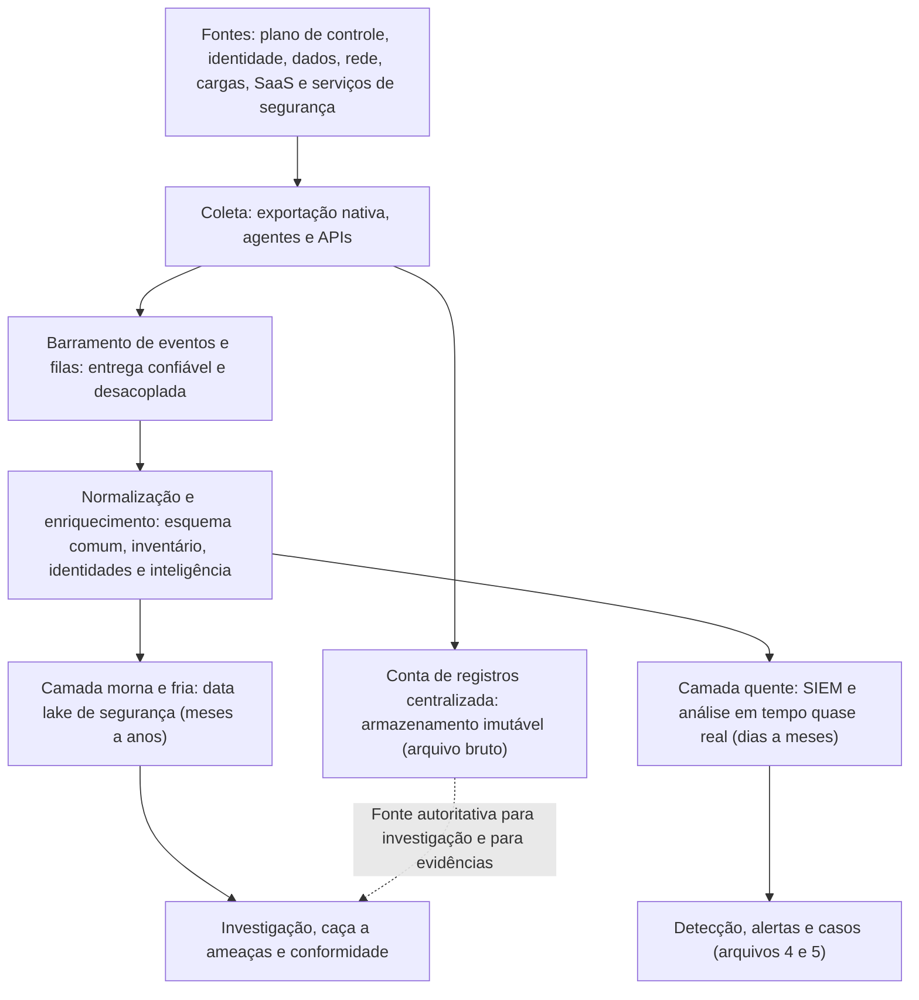

# Arquitetura de Coleta, Centralização, Retenção e Integridade

> **Objetivo pedagógico:** projetar o pipeline de telemetria de segurança: coletar por mecanismos nativos e por agentes, centralizar em uma conta de registros protegida, normalizar com esquemas comuns (OCSF, ECS, ASIM e CIM), organizar o armazenamento em camadas (quente, morna e fria), definir retenção com base em obrigações legais, regulatórias e de investigação, garantir a integridade e a imutabilidade, controlar o acesso e o custo, tratar dados pessoais em registros e escolher entre opções de SIEM e de data lake de segurança.

## 1. Arquitetura de referência



| Princípio | Descrição |
|---|---|
| Arquivo bruto imutável | Cópia original dos registros em armazenamento protegido, na conta de registros, independente do SIEM |
| Separação de contas | A conta de registros é distinta das contas de carga; administradores de cargas não podem apagar registros |
| Coleta desacoplada | Falhas do SIEM não interrompem a coleta nem a retenção |
| Normalização depois da guarda | Normalize para a análise, mas preserve o dado original |
| Camadas | Dados recentes em ferramentas de análise rápida; dados antigos em armazenamento barato e consultável |
| Resiliência | Redundância e verificação de entrega; alertas de silêncio de fontes |

## 2. Mecanismos de coleta

| Mecanismo | Descrição | Exemplos |
|---|---|---|
| Exportação nativa do plano de controle | Entrega organizacional de registros a armazenamento, a barramentos ou a espaços de trabalho | Trilha organizacional do CloudTrail para um bucket na conta de registros; configurações de diagnóstico do Azure; coletores agregados do Google Cloud |
| Streams e filas | Entrega contínua para processamento | Amazon Kinesis Data Firehose; Azure Event Hubs; Google Pub/Sub |
| Agentes em hosts e em contêineres | Coleta de registros de sistema e de aplicações | OpenTelemetry Collector, Fluent Bit, Vector, Elastic Agent e agentes de SIEM |
| Conectores de SaaS e de APIs | Extração de registros de auditoria de aplicações | Conectores do SIEM; APIs de auditoria do Microsoft 365 e do Google Workspace |
| Serviços de segurança | Achados enviados por integração nativa | GuardDuty e Security Hub; Defender for Cloud; Security Command Center |
| Captura de rede | Espelhamento seletivo, quando necessário | Traffic Mirroring e Packet Mirroring |

### Exemplos de configuração de coleta (execute em ambiente de laboratório primeiro)

```bash
# AWS: criar uma trilha organizacional multirregional com validação de integridade de arquivos de registro
# (execute na conta de gerenciamento da organização; o bucket de destino deve existir com a política apropriada)
aws cloudtrail create-trail \
  --name trilha-organizacional \
  --s3-bucket-name bucket-registros-organizacao-exemplo \
  --is-organization-trail --is-multi-region-trail \
  --enable-log-file-validation
aws cloudtrail start-logging --name trilha-organizacional

# Google Cloud: coletor agregado em nível de organização que envia registros de auditoria a um bucket central
gcloud logging sinks create sink-auditoria-organizacao \
  storage.googleapis.com/bucket-registros-organizacao-exemplo \
  --organization=123456789012 --include-children \
  --log-filter='logName:"cloudaudit.googleapis.com"'
```

Os comandos acima **alteram a configuração**: use apenas em contas autorizadas, e valide as permissões do destino (o coletor ou a trilha precisam de permissão de gravação no bucket) e os custos antes de aplicar. No Azure, use as **configurações de diagnóstico** (por política, para impor em todas as assinaturas).

## 3. Normalização e esquemas comuns

| Esquema | Origem | Características |
|---|---|---|
| OCSF (Open Cybersecurity Schema Framework) | Projeto aberto de múltiplos fornecedores, adotado por serviços como o Amazon Security Lake | Classes de eventos e atributos padronizados, independente de fornecedor |
| ECS (Elastic Common Schema) | Elastic | Campos comuns para o ecossistema Elastic |
| ASIM (Advanced Security Information Model) | Microsoft | Esquemas normalizados para o Microsoft Sentinel |
| CIM (Common Information Model) | Splunk | Modelo de dados para o Splunk |
| STIX | OASIS | Representação de inteligência de ameaças (não é um esquema de eventos) |

| Boa prática | Descrição |
|---|---|
| Escolher um esquema-alvo | Reduz o esforço de detecções portáveis |
| Mapear campos essenciais | Horário, identidade, ação, alvo, origem, resultado e recurso |
| Preservar o evento original | Para investigação e para novas análises |
| Enriquecer | Inventário de ativos (dono, classificação e ambiente), identidade (departamento e risco) e inteligência de ameaças |
| Controlar qualidade de parsing | Medir a taxa de eventos analisados com sucesso |
| Versionar os mapeamentos | Mudanças controladas |

## 4. Armazenamento em camadas e retenção

| Camada | Uso | Retenção típica | Custo |
|---|---|---|---|
| Quente (SIEM ou análise rápida) | Detecção em tempo quase real e investigação recente | 30 a 180 dias | Alto |
| Morna (data lake consultável) | Caça a ameaças, investigações e conformidade | 6 a 24 meses | Médio |
| Fria (arquivo imutável) | Evidências legais, conformidade e investigações históricas | 1 a 7 anos ou mais, conforme a obrigação | Baixo |

### 4.1 Definição de retenção

| Fator | Considerações |
|---|---|
| Obrigações legais e regulatórias | Por exemplo, a guarda de registros de acesso a aplicações pelo Marco Civil (art. 15, seis meses, para quem se enquadra) e normas setoriais; PCI DSS: pelo menos 12 meses de histórico de registros de auditoria, com os 3 meses mais recentes imediatamente disponíveis (confirme a versão vigente) |
| Necessidade de investigação | Atacantes podem permanecer meses sem detecção: retenção de pelo menos 12 meses para fontes críticas é comum |
| Contratos e clientes | Cláusulas de retenção e de acesso |
| Privacidade | Reter apenas o necessário e pelo tempo necessário (LGPD, princípios da necessidade e da finalidade) |
| Custo | Camadas e filtros |
| Litígios | Suspensão da eliminação por obrigação legal |

### 4.2 Exemplo de política de retenção (fictícia)

| Fonte | Quente | Morna | Fria |
|---|---|---|---|
| Auditoria do plano de controle e de identidade | 90 dias | 12 meses | 5 anos |
| Acesso a dados restritos e uso de chaves | 90 dias | 12 meses | 5 anos |
| Registros de fluxo e de DNS | 30 dias | 6 meses | 12 meses |
| Registros de WAF e de balanceadores | 30 dias | 6 meses | 12 meses |
| Registros de aplicações (sem dados pessoais) | 15 dias | 3 meses | 6 meses |
| Alertas e casos de segurança | 12 meses | 24 meses | 5 anos |

## 5. Integridade e imutabilidade

| Controle | Descrição |
|---|---|
| Validação de integridade nativa | Arquivos de resumo assinados que permitem detectar alterações (por exemplo, a validação de arquivos de registro do CloudTrail) |
| Armazenamento imutável (WORM) | Retenção protegida que impede alteração e exclusão (por exemplo, S3 Object Lock, imutabilidade de blobs e políticas de retenção bloqueadas) (pasta 09, arquivo 5) |
| Separação de contas e de funções | Administradores de cargas não administram a conta de registros |
| Políticas de negação | Impedem a exclusão de buckets, a desabilitação de trilhas e a alteração de retenção (pasta 05) |
| Criptografia | Em repouso e em trânsito, com chaves sob política própria (pasta 10) |
| Hashes e cadeia de guarda | Cálculo de hashes e manifestos para evidências exportadas (pasta 11, arquivo 5) |
| Monitoramento da própria infraestrutura de registros | Alertas para alterações na configuração de coleta, de armazenamento e de retenção |
| Teste periódico | Verificar que a exclusão e a alteração são realmente bloqueadas |

```bash
# AWS: validar a integridade dos arquivos de registro de uma trilha em um intervalo (somente leitura)
aws cloudtrail validate-logs \
  --trail-arn arn:aws:cloudtrail:sa-east-1:111122223333:trail/trilha-organizacional \
  --start-time 2026-11-01T00:00:00Z --end-time 2026-11-20T00:00:00Z
```

## 6. Controle de acesso aos registros

| Papel | Acesso |
|---|---|
| Analistas do SOC | Leitura de registros e de alertas; sem alteração e sem exclusão |
| Equipe de resposta a incidentes e de forense | Leitura ampliada e exportação de evidências, com registro |
| Engenharia e donos de aplicações | Acesso aos registros de suas aplicações (observabilidade), não aos registros de segurança centrais |
| Auditores | Leitura de somente consulta, com prazo e registro (pasta 11) |
| Administradores da plataforma de registros | Gerem a infraestrutura, sem acesso padrão ao conteúdo sensível; ações auditadas |
| Qualquer papel | Alterações de retenção e exclusão exigem aprovação e registro; preferencialmente bloqueadas por imutabilidade |

## 7. Privacidade e segredos em registros

| Risco | Controle |
|---|---|
| Dados pessoais (CPF, e-mail e endereços) em registros | Minimizar na origem; filtros e mascaramento antes da guarda (pasta 09, arquivo 4); acesso restrito |
| Segredos (senhas, tokens e chaves) em registros | Varredura e bloqueio; rotação em caso de exposição |
| Registros de colaboradores | Política comunicada, com finalidade legítima e acesso restrito |
| Retenção excessiva | Retenção por finalidade e eliminação automática |
| Transferência internacional | Regiões de armazenamento e fornecedores de SIEM (pasta 09, arquivo 6) |
| Direitos dos titulares | Considerar o impacto em registros (justificativa de retenção por obrigação legal e por segurança) |

## 8. Opções de SIEM e de data lake de segurança

| Opção | Características | Considerações |
|---|---|---|
| Microsoft Sentinel | SIEM e SOAR nativos de nuvem, integração forte com o ecossistema Microsoft e conectores para outras nuvens | Custos por volume; linguagem de consulta KQL |
| Google Security Operations (Chronicle) | Análise de segurança em grande escala, com retenção longa e integração com o Google Cloud | Modelo de licenciamento e de retenção |
| Splunk Enterprise Security | SIEM maduro, ampla oferta de aplicações e flexibilidade | Custos e complexidade de operação |
| Elastic Security | Pilha aberta e flexível, com detecções e análises | Operação e dimensionamento |
| IBM QRadar e outros SIEM tradicionais | Presença em ambientes corporativos | Avaliar a evolução do produto e da oferta |
| Amazon Security Lake e data lakes de segurança | Centralização de dados de segurança em esquema aberto (OCSF) em armazenamento próprio, com consulta por diversas ferramentas | Exige ferramentas de análise e de detecção sobre o lake |
| Plataformas de dados de segurança de terceiros e soluções de código aberto | Pipelines flexíveis e separação entre armazenamento e análise | Maturidade da equipe |

Critérios de escolha: **cobertura de fontes e de conectores, modelo de custos por volume, desempenho de consulta, retenção, capacidade de detecção como código, integração com SOAR, residência dos dados, esforço operacional e competências da equipe**. Um desenho comum é **separar o armazenamento (lake) da análise (SIEM)**, para reduzir custos e evitar aprisionamento.

## 9. Gestão de custos de telemetria

| Prática | Descrição |
|---|---|
| Priorizar fontes por valor de segurança | Incluir primeiro as de prioridade 1 e 2 (arquivo 2) |
| Filtrar com critério | Remover campos e eventos de baixo valor, **sem descartar** registros de segurança críticos nem de evidências |
| Camadas de armazenamento | Dados antigos em camadas baratas |
| Amostragem apenas onde aceitável | Evitar amostrar auditoria e identidade |
| Compressão e formatos eficientes | Formatos colunares para o data lake (por exemplo, Parquet) |
| Monitorar volume por fonte | Detectar picos e fontes ruidosas |
| Negociar licenciamento | Modelos por volume ou por capacidade |
| Revisão periódica de custo e de valor | Cada fonte deve ter uso (detecção, investigação ou conformidade) |

## 10. Exemplo prático: arquitetura de registros de uma organização com 60 contas e dois provedores

| Elemento | Decisão |
|---|---|
| Conta de registros | Conta dedicada, com bucket imutável (retenção de 5 anos para auditoria), chave própria e acesso restrito |
| Coleta | Trilha organizacional (AWS), configurações de diagnóstico por política (Azure) e coletores de organização (Google Cloud), todos para o arquivo bruto; fluxo paralelo ao SIEM |
| Normalização | Esquema OCSF no data lake; mapeamentos para o esquema do SIEM; preservação do evento original |
| Camadas | SIEM com 90 dias; data lake consultável com 12 meses; arquivo frio por 5 anos |
| Integridade | Validação de arquivos de registro, imutabilidade, política que impede a exclusão da trilha e alertas de alteração da coleta |
| Acesso | SOC (leitura), resposta (exportação com registro), auditores (leitura com prazo) |
| Privacidade | Filtros de mascaramento para CPF nos registros de aplicações; retenção curta para registros de aplicações |
| Custos | Filtros em registros de baixo valor; economia de 31% do volume ingerido no SIEM sem perda de cobertura crítica |
| Resultado | Cobertura de 100% das contas, tempo mediano de entrega ao SIEM de 3 minutos e evidências íntegras em exercícios de resposta | |

## 11. Casos de uso corporativos

- Projeto da conta de registros e do pipeline de telemetria da organização.
- Seleção de SIEM e de data lake de segurança com critérios de custo, de cobertura e de residência.
- Política de retenção, de integridade e de acesso a registros de segurança.

## 12. Normas e frameworks relevantes

- NIST SP 800-92 (gestão de logs); NIST SP 800-53 Rev. 5 (AU-4, AU-9, AU-11 e AU-12); ISO/IEC 27002:2022 (8.15 e 8.17); CSA CCM v4 (LOG)
- OCSF; PCI DSS v4.0.1 (requisito 10); CIS Controls v8.1 (controle 8)
- LGPD (princípios da necessidade e da segurança); Marco Civil da Internet (arts. 13 e 15); Decreto nº 8.771/2016

## 13. Checklist operacional: coleta, retenção e integridade

- [ ] Conta de registros dedicada, separada das cargas, com armazenamento imutável e chave própria
- [ ] Coleta organizacional e desacoplada das fontes críticas; alertas de silêncio de fontes
- [ ] Esquema comum de normalização escolhido; evento original preservado
- [ ] Enriquecimento com inventário, identidade e inteligência de ameaças
- [ ] Camadas de armazenamento e política de retenção por fonte, aprovada com o Jurídico e a privacidade
- [ ] Integridade validada; políticas que impedem a exclusão e a desabilitação; alertas de alteração da coleta
- [ ] Acesso aos registros por papéis, com registro de acessos e aprovação para exportações
- [ ] Dados pessoais e segredos em registros tratados (filtros, mascaramento e varredura)
- [ ] Critérios de escolha de SIEM e de data lake documentados; custos monitorados
- [ ] Teste anual de recuperação e de integridade dos registros

## 14. Referências

- Kent, K.; Souppaya, M. NIST SP 800-92. 2006.
- OCSF. Open Cybersecurity Schema Framework (documentação).
- PCI Security Standards Council. PCI DSS v4.0.1, requisito 10. 2024.
- Amazon Web Services. AWS CloudTrail e Amazon Security Lake; Microsoft. Microsoft Sentinel e Azure Monitor; Google Cloud. Cloud Logging e Google Security Operations (documentação vigente).
- Pastas 05, 09, 10 e 11 deste repositório.
