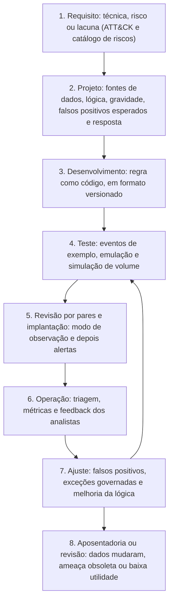

# Engenharia de Detecção, Casos de Uso e Regras

> **Objetivo pedagógico:** desenvolver detecções de segurança em nuvem de forma sistemática: entender os tipos de detecção (regras, limiares, correlação, linhas de base e inteligência), aplicar o ciclo de vida da engenharia de detecção (requisito, projeto, desenvolvimento, teste, implantação, ajuste e aposentadoria), escrever regras em formato portável (Sigma) e em linguagens de consulta, usar um catálogo de casos de uso específicos de nuvem mapeados ao ATT&CK, testar detecções com eventos de exemplo e com emulação de técnicas, e gerir falsos positivos.

## 1. Tipos de detecção

| Tipo | Descrição | Vantagens | Limitações |
|---|---|---|---|
| Regra determinística (assinatura) | Condição exata sobre um evento (por exemplo, `StopLogging`) | Precisa, explicável e rápida | Só detecta o que se conhece |
| Limiar (*threshold*) | Contagem de eventos em uma janela (por exemplo, muitas falhas de autenticação) | Detecta abusos de volume | Ajuste de limiares |
| Correlação | Combinação de eventos de fontes ou de tempos diferentes | Detecta cadeias de ataque | Complexidade e dependência de qualidade dos dados |
| Linha de base e anomalia | Desvios do comportamento normal (UEBA) | Detecta o desconhecido | Falsos positivos e necessidade de período de aprendizado |
| Baseada em inteligência | Correspondência com indicadores conhecidos | Útil para ameaças ativas | Indicadores têm vida curta |
| Comportamental mapeada ao ATT&CK | Sequências de comportamento de técnicas | Resiliente a mudanças de ferramentas | Exige conhecimento e testes |
| Verificação de estado | Estado de configuração fora do esperado | Detecta desvios | Complementar (arquivo 6) |

## 2. Ciclo de vida de uma detecção



| Etapa | Entregáveis |
|---|---|
| Requisito | Técnica do ATT&CK, risco associado e justificativa |
| Projeto | Ficha da detecção (seção 7) |
| Desenvolvimento | Regra em repositório, com identificador, versão e dono |
| Teste | Casos de teste positivos e negativos, com resultados |
| Implantação | Pedido de mudança revisado; período de observação |
| Operação | Procedimento de triagem; indicadores de precisão e de volume |
| Ajuste | Registro de exceções e de alterações |
| Aposentadoria | Justificativa e atualização da cobertura |

## 3. Detecções como código

| Prática | Descrição |
|---|---|
| Repositório versionado | Regras, testes e documentação em Git |
| Formato portável | Regras em formato genérico (por exemplo, Sigma), convertidas para a linguagem do SIEM |
| Revisão por pares | Mudanças aprovadas por outro engenheiro de detecção |
| Testes automatizados no pipeline | Cada regra passa por testes positivos e negativos antes de ser implantada |
| Implantação automatizada | O pipeline publica as regras no SIEM |
| Metadados obrigatórios | Identificador, dono, técnica ATT&CK, gravidade, fonte de dados, falsos positivos esperados e procedimento |
| Gestão de exceções | Listas de permissão com justificativa, dono e expiração |
| Medição | Taxa de alertas verdadeiros e falsos por regra |

### Exemplo de regra em formato Sigma (parada ou exclusão de trilha de auditoria na AWS)

```yaml
title: Parada, exclusão ou alteração de trilha de auditoria do CloudTrail
id: 5b0a1c2e-7f31-4d8e-9a64-0c1d2e3f4a5b
status: experimental
description: Detecta ações que desativam ou alteram a coleta de registros de auditoria, técnica comum de evasão de defesas.
references:
  - https://attack.mitre.org/techniques/T1562/008/
author: Equipe de engenharia de detecção
date: 2026-11-20
tags:
  - attack.defense-evasion
  - attack.t1562.008
logsource:
  product: aws
  service: cloudtrail
detection:
  selection:
    eventSource: cloudtrail.amazonaws.com
    eventName:
      - StopLogging
      - DeleteTrail
      - UpdateTrail
      - PutEventSelectors
  condition: selection
falsepositives:
  - Alterações planejadas e aprovadas pela equipe de plataforma, com chamado de mudança
level: high
```

O identificador (`id`) e a data são exemplos. Ferramentas de conversão (como o `sigma-cli`, baseado no pySigma) traduzem a regra para as linguagens de diferentes SIEM; valide o resultado e os mapeamentos de campos do seu ambiente.

## 4. Catálogo de casos de uso de detecção em nuvem

| # | Caso de uso | Fonte | ATT&CK | Gravidade |
|---|---|---|---|---|
| 1 | Uso da conta raiz ou de proprietário | Auditoria do plano de controle | T1078.004 | Crítica |
| 2 | Parada, exclusão ou alteração de trilhas e de coletores de registros | Auditoria | T1562.008 | Crítica |
| 3 | Desabilitação de serviços de detecção (por exemplo, detector de ameaças) | Auditoria | T1562.001 | Crítica |
| 4 | Criação de chaves de acesso ou de credenciais para usuários privilegiados | Auditoria e identidade | T1098.001 | Alta |
| 5 | Atribuição de papéis administrativos ou anexação de políticas amplas | Auditoria e identidade | T1098.003 | Alta |
| 6 | Alteração de política de confiança de funções (permitir contas externas) | Auditoria | T1098 | Alta |
| 7 | Entrada no console sem MFA, ou remoção de dispositivo de MFA | Identidade | T1556 | Alta |
| 8 | Concessão de consentimento a aplicativos com permissões amplas | Identidade e SaaS | T1528 | Alta |
| 9 | Regra de encaminhamento externo automático de e-mail | SaaS | T1114.003 | Alta |
| 10 | Política de armazenamento que concede acesso público (`Principal: *`) | Auditoria | T1530 | Alta |
| 11 | Compartilhamento de instantâneos, de imagens ou de backups com contas externas | Auditoria | T1537 | Alta |
| 12 | Regra de firewall ou grupo de segurança aberto ao mundo para portas de administração | Auditoria | T1562.007 | Alta |
| 13 | Agendamento de exclusão de chave de criptografia | Auditoria (KMS) | T1485 | Alta |
| 14 | Enumeração em massa de recursos por uma identidade (listagens em sequência) | Auditoria | T1580 | Média |
| 15 | Atividade em regiões não aprovadas ou criação de instâncias de grande porte e de GPU | Auditoria e custos | T1496 | Média |
| 16 | Criação de chaves de contas de serviço (Google Cloud) ou alteração de política de IAM com `allUsers` | Cloud Audit Logs | T1098.001 | Alta |
| 17 | Alteração em políticas de acesso condicional ou exclusões de MFA | Auditoria do provedor de identidade | T1556 | Alta |
| 18 | Acesso anômalo a segredos e a cofres (volume e identidade incomuns) | Registros de cofres | T1555 | Alta |
| 19 | Execução de comandos em contêineres (exec) ou criação de pods privilegiados | Auditoria do Kubernetes | T1609, T1610 | Alta |
| 20 | Acesso anônimo ou de origem externa ao servidor de API do Kubernetes | Auditoria do Kubernetes | T1190 | Crítica |
| 21 | Volume de saída muito acima da linha de base ou destinos novos | Fluxos, NAT e proxy | T1041, T1048 | Alta |
| 22 | Consultas de DNS anômalas (túneis e domínios de baixa reputação) | Registros de DNS | T1071.004 | Alta |
| 23 | Exclusão em massa de versões de objetos ou regras de ciclo de vida que expiram dados | Auditoria e dados | T1485, T1490 | Crítica |
| 24 | Criptografia em massa com chaves externas à organização | Auditoria (KMS e armazenamento) | T1486 | Crítica |
| 25 | Viagem impossível, uso de anonimizadores ou de tokens por origens distintas | Identidade | T1078, T1550 | Alta |

Detecções detalhadas de identidade e de rede estão nas pastas 06 e 08; este catálogo as consolida para a operação do SOC.

## 5. Exemplos de consultas

### 5.1 Amazon Athena sobre CloudTrail: política de bucket que concede acesso a todos

```sql
-- Alterações de política de bucket com Principal "*" (candidatas a exposição pública), últimos 7 dias
SELECT eventtime, useridentity.arn AS identidade, sourceipaddress, awsregion,
       json_extract_scalar(requestparameters, '$.bucketName') AS bucket
FROM cloudtrail_logs
WHERE eventname IN ('PutBucketPolicy', 'PutBucketAcl', 'DeletePublicAccessBlock', 'PutPublicAccessBlock')
  AND (requestparameters LIKE '%"Principal":"*"%' OR requestparameters LIKE '%AllUsers%' OR eventname = 'DeletePublicAccessBlock')
  AND from_iso8601_timestamp(eventtime) > current_timestamp - interval '7' day
ORDER BY eventtime DESC;
```

### 5.2 Google Cloud Logging: execução de comandos em pods do GKE

```
protoPayload.methodName="io.k8s.core.v1.pods.exec.create"
resource.type="k8s_cluster"
```

### 5.3 Kusto (Microsoft Sentinel): grande quantidade de leituras de segredos em um cofre por uma identidade

```kusto
// Leituras de segredos do Key Vault por identidade, em janelas de uma hora (ajuste ao seu esquema)
AzureDiagnostics
| where TimeGenerated > ago(1d)
| where ResourceProvider == "MICROSOFT.KEYVAULT" and OperationName == "SecretGet"
| summarize leituras = count(), segredos_distintos = dcount(id_s) by CallerIPAddress, identity_claim_oid_g, bin(TimeGenerated, 1h)
| where leituras > 50 or segredos_distintos > 20
| order by leituras desc
```

## 6. Testes de detecções

### 6.1 Teste unitário com eventos de exemplo (Python)

```python
# Testa a lógica da regra "parada de trilha" com eventos sintéticos, antes de implantá-la no SIEM
def regra_parada_de_trilha(evento: dict) -> bool:
    return (
        evento.get("eventSource") == "cloudtrail.amazonaws.com"
        and evento.get("eventName") in {"StopLogging", "DeleteTrail", "UpdateTrail", "PutEventSelectors"}
    )

CASOS = [
    ({"eventSource": "cloudtrail.amazonaws.com", "eventName": "StopLogging"}, True),    # deve alertar
    ({"eventSource": "cloudtrail.amazonaws.com", "eventName": "DeleteTrail"}, True),    # deve alertar
    ({"eventSource": "cloudtrail.amazonaws.com", "eventName": "LookupEvents"}, False),  # leitura: não deve alertar
    ({"eventSource": "s3.amazonaws.com", "eventName": "StopLogging"}, False),           # outra fonte: não deve alertar
]

def executar() -> None:
    falhas = 0
    for evento, esperado in CASOS:
        obtido = regra_parada_de_trilha(evento)
        if obtido != esperado:
            falhas += 1
            print(f"FALHOU: {evento} esperado={esperado} obtido={obtido}")
    print("Todos os testes passaram." if falhas == 0 else f"{falhas} teste(s) falharam.")

if __name__ == "__main__":
    executar()
```

### 6.2 Outros níveis de teste

| Nível | Descrição |
|---|---|
| Teste com eventos reais anonimizados | Executar a regra contra dados históricos para estimar o volume e os falsos positivos |
| Teste de volume | Estimar o número de alertas por dia e a carga |
| Emulação de técnicas em laboratório | Executar a técnica (por exemplo, com ferramentas de emulação para nuvem) e verificar o alerta (pasta 12, arquivo 5) |
| Teste de ponta a ponta | Do evento ao alerta e à abertura de caso, com o responsável |
| Reteste após mudanças | Mudanças de esquema ou de fonte podem quebrar a detecção silenciosamente |

## 7. Ficha de detecção

| Campo | Preenchimento |
|---|---|
| ID e título | DET-NUV-002, Parada, exclusão ou alteração de trilha de auditoria |
| Objetivo e risco associado | Evitar a evasão de defesas; risco R-NUV-004 |
| Técnica ATT&CK | T1562.008 |
| Fonte de dados | Auditoria do plano de controle (CloudTrail) |
| Lógica | Eventos `StopLogging`, `DeleteTrail`, `UpdateTrail` e `PutEventSelectors` |
| Gravidade e prioridade | Crítica; atendimento imediato |
| Falsos positivos esperados | Mudanças planejadas, com chamado |
| Exceções governadas | Lista de papéis autorizados, com expiração |
| Procedimento de triagem | Verificar o chamado de mudança, a identidade e a origem; restaurar a trilha; investigar a conta |
| Resposta automática (se houver) | Reativação da trilha e abertura de incidente |
| Dono e revisor | Engenharia de detecção; SOC |
| Teste e última validação | Teste unitário e emulação; data |
| Métricas | Alertas verdadeiros e falsos por trimestre |

## 8. Gestão de falsos positivos e de exceções

| Prática | Descrição |
|---|---|
| Medir a precisão por regra | Proporção de alertas verdadeiros; regras com baixa precisão são ajustadas ou retiradas |
| Ajustar a lógica antes de criar exceções | Refinar condições, janelas e contexto |
| Exceções específicas e justificadas | Por identidade, por recurso ou por intervalo, com dono e expiração; evitar desativar a regra |
| Contexto no alerta | Incluir inventário, identidade e histórico para acelerar a triagem |
| Revisão periódica das exceções | Remover as que não são mais necessárias |
| Distinguir ruído de lacuna | Ruído excessivo pode indicar problema de processo (por exemplo, mudanças fora do pipeline) |
| Feedback dos analistas | Canal para propor melhorias |

## 9. Cobertura e priorização

| Prática | Descrição |
|---|---|
| Mapa de cobertura ATT&CK | Para cada técnica relevante às ameaças da organização, listar as detecções, a fonte de dados e o estado de teste |
| Priorização por risco | Técnicas ligadas a riscos críticos e a cenários de ameaça (pasta 14) |
| Lacunas | Técnicas sem detecção, sem fonte de dados ou sem teste |
| Meta de cobertura | Cobertura testada das técnicas priorizadas (por exemplo, acima de 80% das técnicas de alta prioridade) |
| Cuidado | Cobertura "no papel" não é eficácia: validar por emulação |

## 10. Exemplo prático: implantação do catálogo prioritário

| Etapa | Ação | Resultado |
|---|---|---|
| Seleção | 25 casos de uso do catálogo; 15 priorizados pelos riscos da organização | Plano de 6 semanas |
| Desenvolvimento | Regras em Sigma e consultas nativas, com fichas e testes unitários | Repositório com 15 regras versionadas |
| Teste | Regras executadas por 30 dias de dados históricos anonimizados; emulação de 10 técnicas em laboratório | 3 regras com excesso de falsos positivos ajustadas; 1 lacuna de fonte de dados descoberta (acesso a dados não habilitado) |
| Implantação | Modo de observação por 2 semanas e depois alertas com responsáveis | 11 alertas verdadeiros em 2 meses (mudanças fora do pipeline e uma credencial exposta) |
| Resultado | Precisão média de 74% após o ajuste; tempo mediano de detecção de 6 minutos; cobertura testada de 78% das técnicas priorizadas | |

## 11. Casos de uso corporativos

- Biblioteca de detecções de nuvem, versionada e testada, mantida pela engenharia de detecção.
- Mapa de cobertura ATT&CK e plano de redução de lacunas.
- Programa de ajuste contínuo de falsos positivos e de aposentadoria de regras.

## 12. Normas e frameworks relevantes

- MITRE ATT&CK for Cloud (técnicas e fontes de dados); MITRE ATT&CK Data Sources
- Sigma (especificação de regras genéricas); NIST SP 800-61 Rev. 3; NIST CSF 2.0 (DE.AE)
- CSA CCM v4 (LOG e TVM); ISO/IEC 27002:2022 (8.16); CIS Controls v8.1 (controles 8 e 13)

## 13. Checklist operacional: engenharia de detecção

- [ ] Ciclo de vida de detecções definido (requisito, projeto, teste, implantação, ajuste e aposentadoria)
- [ ] Detecções como código em repositório, com revisão por pares e testes automatizados
- [ ] Ficha de detecção com dono, técnica, fonte, gravidade, falsos positivos e procedimento
- [ ] Catálogo de casos de uso de nuvem implantado e priorizado por riscos
- [ ] Testes unitários, testes com dados históricos e emulação em laboratório
- [ ] Gestão de exceções com justificativa, dono e expiração
- [ ] Mapa de cobertura ATT&CK atualizado e lacunas priorizadas
- [ ] Métricas de precisão, de volume e de tempo de detecção por regra
- [ ] Revisão trimestral das regras e aposentadoria das obsoletas

## 14. Referências

- MITRE. ATT&CK for Cloud; ATT&CK Data Sources. https://attack.mitre.org
- SigmaHQ. Sigma: Generic Signature Format for SIEM Systems (documentação).
- Alexander, D. et al. Detection Engineering: Building and Operating Detections as Code (obras e documentação do setor, edições vigentes).
- MITRE Center for Threat-Informed Defense. Security Stack Mappings (documentação).
- Pastas 06, 08, 12 e 14 deste repositório.
