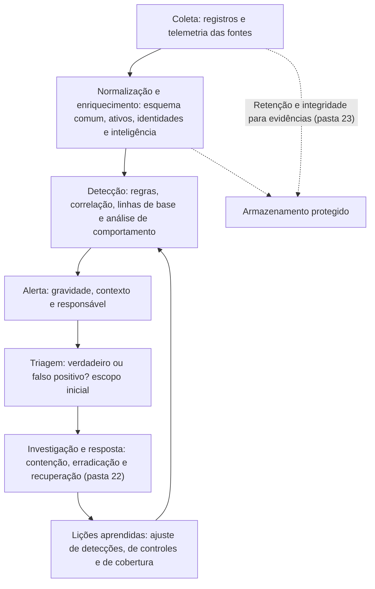

# Fundamentos de Monitoramento de Segurança em Nuvem

> **Objetivo pedagógico:** compreender os objetivos do monitoramento de segurança (detectar, investigar, comprovar e melhorar), distinguir observabilidade operacional de monitoramento de segurança, conhecer os tipos de telemetria (registros, métricas, rastros, fluxos, configuração, identidade e inteligência de ameaças), entender o ciclo de detecção e resposta, os modelos de operação de SOC (interno, terceirizado e híbrido) e os desafios específicos da nuvem (efemeridade, volume, múltiplas contas e responsabilidade compartilhada sobre os registros).

## 1. Por que monitorar

| Objetivo | Descrição | Exemplo |
|---|---|---|
| Detectar | Identificar atividades maliciosas, abusos e falhas de controles em tempo útil | Alerta de uso da conta raiz ou de exclusão de uma trilha de auditoria |
| Investigar | Reconstruir o que aconteceu, quem fez e qual o alcance | Linha do tempo de ações de uma identidade comprometida (pasta 23) |
| Comprovar | Gerar evidências para auditorias, reguladores e processos legais | Registros de acesso a dados restritos (pasta 11) |
| Medir | Alimentar indicadores de risco e de eficácia de controles | Tempo de detecção e cobertura de fontes (pasta 27) |
| Melhorar | Aprender com incidentes e ajustar controles e detecções | Nova regra após um incidente (pasta 22) |
| Dissuadir | Reduzir a ação de agentes internos pela probabilidade de detecção | Registros de acesso privilegiado |

A capacidade de detectar é um dos pilares do NIST CSF 2.0 (função **Detectar**, com as categorias de **monitoramento contínuo** e de **análise de eventos adversos**).

## 2. Observabilidade e monitoramento de segurança

| Aspecto | Observabilidade operacional | Monitoramento de segurança |
|---|---|---|
| Pergunta | O sistema está saudável e com bom desempenho? | Há atividade maliciosa, abuso ou desvio de controles? |
| Dados | Métricas, rastros e registros de aplicações e de infraestrutura | Registros de auditoria, de identidade, de rede, de acesso a dados, de configuração e alertas de segurança |
| Usuários | Engenharia, SRE e operações | SOC, resposta a incidentes, conformidade e auditoria |
| Retenção | Dias a semanas (frequentemente) | Meses a anos (por exigência de investigação e de conformidade) |
| Integridade | Importante | Crítica: evidências devem resistir a adulteração |
| Sobreposição | Muitas fontes são comuns (registros de aplicações e de rede); compartilhar a coleta reduz custos | Requisitos adicionais de proteção e de acesso restrito |

Uma estratégia eficiente **compartilha a plataforma de coleta** com a observabilidade, mas **separa o acesso, a retenção e a proteção** dos dados de segurança.

## 3. Tipos de telemetria

| Tipo | Descrição | Exemplos em nuvem |
|---|---|---|
| Registros de auditoria do plano de controle | Quem fez qual chamada de API, de onde e com que resultado | CloudTrail, log de atividade do Azure e Cloud Audit Logs |
| Registros de identidade | Autenticações, métodos de MFA, alterações de contas e de papéis | Registros de entrada e de auditoria do provedor de identidade |
| Registros de acesso a dados | Leituras e gravações em armazenamento e em bancos | Eventos de dados, registros de armazenamento e auditoria de bancos |
| Registros de rede | Fluxos, DNS, firewall, balanceadores e WAF | VPC Flow Logs, consultas de DNS e registros de WAF |
| Registros de sistema e de aplicações | Eventos do sistema operacional, de contêineres e de aplicações | auditd, Sysmon, registros do Kubernetes e das aplicações |
| Alertas de serviços de segurança | Achados gerados por serviços nativos e por ferramentas | GuardDuty, Defender for Cloud e Security Command Center |
| Configuração e inventário | Estado e histórico de recursos | AWS Config, Azure Resource Graph e Cloud Asset Inventory |
| Métricas e custos | Uso de recursos e gastos, úteis para detectar abusos | Anomalias de custo e de uso |
| Inteligência de ameaças | Indicadores e relatórios sobre ameaças | Listas de IPs e de domínios maliciosos; relatórios de campanhas |
| Telemetria de endpoints | Detecção e resposta em endpoints e em servidores | EDR |

## 4. Ciclo de detecção e resposta

## 5. Modelos de operação de SOC

| Modelo | Descrição | Vantagens | Limitações |
|---|---|---|---|
| SOC interno | Equipe própria, em horário comercial ou 24x7 | Conhecimento do negócio e controle total | Custo, dificuldade de contratação e de retenção de profissionais |
| MSSP e MDR (serviços gerenciados de detecção e resposta) | Terceiro opera o monitoramento e, em parte, a resposta | Cobertura 24x7, escala e especialização | Menor conhecimento do contexto, dependência, necessidade de contratos e de acessos bem definidos |
| Híbrido | Equipe interna com apoio de terceiro (por exemplo, fora do horário e nos níveis iniciais) | Equilíbrio entre contexto e cobertura | Coordenação e clareza de responsabilidades |
| SOC federado ou virtual | Analistas distribuídos nas áreas, com coordenação central | Uso de especialistas das áreas | Padronização e governança |
| Equipe de plantão da engenharia (modelo pequeno) | Alertas de segurança tratados por engenharia de plataforma | Simplicidade | Risco de priorização insuficiente; necessidade de treinamento |

A escolha depende de **porte, criticidade, orçamento, requisitos regulatórios e maturidade**. Em qualquer modelo, a organização continua **responsável** por seus dados, pelas decisões de resposta e pelas comunicações obrigatórias.

## 6. Desafios específicos da nuvem

| Desafio | Descrição | Resposta |
|---|---|---|
| Registros nem sempre ativos por padrão | Registros de dados e outras trilhas exigem habilitação e custos | Linha de base de habilitação, verificada continuamente (arquivo 2) |
| Efemeridade | Recursos surgem e desaparecem em minutos | Inventário e histórico de configuração; enriquecimento no momento do evento |
| Volume e custo | Grande volume de dados, custos de ingestão e de armazenamento | Priorizar fontes críticas, filtrar com critério, usar camadas de armazenamento |
| Múltiplas contas, regiões e provedores | Fragmentação da visibilidade | Coleta organizacional e centralizada, esquemas comuns |
| Responsabilidade compartilhada | O provedor registra eventos da plataforma, mas o cliente habilita, retém e analisa | Matriz de responsabilidades (pasta 02) |
| Registros do provedor limitados | Eventos internos da plataforma não são acessíveis | Solicitações ao provedor e relatórios de incidentes |
| Dependência de identidades e de APIs | O ataque ocorre por chamadas legítimas de API | Detecções baseadas em comportamento de identidade |
| Atribuição de eventos a recursos e a donos | Endereços e identificadores mudam | Etiquetas e enriquecimento por inventário |
| Latência na entrega dos registros | Alguns registros chegam com atraso de minutos | Considerar nas metas de detecção |
| Privacidade e segredos em registros | Dados pessoais e credenciais podem ser registrados | Filtros, mascaramento e acesso restrito |

## 7. Maturidade do monitoramento

| Nível | Descrição |
|---|---|
| 0 Inexistente | Registros dispersos, desabilitados ou apenas locais |
| 1 Básico | Registros do plano de controle e de identidade ativos; alertas pontuais dos serviços nativos |
| 2 Centralizado | Registros centralizados, retidos e protegidos; detecções prioritárias e triagem por responsáveis |
| 3 Gerenciado | Cobertura ampla de fontes, detecções como código mapeadas ao ATT&CK, indicadores de tempo e de qualidade, e resposta com playbooks |
| 4 Otimizado | Detecção baseada em comportamento e em inteligência, automação com salvaguardas, validação por emulação e melhoria contínua |

## 8. Exemplo prático: do zero ao monitoramento básico em 60 dias

| Semana | Ação | Resultado |
|---|---|---|
| 1 a 2 | Habilitar trilhas organizacionais, registros de identidade e serviços de detecção nativos em todas as contas; criar a conta de registros | Visibilidade mínima do plano de controle |
| 3 a 4 | Centralizar registros em armazenamento imutável; habilitar registros de fluxo e de DNS nas redes de produção | Evidências protegidas e telemetria de rede |
| 5 a 6 | Implantar 15 detecções prioritárias (conta raiz, parada de registros, chaves criadas, exposição pública, consentimentos e outras) com responsáveis e procedimentos | Alertas acionáveis |
| 7 a 8 | Exercício de simulação em laboratório, ajuste de regras e primeiros indicadores | Tempo mediano de detecção medido: 14 minutos |
| Resultado | Cobertura de 100% das contas por registros de auditoria, 15 detecções ativas e um processo de triagem definido | |

## 9. Casos de uso corporativos

- Definição da estratégia de monitoramento de segurança em nuvem e do modelo de SOC.
- Avaliação da maturidade de monitoramento e plano de evolução.
- Integração entre segurança, plataforma, conformidade e privacidade na gestão de registros.

## 10. Normas e frameworks relevantes

- NIST CSF 2.0 (DE.CM e DE.AE); NIST SP 800-92 (gestão de logs); NIST SP 800-137 (monitoramento contínuo); NIST SP 800-61 Rev. 3 (resposta a incidentes)
- ISO/IEC 27002:2022 (8.15 registro, 8.16 atividades de monitoramento e 8.17 sincronização de relógios); CSA CCM v4 (LOG, SEF e TVM); CIS Controls v8.1 (8 e 13)
- MITRE ATT&CK for Cloud (técnicas e fontes de dados)

## 11. Checklist operacional: base de monitoramento

- [ ] Estratégia de monitoramento aprovada, com objetivos, escopo e modelo de operação do SOC
- [ ] Responsabilidades entre o cliente e o provedor sobre os registros definidas (pasta 02)
- [ ] Tipos de telemetria priorizados por risco e por criticidade
- [ ] Ciclo de detecção e resposta definido, com responsáveis em cada etapa
- [ ] Desafios da nuvem (volume, efemeridade e múltiplas contas) tratados no desenho
- [ ] Maturidade avaliada e plano de evolução
- [ ] Revisão anual da estratégia

## 12. Referências

- Kent, K.; Souppaya, M. NIST SP 800-92: Guide to Computer Security Log Management. 2006.
- Dempsey, K. et al. NIST SP 800-137. 2011.
- NIST. Cybersecurity Framework 2.0, função Detect. 2024.
- Muniz, J.; McIntyre, G.; AlFardan, N. Security Operations Center: Building, Operating, and Maintaining your SOC. Cisco Press, 2015.
- Pastas 02, 11 e 22 deste repositório.
