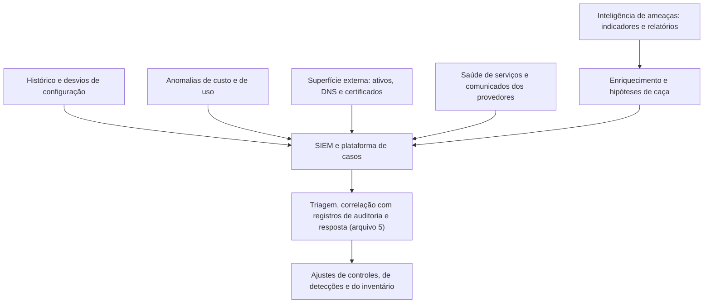

# Monitoramento de Configuração, Custos, Superfície Externa e Inteligência

> **Objetivo pedagógico:** complementar o monitoramento baseado em registros com outras fontes de sinal: histórico e desvios de configuração, anomalias de custo e de uso de recursos (que revelam abusos como mineração de criptomoedas), monitoramento da superfície de ataque externa (ativos expostos, DNS, certificados e *shadow IT*), saúde dos serviços e comunicados de segurança dos provedores, e uso de inteligência de ameaças (indicadores, relatórios e formatos STIX e TAXII), com consultas de somente leitura e exemplos de integração.

## 1. Por que ampliar além dos registros

| Fonte de sinal | O que revela | Exemplo |
|---|---|---|
| Configuração e seu histórico | Mudanças que enfraquecem controles, mesmo sem alertas de ataque | Grupo de segurança aberto ao mundo por 3 horas |
| Custos e uso | Abuso de recursos, credenciais comprometidas e erros de escala | Pico de instâncias de GPU em uma região não utilizada |
| Superfície externa | O que a internet vê da organização, inclusive o que ninguém inventariou | Subdomínio esquecido apontando para um recurso descontinuado |
| Saúde e comunicados do provedor | Incidentes e vulnerabilidades da plataforma que afetam o cliente | Aviso de vulnerabilidade em um serviço gerenciado |
| Inteligência de ameaças | Ameaças, técnicas e indicadores ativos | Campanha contra credenciais de nuvem do mesmo setor |

## 2. Monitoramento de configuração e de desvios

| Mecanismo | AWS | Azure | Google Cloud |
|---|---|---|---|
| Histórico de configuração | AWS Config (linha do tempo de recursos) | Azure Resource Graph (alterações de recursos) e Activity Log | Cloud Asset Inventory (histórico de ativos) |
| Regras e avaliações de conformidade | Regras e pacotes de conformidade do Config | Azure Policy | Políticas da organização e verificações do Security Command Center |
| Notificação de mudanças | Eventos de mudança de configuração e de conformidade | Eventos do Event Grid e alertas do Azure Monitor | Feeds do Cloud Asset Inventory (Pub/Sub) |
| Postura | Security Hub | Defender for Cloud | Security Command Center |

| Caso de uso | Detecção |
|---|---|
| Mudança em recurso crítico fora do pipeline | Comparar a mudança com a origem (pipeline versus console ou API manual) |
| Controle crítico desabilitado (registros, criptografia e bloqueio de acesso público) | Alerta imediato |
| Desvio persistente de um recurso não conforme | Alerta com prazo e dono |
| Recursos sem etiquetas de dono e de classificação | Relatório e prazo de correção |
| Recursos criados em regiões não aprovadas | Alerta e investigação |
| Tempo entre a mudança e a correção | Indicador de eficácia (pasta 17) |

### Consultas de somente leitura

```bash
# AWS: histórico de configuração recente de um bucket
aws configservice get-resource-config-history --resource-type AWS::S3::Bucket --resource-id bucket-exemplo --limit 5

# Azure: alterações recentes de recursos (requer a extensão resource-graph do Azure CLI)
az graph query -q "resourcechanges | where properties.changeAttributes.timestamp > ago(1d) | project timestamp = properties.changeAttributes.timestamp, alvo = properties.targetResourceId, tipo = properties.changeType | take 20"

# Google Cloud: histórico de um recurso e busca por recursos em uma organização
gcloud asset get-history --project=ID-DO-PROJETO --content-type=resource --asset-names="//storage.googleapis.com/bucket-exemplo" --start-time=2026-11-01T00:00:00Z
gcloud asset search-all-resources --scope=organizations/123456789012 --asset-types="compute.googleapis.com/Instance" --page-size=10
```

## 3. Monitoramento de custos e de uso como sinal de segurança

Abusos de credenciais e de recursos (por exemplo, mineração de criptomoedas) **geram custos**; e custos inesperados podem ser o primeiro indício.

| Sinal | Possível causa |
|---|---|
| Aumento súbito do gasto diário | Instâncias criadas por credenciais comprometidas; ataques de esgotamento de carteira; erros de escala |
| Uso de tipos de instância de grande porte ou de GPU sem justificativa | Mineração ou treinamento de modelos não autorizados |
| Recursos em regiões nunca usadas | Atacantes preferem regiões sem monitoramento |
| Aumento de saída de dados (transferência) | Exfiltração |
| Gasto fora do horário habitual | Atividade automatizada |
| Aumento de chamadas de APIs de serviços de alto custo | Abuso de serviços de IA ou de análise |

| Mecanismo | Descrição |
|---|---|
| Detecção de anomalias de custo | AWS Cost Anomaly Detection; recursos de análise e de alertas do Azure Cost Management; alertas e orçamentos do Google Cloud Billing |
| Orçamentos e alertas | Limites por conta, por projeto e por etiqueta, com notificação ao dono e ao SOC |
| Cotas e limites de serviço | Reduzem o alcance do abuso (por exemplo, limites de instâncias de GPU por região) |
| Correlação | Cruzar anomalias de custo com registros de auditoria (quem criou os recursos) |
| Resposta | Playbook para suspeita de mineração: identificar a identidade, desativar credenciais, encerrar recursos e investigar |

```bash
# AWS: anomalias de custo detectadas em um período e monitores configurados
aws ce get-anomaly-monitors --query "AnomalyMonitors[].[MonitorName,MonitorType]" --output table
aws ce get-anomalies --date-interval StartDate=2026-11-01,EndDate=2026-11-20 \
  --query "Anomalies[].[AnomalyStartDate,Impact.TotalImpact,RootCauses[0].Service,RootCauses[0].Region]" --output table
```

## 4. Monitoramento da superfície de ataque externa (EASM)

O monitoramento da **superfície externa** (*External Attack Surface Management*) busca descobrir o que a organização expõe à internet, **inclusive o que não está no inventário**.

| Elemento | Descrição |
|---|---|
| Descoberta de ativos | Domínios, subdomínios, endereços IP, portas e serviços expostos, aplicações e APIs |
| Inventário de nuvem versus visão externa | Comparar o que a organização sabe que expõe com o que a internet vê |
| DNS | Registros pendentes que apontam para recursos descontinuados (tomada de subdomínios); zonas e registros inesperados |
| Certificados | Certificados emitidos para os seus domínios (registros de transparência de certificados); expirações |
| *Shadow IT* e SaaS | Serviços de nuvem e aplicações usados sem aprovação |
| Credenciais e dados expostos | Segredos em repositórios públicos; dados em armazenamentos públicos; credenciais em vazamentos |
| Marca e domínios parecidos | Registro de domínios semelhantes para phishing |
| Verificação contínua | Varreduras periódicas e alertas para novos ativos |

> **Atenção:** realize varreduras ativas **somente em ativos próprios ou autorizados** e conforme as políticas dos provedores. A pesquisa em fontes públicas (DNS e transparência de certificados) é passiva.

### Exemplo: monitorar certificados emitidos para o seu domínio (transparência de certificados)

```bash
# Consulta passiva a um serviço público de pesquisa de transparência de certificados (substitua pelo seu domínio)
curl -s "https://crt.sh/?q=%25.exemplo.org&output=json" | python3 -c "
import json, sys
dados = json.load(sys.stdin)
vistos = set()
for item in dados:
    for nome in item['name_value'].split('\n'):
        vistos.add((nome.strip().lower(), item['issuer_name'], item['not_before']))
for nome, emissor, inicio in sorted(vistos)[:30]:
    print(nome, '|', emissor[:40], '|', inicio)
"
```

Compare a lista com o inventário de domínios e de certificados (pasta 10, arquivo 7): nomes **desconhecidos** podem indicar *shadow IT*, emissão indevida ou ataques (por exemplo, subdomínios usados em phishing).

## 5. Saúde dos serviços e comunicados do provedor

| Fonte | Uso |
|---|---|
| Painéis de saúde dos serviços (AWS Health, Azure Service Health e Google Cloud Service Health) | Acompanhar incidentes, manutenções e eventos que afetam os recursos da organização |
| Boletins de segurança dos provedores | Vulnerabilidades e recomendações de configuração |
| Relatórios pós-incidente | Lições e ajustes de arquitetura (pasta 04, arquivo 6) |
| Notificações de abuso e de credenciais expostas | Alertas dos provedores sobre chaves vazadas ou recursos comprometidos: tratar como críticos |
| Integração | Encaminhar comunicados ao SOC e à gestão de incidentes, com responsável por avaliação |

## 6. Inteligência de ameaças

| Nível | Descrição | Uso |
|---|---|---|
| Estratégica | Tendências, motivações e relatórios sobre o cenário de ameaças | Direção, planejamento e priorização de riscos |
| Tática | Técnicas e procedimentos de atacantes (ATT&CK) | Engenharia de detecção e validação |
| Operacional | Campanhas ativas, ferramentas e infraestrutura | Caça a ameaças e ajuste de detecções |
| Técnica (indicadores) | IPs, domínios, hashes e outros indicadores de comprometimento | Enriquecimento e bloqueios, com vida curta |

| Fonte | Exemplos |
|---|---|
| Serviços nativos dos provedores | Inteligência integrada a serviços como o GuardDuty, o Defender e o Security Command Center |
| Comunidades e centros de compartilhamento setoriais | Centros de análise e compartilhamento de informações do setor (ISAC), CSIRTs nacionais e do setor |
| Fornecedores comerciais | Serviços de inteligência |
| Fontes abertas | Relatórios públicos, publicações de pesquisadores e bases abertas |
| Plataformas de inteligência | MISP e plataformas de gestão de inteligência de ameaças |
| Formatos | STIX (representação) e TAXII (transporte), padrões do OASIS |

### Boas práticas

| Prática | Descrição |
|---|---|
| Priorizar relevância | Inteligência relacionada ao seu setor, à sua pilha tecnológica e aos seus riscos |
| Qualidade e contexto | Avaliar a fonte, a confiança e a idade dos indicadores |
| Converter em ação | Transformar relatórios em hipóteses de caça e em detecções; indicadores em enriquecimento e em bloqueios temporários |
| Expiração de indicadores | Retirar indicadores antigos para reduzir falsos positivos |
| Compartilhar | Participar de comunidades setoriais, respeitando a confidencialidade e a privacidade |
| Registro de uso | Medir quantas detecções e caças nasceram de inteligência |

## 7. Integrações e fluxo



## 8. Exemplo prático: descoberta de abuso de recursos por custo e correlação

| Etapa | Resultado |
|---|---|
| Alerta de custo | Anomalia de US$ 9.800 em 2 dias em uma conta de desenvolvimento; origem: instâncias de computação em uma região não utilizada |
| Correlação com a auditoria | As instâncias foram criadas por uma chave de acesso de um usuário de integração às 03:12 UTC, a partir de um IP incomum |
| Investigação | 46 instâncias de GPU executando um minerador; chave de acesso exposta em um repositório público de um colaborador |
| Contenção | Chave desativada, instâncias encerradas, sessões revogadas, rotação de segredos relacionados |
| Correções | Política que nega regiões não aprovadas; cota de instâncias de GPU; varredura de segredos nos repositórios; alerta de custo com limiar menor e roteado ao SOC |
| Resultado | Tempo de detecção de 2 dias, com custo evitável; novas detecções de criação de instâncias em regiões incomuns | |

## 9. Casos de uso corporativos

- Painel integrado de desvios de configuração, anomalias de custo e superfície externa.
- Programa de monitoramento da superfície externa, com inventário e verificação de DNS e de certificados.
- Fluxo de inteligência de ameaças para detecção, caça e priorização de riscos.

## 10. Normas e frameworks relevantes

- NIST CSF 2.0 (ID.AM, inventário de ativos; DE.CM, monitoramento contínuo); NIST SP 800-137; NIST SP 800-128 (gestão de configuração)
- ISO/IEC 27002:2022 (5.7, inteligência de ameaças; 8.9, gestão de configuração; 8.16, atividades de monitoramento); CSA CCM v4 (TVM, CCC e LOG)
- OASIS STIX e TAXII 2.1; MITRE ATT&CK; MITRE Engage
- MITRE ATT&CK: T1496 (sequestro de recursos), T1583 e T1584 (infraestrutura de atacantes), T1598 e T1566 (phishing)

## 11. Checklist operacional: monitoramento complementar

- [ ] Histórico e regras de configuração habilitados; alertas para mudanças em controles críticos e fora do pipeline
- [ ] Orçamentos, anomalias de custo e cotas de serviços, com alertas ao dono e ao SOC
- [ ] Correlação entre anomalias de custo e registros de auditoria; playbook de abuso de recursos
- [ ] Monitoramento da superfície externa (ativos, DNS, certificados e *shadow IT*), com verificação de subdomínios órfãos
- [ ] Varreduras ativas somente em ativos próprios ou autorizados
- [ ] Painéis de saúde dos serviços e comunicados de segurança dos provedores integrados ao SOC
- [ ] Notificações de credenciais expostas e de abuso tratadas como críticas
- [ ] Processo de inteligência de ameaças (fontes, relevância, conversão em detecções e expiração de indicadores)
- [ ] Revisão trimestral das fontes complementares e de seus resultados

## 12. Referências

- Amazon Web Services. AWS Config, AWS Cost Anomaly Detection e AWS Health; Microsoft. Azure Resource Graph, Azure Cost Management e Azure Service Health; Google Cloud. Cloud Asset Inventory e Cloud Billing (documentação vigente).
- OASIS. STIX 2.1 e TAXII 2.1 (especificações).
- Certificate Transparency (RFC 9162) e serviços públicos de consulta.
- MITRE. ATT&CK; MITRE Engage (documentação).
- Pastas 04, 10, 14 e 17 deste repositório.
