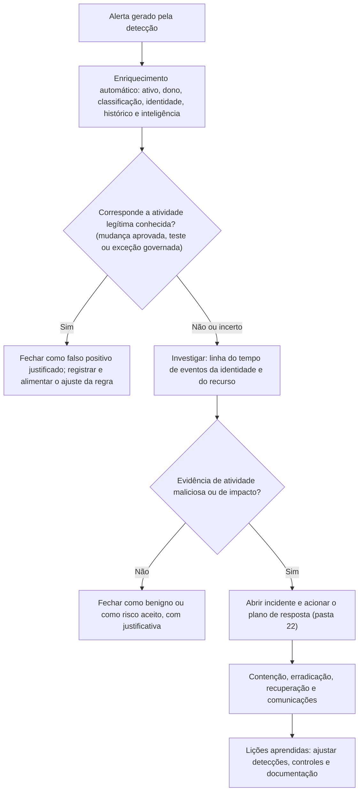

# Operação do SOC, SIEM, SOAR e Triagem

> **Objetivo pedagógico:** operar o monitoramento de segurança em nuvem no dia a dia: estruturar papéis e níveis do SOC, definir severidade, prioridade e prazos de atendimento, conduzir a triagem de alertas com enriquecimento de contexto, usar playbooks e automação (SOAR) com salvaguardas, gerir o cansaço de alertas, praticar a caça a ameaças orientada por hipóteses, escolher e governar serviços gerenciados (MDR e MSSP), e proteger os dados tratados pelo SOC.

## 1. Papéis e responsabilidades

| Papel | Responsabilidades |
|---|---|
| Analista de triagem (nível 1) | Monitorar a fila de alertas, validar, enriquecer, classificar e escalar |
| Analista de investigação e resposta (nível 2) | Investigar incidentes, executar contenção, coordenar com as áreas |
| Especialista e caçador de ameaças (nível 3) | Caça proativa, análise avançada, apoio forense e melhoria de detecções |
| Engenheiro de detecção | Desenvolver, testar e manter detecções (arquivo 4) |
| Engenheiro de plataforma de segurança | Operar o SIEM, a coleta, o SOAR e as integrações |
| Gerente do SOC | Prioridades, indicadores, escalonamento e interface com a direção |
| Líder de resposta a incidentes | Coordenar incidentes graves (pasta 22) |
| Encarregado (DPO) e Jurídico | Acionados quando houver dados pessoais ou obrigação de comunicação (pasta 11, arquivo 6) |
| Donos de ativos e de aplicações | Fornecer contexto e executar correções |

Em equipes pequenas, os papéis se combinam; o importante é que **cada alerta tenha um responsável** e que as responsabilidades de escalonamento estejam claras.

## 2. Severidade, prioridade e prazos

| Severidade | Critério (exemplos) | Prazo de reconhecimento | Prazo de triagem inicial | Escalonamento |
|---|---|---|---|---|
| Crítica | Credencial administrativa comprometida; exposição de dados restritos; desabilitação de registros; indício de ransomware | 5 a 15 minutos | 30 minutos | Imediato ao líder de resposta e à direção |
| Alta | Chave de acesso criada em contexto incomum; política pública; comunicação com infraestrutura maliciosa | 15 a 30 minutos | 2 horas | Nível 2 |
| Média | Anomalias de acesso; achados de postura relevantes | 4 horas | 1 dia útil | Conforme a análise |
| Baixa | Informativos e ajustes | 1 dia útil | 3 dias úteis | Conforme a necessidade |

A **prioridade** combina a severidade com o **contexto**: criticidade do ativo, classificação dos dados, exposição, identidade envolvida e inteligência de ameaças. Prazos são **referências** (ajuste aos requisitos e ao porte, 24x7 ou horário comercial).

## 3. Fluxo de triagem



### 3.1 Perguntas-padrão da triagem

| Pergunta | Fontes |
|---|---|
| Quem (identidade, tipo e privilégios)? | Registros de identidade; inventário de identidades |
| O quê (ação e recurso)? | Registros de auditoria |
| De onde (IP, localização, agente e dispositivo)? | Registros de entrada e de rede; inteligência |
| Quando e com que frequência? | Linha do tempo; histórico |
| É normal para esta identidade e para este recurso? | Linhas de base; histórico de 30 a 90 dias |
| Há mudança aprovada ou teste relacionado? | Sistema de mudanças; calendário |
| Qual o impacto potencial (dados, privilégios e produção)? | Inventário; classificação de dados |
| Há outros sinais correlacionados? | Outras fontes e alertas |
| Há obrigação de comunicação? | DPO e Jurídico |

## 4. Playbooks

Playbooks padronizam a resposta. Detalhes da resposta a incidentes em nuvem estão na pasta 22.

### Exemplo de playbook: chave de acesso exposta ou usada de origem inesperada

| Passo | Ação | Responsável | Automação possível |
|---|---|---|---|
| 1 | Validar o alerta; identificar a chave, a identidade, as permissões e a origem | Nível 1 | Enriquecimento automático |
| 2 | Verificar se há mudança ou uso legítimo (contato com o dono) | Nível 1 | Consulta ao sistema de mudanças |
| 3 | Preservar evidências: exportar os registros do período e o estado da identidade | Nível 2 | Exportação automática |
| 4 | Conter: desativar a chave (sem excluí-la), revogar sessões, restringir permissões | Nível 2 | Ação automática para alta confiança, com aprovação nos demais |
| 5 | Investigar: ações realizadas, recursos criados, dados acessados e persistência | Nível 2 e 3 | Consultas pré-montadas |
| 6 | Erradicar: remover recursos e acessos indevidos; rotacionar segredos | Nível 2 | Parcial |
| 7 | Avaliar impacto em dados pessoais e obrigações (DPO e Jurídico) | Líder de incidente | Não |
| 8 | Recuperar e reforçar (federação, remoção de chaves de longa duração e detecções) | Plataforma e segurança | Parcial |
| 9 | Lições aprendidas e atualização de regras e de playbooks | Equipe | Não |

## 5. SOAR: automação e orquestração

| Tipo de ação | Exemplos | Risco | Abordagem |
|---|---|---|---|
| Enriquecimento | Consultar inventário, reputação de IP e histórico da identidade | Baixo | Automático |
| Notificação e abertura de caso | Notificar o dono e abrir chamado | Baixo | Automático |
| Coleta de evidências | Exportar registros e o estado dos recursos | Baixo (somente leitura) | Automático |
| Contenção de baixo impacto e reversível | Desativar uma chave de acesso, adicionar uma regra de bloqueio temporária, aplicar uma etiqueta de quarentena | Médio | Automático para casos de alta confiança, com limites e registro |
| Contenção de alto impacto | Desligar sistemas de produção, bloquear contas de executivos, revogar acessos amplos | Alto | Aprovação humana |
| Remediação de configuração | Reverter uma política pública | Médio | Automático em recursos de baixa criticidade; aprovação nos críticos |

### Salvaguardas obrigatórias

| Salvaguarda | Descrição |
|---|---|
| Limites de escopo | Número máximo de ações por execução e por hora |
| Listas de exclusão | Contas críticas, de emergência e sistemas essenciais nunca são alvo de ação automática sem aprovação |
| Reversibilidade | Toda ação automática tem ação inversa documentada |
| Preservação de evidências | Antes de alterar, preservar |
| Registro e rastreabilidade | Cada ação automática registrada com identificador, motivo e horário |
| Permissões mínimas para a automação | Identidades da automação com permissões restritas e monitoradas |
| Testes | Em ambiente de laboratório e com simulações |
| Falha segura | Em erro, interromper e escalar |
| Revisão periódica | Revisar o impacto e a taxa de ações incorretas |

## 6. Gestão do cansaço de alertas

| Prática | Descrição |
|---|---|
| Medir o volume e a precisão por regra | Identificar as regras que geram a maior parte do ruído |
| Priorizar por contexto | Elevar alertas de ativos críticos; rebaixar os de baixa criticidade |
| Agrupar e desduplicar | Reduzir alertas repetidos do mesmo evento |
| Automatizar o enriquecimento e o fechamento de casos triviais | Liberar analistas |
| Ajustar ou aposentar regras de baixo valor | Revisão trimestral |
| Limitar o tamanho da fila e escalonar acúmulos | Indicadores de envelhecimento |
| Rodízio e carga de trabalho sustentável | Evitar fadiga e perda de profissionais |
| Canal de feedback | Analistas propõem melhorias de detecção |

## 7. Caça a ameaças (*threat hunting*)

A caça a ameaças é a busca **proativa**, orientada por hipóteses, de atividades que as detecções existentes não capturaram.

| Etapa | Descrição |
|---|---|
| Hipótese | Baseada em inteligência, em técnicas do ATT&CK e em riscos (por exemplo, "um atacante com uma chave roubada pode estar enumerando recursos e assumindo funções entre contas") |
| Dados necessários | Registros de auditoria, de identidade e de rede, com retenção suficiente |
| Consultas e análise | Consultas exploratórias no data lake ou no SIEM |
| Resultados | Achados (incidente, risco ou nada), lacunas de dados ou de detecção |
| Conversão em detecção | Transformar achados úteis em regras permanentes |
| Registro | Documentar a hipótese, as consultas, os resultados e as lições |

### Exemplo de consulta de caça (Athena sobre CloudTrail): cadeias de assunção de funções entre contas

```sql
-- Identidades que assumiram funções em muitas contas distintas em 24 horas (possível movimento lateral ou enumeração)
SELECT useridentity.arn AS identidade,
       count(DISTINCT json_extract_scalar(requestparameters, '$.roleArn')) AS funcoes_distintas,
       count(*) AS chamadas,
       min(eventtime) AS primeira, max(eventtime) AS ultima
FROM cloudtrail_logs
WHERE eventname = 'AssumeRole'
  AND from_iso8601_timestamp(eventtime) > current_timestamp - interval '1' day
GROUP BY useridentity.arn
HAVING count(DISTINCT json_extract_scalar(requestparameters, '$.roleArn')) > 10
ORDER BY funcoes_distintas DESC;
```

Os resultados indicam **candidatos**, e não incidentes: automação de implantação legítima também assume muitas funções. Investigue o contexto antes de concluir.

## 8. Serviços gerenciados (MDR e MSSP)

| Aspecto | Orientação |
|---|---|
| Escopo de serviço | Que fontes são monitoradas, que detecções, quais horários, quais ações de resposta e até onde vai a autonomia do fornecedor |
| Responsabilidades (RACI) | Quem detecta, quem triagem, quem decide a contenção, quem executa e quem comunica a autoridades e a clientes |
| Acessos | Identidades individuais, privilégios mínimos, aprovações e registros; acesso somente leitura por padrão; ações de resposta com permissões específicas e limitadas |
| Acordos de nível de serviço | Tempos de reconhecimento, de triagem e de escalonamento; relatórios; penalidades |
| Conhecimento do contexto | Informar inventário, criticidade, janelas de mudança e contatos; manter atualizado |
| Dados e privacidade | Contrato de tratamento de dados (LGPD); localização dos dados; retenção; subcontratados (pasta 11) |
| Transparência | Acesso às detecções, aos alertas e aos dados; direito de auditoria; relatórios de terceiros |
| Saída | Propriedade dos dados e das regras; portabilidade; transição |
| Integração com a resposta a incidentes | Procedimentos, contatos e exercícios conjuntos |
| Avaliação | Revisões periódicas de qualidade e exercícios de validação |

**A responsabilidade final pelo risco e pela comunicação permanece com a organização**, mesmo com serviços gerenciados.

## 9. Proteção dos dados e dos acessos do SOC

| Risco | Controle |
|---|---|
| O SOC acessa grande volume de dados sensíveis | Acesso mínimo, por função, com registro e revisão |
| Contas do SOC são alvos de alto valor | MFA resistente a phishing, estações dedicadas e acesso privilegiado sob demanda |
| Ferramentas de segurança comprometidas | Gestão de vulnerabilidades, segmentação e monitoramento das próprias ferramentas |
| Credenciais de integração (SOAR e conectores) | Cofre, rotação e permissões mínimas |
| Exportação de dados | Aprovação e registro; evitar cópias em estações |
| Uso de dados para outras finalidades | Política de uso e de privacidade |

## 10. Exemplo prático: reorganização da triagem de um SOC pequeno

| Situação inicial | Ação | Resultado |
|---|---|---|
| 1.400 alertas por semana, 90% de baixo valor; fila com 2 semanas de atraso | Análise de volume por regra; 12 regras ajustadas e 9 aposentadas; enriquecimento automático; priorização por criticidade do ativo | 310 alertas por semana, 71% de precisão |
| Sem playbooks | 8 playbooks para os casos mais frequentes (chave exposta, política pública, MFA removido, consentimento de aplicativo e outros) | Resposta padronizada |
| Contenção manual e lenta | Automação de coleta de evidências e de contenção reversível para casos de alta confiança, com salvaguardas | Tempo mediano de contenção de 3 horas para 18 minutos |
| Cobertura apenas em horário comercial | MDR para o período noturno, com RACI e acessos mínimos | Cobertura 24x7 |
| Caça a ameaças inexistente | Uma caça por mês, com conversão de achados em regras | 4 novas detecções em 6 meses |
| Resultado | Tempo mediano de resposta a alertas críticos de 4 horas para 22 minutos | |

## 11. Casos de uso corporativos

- Definição do modelo operacional do SOC de nuvem, com RACI, severidades e prazos.
- Biblioteca de playbooks e de automações seguras (SOAR).
- Contratação e governança de serviços gerenciados de detecção e resposta.

## 12. Normas e frameworks relevantes

- NIST SP 800-61 Rev. 3 (resposta a incidentes); NIST CSF 2.0 (DE.AE, RS.MA e RS.AN); NIST SP 800-137
- ISO/IEC 27035 (gestão de incidentes de segurança da informação); ISO/IEC 27002:2022 (5.24 a 5.28 e 8.16); CSA CCM v4 (SEF e LOG)
- MITRE ATT&CK; MITRE Engage (engajamento e defesa ativa, documentação)
- LGPD, art. 48; Resolução CD/ANPD nº 15/2024; normas setoriais de comunicação de incidentes

## 13. Checklist operacional: operação do SOC

- [ ] Papéis, escalas, RACI e canais de escalonamento definidos (inclusive serviços gerenciados)
- [ ] Severidades, prioridades e prazos de atendimento definidos e medidos
- [ ] Fluxo de triagem documentado, com enriquecimento automático e perguntas-padrão
- [ ] Playbooks para os casos mais frequentes e críticos, testados em exercícios
- [ ] Automação (SOAR) com salvaguardas, listas de exclusão, reversibilidade e registro
- [ ] Gestão de volume e de qualidade de alertas, com revisão trimestral de regras
- [ ] Caça a ameaças periódica, orientada por hipóteses, com conversão em detecções
- [ ] Serviços gerenciados com escopo, acessos mínimos, SLAs, privacidade e saída definidos
- [ ] Proteção das contas e das ferramentas do SOC; acesso a dados sensíveis controlado
- [ ] Integração com a resposta a incidentes, o DPO e o Jurídico

## 14. Referências

- Cichonski, P. et al. NIST SP 800-61 Rev. 3: Incident Response Recommendations and Considerations for Cybersecurity Risk Management. 2025.
- ISO/IEC 27035-1:2023. Information security incident management: Principles and process.
- Muniz, J. et al. Security Operations Center. Cisco Press, 2015.
- Sqrrl (Lee, R.); Bianco, D. A Framework for Cyber Threat Hunting (referências do setor sobre caça a ameaças).
- Pastas 11, 12, 22 e 23 deste repositório.
