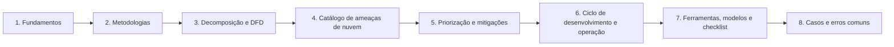

# 14 Modelagem de Ameaças em Nuvem

## Objetivo

Antecipar como um sistema em nuvem pode ser atacado e o que fazer a respeito, ainda no desenho: compreender os fundamentos e as quatro perguntas da modelagem de ameaças, escolher metodologias (STRIDE, PASTA, LINDDUN, árvores de ataque e ATT&CK), decompor o sistema em diagramas de fluxo de dados com fronteiras de confiança, usar um catálogo de ameaças específicas de nuvem, priorizar e tratar as ameaças com controles, detecções e testes, integrar a prática ao ciclo de desenvolvimento e à operação, e manter modelos como código.

## Trilha de estudo recomendada

## Conteúdo da pasta

| Ordem | Arquivo | Objetivo |
|---|---|---|
| 1 | [fundamentos-de-modelagem-de-ameacas-em-nuvem.md](fundamentos-de-modelagem-de-ameacas-em-nuvem.md) | Conceitos, as quatro perguntas, processo e particularidades da nuvem |
| 2 | [metodologias-stride-pasta-linddun-e-attack.md](metodologias-stride-pasta-linddun-e-attack.md) | STRIDE, PASTA, LINDDUN, árvores de ataque, ATT&CK e critérios de escolha |
| 3 | [decomposicao-do-sistema-dfd-e-fronteiras-de-confianca.md](decomposicao-do-sistema-dfd-e-fronteiras-de-confianca.md) | Ativos, atores, pontos de entrada, DFD, fronteiras de confiança e modelo como código |
| 4 | [catalogo-de-ameacas-especificas-de-nuvem.md](catalogo-de-ameacas-especificas-de-nuvem.md) | Catálogo de 32 ameaças de nuvem, com STRIDE, ATT&CK e mitigações |
| 5 | [analise-de-riscos-priorizacao-e-mitigacoes.md](analise-de-riscos-priorizacao-e-mitigacoes.md) | Avaliação, priorização, casos de abuso, requisitos e rastreabilidade |
| 6 | [modelagem-de-ameacas-no-ciclo-de-desenvolvimento-e-na-operacao.md](modelagem-de-ameacas-no-ciclo-de-desenvolvimento-e-na-operacao.md) | Gatilhos, modelagem leve, verificação em pipeline e validação |
| 7 | [ferramentas-modelos-e-checklist-de-modelagem-de-ameacas.md](ferramentas-modelos-e-checklist-de-modelagem-de-ameacas.md) | Ferramentas, oficina, registro de ameaças, exemplo completo e checklist |
| 8 | [casos-de-uso-e-erros-comuns-em-modelagem-de-ameacas.md](casos-de-uso-e-erros-comuns-em-modelagem-de-ameacas.md) | Casos fictícios, erros comuns, exercícios e perguntas de revisão |

## Princípios da pasta

- Modelar ameaças é conversar sobre o sistema com quem o constrói, e não produzir um documento
- Começar cedo, com poucas pessoas e um quadro, e repetir a cada mudança relevante
- O modelo é útil se gerar ações: requisitos, controles, detecções e testes
- Fronteiras de confiança e fluxos de dados importam mais que a ferramenta escolhida
- Em nuvem, identidade, configuração e plano de controle fazem parte da superfície de ataque
- Um modelo desatualizado é pior que nenhum: mantê-lo próximo do código

## Relação com outras pastas

- 04: riscos (as ameaças alimentam o registro de riscos)
- 05: arquitetura (revisão de arquitetura e registro de decisões)
- 06 a 10: identidade, zero trust, rede, dados e criptografia (controles que mitigam)
- 12: controles e linha de base (mitigações)
- 13: monitoramento (detecções para as ameaças modeladas)
- 15 e 16: vulnerabilidades e avaliações (validação do modelo)
- 18 a 21: cargas, contêineres, Kubernetes e DevSecOps
- 22: resposta a incidentes (cenários dos modelos)

## Referências

- Threat Modeling Manifesto (2020)
- Shostack, A. Threat Modeling: Designing for Security. Wiley, 2014
- Tarandach, I.; Coles, M. Threat Modeling: A Practical Guide for Development Teams. O'Reilly, 2020
- OWASP. Threat Modeling Cheat Sheet e Threat Modeling Process
- MITRE ATT&CK for Cloud; OWASP Top 10 CI/CD Security Risks
- UcedaVélez, T.; Morana, M. Risk Centric Threat Modeling (PASTA). Wiley, 2015
