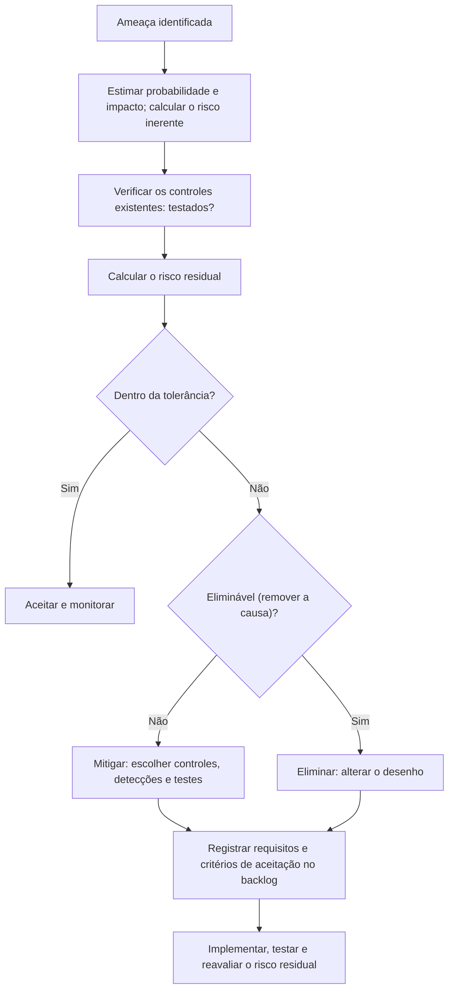

# Análise de Riscos, Priorização e Mitigações

> **Objetivo pedagógico:** responder à terceira pergunta da modelagem ("o que vamos fazer a respeito?"): avaliar o risco de cada ameaça (probabilidade, impacto e fatores de explorabilidade), priorizar com critérios claros, escolher entre eliminar, mitigar, transferir e aceitar, derivar requisitos de segurança e casos de abuso, mapear ameaças a controles, a detecções e a testes, registrar o risco residual, manter a rastreabilidade com o backlog e usar dados exportados para priorizar com DuckDB.

## 1. Da ameaça ao risco

| Elemento | Pergunta | Referência |
|---|---|---|
| Probabilidade | Quão provável é que a ameaça se concretize no período considerado? | Escala de probabilidade da organização (pasta 04, arquivo 2) |
| Impacto | Qual o dano ao negócio, aos titulares e à conformidade? | Escala de impacto, com regras de piso por classificação de dados |
| Fatores de explorabilidade | Qual a dificuldade para o atacante? | Seção 2 |
| Controles existentes | O que já reduz a probabilidade ou o impacto, e **está testado**? | Pasta 12, arquivo 5 |
| Risco residual | Qual o risco depois dos controles verificados? | Pasta 04, arquivo 4 |

Use **os mesmos critérios de risco** da gestão de riscos corporativa, para que as ameaças possam entrar no registro de riscos sem tradução (pasta 04).

## 2. Fatores que influenciam a probabilidade

| Fator | Pergunta | Efeito |
|---|---|---|
| Exposição | O componente está acessível pela internet ou apenas por redes privadas? | Maior exposição aumenta a probabilidade |
| Pré-condições | Que condições o atacante precisa (credencial, acesso à rede e conhecimento)? | Mais pré-condições reduzem a probabilidade |
| Habilidade e recursos exigidos | O ataque é trivial (ferramentas públicas) ou sofisticado? | Ataques simples e automatizáveis são mais prováveis |
| Atratividade do alvo | O ativo é valioso ou notório? | Maior atratividade aumenta a probabilidade |
| Histórico e inteligência | Há ataques reais conhecidos desse tipo? | Casos reais elevam a probabilidade |
| Eficácia dos controles | Os controles existentes são fortes, verificados e independentes? | Controles eficazes reduzem a probabilidade |
| Detectabilidade e tempo de resposta | O ataque seria percebido e contido rapidamente? | Detecção rápida reduz o impacto, e não necessariamente a probabilidade |
| Raio de impacto | Quanto o atacante alcança após o primeiro passo? | Define a severidade |

## 3. Priorização

### 3.1 Matriz e níveis

Aplique a matriz de risco da organização (por exemplo, 5×5, com níveis baixo, médio, alto e crítico), registrando o **risco inerente** (sem controles) e o **risco residual** (com os controles verificados).

| Passo | Prática |
|---|---|
| 1 | Estimar probabilidade e impacto de cada ameaça, com justificativa curta |
| 2 | Aplicar regras de piso (por exemplo, impacto mínimo 4 para exposição de dados restritos) |
| 3 | Considerar os controles existentes **somente se verificados** |
| 4 | Calcular o risco residual e o nível |
| 5 | Priorizar por nível, e dentro do nível por facilidade de mitigação e por ganho (várias ameaças tratadas por uma ação) |
| 6 | Revisar com um segundo avaliador para reduzir vieses |

### 3.2 Critérios de desempate e de agrupamento

| Critério | Descrição |
|---|---|
| Ameaças com causa comum | Uma única mitigação (por exemplo, MFA resistente a phishing) trata várias ameaças: priorize |
| Ganhos rápidos | Mitigações de baixo esforço e alto efeito (por exemplo, políticas preventivas) |
| Dependências | Mitigações que habilitam outras (por exemplo, registros habilitados antes de detecções) |
| Requisitos legais e contratuais | Ameaças ligadas a obrigações com prazo |
| Incerteza alta | Ameaças com pouca informação: investigar (teste ou prova de conceito) antes de decidir |

## 4. Opções de tratamento

| Opção | Descrição | Exemplo |
|---|---|---|
| Eliminar | Remover o recurso, a funcionalidade ou o fluxo que gera a ameaça | Não enviar dados pessoais por e-mail: enviar apenas um link com autenticação |
| Mitigar | Adicionar ou fortalecer controles | MFA resistente a phishing; acesso privado; autorização por objeto |
| Transferir | Compartilhar o risco com terceiros (seguro e contratos), sem substituir controles | Seguro cibernético para riscos financeiros residuais |
| Aceitar | Reter o risco de forma consciente, com alçada, prazo e monitoramento | Ameaça de baixo impacto cujo tratamento é desproporcional (pasta 04, arquivo 5) |

**Prefira eliminar e prevenir** a detectar e reagir; mas mantenha a **defesa em profundidade**: para ameaças críticas, combine controles preventivos, detectivos e corretivos independentes.

### 4.1 Escolha de mitigações

| Critério | Pergunta |
|---|---|
| Eficácia | Reduz a probabilidade ou o impacto da ameaça específica? |
| Cobertura | Trata várias ameaças? |
| Custo e esforço | Implementação, operação e impacto na experiência |
| Verificabilidade | Pode ser testada e evidenciada? |
| Alinhamento | Corresponde a controles da linha de base e a padrões existentes (pasta 12) |
| Efeitos colaterais | Cria novos riscos ou dependências? |

## 5. Requisitos de segurança e casos de abuso

### 5.1 Casos de abuso

Um **caso de abuso** (ou de uso malicioso) descreve o que o atacante tenta fazer, em oposição ao caso de uso legítimo. Ajuda a gerar requisitos testáveis.

| Caso de uso legítimo | Caso de abuso | Requisito de segurança derivado |
|---|---|---|
| "Como cliente, quero consultar meus extratos." | "Como atacante, altero o identificador na requisição para ler extratos de outro cliente." | "A API verifica, em toda requisição, que o objeto pertence ao titular autenticado (autorização por objeto), com testes automatizados de acesso cruzado." |
| "Como cliente, recebo meu extrato por e-mail." | "Como atacante, intercepto ou adivinho o link do extrato." | "Links assinados, de uso único, com validade de 15 minutos; e-mail sem dados pessoais." |
| "Como administrador, implanto novas versões." | "Como atacante, altero o pipeline para implantar código malicioso." | "Alterações no pipeline exigem revisão de dois responsáveis; artefatos são assinados e verificados antes da implantação." |
| "Como parceiro, envio lotes de dados." | "Como atacante, uso as credenciais do parceiro para ler dados de outros parceiros." | "Credenciais por parceiro, escopo mínimo e isolamento de dados por parceiro, com alertas de acessos fora do padrão." |

### 5.2 Critérios de aceitação de segurança

Escreva requisitos como **critérios verificáveis** no backlog:

| Requisito | Critério de aceitação |
|---|---|
| Autorização por objeto | Teste automatizado que tenta acessar objetos de outro titular e espera resposta de acesso negado |
| Links temporários | Teste que verifica a expiração, o uso único e a invalidação após o uso |
| Bloqueio de acesso público | Teste de criação de armazenamento público em conta de teste: deve ser negado pela política |
| Detecção de volume anômalo | Emulação de leitura em massa em laboratório deve gerar alerta em até 10 minutos |
| Registros de auditoria | Todas as ações administrativas aparecem na conta de registros com identidade e horário |

## 6. Rastreabilidade: ameaça, controle, detecção e teste

| Ameaça | Mitigação (controle da linha de base) | Detecção | Teste ou validação | Requisito no backlog |
|---|---|---|---|---|
| AMEA-NUV-013 Armazenamento exposto | BSL-17 | Alteração de política pública | Teste de criação pública negada | REQ-021 |
| AMEA-NUV-014 Cópia por credencial de leitura | BSL-18, BSL-20 | Volume anômalo de leitura | Emulação de leitura em massa | REQ-022 |
| AMEA-NUV-027 Pipeline envenenado | BSL-28 | Alterações de definições de pipeline | Revisão e teste de intrusão do pipeline | REQ-030 |

A rastreabilidade permite responder: **"o que protege contra esta ameaça, como sabemos que funciona e como saberíamos se falhar?"**

## 7. Risco residual e aceitação

| Prática | Descrição |
|---|---|
| Registrar o risco residual por ameaça | Com os controles verificados |
| Ameaças aceitas | Com justificativa, alçada, prazo e gatilhos de revisão (pasta 04, arquivo 5) |
| Ameaças sem mitigação viável | Controles compensatórios e monitoramento reforçado (pasta 12, arquivo 7) |
| Integração ao registro de riscos | As ameaças de nível alto e crítico entram no registro corporativo |
| Revisão | O risco residual muda quando controles são testados ou quando o sistema muda |

## 8. Priorização com DuckDB

`ameacas.csv` (fictício):

```
id,titulo,stride,probabilidade,impacto,controle_id,controle_testado,status
AMEA-NUV-013,Armazenamento de extratos exposto,I,2,5,BSL-17,sim,mitigada
AMEA-NUV-014,Copia de dados por credencial de leitura,I,3,5,BSL-20,nao,aberta
AMEA-NUV-027,Pipeline envenenado,T,3,5,BSL-28,nao,aberta
AMEA-NUV-004,Escalonamento por permissoes de IAM,E,3,4,BSL-10,sim,mitigada
AMEA-NUV-023,Negacao de servico de camada 7,D,4,3,BSL-16,sim,mitigada
AMEA-NUV-029,Dependencias comprometidas,T,3,4,BSL-28,nao,aberta
```

```sql
-- Pontuação (probabilidade x impacto), nível e alerta de "controle não testado" para ameaças de nível alto ou crítico
SELECT id, titulo, stride, probabilidade * impacto AS pontuacao,
       CASE
         WHEN probabilidade * impacto >= 17 THEN 'critico'
         WHEN probabilidade * impacto >= 10 THEN 'alto'
         WHEN probabilidade * impacto >= 5 THEN 'medio'
         ELSE 'baixo'
       END AS nivel,
       controle_id, controle_testado, status,
       CASE WHEN probabilidade * impacto >= 10 AND controle_testado = 'nao' THEN 'PRIORIZAR TESTE DO CONTROLE' END AS alerta
FROM read_csv_auto('ameacas.csv')
ORDER BY pontuacao DESC;
```

Os valores e os limiares são exemplos: use as escalas e os níveis definidos na sua gestão de riscos. O alerta de "controle não testado" implementa a regra do arquivo 5 da pasta 12: **controle não verificado não reduz o risco**.

## 9. Fluxo de decisão



## 10. Exemplo prático: priorização do modelo de uma plataforma de pagamentos

| Etapa | Resultado |
|---|---|
| Ameaças identificadas | 41 (STRIDE, catálogo e ATT&CK) |
| Avaliação | 3 críticas, 9 altas, 17 médias, 12 baixas (risco residual considerando apenas controles testados) |
| Agrupamento | 7 das 12 ameaças críticas e altas tratadas por três ações: MFA resistente a phishing nos pipelines e nos administradores, autorização por objeto com testes e perímetro de dados |
| Eliminações | 2 ameaças eliminadas por mudança de desenho (remoção do envio de dados por e-mail e do acesso direto de parceiros ao banco) |
| Requisitos | 28 requisitos com critérios de aceitação no backlog; 19 testes automatizados criados |
| Detecções | 6 novas detecções; 2 validadas por emulação |
| Aceitações | 4 ameaças baixas aceitas, com justificativa |
| Resultado | Risco residual das 3 ameaças críticas reduzido para médio em 8 semanas; modelo integrado ao registro de riscos | |

## 11. Casos de uso corporativos

- Integração das ameaças priorizadas ao registro de riscos corporativo.
- Geração de requisitos de segurança com critérios de aceitação para o backlog.
- Priorização de investimentos em controles por ameaças e por causas comuns.

## 12. Normas e frameworks relevantes

- ISO/IEC 27005:2022 (análise e avaliação de riscos); ISO 31000:2018; NIST SP 800-30 Rev. 1; FAIR (quantificação, pasta 04, arquivo 4)
- NIST SP 800-218 (SSDF: PW.1, requisitos de segurança e riscos de desenho); OWASP ASVS (requisitos verificáveis); OWASP SAMM
- NIST SP 800-53 Rev. 5 (SA-8, princípios de engenharia de segurança; RA-3, avaliação de riscos); ISO/IEC 27002:2022 (8.26 e 8.27)

## 13. Checklist operacional: riscos e mitigações

- [ ] Critérios de probabilidade e de impacto da organização aplicados às ameaças, com regras de piso
- [ ] Risco inerente e residual registrados; controles considerados somente se verificados
- [ ] Priorização por nível, por causa comum e por esforço; incertezas altas investigadas
- [ ] Tratamento definido (eliminar, mitigar, transferir ou aceitar) com justificativa
- [ ] Casos de abuso e requisitos com critérios de aceitação no backlog
- [ ] Rastreabilidade entre ameaça, controle, detecção, teste e requisito
- [ ] Ameaças altas e críticas integradas ao registro de riscos; aceitações com alçada e prazo
- [ ] Reavaliação do risco residual após a implementação e os testes

## 14. Referências

- ISO/IEC 27005:2022. Information security, cybersecurity and privacy protection: Guidance on managing information security risks.
- Ross, R. et al. NIST SP 800-30 Rev. 1. 2012.
- OWASP. Application Security Verification Standard 4.0; SAMM v2.
- Sindre, G.; Opdahl, A. L. Eliciting Security Requirements with Misuse Cases. Requirements Engineering, 2005.
- Pastas 04 e 12 deste repositório.
