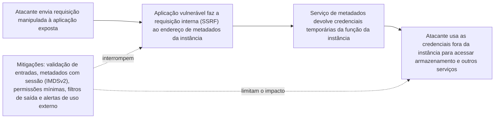

# Catálogo de Ameaças Específicas de Nuvem

> **Objetivo pedagógico:** usar um catálogo de 32 ameaças específicas de nuvem (identidade, plano de controle, dados, rede, computação, contêineres, funções sem servidor, pipelines, cadeia de suprimentos, multi-inquilino, provedor e IA) como **lista de apoio** às sessões de modelagem, relacionando cada ameaça à categoria STRIDE, à técnica do ATT&CK, aos controles que a mitigam e às detecções, e conhecer padrões clássicos (SSRF contra o serviço de metadados, agente confuso, envenenamento de pipeline e confusão de dependências).

> **Como usar:** o catálogo **complementa** a conversa com o time e o STRIDE; não os substitui. Selecione as ameaças aplicáveis ao seu DFD, adapte a redação ao contexto e registre-as no registro de ameaças (arquivo 7). As referências de controles são às pastas deste repositório.

## 1. Catálogo de ameaças

### 1.1 Identidade e acesso

| ID | Ameaça | STRIDE | ATT&CK | Mitigações (pasta) | Detecção (pasta 13) |
|---|---|---|---|---|---|
| AMEA-NUV-001 | Roubo e uso de credenciais de pessoas (phishing, reutilização e vazamentos) para acessar o plano de controle | S | T1078.004 | MFA resistente a phishing, acesso condicional (06 e 07) | Entradas anômalas e sem MFA |
| AMEA-NUV-002 | Roubo de tokens e de cookies de sessão (proxy reverso, malware) e reutilização | S | T1539, T1550 | Tokens curtos e vinculados ao dispositivo, avaliação contínua (06 e 07) | Uso de token por origens distintas |
| AMEA-NUV-003 | Fadiga de MFA e engenharia social no suporte para redefinir fatores | S | T1621, T1556 | Correspondência de número, autenticadores resistentes a phishing, verificação forte na recuperação (06) | Alteração de métodos de autenticação |
| AMEA-NUV-004 | Escalonamento de privilégio por permissões de gestão de identidades (criar papéis, anexar políticas e passar funções) | E | T1098, T1548 | Limites de permissão, políticas organizacionais, revisão de caminhos de escalonamento (06) | Criação e alteração de papéis e de políticas |
| AMEA-NUV-005 | Problema do agente confuso: função com confiança entre contas sem condições (identificador externo) permite que terceiros a assumam | E, S | T1199, T1098 | Condições na política de confiança (identificador externo, conta de origem), revisão de confianças (06) | Alteração de políticas de confiança; assunção por contas inesperadas |
| AMEA-NUV-006 | Chaves de acesso de longa duração expostas em repositórios, imagens ou registros | S, I | T1552 | Federação e credenciais temporárias, varredura de segredos (06 e 21) | Uso de chave por origem desconhecida |
| AMEA-NUV-007 | Consentimento de aplicativos de terceiros com permissões amplas em SaaS (consent phishing) | S, I | T1528 | Aprovação administrativa de consentimentos, revisão de aplicativos (12, arquivo 6) | Concessão de consentimento |
| AMEA-NUV-008 | Abuso de contas de serviço com permissões excessivas | E | T1078.004 | Privilégio mínimo, identidades de carga, revisão (06) | Uso anômalo de contas de serviço |

### 1.2 Plano de controle e evasão de defesas

| ID | Ameaça | STRIDE | ATT&CK | Mitigações (pasta) | Detecção |
|---|---|---|---|---|---|
| AMEA-NUV-009 | Parada ou exclusão de registros de auditoria, de detectores e de coletores | R, T | T1562.008, T1562.001 | Políticas organizacionais, conta de registros imutável (05 e 13) | Alteração em trilhas e em serviços de detecção |
| AMEA-NUV-010 | Alteração de regras de rede e abertura de portas de administração ao mundo | T | T1562.007 | Políticas que impedem regras abertas, verificação contínua (08 e 12) | Alterações de grupos de segurança |
| AMEA-NUV-011 | Criação de recursos em regiões não monitoradas ou não aprovadas | T | T1578, T1496 | Política de regiões aprovadas, alertas de custo (03 e 13) | Atividade em regiões incomuns |
| AMEA-NUV-012 | Persistência por usuários, chaves, funções ou regras de e-mail criados pelo atacante | E | T1136.003, T1098.001 | Detecção e revisão de acessos (06 e 13) | Criação de identidades e de credenciais |

### 1.3 Dados

| ID | Ameaça | STRIDE | ATT&CK | Mitigações (pasta) | Detecção |
|---|---|---|---|---|---|
| AMEA-NUV-013 | Armazenamento ou banco de dados exposto à internet por configuração | I | T1530 | Bloqueio de acesso público, acesso privado, verificação contínua (09 e 12) | Políticas públicas e abertura de acesso |
| AMEA-NUV-014 | Cópia de dados por credencial com permissão de leitura (exfiltração por API) | I | T1530, T1537 | Chaves do cliente com política própria, perímetro de dados, acesso por atributos (09 e 10) | Volume anômalo de leitura e de transferência |
| AMEA-NUV-015 | Compartilhamento de instantâneos, de imagens e de backups com contas externas | I | T1537 | Políticas que impedem o compartilhamento externo (08 e 09) | Compartilhamentos externos de recursos |
| AMEA-NUV-016 | Destruição ou criptografia de dados e de backups (ransomware e sabotagem), inclusive por exclusão de chaves | T, D | T1485, T1486, T1490 | Backups imutáveis e isolados, proteção de chaves (09 e 10) | Exclusão em massa; agendamento de exclusão de chaves |
| AMEA-NUV-017 | Dados pessoais e segredos em registros, em telemetria e em mensagens de erro | I | T1552 | Mascaramento, filtros e retenção curta (09 e 13) | Varredura de registros |
| AMEA-NUV-018 | Reidentificação e vinculação de dados pseudonimizados em análises | I | n/a (privacidade) | HMAC com chave protegida, testes de reidentificação (09) | Revisão de acessos a bases de análise |

### 1.4 Rede, computação e contêineres

| ID | Ameaça | STRIDE | ATT&CK | Mitigações (pasta) | Detecção |
|---|---|---|---|---|---|
| AMEA-NUV-019 | SSRF para o serviço de metadados da instância, com roubo de credenciais da função | I, E | T1552.005 | Metadados com sessão obrigatória (IMDSv2), permissões mínimas da função, filtros de saída (12 e 18) | Uso de credenciais de instância fora da instância |
| AMEA-NUV-020 | Exploração de vulnerabilidades em aplicações e em imagens expostas | E, T | T1190 | WAF, gestão de vulnerabilidades, imagens mínimas (08, 15 e 18) | Alertas de WAF e de exploração |
| AMEA-NUV-021 | Movimentação lateral por rede plana e regras amplas | E | T1021 | Microssegmentação, negar por padrão (07 e 08) | Fluxos internos anômalos |
| AMEA-NUV-022 | Sequestro de recursos para mineração e abuso de custos | D | T1496 | Cotas, regiões aprovadas, alertas de custo (13) | Anomalias de custo e de uso |
| AMEA-NUV-023 | Negação de serviço de camada 7 e esgotamento de carteira por escalabilidade automática | D | T1498, T1499 | WAF, limitação de taxa, limites de escala (08) | Picos de requisições e de custos |
| AMEA-NUV-024 | Tomada de subdomínio (registros de DNS apontando para recursos descontinuados) | S | T1584 | Inventário de DNS e verificação periódica (08 e 13) | Varredura de DNS e de certificados |
| AMEA-NUV-025 | Escape de contêiner, pods privilegiados e acesso ao servidor de API do cluster | E | T1611, T1610, T1609 | Políticas de admissão, perfis de segurança, RBAC mínimo (19 e 20) | Execução em pods, pods privilegiados e acesso anônimo |

### 1.5 Funções sem servidor, pipelines e cadeia de suprimentos

| ID | Ameaça | STRIDE | ATT&CK | Mitigações (pasta) | Detecção |
|---|---|---|---|---|---|
| AMEA-NUV-026 | Injeção por eventos em funções sem servidor com permissões excessivas | T, E | T1648 | Validação de entradas, um papel mínimo por função (18) | Padrões anômalos de invocação |
| AMEA-NUV-027 | Envenenamento da execução do pipeline (alteração de arquivos de fluxo de trabalho por *pull request* ou ramo não confiável) | T, E | T1195 | Revisão obrigatória, ambientes protegidos, identidades por ramo (21) | Alterações em definições de pipeline |
| AMEA-NUV-028 | Exposição de segredos em registros de CI/CD e em variáveis | I | T1552 | Cofre de segredos, mascaramento, federação (06 e 21) | Varredura de segredos |
| AMEA-NUV-029 | Dependências e ações de terceiros comprometidas (confusão de dependências, *typosquatting* e ações não fixadas) | T | T1195 | Fixação de versões e de resumos, repositórios internos, SBOM (21) | Alertas de varredura de dependências |
| AMEA-NUV-030 | Imagem de contêiner ou módulo de infraestrutura malicioso ou adulterado | T | T1525, T1195 | Assinatura, proveniência e admissão por política (10 e 21) | Verificação de assinaturas na implantação |

### 1.6 Multi-inquilino, provedor e IA

| ID | Ameaça | STRIDE | ATT&CK | Mitigações (pasta) | Detecção |
|---|---|---|---|---|---|
| AMEA-NUV-031 | Acesso a dados de outro inquilino por falha de autorização em plataformas multi-inquilino (referência direta insegura a objetos) | I, E | T1190 | Autorização por inquilino em todas as camadas, testes de isolamento (05 e 07) | Acessos entre inquilinos |
| AMEA-NUV-032 | Falha de isolamento ou acesso indevido no provedor, e vazamento por serviço de IA generativa com dados corporativos | I | n/a | Premissas e relatórios do provedor, chaves do cliente, computação confidencial, políticas de uso de IA (02, 10 e 11) | Monitoramento de uso e de comunicados do provedor |

## 2. Padrões clássicos de ataque em nuvem

### 2.1 SSRF contra o serviço de metadados (AMEA-NUV-019)

Casos públicos de incidentes em que credenciais obtidas por essa via levaram ao acesso de grandes volumes de dados mostram a importância de combinar **validação de entradas, metadados protegidos e permissões mínimas**.

### 2.2 Problema do agente confuso entre contas (AMEA-NUV-005)

| Elemento | Descrição |
|---|---|
| Cenário | Um serviço de terceiros assume uma função na sua conta para prestar um serviço; a política de confiança permite que a conta do terceiro assuma a função |
| Ameaça | Outro cliente do mesmo terceiro faz o serviço assumir **a sua função** em nome dele (o serviço age como "agente confuso") |
| Mitigação | Exigir um **identificador externo único** por cliente na condição da confiança e limitar as permissões da função; revisar periodicamente as relações de confiança |

### 2.3 Envenenamento da execução do pipeline (AMEA-NUV-027)

| Elemento | Descrição |
|---|---|
| Cenário | O pipeline executa fluxos de trabalho definidos no repositório, com acesso a segredos e a identidades de implantação |
| Ameaça | Um atacante com a capacidade de propor alterações (ou de comprometer um colaborador) altera a definição do fluxo e executa comandos com as permissões do pipeline |
| Mitigação | Proteção de ramos, revisão obrigatória, separação entre pipelines de teste (sem segredos) e de implantação, identidades por ambiente e por ramo, aprovação para produção, fixação de ações de terceiros por resumo |
| Referência | OWASP Top 10 CI/CD Security Risks (por exemplo, a execução de fluxo de pipeline envenenado) |

### 2.4 Confusão de dependências (AMEA-NUV-029)

| Elemento | Descrição |
|---|---|
| Cenário | Uma organização usa pacotes internos com nomes que não existem em repositórios públicos |
| Ameaça | Um atacante publica um pacote público com o mesmo nome e versão maior; o gerenciador de pacotes o instala no pipeline |
| Mitigação | Repositório interno como única fonte, reserva de nomes, fixação de versões e de resumos, escopos e verificação de proveniência |

## 3. Como aplicar o catálogo em uma sessão

| Passo | Atividade |
|---|---|
| 1 | Percorra o DFD e selecione as categorias do catálogo aplicáveis (por exemplo, identidade, dados e pipelines) |
| 2 | Para cada ameaça aplicável, reescreva-a no contexto: ator, ativo, caminho e pré-condições |
| 3 | Verifique os controles existentes e como são comprovados |
| 4 | Registre lacunas e dúvidas |
| 5 | Pergunte "o que mais?": o catálogo não é exaustivo |
| 6 | Mapeie a detecção e o teste que validariam o controle |

### Modelo de ficha de ameaça

| Campo | Preenchimento |
|---|---|
| ID e título | AMEA-NUV-013: armazenamento de extratos exposto à internet |
| Ator, ativo e caminho | Atacante oportunista; PDFs de extratos; busca de buckets públicos |
| STRIDE e ATT&CK | I; T1530 |
| Fronteira de confiança afetada | Conta de produção e internet |
| Pré-condições | Bucket criado ou configurado sem bloqueio de acesso público |
| Controles existentes | Política organizacional de bloqueio de acesso público; módulo seguro por padrão |
| Como é verificado | Teste automatizado diário; alerta de alteração de política |
| Probabilidade, impacto e nível | Baixa, alto, médio |
| Lacunas | Contas legadas fora do escopo da política |
| Ação, responsável e prazo | Aplicar a política às contas legadas; Plataforma; 30 dias |

## 4. Mapa de ameaças por componente típico

| Componente | Ameaças do catálogo mais frequentes |
|---|---|
| API pública | 001, 002, 020, 023, 031 |
| Armazenamento de objetos | 013, 014, 015, 016, 017 |
| Banco de dados gerenciado | 013, 014, 016, 018 |
| Funções sem servidor | 004, 008, 026 |
| Contêineres e Kubernetes | 021, 025, 030 |
| Pipeline de CI/CD | 006, 027, 028, 029, 030 |
| Provedor de identidade e federação | 001, 002, 003, 005, 007 |
| Plano de controle e contas | 004, 009, 010, 011, 012 |
| Rede e DNS | 010, 021, 023, 024 |
| Plataformas multi-inquilino | 014, 031 |
| SaaS e integrações | 007, 008, 015 |

## 5. Exemplo prático: aplicação do catálogo a uma plataforma de dados

| Passo | Resultado |
|---|---|
| Componentes | Ingestão, data lake em armazenamento de objetos, motor de análises, conector de SaaS de visualização e pipeline |
| Seleção | Ameaças 004, 006, 007, 013 a 018, 027, 029 e 031 consideradas aplicáveis |
| Reescrita no contexto | Por exemplo, a 014 foi descrita como "um analista com credencial roubada copia toda a zona de consumo por API em uma noite" |
| Lacunas encontradas | Sem alerta de volume de leitura (014); conector de SaaS com permissões amplas (007); ação de terceiros de CI/CD não fixada (029) |
| Ações | Detecção de volume; revisão de permissões do conector; fixação por resumo; teste de isolamento entre inquilinos (031) |
| Resultado | 8 requisitos no backlog e 3 detecções novas; duas ameaças aceitas com justificativa | |

## 6. Casos de uso corporativos

- Catálogo de ameaças da organização, adaptado e mantido pela equipe de segurança.
- Insumo para oficinas de modelagem e para revisões de arquitetura.
- Base para validação de detecções e para exercícios de equipe roxa.

## 7. Normas e frameworks relevantes

- MITRE ATT&CK for Cloud e matriz de contêineres; Matriz de ameaças para Kubernetes (Microsoft); OWASP Top 10 CI/CD Security Risks; OWASP API Security Top 10
- CSA Top Threats to Cloud Computing (edições vigentes); CSA CCM v4 (TVM e IVS); NIST SP 800-204 (série)
- ENISA Threat Landscape; relatórios públicos de incidentes de nuvem (referências de contexto)

## 8. Checklist operacional: catálogo de ameaças

- [ ] Catálogo adaptado ao contexto da organização, com identificadores, STRIDE, ATT&CK, controles e detecções
- [ ] Catálogo usado como apoio, e não substituto, da conversa com o time
- [ ] Ameaças aplicáveis selecionadas por componente e reescritas no contexto
- [ ] Padrões clássicos (SSRF, agente confuso, pipeline envenenado e confusão de dependências) cobertos nos modelos
- [ ] Ameaças sem controle ou sem detecção registradas como lacunas
- [ ] Catálogo atualizado com novos incidentes, técnicas e serviços (revisão semestral)

## 9. Referências

- MITRE. ATT&CK for Cloud e ATT&CK for Containers. https://attack.mitre.org
- OWASP. Top 10 CI/CD Security Risks (2022).
- Cloud Security Alliance. Top Threats to Cloud Computing (edições vigentes).
- Microsoft. Threat matrix for Kubernetes (documentação).
- Birsan, A. Dependency Confusion: How I Hacked Into Apple, Microsoft and Dozens of Other Companies. 2021.
- Pastas 06, 08, 09, 12 e 13 deste repositório.
