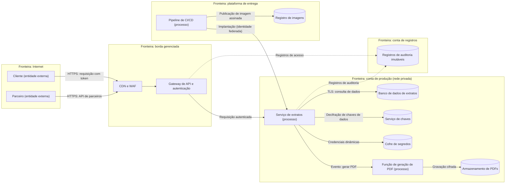

# Decomposição do Sistema, DFD e Fronteiras de Confiança

> **Objetivo pedagógico:** responder à primeira pergunta da modelagem ("o que estamos construindo?") de forma útil: definir escopo, ativos, atores e pontos de entrada, construir diagramas de fluxo de dados (DFD) em níveis, identificar as fronteiras de confiança típicas de nuvem (internet, redes, contas, inquilinos, clusters, pipelines e provedor de identidade), registrar premissas e dependências, classificar os dados que atravessam os fluxos e manter o modelo como código (Mermaid, OWASP pytm e Threagile).

## 1. Escopo e insumos

| Elemento | Perguntas |
|---|---|
| Objetivo do sistema | Para que serve? Quem depende dele? Qual o impacto de uma falha? |
| Escopo da modelagem | Quais componentes, ambientes e fluxos estão incluídos e quais ficam fora (e por quê)? |
| Documentação existente | Diagramas de arquitetura, ADRs, infraestrutura como código, matriz de responsabilidade e classificação de dados |
| Participantes | Quem entende cada parte? |
| Premissas | O que se assume sem verificar (por exemplo, isolamento do provedor)? |
| Dependências | Provedores, serviços de terceiros, bibliotecas e outras equipes |
| Restrições | Prazo, orçamento, requisitos regulatórios e tecnologias obrigatórias |

Use a **infraestrutura como código** e os diagramas como fonte: o modelo deve refletir o que **existe de fato**, e não apenas o que se desenhou.

## 2. Ativos, atores e pontos de entrada

### 2.1 Ativos

| Categoria | Exemplos |
|---|---|
| Dados | Dados de clientes, dados financeiros, segredos de negócio, registros de auditoria |
| Credenciais e chaves | Senhas, tokens, chaves de acesso, chaves de criptografia e certificados |
| Identidades e permissões | Contas administrativas, funções de carga, relações de confiança entre contas |
| Disponibilidade e integridade de serviços | Processamento de pagamentos, APIs, pipelines |
| Código e artefatos | Repositórios, imagens, módulos de infraestrutura |
| Configuração e políticas | Políticas organizacionais, regras de rede e de acesso |
| Reputação e conformidade | Confiança de clientes, licenças e certificações |

### 2.2 Atores (legítimos e ameaçadores)

| Ator | Descrição | Capacidades típicas |
|---|---|---|
| Cliente ou usuário final | Usa a aplicação | Acesso por interfaces públicas |
| Colaborador, administrador e engenheiro | Opera e desenvolve | Acesso privilegiado a ambientes e a pipelines |
| Serviço ou sistema parceiro | Integração por API | Credenciais e escopos específicos |
| Atacante externo oportunista | Busca exposições e credenciais vazadas | Varredura em larga escala, ferramentas públicas |
| Atacante externo direcionado | Visa a organização ou o setor | Phishing, engenharia social, exploração de vulnerabilidades |
| Atacante com credencial comprometida | Controla uma identidade legítima | Ações permitidas àquela identidade |
| Agente interno malicioso ou negligente | Funcionário ou prestador | Acesso legítimo, conhecimento do ambiente |
| Locatário malicioso (em plataformas multi-inquilino) | Um cliente que tenta acessar dados de outro | Acesso legítimo à própria conta e às APIs |
| Fornecedor ou terceiro comprometido | Componente da cadeia de suprimentos | Código, imagens, bibliotecas ou ações de CI/CD |
| Pessoal do provedor de nuvem | Funcionários do provedor | Acesso à infraestrutura (premissas e controles do provedor) |

Defina **quais atores estão no escopo** e quais capacidades se assumem para cada um (por exemplo, "atacante com uma credencial de desenvolvedor comprometida").

### 2.3 Pontos de entrada

| Ponto de entrada | Exemplos |
|---|---|
| Interfaces públicas | Aplicações web, APIs, portais e serviços de e-mail |
| Interfaces de administração | Console de nuvem, APIs de gestão, ferramentas de operação |
| Identidade | Provedor de identidade, federação, fluxos de recuperação de conta |
| Integrações | APIs de parceiros, webhooks, aplicativos conectados e conectores de SaaS |
| Pipelines e repositórios | Sistemas de CI/CD, repositórios de código e de artefatos, registros de contêineres |
| Eventos e filas | Mensagens e acionadores de funções |
| Entradas de dados | Cargas, importações e formulários |
| Conectividade híbrida | VPN, conexões dedicadas e acesso de redes locais |
| Fornecedores e suporte | Acesso de terceiros e do pessoal de suporte |

## 3. Diagramas de fluxo de dados (DFD)

O DFD usa quatro elementos básicos e as fronteiras de confiança:

| Elemento | Notação usual | Exemplos em nuvem |
|---|---|---|
| Entidade externa | Retângulo | Usuário, parceiro, serviço externo |
| Processo | Círculo ou retângulo arredondado | Aplicação, função sem servidor, contêiner, serviço gerenciado de processamento |
| Repositório de dados | Linhas paralelas | Banco de dados, bucket, fila, cofre de segredos, serviço de chaves |
| Fluxo de dados | Seta rotulada | Requisição HTTPS, consulta ao banco, evento, chamada de API do provedor |
| Fronteira de confiança | Linha tracejada ou região | Internet, rede privada, conta, inquilino, cluster |

### 3.1 Níveis de detalhe

| Nível | Conteúdo | Uso |
|---|---|---|
| Nível 0 (contexto) | O sistema como um único processo e suas entidades externas | Escopo e visão geral |
| Nível 1 | Principais componentes, repositórios e fluxos, com as fronteiras de confiança | Ponto de partida da modelagem (suficiente na maioria dos casos) |
| Nível 2 | Detalhamento de componentes críticos (por exemplo, o fluxo de autenticação ou o pipeline) | Análises aprofundadas |
| Diagrama de implantação | Contas, regiões, redes e serviços reais | Mapear as ameaças de configuração e de infraestrutura |

### 3.2 Exemplo: DFD de nível 1 de uma API de extratos em nuvem (Mermaid)



### 3.3 Como desenhar um bom DFD

| Prática | Descrição |
|---|---|
| Um diagrama por vez, no quadro | Simplicidade; a conversa vale mais que o desenho perfeito |
| Rotular os fluxos | Protocolo, dados transportados, autenticação e classificação |
| Incluir o plano de controle | Identidades administrativas, APIs de gestão, pipelines e registros |
| Incluir o que "não é código" | Serviços gerenciados, provedor de identidade e fornecedores |
| Marcar premissas e partes fora do escopo | Evita falsas certezas |
| Validar com quem constrói e opera | Corrigir divergências com a realidade |
| Versionar o diagrama | Atualizar a cada mudança relevante |

## 4. Fronteiras de confiança típicas de nuvem

| Fronteira | O que muda ao cruzar | Ameaças típicas na travessia |
|---|---|---|
| Internet para a borda | De não confiável para entrada controlada | Ataques de aplicação, negação de serviço, falsificação |
| Borda para a rede privada | De zona exposta para zona interna | Contorno do WAF, acesso direto à origem |
| Conta ou assinatura de produção versus não produção | Níveis diferentes de controle e de dados | Movimento lateral de desenvolvimento para produção |
| Conta de carga versus conta de registros e de segurança | Domínios administrativos distintos | Exclusão de registros, abuso de acessos de segurança |
| Entre contas por relações de confiança de funções | Delegação de permissões | Problema do agente confuso, confiança excessiva |
| Plano de dados versus plano de controle | Uso do serviço versus gestão | Escalonamento de privilégio para administrar recursos |
| Inquilino A versus inquilino B (plataformas multi-inquilino) | Isolamento entre clientes | Acesso a dados de outros clientes por falhas de autorização |
| Cluster e espaços de nomes; nó e contêiner | Isolamento entre cargas | Escape de contêiner, movimentação entre espaços de nomes |
| Pipeline de entrega versus ambiente de execução | Código e identidades de implantação | Pipeline comprometido, segredos expostos |
| Provedor de identidade versus aplicações | Confiança em asserções e em tokens | Falsificação de tokens, sequestro de sessão |
| Organização versus fornecedores e SaaS | Dados e acessos compartilhados com terceiros | Aplicativos conectados com permissões excessivas |
| Cliente versus provedor de nuvem | Responsabilidade compartilhada | Falhas de isolamento do provedor, acesso do pessoal do provedor |
| Ambiente local versus nuvem (conectividade híbrida) | Redes de naturezas e de controles diferentes | Movimento lateral entre ambientes |

Regra: **cada fluxo que cruza uma fronteira de confiança é um candidato prioritário a ameaças**; pergunte sempre "quem autentica quem?", "o que é validado?" e "o que é registrado?".

## 5. Classificação dos dados nos fluxos

| Prática | Descrição |
|---|---|
| Marcar cada fluxo e repositório com a classificação | Público, interno, confidencial ou restrito (pasta 09, arquivo 2) |
| Identificar dados pessoais e sensíveis | Alimenta o LINDDUN e o RIPD |
| Verificar controles proporcionais | Dados restritos exigem criptografia, acesso mínimo e registros reforçados |
| Identificar cópias e derivados | Backups, caches, registros e ambientes de teste |
| Registrar a localização (regiões) | Residência e transferências (pasta 09, arquivo 6) |

## 6. Premissas e dependências

| Tipo | Exemplos | Tratamento |
|---|---|---|
| Premissa sobre o provedor | "O isolamento entre inquilinos funciona" | Registrar; avaliar relatórios; planos de contingência |
| Premissa sobre terceiros | "O SaaS de e-mail protege os dados enviados" | Avaliação de fornecedores (pasta 11) |
| Premissa sobre o ambiente | "Somente o pipeline implanta em produção" | Verificar por política; incluir como controle a testar |
| Premissa sobre pessoas | "Administradores usam MFA forte" | Verificar por dados (pasta 12, arquivo 5) |
| Dependências críticas | Provedor de identidade, DNS, serviço de chaves | Ameaças de indisponibilidade e de comprometimento (pasta 04, arquivo 6) |

Premissas **não verificadas** são fontes frequentes de falhas: cada premissa crítica deve ter um **teste ou um controle** associado.

## 7. Modelo como código

### 7.1 Mermaid no repositório

Diagramas em Mermaid (como o do item 3.2) podem ser versionados junto ao código, revisados em *pull requests* e renderizados no GitHub.

### 7.2 OWASP pytm (modelo em Python)

O **pytm** descreve o sistema em código Python e gera diagramas e uma lista de ameaças a partir de regras. O exemplo abaixo é **ilustrativo**; confira a API e as opções na documentação da versão que você instalar.

```python
# Exemplo ilustrativo com OWASP pytm (pip install pytm)
# Execução (conforme a documentação): python modelo.py --report docs/modelo.md  |  python modelo.py --dfd | dot -Tpng -o dfd.png
from pytm import TM, Actor, Boundary, Dataflow, Datastore, Server

tm = TM("API de extratos")
tm.description = "API pública de consulta de extratos em nuvem"
tm.isOrdered = True

internet = Boundary("Internet")
borda = Boundary("Borda gerenciada")
conta_prod = Boundary("Conta de producao")

cliente = Actor("Cliente")
cliente.inBoundary = internet

gateway = Server("Gateway de API")
gateway.inBoundary = borda
gateway.isHardened = True

servico = Server("Servico de extratos")
servico.inBoundary = conta_prod
servico.isHardened = True

banco = Datastore("Banco de extratos")
banco.inBoundary = conta_prod
banco.isEncrypted = True
banco.isSQL = True

Dataflow(cliente, gateway, "Requisicao HTTPS com token", protocol="HTTPS", dstPort=443)
Dataflow(gateway, servico, "Requisicao autenticada", protocol="HTTPS")
Dataflow(servico, banco, "Consulta de dados", protocol="TLS")

if __name__ == "__main__":
    tm.process()
```

### 7.3 Threagile

O **Threagile** descreve o modelo em **YAML** (ativos de dados, ativos técnicos, canais de comunicação e fronteiras), gera riscos a partir de regras e produz relatórios e diagramas. Vantagens: formato declarativo, integração em pipelines e relatórios padronizados. Consulte a documentação para a estrutura do arquivo e para as opções de execução.

| Aspecto | Modelo como código | Modelo em diagrama manual |
|---|---|---|
| Versionamento e revisão | Sim, por pull request | Limitado |
| Atualização junto ao código | Mais fácil | Tende a ficar desatualizado |
| Geração de ameaças | Parcialmente automática, com regras | Manual |
| Facilidade de uso | Exige familiaridade técnica | Mais acessível |
| Limitação | Regras genéricas: sempre revisar e complementar com a conversa | Sujeito a omissões |

## 8. Exemplo prático: decomposição de uma plataforma de análises de clientes

| Elemento | Resultado |
|---|---|
| Escopo | Pipeline de ingestão, data lake, motor de análises e portal de relatórios; fora do escopo: sistemas de origem |
| Ativos | Dados pessoais de clientes (confidencial), chaves de criptografia, credenciais do pipeline, modelos analíticos |
| Atores | Analistas internos, parceiro de pesquisa, atacante externo e com credencial comprometida, agente interno, fornecedor de SaaS de visualização |
| Pontos de entrada | Portal de relatórios, API de ingestão, console de nuvem, pipeline e conectores de SaaS |
| Fronteiras identificadas | Internet e portal; conta de ingestão e conta do data lake; conta de análises e conta de parceiro; pipeline e produção; organização e SaaS |
| Fluxos que cruzam fronteiras | 11 (por exemplo, exportação para o parceiro, ingestão a partir de sistemas de origem e conector de SaaS) |
| Premissas registradas | 6 (por exemplo, "o parceiro acessa apenas dados pseudonimizados" e "o pipeline é a única via de implantação") |
| Resultado | Base para 41 ameaças identificadas nas sessões seguintes, com 5 premissas convertidas em testes |

## 9. Casos de uso corporativos

- Diagramas de fluxo de dados com fronteiras de confiança como parte da documentação de arquitetura.
- Biblioteca de modelos de referência (por exemplo, aplicação web, API sem servidor e plataforma de dados) para acelerar novas modelagens.
- Modelos como código mantidos no repositório, ao lado da infraestrutura.

## 10. Normas e frameworks relevantes

- OWASP Threat Modeling Process (decomposição da aplicação); Microsoft SDL (diagramas de fluxo de dados); NIST SP 800-154
- ISO/IEC/IEEE 42010:2022 (descrição de arquiteturas); modelo C4 (pasta 05, arquivo 7)
- OWASP pytm e OWASP Threat Dragon; Threagile; NIST SP 800-160 Vol. 1 (princípios de arquitetura)

## 11. Checklist operacional: decomposição

- [ ] Escopo, objetivos, premissas e dependências documentados
- [ ] Ativos, atores (com capacidades assumidas) e pontos de entrada listados
- [ ] DFD de nível 1 (e deploy) com fluxos rotulados e fronteiras de confiança, validado com quem constrói e opera
- [ ] Plano de controle, pipelines, identidade e fornecedores incluídos no diagrama
- [ ] Dados classificados em cada fluxo e repositório; dados pessoais identificados
- [ ] Fluxos que cruzam fronteiras de confiança destacados como prioritários
- [ ] Premissas críticas transformadas em controles ou testes
- [ ] Diagrama e modelo versionados e atualizados a cada mudança relevante

## 12. Referências

- Shostack, A. Threat Modeling: Designing for Security, caps. 2 a 4. Wiley, 2014.
- OWASP. Threat Modeling Process; Threat Dragon; pytm (documentação).
- Schneider, C. Threagile: Agile Threat Modeling Toolkit (documentação).
- Brown, S. The C4 Model for Visualising Software Architecture (c4model.com).
- Pastas 05, 09 e 11 deste repositório.
