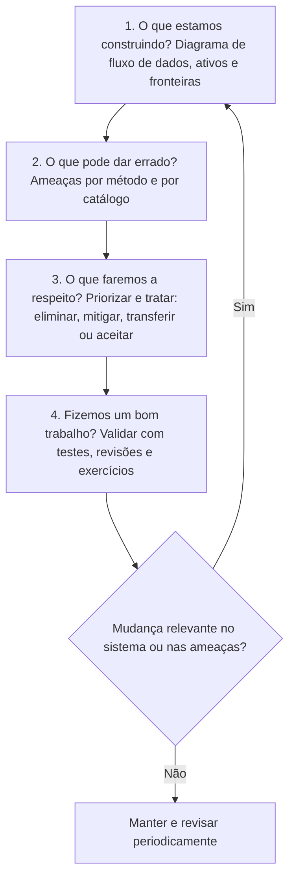
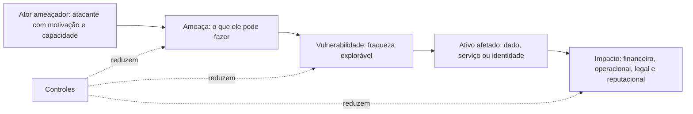

# Fundamentos de Modelagem de Ameaças em Nuvem

> **Objetivo pedagógico:** compreender o que é modelagem de ameaças e por que ela é eficaz quando feita no desenho, aplicar as quatro perguntas fundamentais (o que estamos construindo, o que pode dar errado, o que faremos a respeito e se fizemos um trabalho suficientemente bom), distinguir ameaça, vulnerabilidade, risco e controle, conhecer os conceitos centrais (ativos, atores, pontos de entrada, fronteiras de confiança e fluxos de dados), entender as particularidades da nuvem e o papel da modelagem no conjunto de práticas de segurança.

## 1. O que é modelagem de ameaças

Modelagem de ameaças é uma prática **estruturada e colaborativa** de analisar um sistema para identificar como ele pode ser atacado, que danos isso causaria e que medidas reduzem o risco, **antes** (e durante) a construção. O resultado não é um relatório, mas **decisões**: requisitos de segurança, controles, detecções e testes.

| Característica | Descrição |
|---|---|
| Proativa | Encontra falhas de **desenho**, que são caras de corrigir depois |
| Colaborativa | Reúne quem constrói, quem opera e quem conhece segurança |
| Baseada em modelos | Usa uma representação do sistema (diagramas) como base da conversa |
| Orientada a ação | Termina em tarefas verificáveis |
| Iterativa | Atualizada a cada mudança relevante |
| Complementar | Não substitui testes, revisões de código nem verificação de postura |

## 2. As quatro perguntas

Segundo o **Manifesto de Modelagem de Ameaças (2020)** e a obra de Adam Shostack, a prática se organiza em quatro perguntas:

| # | Pergunta | Atividade | Saída |
|---|---|---|---|
| 1 | **O que estamos construindo?** | Decompor o sistema: componentes, dados, fluxos e fronteiras | Diagrama de fluxo de dados e lista de ativos (arquivo 3) |
| 2 | **O que pode dar errado?** | Identificar ameaças com metodologias e catálogos | Lista de ameaças (arquivos 2 e 4) |
| 3 | **O que vamos fazer a respeito?** | Priorizar, escolher mitigações e registrar decisões | Plano de tratamento e requisitos (arquivo 5) |
| 4 | **Fizemos um trabalho suficientemente bom?** | Validar o modelo, as mitigações e a cobertura | Testes, revisões e ajustes (arquivo 6) |

## 3. Conceitos centrais

| Conceito | Definição | Exemplo em nuvem |
|---|---|---|
| Ativo | O que tem valor e precisa ser protegido | Dados de clientes, chaves de criptografia, credenciais, disponibilidade do serviço, reputação |
| Ator | Quem interage com o sistema (legítimo ou não) | Cliente, administrador, serviço parceiro, atacante externo, funcionário malicioso |
| Ponto de entrada | Onde um ator pode interagir com o sistema | API pública, console de nuvem, pipeline de implantação, interface de administração |
| Fronteira de confiança | Linha onde o nível de confiança muda | Internet e rede privada; conta de produção e conta de desenvolvimento; inquilino A e inquilino B |
| Fluxo de dados | Movimento de dados entre componentes | Requisição da API ao banco de dados; evento para uma função |
| Ameaça | Possível evento adverso que explora uma fraqueza | "Um atacante usa uma credencial roubada para ler o armazenamento" |
| Vulnerabilidade (ou fraqueza) | Falha no desenho, na implementação ou na configuração | Papel com permissões excessivas |
| Risco | Combinação de probabilidade e impacto de uma ameaça | Risco alto de vazamento de dados de clientes |
| Controle (mitigação) | Medida que reduz probabilidade, impacto ou ambos | MFA resistente a phishing; acesso privado; detecção de anomalias |
| Premissa | O que se assume como verdadeiro sem verificar | "O provedor isola corretamente os inquilinos" |
| Superfície de ataque | Soma dos pontos de entrada e dos componentes expostos | Endpoints, identidades, permissões e integrações |

### Ameaça, vulnerabilidade e risco

## 4. Quando modelar

| Momento | Escopo típico | Esforço |
|---|---|---|
| Nova solução ou nova arquitetura | Sistema inteiro | Oficina de 2 a 4 horas, com documentação |
| Mudança relevante (nova integração, nova classe de dados, nova exposição pública, novo provedor) | Parte afetada | 30 a 90 minutos |
| Nova funcionalidade com impacto de segurança | Funcionalidade | 30 a 60 minutos no refinamento |
| Mudança de infraestrutura crítica (contas, rede, identidade) | Componente | Revisão com o modelo existente |
| Após um incidente ou um teste de intrusão | Cenário do incidente | Atualizar o modelo e revisar as hipóteses |
| Revisão periódica | Sistemas críticos | Anual ou em cada mudança relevante |

Regra prática: **quanto mais cedo, mais barato**; mas é melhor um modelo leve e atualizado que um modelo exaustivo e abandonado.

## 5. O que a nuvem muda

| Aspecto | Efeito na modelagem |
|---|---|
| O plano de controle (APIs de gestão) faz parte do sistema | Ameaças contra identidades administrativas, políticas, chaves e registros entram no modelo |
| Identidade como perímetro | Credenciais, tokens, papéis e confiança entre contas são alvos centrais |
| Configuração em lugar de código | Muitas ameaças são **erros de configuração** (exposição, permissões e registros) |
| Responsabilidade compartilhada | Componentes gerenciados são "caixas-pretas": modela-se a **configuração e o uso** do cliente, e registram-se as **premissas** sobre o provedor |
| Multi-inquilino | Ameaças de isolamento entre clientes, em plataformas próprias (SaaS) e no uso de serviços compartilhados |
| Serviços gerenciados e sem servidor | Fronteiras de confiança entre serviços; permissões entre componentes; eventos como entrada |
| Infraestrutura como código e pipelines | O pipeline é um componente crítico: quem o controla controla a produção |
| Cadeia de suprimentos | Imagens, bibliotecas, ações de CI/CD e módulos de terceiros |
| Efemeridade e escala | Modelos devem ser mantidos próximos ao código e revisados com frequência |
| APIs em todo lugar | Entradas e permissões entre serviços multiplicam os pontos de entrada |
| Dados e privacidade | Ameaças à privacidade (LINDDUN) e à conformidade (LGPD) |

## 6. Relação com as demais práticas

| Prática | Relação |
|---|---|
| Gestão de riscos (pasta 04) | As ameaças priorizadas alimentam o registro de riscos; o catálogo de riscos é insumo para o modelo |
| Arquitetura de segurança (pasta 05) | A modelagem informa decisões de arquitetura e ADRs |
| Controles (pasta 12) | Mitigações mapeadas à linha de base |
| Monitoramento (pasta 13) | Cada ameaça relevante gera ou valida uma detecção |
| Testes de intrusão e avaliações (pasta 16) | Validam o modelo e descobrem ameaças não previstas |
| Resposta a incidentes (pasta 22) | Os cenários do modelo alimentam playbooks e exercícios |
| DevSecOps (pasta 21) | Integração ao ciclo de entrega |

## 7. Papéis e participação

| Papel | Contribuição |
|---|---|
| Arquiteto ou líder técnico | Explica o sistema, as decisões e as dependências |
| Desenvolvedores e engenheiros de plataforma | Detalham fluxos, permissões, configurações e implantação |
| Engenheiro de segurança (facilitador) | Conduz o método, traz conhecimento de ameaças e catálogos |
| Dono do produto | Prioridades, dados, requisitos de negócio e impacto |
| Operações e SRE | Visão de operação, monitoramento e resposta |
| Privacidade (DPO) e conformidade | Dados pessoais, requisitos legais e riscos de privacidade |
| Seguradores de riscos (2ª linha), quando cabível | Integração ao registro de riscos |

Dica: **duas a seis pessoas** costumam bastar; o facilitador não precisa ser o "dono" do modelo: o time do sistema é o dono.

## 8. Exemplo prático: modelagem rápida de uma funcionalidade

Funcionalidade: "exportar extratos em PDF por e-mail" para uma plataforma de pagamentos em nuvem.

| Pergunta | Resposta (resumo) |
|---|---|
| O que estamos construindo? | Um serviço sem servidor gera o PDF a partir do banco, salva em um bucket e envia um link temporário ao e-mail do cliente |
| O que pode dar errado? | Link previsível ou de longa duração; bucket com acesso público; função com permissões amplas; e-mail de destino alterado por um atacante; PDFs retidos sem prazo; envio de dados pessoais em texto claro por e-mail |
| O que faremos a respeito? | Links assinados de 15 minutos e uso único; bucket privado com chave do cliente; função com permissão mínima; confirmação do e-mail alterado por MFA; retenção de 24 horas; e-mail sem dados, apenas com o link; registros de acesso e detecção de downloads em volume |
| Fizemos um bom trabalho? | Teste de intrusão da funcionalidade; testes automatizados de expiração do link; emulação de acesso em massa para validar o alerta |
| Resultado | 7 requisitos de segurança entraram no backlog, e a decisão sobre o e-mail evitou um risco de privacidade |

## 9. Casos de uso corporativos

- Modelagem de ameaças como parte obrigatória da revisão de arquitetura de novos sistemas.
- Modelos de ameaças de plataformas compartilhadas (landing zone, pipelines e identidade).
- Formação de times de produto em modelagem leve de ameaças.

## 10. Normas e frameworks relevantes

- Threat Modeling Manifesto; OWASP Threat Modeling Cheat Sheet; NIST SP 800-154 (modelagem de ameaças centrada em dados, publicação em rascunho)
- NIST SP 800-160 Vol. 1 Rev. 1 (engenharia de sistemas seguros); NIST SP 800-218 (SSDF, prática PW.1: projetar software para atender a requisitos de segurança e mitigar riscos)
- ISO/IEC 27005:2022 (identificação de riscos); ISO/IEC 27002:2022 (8.25 e 8.27, ciclo de vida de desenvolvimento seguro e princípios de arquitetura segura); OWASP SAMM (prática de avaliação de ameaças)
- CSA Top Threats to Cloud Computing (edições vigentes); MITRE ATT&CK for Cloud

## 11. Checklist operacional: base de modelagem de ameaças

- [ ] Prática definida na organização: quando, quem, como e com que insumos
- [ ] Gatilhos de modelagem (novo sistema, mudança relevante, incidente e revisão periódica) documentados
- [ ] Facilitadores formados e times de produto capacitados
- [ ] Quatro perguntas usadas como estrutura de todas as sessões
- [ ] Premissas sobre o provedor e sobre terceiros registradas
- [ ] Saídas conectadas a backlog, riscos, controles, detecções e testes
- [ ] Revisão anual da prática e dos modelos de sistemas críticos

## 12. Referências

- Threat Modeling Manifesto. 2020. https://www.threatmodelingmanifesto.org
- Shostack, A. Threat Modeling: Designing for Security. Wiley, 2014.
- Tarandach, I.; Coles, M. Threat Modeling: A Practical Guide for Development Teams. O'Reilly, 2020.
- OWASP. Threat Modeling Cheat Sheet. https://cheatsheetseries.owasp.org
- Dodge, J. et al. NIST SP 800-218: SSDF Version 1.1. 2022.
- Pastas 04, 05 e 12 deste repositório.
