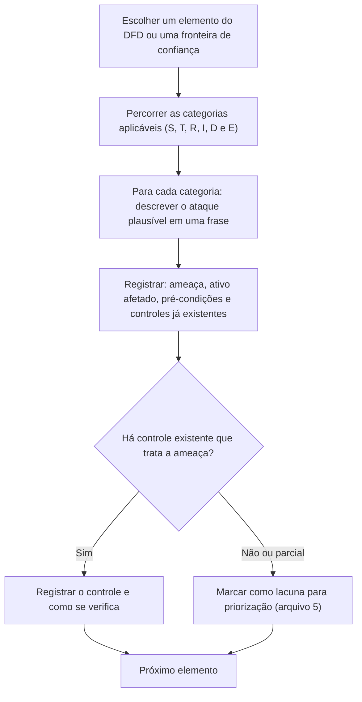
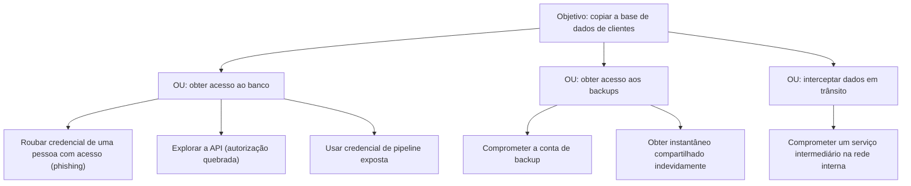
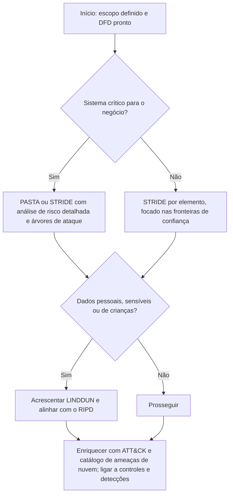

# Metodologias: STRIDE, PASTA, LINDDUN, Árvores de Ataque e ATT&CK

> **Objetivo pedagógico:** conhecer e aplicar as principais metodologias de identificação de ameaças (STRIDE e STRIDE por elemento, PASTA, LINDDUN para privacidade, árvores de ataque, ameaças baseadas na cadeia de ataque e na matriz ATT&CK para nuvem), reconhecer as limitações de métodos como o DREAD, usar jogos e cartas para facilitar as sessões, e escolher uma combinação adequada ao contexto, ao tempo disponível e à maturidade da equipe.

## 1. Visão geral

| Método | Foco | Pergunta central | Melhor uso |
|---|---|---|---|
| STRIDE | Ameaças por categoria de violação de propriedade de segurança | "Que tipo de ataque cada elemento do sistema pode sofrer?" | Desenho de sistemas e de funcionalidades; método padrão para começar |
| PASTA | Processo centrado em riscos e em cenários de ataque, em sete etapas | "Que cenários de ataque realistas afetam os objetivos de negócio?" | Sistemas críticos e análises mais profundas, com ligação ao negócio |
| LINDDUN | Ameaças à privacidade | "Como a privacidade dos titulares pode ser violada?" | Sistemas com dados pessoais |
| Árvores de ataque | Decomposição de um objetivo do atacante em caminhos | "Por quais caminhos o atacante atinge este objetivo?" | Objetivos de alto impacto e priorização de defesas |
| Cadeia de ataque e ATT&CK | Táticas e técnicas observadas em ataques reais | "Que técnicas reais se aplicam ao nosso sistema?" | Enriquecer o modelo e ligar às detecções |
| Modelagem centrada em ativos ou em dados | Parte dos ativos mais valiosos | "O que mais importa proteger e como pode ser comprometido?" | Priorização inicial |

Não existe método único: **combine** conforme a necessidade (por exemplo, STRIDE para o sistema, LINDDUN para dados pessoais e ATT&CK para detecções).

## 2. STRIDE

O STRIDE foi proposto por Loren Kohnfelder e Praerit Garg na Microsoft (1999). Cada letra corresponde a uma categoria de ameaça e a uma **propriedade de segurança violada**:

| Letra | Ameaça | Propriedade violada | Pergunta | Exemplo em nuvem |
|---|---|---|---|---|
| S | Falsificação de identidade (*Spoofing*) | Autenticidade | Alguém pode se passar por outro usuário, serviço ou componente? | Uso de um token roubado de um serviço; chamada a uma API interna sem autenticação |
| T | Adulteração (*Tampering*) | Integridade | Dados, código ou configurações podem ser alterados indevidamente? | Alteração de uma política de IAM; modificação de uma imagem de contêiner |
| R | Repúdio (*Repudiation*) | Não repúdio | Alguém pode negar uma ação sem que se possa provar? | Ações administrativas sem registros; registros alteráveis |
| I | Divulgação de informação (*Information disclosure*) | Confidencialidade | Dados podem ser expostos a quem não deve vê-los? | Armazenamento público; segredos em registros; mensagens de erro detalhadas |
| D | Negação de serviço (*Denial of service*) | Disponibilidade | O serviço pode ser tornado indisponível ou ter custos inflados? | Inundação de requisições; exclusão de chaves; esgotamento de cota |
| E | Elevação de privilégio (*Elevation of privilege*) | Autorização | Alguém pode obter permissões que não deveria ter? | Escalonamento por permissão de passar funções; escape de contêiner |

### 2.1 STRIDE por elemento

O STRIDE é aplicado a cada elemento do diagrama de fluxo de dados, pois nem todas as categorias se aplicam a todos os elementos:

| Elemento do DFD | S | T | R | I | D | E |
|---|---|---|---|---|---|---|
| Entidade externa (usuário, serviço de terceiros) | X |  | X |  |  |  |
| Processo (aplicação, função, serviço) | X | X | X | X | X | X |
| Repositório de dados (banco, bucket, fila) |  | X | X* | X | X |  |
| Fluxo de dados (conexão, mensagem) |  | X |  | X | X |  |

\* Aplica-se principalmente a registros de auditoria (repúdio em repositórios de logs).

### 2.2 Como conduzir uma sessão STRIDE

Dica: **concentre-se nas fronteiras de confiança** e nos fluxos que as atravessam; é onde a maioria das ameaças relevantes se concentra.

### 2.3 Exemplo: STRIDE sobre uma API pública de extratos

| Elemento | Categoria | Ameaça | Mitigações candidatas |
|---|---|---|---|
| Cliente para a API (fluxo) | S | Uso de token roubado por outro dispositivo | Tokens de curta duração, vinculação ao dispositivo e MFA resistente a phishing |
| API (processo) | E | Acesso a extratos de outra conta por manipulação do identificador (autorização em nível de objeto quebrada) | Autorização por objeto no serviço e testes automatizados |
| API para o banco (fluxo) | I | Interceptação de dados entre a API e o banco | TLS com validação de certificado e ponto de extremidade privado |
| Banco (repositório) | I | Cópia do banco por credencial com permissão de leitura | Chaves do cliente com política própria, acesso por identidade e alertas de volume |
| Registros de auditoria (repositório) | R | Administrador apaga registros para ocultar uma ação | Conta de registros imutável e políticas de negação |
| API (processo) | D | Inundação de requisições que esgota recursos e eleva custos | WAF, limitação de taxa e cotas |
| Pipeline de implantação (processo) | T | Alteração do código ou da imagem antes da implantação | Assinatura de artefatos, revisão obrigatória e identidade federada com permissões mínimas |

## 3. PASTA (Process for Attack Simulation and Threat Analysis)

O PASTA, proposto por Tony UcedaVélez e Marco Morana, é um processo de **sete etapas**, centrado em riscos e orientado ao negócio.

| Etapa | Nome | Atividades |
|---|---|---|
| 1 | Definição dos objetivos | Objetivos de negócio, requisitos de segurança e de conformidade, análise de impacto |
| 2 | Definição do escopo técnico | Infraestrutura, aplicações, serviços e dependências incluídos |
| 3 | Decomposição da aplicação | Fluxos de dados, componentes, fronteiras de confiança, atores e casos de uso |
| 4 | Análise de ameaças | Ameaças, motivações e inteligência de ameaças relevantes |
| 5 | Análise de vulnerabilidades e fraquezas | Vulnerabilidades conhecidas e fraquezas de desenho e de configuração |
| 6 | Modelagem de ataques | Árvores de ataque, cenários e simulação de ataques ligando ameaças e fraquezas |
| 7 | Análise de risco e de impacto | Quantificação do risco, priorização e contramedidas |

Indicado quando é necessário **ligar ameaças a impactos de negócio**, justificar investimentos ou tratar sistemas críticos; exige mais tempo que o STRIDE.

## 4. LINDDUN: ameaças à privacidade

O LINDDUN (da Universidade KU Leuven) complementa o STRIDE com ameaças à **privacidade**, relevantes para a LGPD.

| Letra | Ameaça | Descrição | Exemplo em nuvem |
|---|---|---|---|
| L | Vinculabilidade (*Linkability*) | Ligar itens de dados ou ações ao mesmo titular | Identificadores comuns entre bases de análises |
| I | Identificabilidade (*Identifiability*) | Identificar um titular a partir de dados | Reidentificação por combinação de atributos |
| N | Não repúdio (*Non-repudiation*) | Impossibilidade de negar uma ação, quando isso é indesejável ao titular | Registros que comprovam uma ação sensível |
| D | Detectabilidade (*Detectability*) | Detectar a existência de dados ou de um titular | Respostas de API que revelam se um CPF existe na base |
| D | Divulgação de informação (*Disclosure of information*) | Exposição de dados pessoais | Dados pessoais em registros e em backups |
| U | Desconhecimento (*Unawareness*) | O titular não sabe como seus dados são tratados | Telemetria e compartilhamentos não informados |
| N | Não conformidade (*Non-compliance*) | Descumprimento de requisitos legais e de políticas | Retenção além do necessário; transferência internacional sem instrumento |

Use o LINDDUN em sistemas que tratam **dados pessoais em larga escala, dados sensíveis ou dados de crianças**, em conjunto com o RIPD (pasta 11, arquivo 6).

## 5. Árvores de ataque

Uma **árvore de ataque** (popularizada por Bruce Schneier) decompõe o **objetivo do atacante** (raiz) em subobjetivos e passos (folhas), com operadores E e OU.

| Uso | Descrição |
|---|---|
| Análise de caminhos | Identificar os caminhos mais prováveis, mais baratos ou mais difíceis de detectar |
| Atribuição de atributos | Custo, habilidade, probabilidade e detectabilidade por folha |
| Priorização de defesas | Atacar os caminhos de menor esforço ou os pontos comuns a vários caminhos |
| Cobertura de detecção | Verificar se há detecção em cada ramo relevante |
| Comunicação | Ilustração para a direção sobre o que se está protegendo e por quê |

## 6. Ameaças baseadas em ATT&CK e na cadeia de ataque

| Recurso | Uso na modelagem |
|---|---|
| MITRE ATT&CK for Cloud | Biblioteca de **técnicas reais** por tática (acesso inicial, execução, persistência, escalonamento de privilégio, evasão de defesas, acesso a credenciais, descoberta, movimento lateral, coleta, exfiltração e impacto) aplicáveis a IaaS, SaaS e identidade |
| Matriz de contêineres do ATT&CK e matriz de ameaças para Kubernetes | Ameaças específicas de clusters e de contêineres |
| Cadeia de ataque cibernético (*kill chain*) | Estrutura de fases (reconhecimento, armamento, entrega, exploração, instalação, comando e controle e ações sobre objetivos) para pensar em como interromper o ataque |
| Mapeamento de controles | Os mapeamentos de controles a técnicas (por exemplo, os do MITRE Center for Threat-Informed Defense) indicam quais controles mitigam cada técnica |
| Detecções | Cada técnica relevante deve ter uma detecção ou uma justificativa (pasta 13, arquivo 4) |

**Como usar:** depois do STRIDE, percorra as táticas do ATT&CK e pergunte: "para cada tática, que técnicas se aplicam ao nosso sistema, e que controle ou detecção temos?" Isso reforça a **ligação entre a modelagem, os controles e a detecção**.

## 7. Métodos e práticas com ressalvas

| Método ou prática | Observação |
|---|---|
| DREAD (pontuação de dano, reprodutibilidade, explorabilidade, usuários afetados e descoberta) | Foi abandonado pela própria Microsoft por ser subjetivo e inconsistente; prefira critérios próprios de risco (probabilidade e impacto) com definições claras (pasta 04, arquivo 2) |
| Listas gigantes de ameaças sem priorização | Geram ruído; priorize por risco |
| Modelagem apenas por ferramentas automáticas | As ferramentas geram ameaças genéricas; a conversa com o time é essencial |
| Foco apenas em ameaças técnicas | Inclua ameaças de processo, de pessoas e de fornecedores |
| Ignorar abusos legítimos (abuso de funcionalidade, fraude) | Modele casos de abuso (arquivo 5) |

## 8. Jogos e cartas para facilitar sessões

| Recurso | Descrição |
|---|---|
| Elevation of Privilege (EoP) | Jogo de cartas criado por Adam Shostack, que usa as categorias do STRIDE para estimular a discussão de ameaças de forma lúdica |
| OWASP Cornucopia | Jogo de cartas para identificar requisitos e ameaças de segurança de aplicações |
| Cartas de ameaças de privacidade | Baralhos baseados no LINDDUN |
| Oficinas com perguntas-guia | "Se eu fosse o atacante, o que eu tentaria primeiro?" |

Os jogos **reduzem a barreira de entrada** e ajudam times sem experiência em segurança a participar ativamente.

## 9. Como escolher o método

| Situação | Método sugerido |
|---|---|
| Time novo em modelagem; funcionalidade ou serviço comum | STRIDE por elemento, com um quadro e 60 a 90 minutos |
| Sistema crítico, com impacto de negócio relevante e necessidade de justificar investimentos | PASTA (ou STRIDE com análise de risco e árvores de ataque nos cenários principais) |
| Tratamento de dados pessoais, dados sensíveis ou de crianças | STRIDE + LINDDUN |
| Integração com detecção e resposta | STRIDE + ATT&CK |
| Objetivos de alto impacto específicos (por exemplo, exfiltração da base de clientes) | Árvores de ataque |
| Pouco tempo | Quatro perguntas com STRIDE focado nas fronteiras de confiança |
| Ambientes de plataforma (contas, identidade e pipelines) | STRIDE + catálogo de ameaças de nuvem (arquivo 4) + ATT&CK |

## 10. Exemplo prático: combinação de métodos para uma plataforma de saúde

| Etapa | Método | Resultado |
|---|---|---|
| Sistema e fronteiras | DFD e STRIDE por elemento | 34 ameaças identificadas |
| Dados de pacientes | LINDDUN | 9 ameaças de privacidade adicionais (reidentificação em análises, detectabilidade por respostas de API e retenção excessiva) |
| Objetivo crítico "copiar prontuários" | Árvore de ataque | 7 caminhos; os 3 mais viáveis priorizados |
| Ligação com a operação | ATT&CK para nuvem | 12 técnicas relevantes mapeadas a controles; 4 lacunas de detecção |
| Priorização | Probabilidade e impacto (pasta 04) | 11 ameaças altas e críticas, com ações e prazos |
| Resultado | Requisitos de segurança no backlog, RIPD atualizada e detecções planejadas | |

## 11. Casos de uso corporativos

- Padronização do método de modelagem por tipo de sistema e por criticidade.
- Treinamento de times com jogos e com exercícios de STRIDE.
- Ligação sistemática da modelagem ao ATT&CK, aos controles e às detecções.

## 12. Normas e frameworks relevantes

- Kohnfelder, L.; Garg, P. The Threats to Our Products (Microsoft, 1999); Microsoft Security Development Lifecycle (modelagem de ameaças)
- UcedaVélez, T.; Morana, M. Risk Centric Threat Modeling: Process for Attack Simulation and Threat Analysis. Wiley, 2015; LINDDUN (KU Leuven)
- Schneier, B. Attack Trees. Dr. Dobb's Journal, 1999; MITRE ATT&CK for Cloud e para contêineres; Matriz de ameaças para Kubernetes (Microsoft)
- OWASP Cornucopia; Shostack, A. Elevation of Privilege (EoP) Card Game

## 13. Checklist operacional: metodologias

- [ ] Método padrão definido por tipo de sistema (STRIDE como base) e critérios para métodos adicionais
- [ ] LINDDUN aplicado a sistemas com dados pessoais relevantes, alinhado ao RIPD
- [ ] Árvores de ataque para objetivos de alto impacto
- [ ] ATT&CK usado para enriquecer o modelo e ligar a controles e detecções
- [ ] Critérios de risco com definições claras (sem uso de pontuações subjetivas como o DREAD)
- [ ] Jogos e cartas disponíveis para facilitar as sessões
- [ ] Facilitadores formados nos métodos

## 14. Referências

- Shostack, A. Threat Modeling: Designing for Security. Wiley, 2014.
- UcedaVélez, T.; Morana, M. Risk Centric Threat Modeling. Wiley, 2015.
- Wuyts, K.; Joosen, W. LINDDUN Privacy Threat Modeling: A Tutorial. KU Leuven, 2015 (e atualizações).
- Schneier, B. Attack Trees. 1999.
- MITRE. ATT&CK for Cloud. https://attack.mitre.org
- Pastas 04, 11 e 13 deste repositório.
