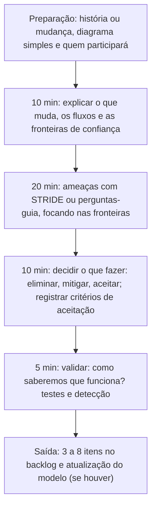

# Modelagem de Ameaças no Ciclo de Desenvolvimento e na Operação

> **Objetivo pedagógico:** integrar a modelagem de ameaças ao ciclo de desenvolvimento e à operação em nuvem: definir gatilhos e níveis de esforço (modelagem leve e aprofundada), conduzir sessões eficazes, aplicar a prática à revisão de mudanças de infraestrutura como código, verificar em pipeline que o modelo acompanha as mudanças, usar campeões de segurança, validar o modelo (quarta pergunta) com testes, equipe roxa e incidentes, e medir a cobertura e a qualidade da prática.

## 1. Gatilhos e níveis de esforço

| Gatilho | Nível | Duração e formato | Resultado |
|---|---|---|---|
| Novo sistema ou arquitetura | Aprofundado | Oficina de 2 a 4 horas, mais análise e documentação | Modelo completo, requisitos e plano |
| Mudança relevante (nova exposição pública, nova classe de dados, nova integração ou novo provedor) | Moderado | 60 a 90 minutos | Atualização do modelo e das ameaças afetadas |
| Funcionalidade com impacto de segurança (autenticação, autorização, pagamentos, exportação de dados) | Leve | 30 a 60 minutos no refinamento do backlog | Ameaças e critérios de aceitação da história |
| Mudança de infraestrutura crítica (contas, redes, identidade, chaves, pipelines) | Moderado | Revisão do plano de mudança com o modelo existente | Ameaças e controles verificados antes da aplicação |
| Incidente, quase-incidente ou achado de teste de intrusão | Dirigido | Revisão do cenário (30 a 60 minutos) | Atualização do modelo, ameaças novas e correção de premissas |
| Revisão periódica de sistemas críticos | Moderado | Anual | Modelo atualizado e validado |

**Triagem:** use a classificação da revisão de arquitetura (pasta 05, arquivo 6, níveis 1, 2 e 3) para definir o nível de modelagem: sistemas de nível 3 exigem modelo aprofundado; os de nível 1, usam padrões e modelos de referência.

## 2. Modelagem leve (30 a 60 minutos)



### Perguntas-guia para sessões rápidas

| Pergunta | Foco |
|---|---|
| Quem pode chamar isto e como se autentica? | Falsificação de identidade |
| O que acontece se a entrada for maliciosa ou de outro cliente? | Adulteração e elevação de privilégio |
| Que dados passam por aqui e quem poderia vê-los? | Divulgação de informação |
| Como saberíamos que algo errado aconteceu? | Repúdio e detecção |
| O que ocorre se isto falhar ou for abusado em volume? | Negação de serviço e custos |
| Que permissões esta identidade realmente precisa? | Privilégio mínimo |
| O que muda nas fronteiras de confiança? | Novas ameaças |
| Que premissa estamos fazendo sem verificar? | Premissas frágeis |

## 3. Sessão aprofundada (sistemas críticos)

| Fase | Atividades | Duração (referência) |
|---|---|---|
| Preparação | Reunir diagramas, infraestrutura como código, classificação de dados, riscos e incidentes anteriores; definir escopo e participantes | 1 a 2 dias (antes) |
| Decomposição | DFD, ativos, atores, pontos de entrada, fronteiras e premissas (arquivo 3) | 60 a 90 minutos |
| Identificação de ameaças | STRIDE por elemento, catálogo de nuvem, LINDDUN e ATT&CK; árvores de ataque para objetivos críticos | 90 a 120 minutos |
| Avaliação e priorização | Riscos, controles existentes e verificados, priorização (arquivo 5) | 45 a 60 minutos |
| Decisão e requisitos | Tratamento, requisitos com critérios de aceitação, responsáveis e prazos | 30 a 45 minutos |
| Documentação e acompanhamento | Registro de ameaças, integração ao backlog e ao registro de riscos; agendamento de validações | Após a sessão |

Boas práticas de facilitação: **limitar o tempo por elemento**, registrar dúvidas e voltar depois, evitar discussões de solução detalhada, incentivar a participação de todos e manter o foco em **fronteiras de confiança e em dados**.

## 4. Revisão de mudanças de infraestrutura como código

A revisão de mudanças de infraestrutura é um bom ponto para uma **mini modelagem**: o plano mostra o que mudará.

| Pergunta ao revisar o plano (por exemplo, o resultado de `terraform plan`) | Ameaça associada |
|---|---|
| Alguma regra de rede abre acesso à internet ou entre fronteiras de confiança? | Exposição e movimentação lateral |
| Alguma política ou papel concede permissões amplas ou novas relações de confiança? | Elevação de privilégio e agente confuso |
| Algum armazenamento, banco ou fila perde o bloqueio de acesso público, a criptografia ou os registros? | Divulgação de informação e repúdio |
| Alguma chave tem política alterada ou exclusão agendada? | Destruição de dados e acesso indevido |
| Novos endpoints, domínios ou integrações foram criados? | Novos pontos de entrada |
| Alguma identidade de pipeline ou credencial é criada, alterada ou compartilhada? | Comprometimento do pipeline |
| Recursos são criados fora das regiões ou contas aprovadas? | Abuso e residência de dados |

Combine a revisão humana com **verificações automáticas** de políticas no pipeline (pasta 12, arquivo 3), que bloqueiam as violações conhecidas e liberam a conversa para as ameaças novas.

## 5. Verificar no pipeline que o modelo acompanha as mudanças

Um controle simples e eficaz: **falhar a verificação do *pull request* quando a infraestrutura mudar sem revisão do modelo de ameaças**.

```yaml
# Exemplo de fluxo de trabalho do GitHub Actions: exige revisão do modelo de ameaças quando a infraestrutura muda
# Estrutura esperada do repositório: infra/ (infraestrutura como código) e threat-model/ (modelo de ameaças)
name: verificar-modelo-de-ameacas
on:
  pull_request:
    branches: [main]
jobs:
  verificar:
    runs-on: ubuntu-latest
    steps:
      - uses: actions/checkout@v4
        with:
          fetch-depth: 0
      - name: Exigir revisão do modelo de ameaças quando a infraestrutura muda
        run: |
          base="origin/${{ github.base_ref }}"
          mudou_infra=$(git diff --name-only "$base"...HEAD | grep -E '^(infra/|terraform/)' || true)
          mudou_modelo=$(git diff --name-only "$base"...HEAD | grep -E '^threat-model/' || true)
          if [ -n "$mudou_infra" ] && [ -z "$mudou_modelo" ]; then
            echo "A infraestrutura mudou sem revisão do modelo de ameaças (pasta threat-model/)."
            echo "Atualize o modelo ou justifique, na descrição do pull request, por que não há impacto."
            exit 1
          fi
          echo "Verificação concluída."
```

O exemplo é **ilustrativo**: ajuste os caminhos, fixe as versões de ações de terceiros por resumo (boa prática de cadeia de suprimentos) e preveja uma forma de **justificar a ausência de impacto** (por exemplo, um rótulo no *pull request*), para evitar a atualização apenas "para passar na verificação".

## 6. Campeões de segurança e capacitação

| Prática | Descrição |
|---|---|
| Campeões de segurança nos times | Pessoas do time treinadas para facilitar sessões leves e para acionar a segurança quando necessário |
| Treinamento por exercícios | Sessões práticas com jogos (EoP e Cornucopia) e com sistemas reais da organização |
| Biblioteca de modelos de referência | Modelos prontos de padrões comuns (aplicação web, API sem servidor, plataforma de dados e pipeline) que o time adapta |
| Catálogo de ameaças e de mitigações | Material de consulta (arquivo 4) |
| Horário de atendimento (*office hours*) | Apoio da segurança sob demanda |
| Reconhecimento | Valorizar quem identifica ameaças e melhora o desenho |
| Revisão por pares | Modelos revisados por outro time ou pela segurança, conforme a criticidade |

## 7. Validação: "fizemos um trabalho suficientemente bom?"

| Validação | Descrição |
|---|---|
| Revisão do modelo | Outro time ou a segurança revisa a decomposição, as premissas e a cobertura das fronteiras |
| Testes dos controles | Controles críticos verificados por testes automatizados e por reexecução (pasta 12, arquivo 5) |
| Validação de detecções | Emulação das técnicas ligadas às ameaças críticas em laboratório (pasta 13, arquivo 4) |
| Testes de intrusão e avaliações (pasta 16) | Achados **não previstos no modelo** indicam lacunas da modelagem: atualizar o modelo e aprender |
| Equipe roxa | Cenários baseados no modelo, com a equipe defensiva |
| Exercícios de mesa | Cenários de incidentes derivados das ameaças críticas (pasta 22) |
| Revisão pós-incidente | O incidente estava no modelo? Se não, por quê? Se sim, os controles funcionaram? |
| Verificação de premissas | Testar as premissas críticas registradas |

### Aprendizado a partir de lacunas

| Observação | Pergunta de melhoria |
|---|---|
| Achado de teste de intrusão fora do modelo | A decomposição omitiu algum componente, fluxo ou ator? |
| Incidente com técnica prevista, mas sem detecção | O controle ou a detecção foi implementado e testado? |
| Mitigações implementadas, mas ineficazes | A mitigação tratava a ameaça certa? Foi verificada? |
| Ameaça repetida em vários sistemas | Falta um controle de plataforma, um módulo ou um padrão? |

## 8. Operação: manter o modelo vivo

| Prática | Descrição |
|---|---|
| Modelo no repositório, junto ao código | Atualização em pull requests; histórico de alterações |
| Revisão em mudanças relevantes | Conforme os gatilhos da seção 1 |
| Revisão anual de sistemas críticos | Verificação de premissas, de ameaças e de controles |
| Atualização do catálogo | Com novas técnicas, serviços e incidentes públicos |
| Integração com o registro de riscos | Riscos residuais atualizados |
| Integração com a operação | Ameaças críticas ligadas a detecções, playbooks e exercícios |
| Descarte | Modelos de sistemas descontinuados arquivados |

## 9. Indicadores

| Indicador | Definição | Meta típica |
|---|---|---|
| Cobertura | Sistemas críticos com modelo de ameaças atual ÷ sistemas críticos | 100% |
| Atualidade | Modelos revisados nos últimos 12 meses ou após a última mudança relevante | Acima de 90% |
| Ameaças com ação | Ameaças altas e críticas com requisito, responsável e prazo | 100% |
| Mitigações verificadas | Controles de ameaças críticas com teste ou evidência | Acima de 90% |
| Lacunas do modelo | Achados de testes e de incidentes não previstos no modelo ÷ total de achados | Em redução |
| Tempo até a mitigação | Mediana entre a identificação e a mitigação, por nível | Dentro dos prazos |
| Participação | Percentual de times com campeões de segurança e sessões realizadas | Crescente |
| Detecções ligadas a ameaças | Ameaças críticas com detecção validada | Acima de 80% |

## 10. Exemplo prático: integração em uma organização com 25 times

| Etapa | Ação | Resultado |
|---|---|---|
| Triagem | Sistemas classificados em níveis 1, 2 e 3 pela revisão de arquitetura | 6 sistemas de nível 3 e 11 de nível 2 |
| Capacitação | 28 campeões formados em duas oficinas práticas, com STRIDE e jogos | Times capazes de conduzir sessões leves |
| Modelos de referência | 5 modelos de padrões (aplicação web, API sem servidor, plataforma de dados, pipeline e landing zone) | Redução do tempo de modelagem de novos sistemas em 50% |
| Verificação em pipeline | Fluxo que exige revisão do modelo quando a infraestrutura muda | 23% dos pull requests de infraestrutura acionaram revisão; 9% resultaram em ameaças novas |
| Validação | Testes de intrusão em 4 sistemas; equipe roxa para 3 ameaças críticas | 5 achados fora do modelo (3 componentes de terceiros omitidos); modelos atualizados |
| Resultado | Cobertura de 100% dos sistemas críticos em 9 meses; lacunas do modelo caíram de 38% para 14% dos achados | |

## 11. Casos de uso corporativos

- Prática de modelagem de ameaças integrada ao ciclo de entrega e à revisão de arquitetura.
- Programa de campeões de segurança com modelos de referência.
- Verificação contínua de que os modelos acompanham a infraestrutura e o código.

## 12. Normas e frameworks relevantes

- NIST SP 800-218 (SSDF: PW.1 projeto de software; PW.2 revisão do projeto); ISO/IEC 27002:2022 (8.25 a 8.29, desenvolvimento seguro e testes de segurança)
- OWASP SAMM (avaliação de ameaças e arquitetura de segurança); Microsoft SDL; BSIMM (modelo de maturidade com atividades de modelagem de ameaças)
- NIST SP 800-160 Vol. 1; CSA CCM v4 (AIS e CCC)

## 13. Checklist operacional: ciclo de desenvolvimento e operação

- [ ] Gatilhos e níveis de modelagem definidos, ligados à triagem da revisão de arquitetura
- [ ] Modelagem leve incorporada ao refinamento do backlog; sessões aprofundadas para sistemas críticos
- [ ] Revisão de mudanças de infraestrutura com perguntas de ameaças e verificações automáticas
- [ ] Verificação no pipeline de que o modelo acompanha mudanças relevantes, com justificativa de exceção
- [ ] Campeões de segurança, treinamento e modelos de referência disponíveis
- [ ] Validação por testes, por emulação, por equipe roxa e por revisão pós-incidente
- [ ] Modelos mantidos junto ao código, com histórico e revisão periódica
- [ ] Indicadores de cobertura, de atualidade e de lacunas acompanhados
- [ ] Ligação com o registro de riscos, as detecções e a resposta a incidentes

## 14. Referências

- Dodge, J. et al. NIST SP 800-218: SSDF Version 1.1. 2022.
- OWASP. Software Assurance Maturity Model (SAMM) v2.
- Microsoft. Security Development Lifecycle: Threat Modeling (documentação).
- Tarandach, I.; Coles, M. Threat Modeling: A Practical Guide for Development Teams. O'Reilly, 2020.
- Pastas 05, 12, 13, 16, 21 e 22 deste repositório.
